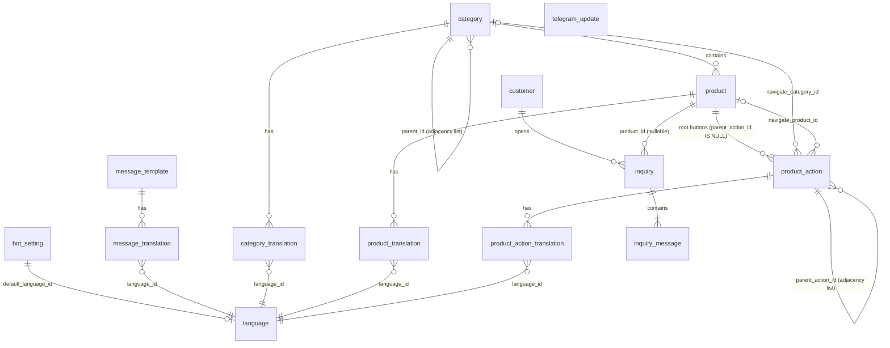
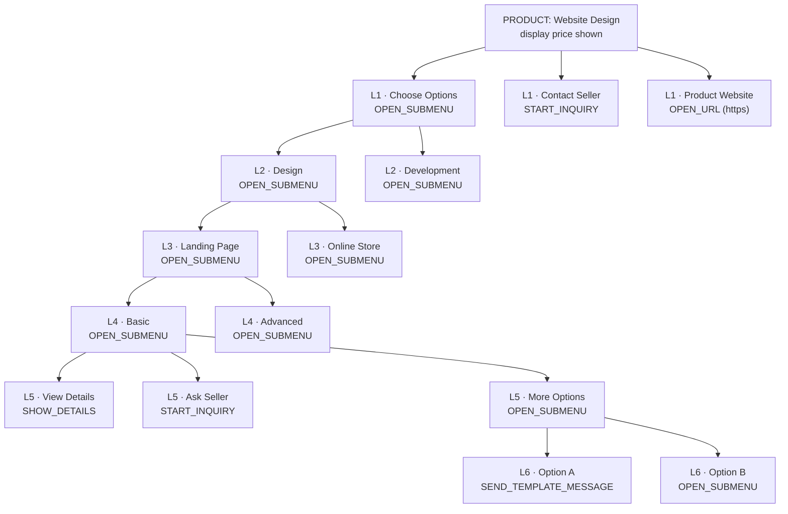
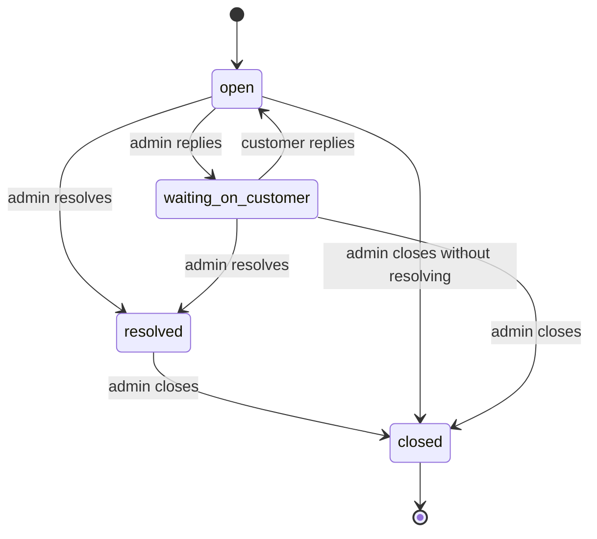

# Data Model — Rabet (رابط)

**Phase 03A — Final simplified data model & recursive dynamic button architecture (design only)**

This document specifies the PostgreSQL data model for Rabet: the entities, the two
independent recursive hierarchies, the configurable button-action architecture, the
integrity rules, the business-journey support, the infrastructure recommendation and the
migration workflow. It is written to be reviewable by a Product Manager as well as an
engineer.

> **Status:** **DESIGN ONLY.** No database exists, no schema files exist, no migration
> files exist and no dependencies are installed. Nothing in this document has been applied
> to any database. Phase 03B is the implementation phase and is explicitly **not started**
> by this document. See §17 "Phase 03B implementation plan".

Related: [ARCHITECTURE.md](./ARCHITECTURE.md) for the stack and ADRs,
[PROGRESS.md](./PROGRESS.md) for phase status.

---

## 1. Domain summary

Rabet is **a configurable digital-product catalog inside a Telegram bot, with a
mobile-first administration dashboard**. One bot, one administrator (the seller), one
merchant.

Customers do this:

1. Start the bot.
2. Choose a language **if** more than one language is enabled.
3. Browse product categories and subcategories to arbitrary depth.
4. See product titles, descriptions and **displayed prices**.
5. Interact with **configurable product buttons** — the seller decides what each button
   does from the dashboard, including buttons that open further menus.
6. Navigate nested button choices to arbitrary depth.
7. Receive configurable, localized bot messages.
8. Open safe external information pages.
9. **Open an inquiry** linked to a product.
10. Communicate with the seller through the bot.
11. Receive replies written from the admin dashboard.

### 1.1 What an inquiry is — and is not

An **inquiry** is a tracked conversation between a customer and the seller. It is the
primary business interaction of the MVP.

> **An inquiry is not a purchase.** Starting an inquiry creates no order, no payment, no
> invoice and no debt. A displayed price is a **quote shown to the customer**, not a
> charge. A selected option is a **choice recorded in the inquiry context**, not a paid
> line item. This separation is enforced structurally: there is no `order`, no `payment`
> and no financial state anywhere in this model (§16).

### 1.2 Runtime surfaces

| Surface | What it needs |
| --- | --- |
| Bot conversation | customer identity + chosen language, catalog browsing, button navigation, inquiry creation, two-way messaging |
| Catalog management | arbitrarily nested **categories**, **products** with displayed prices, per-language content, activation |
| Interaction configuration | a per-product **recursive button tree**, per-language labels and messages, action types, ordering, activation |
| Inquiry operations | customer, product link, frozen context (price snapshot + selected path), status, messages, delivery state |
| Support | configurable support categories, general conversations (unified with product inquiries) |
| Integration | Telegram update deduplication / idempotency |

### 1.3 Non-goals enforced by this design

No multi-tenancy, no multi-bot, no multi-vendor marketplace, no employee roles or granular
permissions, no advanced analytics, no warehouse, **and no payments**. The system has
exactly one bot, one administrator and one seller, and the schema says so by construction:
there is no `tenant_id`, no `bot_id`, no `seller_id`, no `role` column, and no money-flow
table anywhere.

### 1.4 Design principles applied

1. **Two hierarchies, two purposes.** The **catalog hierarchy** organizes products; the
   **interaction hierarchy** controls what buttons do. They are separate tables, separate
   recursions, separate integrity rules. They are never merged, and navigation between
   them is an explicit, validated action (`NAVIGATE_CATALOG`) — never an implicit
   structural link (§4 vs §5, ADR-014).
2. **Adjacency lists for both recursions.** `parent_id` self-references are the simplest
   structure that delivers arbitrary depth, keep every tree operation in one table, and
   are fully supported by Postgres recursive CTEs. No materialised path, no `ltree`, no
   graph store (§11.4).
3. **No fixed depth in the schema.** Neither recursion carries a depth column or a depth
   constraint. Depth is bounded only by a **runtime safeguard** in the application, which
   is a soft UX/resource guard, not a schema cap (§11.3).
4. **Constraints in the database, not only in the app.** Enums for the closed action-type
   allowlist; uniqueness for sibling ordering and language pairs; triggers that make cycles,
   cross-product parents and children-under-terminal-nodes **impossible to write**, so an
   application bug cannot corrupt a tree (§11).
5. **One localization mechanism, reused.** Every admin-configurable content type has the
   same shape: a parent row plus one row per language, with a single English-first
   fallback rule (§7). The button tree reuses that exact pattern rather than inventing a
   second one (§5.5).
6. **Mutable menus, immutable conversation context.** The button tree is live and
   editable at any time. Anything a customer has already sent to the seller — the product
   and price that were shown, the options that were selected, the messages — is **frozen**
   at inquiry time, so later menu or price edits never rewrite a conversation (§9.2).
7. **Store only the customer data the product needs.** No phone numbers, no email
   addresses, no geolocation, no marketing profiles (§12.3).
8. **Secrets never become rows.** The bot token, `AUTH_SECRET` and the admin password hash
   stay in environment variables. No table is designed to hold them (§12.1).
9. **Every Telegram-derived write is idempotent.** Update-level, message-level and
   inquiry-level dedup all use one insert-as-lock pattern (§11.6).

---

## 2. Entity overview (A — simplified MVP entity list)

**Fourteen tables**, grouped into seven domains. This is the *final* simplified list: the
earlier Phase 03A draft carried a fourteen-table model built around orders and payments;
the entire financial subsystem has been removed and the freed complexity has been spent on
the configurable button tree and the unified inquiry system instead. See §16 for exactly
what was dropped and why.

| # | Table | Domain | Purpose | MVP? |
| --- | --- | --- | --- | --- |
| 1 | `bot_setting` | Configuration | Single-row settings store for the one bot, incl. support categories | ✅ |
| 2 | `language` | Configuration | Enabled languages, the default language, text direction | ✅ |
| 3 | `message_template` | Content | Editable global bot strings, keyed by a stable code identifier | ✅ |
| 4 | `message_translation` | Content | Per-language bodies for the templates above (fallback in §7) | ✅ |
| 5 | `category` | Catalog | **Recursive product-category tree** (adjacency list) | ✅ |
| 6 | `category_translation` | Catalog | Per-language category name/description | ✅ |
| 7 | `product` | Catalog | A digital product with a displayed price, belonging to a category | ✅ |
| 8 | `product_translation` | Catalog | Per-language product name/description/details | ✅ |
| 9 | `product_action` | Buttons | **Recursive interaction-button tree** per product (adjacency list) | ✅ |
| 10 | `product_action_translation` | Buttons | Per-language button label + menu text + template body | ✅ |
| 11 | `customer` | People | A Telegram customer — minimal attributes only | ✅ |
| 12 | `inquiry` | Conversations | One customer ↔ seller thread (product inquiry **or** general support) | ✅ |
| 13 | `inquiry_message` | Conversations | One message on a thread (customer or admin) + delivery state | ✅ |
| 14 | `telegram_update` | Integration | Deduplication / idempotency log for Telegram updates | ✅ |

### 2.1 Deliberately absent, with reasons

| Candidate | Decision | Why |
| --- | --- | --- |
| `order`, `order_item` | **Absent (deferred).** | The MVP has no checkout. An inquiry is not a purchase (§1.1). Price is a display attribute of a product, and the price a customer saw is frozen on the inquiry itself (§9.2). When a compliant real checkout is in scope it is a new feature, not an unblocking dependency — see §16. |
| `payment`, `payment_event`, wallet/charge tables | **Absent (deferred).** | No payment gateway, no Binance API, no Vodafone Cash API, no financial webhooks, no payment-evidence processing, no settlement engine, no invoices, no refunds. Telegram requires **Telegram Stars** for real digital-goods purchases inside bots; that path is explicitly deferred (§16, ADR-013). |
| `order_event` / event-sourced audit log | **Absent (deferred).** | Nothing stateful enough to warrant an append-only event log remains in the MVP. Inquiry status transitions are validated in the write path; an optional `inquiry_event` table is the documented upgrade (§16.2). |
| `admin_user` / roles | **Absent.** | One admin, declared by `ADMIN_EMAIL` / `ADMIN_PASSWORD_HASH` env vars. Already solved by Phase 02 (ADR-009). A table would imply accounts that do not exist. |
| `session` (revocation) | **Deferred.** | JWT sessions remain stateless (ADR-009). Revisited as an open decision (§19.4), not needed for the MVP. |
| `support_ticket` / `support_message` | **Absent — unified into `inquiry` / `inquiry_message`.** | Product inquiries and general support are the same interaction (a customer talking to the seller over Telegram, answered from the dashboard). Duplicating the messaging system would double the read paths, the reply flow and the delivery-error handling for no benefit (§9.4). |
| `support_category` table | **Absent.** | Support categories are a `text[]` on the settings singleton — one dashboard form, no orphan-row cleanup, trivially rendered as a keyboard. Promotion to a table (needed only for per-category localization, SLAs or assignment rules) is the documented additive path (§16.2, §19.3). |
| `product_variant` / `service_option` | **Deferred, designed for.** | The button tree already expresses selectable options *as configurable buttons* (the worked example in §6 builds a four-deep option picker with no variants table). A dedicated variants table is additive later if structured stock-keeping is ever required (§16.2). |
| `bot` table | **Absent.** | Exactly one bot; its token is a secret and belongs in env, not a table. |
| Analytics / funnel tables | **Absent.** | Explicitly out of scope. Journey stages are inferred, never stored as a funnel. |

---

## 3. Relationship definitions (B — ER overview)

```
bot_setting  (singleton — one row, id = 1)
language     (independent; referenced by every translation table)

message_template ──0..N──▶ message_translation

category  ──0..N──▶ category_translation
category  ──0..N──▶ category          (self-reference: parent_id, adjacency list)
category  ──0..N──▶ product

product   ──0..N──▶ product_translation
product   ──0..N──▶ product_action    (root buttons: parent_action_id IS NULL)
product_action ──0..N──▶ product_action        (self-reference: parent_action_id)
product_action ──0..N──▶ product_action_translation
product_action ──0..1──▶ category      (navigate_category_id, NAVIGATE_CATALOG only)
product_action ──0..1──▶ product       (navigate_product_id, NAVIGATE_CATALOG only)

customer  ──0..N──▶ inquiry
product   ──0..N──▶ inquiry            (product_id, nullable — null = general support)
inquiry   ──1..N──▶ inquiry_message

telegram_update                                (standalone idempotency log)
```

Cardinality notes that matter for integrity:

- **`product` → `product_action` is 1:N and CASCADE.** The button tree is wholly owned by
  the product: deleting a product removes its tree. No action can outlive its product, and
  no action can reference another product's parent (§11.2, constraint **A2**).
- **`product_action` → `product_action` is 1:N self-referencing.** Root buttons have
  `parent_action_id IS NULL`; child buttons reference a parent **in the same product**
  whose `action_type = OPEN_SUBMENU` (constraints **A2** and **A4**).
- **`product_action` → `category` / `product` (navigation targets) are 0..1 and nullable.**
  They are populated only by `NAVIGATE_CATALOG`, and only one may be set. They are real
  foreign keys, because Postgres cannot validate an id stored inside a JSON column.
- **`inquiry` → `product` is 0..N and nullable** with `ON DELETE SET NULL`: a general
  support inquiry has no product, and deleting a product keeps the conversation readable
  through the frozen snapshot (§9.2).
- **`inquiry` → `inquiry_message` is 1:N and CASCADE** — a thread is one unit.
- **No relationship is many-to-many.** No join table exists.

### 3.1 Mermaid ER diagram



---

## 4. The catalog hierarchy (C — recursive product-category tree)

**Purpose: organizing products.** Categories are pure navigation. They carry no price and
no buttons — those live on products. A category groups subcategories and/or products.

Example target structure (from the product vision):

```
Digital Products
├── Design
│   ├── Websites
│   │   ├── Landing Pages      ← products attach here
│   │   └── Online Stores
│   └── Logos
└── Development
    ├── Websites
    └── Telegram Bots
```

The catalog hierarchy is **independent of the interaction hierarchy** (§5). Browsing
categories is not the same as pressing a product's buttons; jumping from a button to a
category is an explicit, validated `NAVIGATE_CATALOG` action.

### 4.1 `category` — self-referencing adjacency list

| Column | Type | Constraints | Notes |
| --- | --- | --- | --- |
| `id` | `uuid` | `PRIMARY KEY` | |
| `parent_id` | `uuid` | nullable, `FK → category.id ON DELETE RESTRICT`, `CHECK (parent_id <> id)` | root categories are `NULL` |
| `slug` | `text` | `NOT NULL UNIQUE` | stable dashboard/bot key, e.g. `design.websites.landing` |
| `sort_order` | `integer` | `NOT NULL DEFAULT 0` | ordering among siblings of the same parent |
| `is_active` | `boolean` | `NOT NULL DEFAULT false` | activation gate; independent of deletion |
| `deleted_at` | `timestamptz` | nullable | soft delete |
| `created_at` | `timestamptz` | `NOT NULL DEFAULT now()` | |
| `updated_at` | `timestamptz` | `NOT NULL DEFAULT now()` | trigger-maintained |

Integrity constraints (documented in full in §11):

- **C1 — no self-parent:** `CHECK (parent_id <> id)`.
- **C2 — no cycles, no invalid parents:** trigger `category_check_ancestry` fires
  `BEFORE INSERT/UPDATE` on `parent_id`, walks the ancestor chain with a bounded loop and
  raises if the new parent is the node itself, one of its own descendants, or a deleted
  node.
- **C3 — deleted ancestors are unreachable:** the read path filters `deleted_at IS NULL`
  and the ancestry trigger refuses to point a node at a deleted parent. Deleting a category
  that still has live children is blocked by `ON DELETE RESTRICT` — the admin must re-parent
  or delete the children first. Silently orphaning products would let the catalog sell
  things the seller believes are gone.
- **C4 — no duplicate sibling ordering:** two partial unique indexes (§13) guarantee a
  category cannot have two children with the same `sort_order`, and root categories cannot
  share one either.
- **No depth cap.** Nothing in the schema limits depth; the recursive CTE that renders the
  tree walks as far as the data goes. A runtime guard against pathological depth is
  documented in §11.3.

### 4.2 `category_translation`

| Column | Type | Constraints | Notes |
| --- | --- | --- | --- |
| `id` | `uuid` | `PRIMARY KEY` | |
| `category_id` | `uuid` | `NOT NULL`, `FK → category.id ON DELETE CASCADE` | |
| `language_id` | `uuid` | `NOT NULL`, `FK → language.id` | |
| `name` | `text` | `NOT NULL` | display name |
| `description` | `text` | nullable | optional category blurb shown above its children |
| `created_at` | `timestamptz` | `NOT NULL DEFAULT now()` | |
| `updated_at` | `timestamptz` | `NOT NULL DEFAULT now()` | |

- `UNIQUE (category_id, language_id)` — one translation per category per language.
- The write path requires a **default-language name** before a category can be activated
  (§7), so a live category can never be nameless.

### 4.3 `product`

A product is a digital good or service with a **displayed price**. Products attach to
whichever category is appropriate — typically a leaf, but the schema allows any category,
so moving a category later never strands its products.

| Column | Type | Constraints | Notes |
| --- | --- | --- | --- |
| `id` | `uuid` | `PRIMARY KEY` | |
| `category_id` | `uuid` | `NOT NULL`, `FK → category.id ON DELETE RESTRICT` | deleting a category with products is blocked; re-parent them first |
| `slug` | `text` | `NOT NULL UNIQUE` | stable key, e.g. `website-design.landing.basic` |
| `price` | `numeric(18,2)` | `NOT NULL`, `CHECK (price >= 0)` | **display price — a quote, never a charge** (§1.1) |
| `is_active` | `boolean` | `NOT NULL DEFAULT false` | starts inactive; nothing is customer-visible until the seller turns it on |
| `sort_order` | `integer` | `NOT NULL DEFAULT 0` | ordering among products of the same category |
| `deleted_at` | `timestamptz` | nullable | soft delete |
| `created_at` | `timestamptz` | `NOT NULL DEFAULT now()` | |
| `updated_at` | `timestamptz` | `NOT NULL DEFAULT now()` | |

- **Currency is global**, on `bot_setting.currency` (§4.5). One merchant, one displayed
  currency — the simplest thing that serves the MVP. Per-product currency is the documented
  additive path if the seller ever trades in two currencies (§16.2).
- **Price is not money.** There is no `order` to spend it against. The price exists to be
  *shown* next to a product, and to be *frozen* onto an inquiry when a customer asks about
  it (§9.2), so the conversation quotes what the customer actually saw.

### 4.4 `product_translation`

| Column | Type | Constraints | Notes |
| --- | --- | --- | --- |
| `id` | `uuid` | `PRIMARY KEY` | |
| `product_id` | `uuid` | `NOT NULL`, `FK → product.id ON DELETE CASCADE` | |
| `language_id` | `uuid` | `NOT NULL`, `FK → language.id` | |
| `name` | `text` | `NOT NULL` | display name |
| `description` | `text` | nullable | short description shown in the product card |
| `details` | `text` | nullable | long-form content shown by the `SHOW_DETAILS` action |
| `created_at` | `timestamptz` | `NOT NULL DEFAULT now()` | |
| `updated_at` | `timestamptz` | `NOT NULL DEFAULT now()` | |

- `UNIQUE (product_id, language_id)`.
- `details` is deliberately separate from `description`: the product card shows the short
  text, and a `SHOW_DETAILS` button reveals the long text — configurable, localized, and
  requiring no extra table.

### 4.5 `bot_setting` — exactly one row

| Column | Type | Constraints | Notes |
| --- | --- | --- | --- |
| `id` | `smallint` | `PRIMARY KEY`, `CHECK (id = 1)` | forces the singleton |
| `default_language_id` | `uuid` | `NOT NULL` FK → `language.id` | fallback language for all content (§7) |
| `currency` | `char(3)` | `NOT NULL`, `CHECK (currency IN ('SAR','USD','AED','EGP'))` | the single displayed currency for catalog prices |
| `display_name` | `text` | `NOT NULL` | shown in the bot's greeting |
| `ask_for_language` | `boolean` | `NOT NULL DEFAULT true` | if only one language is enabled the bot skips the language step regardless |
| `support_category` | `text[]` | `NOT NULL DEFAULT '{}'` | configurable support categories (§9.4) |
| `support_reply_time` | `text` | nullable | e.g. "within 24 hours", shown in support templates |
| `created_at` | `timestamptz` | `NOT NULL DEFAULT now()` | |
| `updated_at` | `timestamptz` | `NOT NULL DEFAULT now()` | trigger-maintained |

Kept as **one typed row** rather than a key/value map so the schema stays self-documenting
and the dashboard form is one form. The one exception is `support_category`, which is an
array because a category *is* just a short editable string at this scale (§2.1).

### 4.6 `language`

| Column | Type | Constraints | Notes |
| --- | --- | --- | --- |
| `id` | `uuid` | `PRIMARY KEY` | |
| `code` | `char(2)` | `NOT NULL UNIQUE` | ISO 639-1: `en`, `ar` |
| `label` | `text` | `NOT NULL` | display label, e.g. "English", "العربية" |
| `text_direction` | `text` | `NOT NULL DEFAULT 'ltr'`, `CHECK (text_direction IN ('ltr','rtl'))` | Arabic renders right-to-left |
| `is_enabled` | `boolean` | `NOT NULL DEFAULT false` | `en` seeded `true` |
| `created_at` | `timestamptz` | `NOT NULL DEFAULT now()` | |

- The default language lives in `bot_setting.default_language_id`, **not** as a boolean
  flag on `language` — there is exactly one default because there is exactly one settings
  row, which kills the classic "two rows claim to be the default" bug.
- The referenced default language must itself be `is_enabled`; enforced by the FK plus a
  write-path check (§12.5).

---

## 5. The interaction hierarchy (D — recursive interaction-button tree)

**Purpose: controlling customer interaction.** This is a separate recursion from the
catalog (§4). Each product owns a tree of buttons. Each button independently:

- has a **label**, translatable into every enabled language;
- has an **action type** chosen from a closed, safe allowlist (§5.2);
- may **open a submenu** containing further buttons — recursively, to arbitrary depth;
- may **first send a configurable localized message** and *then* show the next choices;
- has its own **order** among its siblings and its own **activation state**.

Root buttons have `parent_action_id IS NULL`. Child buttons reference a valid parent. All
descendants of a root button belong to that root button's product — the database enforces
it (§11.2, constraint **A2**).

### 5.1 `product_action` — self-referencing adjacency list

| Column | Type | Constraints | Notes |
| --- | --- | --- | --- |
| `id` | `uuid` | `PRIMARY KEY` | also the opaque identifier carried in Telegram `callback_data` (§8.1) |
| `product_id` | `uuid` | `NOT NULL`, `FK → product.id ON DELETE CASCADE` | the product this tree belongs to |
| `parent_action_id` | `uuid` | nullable, `FK → product_action.id ON DELETE CASCADE`, `CHECK (parent_action_id <> id)` | `NULL` = root button |
| `action_type` | `action_type` | `NOT NULL` | enum allowlist (§5.2); the only menu-capable type is `OPEN_SUBMENU` |
| `url` | `text` | nullable, `CHECK (url IS NULL OR url ~ '^https://')` | used by `OPEN_URL` only; DB-level HTTPS guarantee, full validation in the app (§12.4) |
| `navigate_category_id` | `uuid` | nullable, `FK → category.id ON DELETE SET NULL` | used by `NAVIGATE_CATALOG` only |
| `navigate_product_id` | `uuid` | nullable, `FK → product.id ON DELETE SET NULL` | used by `NAVIGATE_CATALOG` only |
| `action_config` | `jsonb` | `NOT NULL DEFAULT '{}'` | validated object; scalar extension room for future action types (§5.4) |
| `sort_order` | `integer` | `NOT NULL DEFAULT 0` | ordering among siblings of the same parent |
| `is_active` | `boolean` | `NOT NULL DEFAULT true` | a newly created button is live once it has a label; the whole tree is gated on `product.is_active` |
| `created_at` | `timestamptz` | `NOT NULL DEFAULT now()` | |
| `updated_at` | `timestamptz` | `NOT NULL DEFAULT now()` | |

Postgres enum:

```sql
CREATE TYPE action_type AS ENUM (
  'OPEN_SUBMENU',
  'START_INQUIRY',
  'SHOW_DETAILS',
  'SEND_TEMPLATE_MESSAGE',
  'OPEN_URL',
  'OPEN_SUPPORT',
  'NAVIGATE_CATALOG'
);
```

> **Why `is_active` defaults to `true` here** while `product` and `category` default to
> `false`: a button is created *inside* the tree editor after the seller has already typed
> its label and chosen its type, so it is born ready. The customer never sees it until the
> **product** itself is activated, which is the real publish gate. Buttons and categories
> are different objects with different publish ergonomics; the difference is deliberate.

### 5.2 Button action types (F — the closed, safe allowlist)

Seven types. Exactly one is menu-capable; the other six are terminal. This is the
**complete** set the bot knows how to execute — there is no arbitrary action, no
JavaScript, no SQL, no script, no webhook, no general-purpose workflow engine.

| `action_type` | Menu-capable? | Configuration | What happens when the customer taps it |
| --- | --- | --- | --- |
| `OPEN_SUBMENU` | **Yes — the only one** | optional localized `menu_text` | Optionally sends an editable localized message, **then** displays this button's active children as a new keyboard (with Back / Return to product). This is how a message and further choices are combined without a workflow engine. |
| `START_INQUIRY` | No | none | Creates or **resumes** a tracked conversation tied to this product, freezing the displayed price and the button path the customer took (§9.2). Confirms to the customer and surfaces the inquiry in the dashboard inbox. **No purchase, no payment.** |
| `SHOW_DETAILS` | No | none | Displays this product's localized `product_translation.details` inside Telegram (falls back to `description`, then to a generic message if both are empty). |
| `SEND_TEMPLATE_MESSAGE` | No | localized `template_body` (on the translation row) | Sends one configurable localized message to the customer. Safe, predefined placeholders only (`{{product_name}}`, `{{customer_name}}`, `{{price}}`, …); templates never execute code. |
| `OPEN_URL` | No | `url` (HTTPS, validated) | Renders as a Telegram **URL button** — the customer's Telegram client decides in-app vs. external browser; Rabet cannot and does not guarantee which, or that the customer leaves Telegram at all. Information pages only, **never** a payment or checkout redirect (§16, ADR-013). |
| `OPEN_SUPPORT` | No | optional support category in `action_config` | Creates or resumes a **general** conversation (no product) with a configurable support category. Same messaging system as a product inquiry (§9.4). |
| `NAVIGATE_CATALOG` | No | `navigate_category_id` **or** `navigate_product_id` (exactly one) | Jumps the customer to another category menu or product card. The targets are real foreign keys, so a moved or deleted catalog node cannot produce a dangling button. |

**What this deliberately excludes:** arbitrary executable actions, user-defined
JavaScript/SQL, external automation scripts, webhook dispatch, timed/delayed sequences,
conditional branching logic, and any kind of general-purpose workflow engine. Every
behaviour above is a fixed, server-side handler behind a closed enum. Adding a completely
**new** action type is an implementation change (extend the enum, add a handler, extend the
admin form); adding a **supported** button or nesting level is configuration only — no code
change (§18, validation V-13).

### 5.3 Terminal vs. menu-capable — enforced, not conventional

The rule "only `OPEN_SUBMENU` may have children" is structural (constraint **A4**):

- Inserting a child whose parent's `action_type <> 'OPEN_SUBMENU'` is rejected.
- Changing a node's `action_type` away from `OPEN_SUBMENU` while it has children is
  rejected.

This is what makes "terminal action nodes must not accidentally contain unreachable child
nodes" literally impossible in the database, rather than a convention the app has to
remember.

### 5.4 `action_config` — small, validated, and nearly empty at MVP

`action_config` is a `jsonb` object, `NOT NULL DEFAULT '{}'`, validated as a flat object by
the write path. Every config value that has **relational meaning** is a real constrained
column instead: `url` is a column (HTTPS-checked, §12.4) and navigation targets are foreign
keys. At MVP, no action type *requires* a `action_config` value; `OPEN_SUPPORT` may
optionally carry `{"support_category": "Order issue"}`.

The column is retained because it is the additive extension point for a **future** action
type whose scalar configuration does not deserve a column — and adding a real column later
is equally fine. It is never used to store localizable text (that is §5.5), an action type
(the enum does that), or a parent reference (`parent_action_id` does that).

### 5.5 `product_action_translation` — and why a separate translation table is justified

| Column | Type | Constraints | Notes |
| --- | --- | --- | --- |
| `id` | `uuid` | `PRIMARY KEY` | |
| `action_id` | `uuid` | `NOT NULL`, `FK → product_action.id ON DELETE CASCADE` | |
| `language_id` | `uuid` | `NOT NULL`, `FK → language.id` | |
| `label` | `text` | `NOT NULL`, `CHECK (length(label) <= 64)` | the button text the customer sees; 64 is the practical Telegram button-text limit |
| `menu_text` | `text` | nullable | the optional message sent before this submenu's children (`OPEN_SUBMENU` only) |
| `template_body` | `text` | nullable | the message body for `SEND_TEMPLATE_MESSAGE` (and an optional rich body for `SHOW_DETAILS`) |
| `created_at` | `timestamptz` | `NOT NULL DEFAULT now()` | |
| `updated_at` | `timestamptz` | `NOT NULL DEFAULT now()` | |

- `UNIQUE (action_id, language_id)` — one translation per button per language.
- The write path requires a **default-language `label`** before a button may be active, so
  a customer never sees an empty button.

**Decision record — table vs. inline JSON translations.** The mandate asks whether a
separate action-translation table is justified or whether the existing localization
strategy can be reused. The answer is **reuse the strategy, which means a table**:

- The existing strategy (§7) is *one row per language per parent entity, with a single
  English-first fallback chain*. Reusing it for buttons means **one** fallback helper, one
  admin form shape, one "default language required" rule and one "disabled language stops
  being offered" rule across categories, products, actions and templates.
- It is **constraint-enforceable**: `UNIQUE (action_id, language_id)`, a real FK to
  `language`, `NOT NULL` on `label`, and a length check. An inline `jsonb` translations
  column cannot express any of those at the database level.
- It keeps the admin **tree editor editing structured fields**, not JSON — which is a hard
  requirement (§10, "do not require editing raw JSON").
- The rejected alternative — a `translations jsonb` column on `product_action` — would have
  been one fewer table but a *second, divergent* localization mechanism with two fallback
  implementations and two validation paths. That is the opposite of minimum *maintainable*.

`jsonb` is kept only where it genuinely has no relational or localizable meaning
(`action_config`), which is the right tool for the right job.

---

## 6. Worked example (E — a six-level nested button tree)

Product: **Website Design** (category: `Digital Products › Design › Websites`).
This is the example from the product vision, rendered as `product_action` rows. It reaches
**six levels** of buttons and mixes action types at every level.



Stored as adjacency-list rows (illustrative — `sort_order` orders siblings, `parent_action_id`
defines the shape):

| level | `sort_order` | label (en) | `action_type` | parent |
| --- | --- | --- | --- | --- |
| 1 | 0 | Choose Options | `OPEN_SUBMENU` | `NULL` (root) |
| 1 | 1 | Contact Seller | `START_INQUIRY` | `NULL` (root) |
| 1 | 2 | Product Website | `OPEN_URL` | `NULL` (root) |
| 2 | 0 | Design | `OPEN_SUBMENU` | Choose Options |
| 2 | 1 | Development | `OPEN_SUBMENU` | Choose Options |
| 3 | 0 | Landing Page | `OPEN_SUBMENU` | Design |
| 3 | 1 | Online Store | `OPEN_SUBMENU` | Design |
| 4 | 0 | Basic | `OPEN_SUBMENU` | Landing Page |
| 4 | 1 | Advanced | `OPEN_SUBMENU` | Landing Page |
| 5 | 0 | View Details | `SHOW_DETAILS` | Basic |
| 5 | 1 | Ask Seller | `START_INQUIRY` | Basic |
| 5 | 2 | More Options | `OPEN_SUBMENU` | Basic |
| 6 | 0 | Option A | `SEND_TEMPLATE_MESSAGE` | More Options |
| 6 | 1 | Option B | `OPEN_SUBMENU` | More Options |

What this demonstrates, requirement by requirement:

- **Multiple buttons per product** — three root buttons.
- **Multiple children per submenu** — every `OPEN_SUBMENU` has two or three.
- **Arbitrary-depth nesting** — six levels; nothing in the schema stops a seventh.
- **A different action type at every level** — submenu, inquiry, URL, details, template.
- **Message before more options** — "Basic" (`OPEN_SUBMENU`) can carry a localized
  `menu_text` introducing its three children, so an explanatory message and further choices
  are one button, not a workflow.
- **A selected path feeding an inquiry** — a customer who navigates
  `Choose Options → Design → Landing Page → Basic → Ask Seller` has her button path frozen
  onto the inquiry as `["Choose Options","Design","Landing Page","Basic"]` (§9.2), with
  **no** order, cart or payment created.
- **Continuing further when necessary** — `Option B` at level 6 is itself an `OPEN_SUBMENU`,
  so the tree can keep growing from any node.

---

## 7. Localization strategy — one mechanism, reused

Resolution order for **any** translatable content (category name, product name, button
label, menu text, template body):

1. The row for the **requested** language — the customer's `selected_language_id` in the
   bot, or the dashboard's chosen language in the admin UI.
2. If absent, the row for `bot_setting.default_language_id` (**English by default**). This
   is the mandated fallback: **English is shown when an Arabic translation is unavailable.**
3. If absent too, the read fails loudly in development and the bot substitutes a generic
   safe string in production. Steps below make this third case unreachable for anything the
   customer can be shown.

Supporting rules:

- **A default-language name/label is required before activation** — for a category, a
  product and a button. Enforced in the write path (a `CHECK` cannot inspect another
  table). A live object can never be nameless in the fallback language.
- **Disabling a language** (`language.is_enabled = false`) does not delete its
  translations; they simply stop being offered and content falls back to the default.
- **Adding a language** is `INSERT`-only: a `language` row plus translations. No existing
  row is rewritten, and the fallback chain handles every gap automatically.
- **Arabic rendering**: `language.text_direction = 'rtl'` tells the bot layer to render the
  keyboard right-to-left. The dashboard interface itself remains English-only (ADR-006).
- **Placeholder safety**: `template_body` and `message_translation.body` may contain
  predefined `{{placeholders}}` that are substituted server-side from an allowlist of
   context values (product name, customer first name, price, inquiry reference). They are
   never parsed as code, and no customer-supplied text is ever interpolated into a
   template *position* — only into a placeholder value.

---

## 8. Telegram navigation and callback rules (H)

### 8.1 `callback_data` — short, opaque, re-resolved every tap

Telegram requires `callback_data` to be **1–64 bytes**. Rabet stores **only the action's
`uuid`** (36 bytes, opaque, no positional encoding, no product prefix, no state). The uuid
is a pure identifier: every fact needed to render a menu is re-fetched server-side on each
tap, so a button can never carry stale assumptions.

A **small set of reserved navigation tokens** is resolved by the bot layer without a
configured action row — these are affordances, not configuration:

| Token | Meaning |
| --- | --- |
| `back` | Show the current action's parent menu (the siblings of its parent). At a root button, equivalent to `product`. |
| `product` | Show this product's root buttons (the "return to product" affordance). |
| `home` | Show the catalog root / main menu. |
| `page:<n>` | Show page `n` of a paginated menu (§8.3). |

All tokens are validated server-side on every callback; an unknown or malformed
`callback_data` is answered with the generic "this option is no longer available" path
(§8.5) and never throws.

**URL buttons are not callback buttons.** `OPEN_URL` renders as a Telegram
`InlineKeyboardButton` with a `url` field, not `callback_data`. The two Bot API behaviours
are exclusive, and the model treats them as different columns (`url` vs. opaque id) — an
action is one or the other by its type.

### 8.2 What happens on a callback, in order

1. **Deduplicate.** Insert into `telegram_update` on `update_id`; if nothing was inserted,
   the update was already handled — acknowledge `200 OK` and stop (§11.6).
2. **Answer the callback query promptly.** `answerCallbackQuery` is called before the
   expensive work, so the customer's spinner clears immediately.
3. **Resolve the action server-side.** Load `product_action` by the uuid from
   `callback_data` (or resolve a reserved token). If missing → stale path (§8.5).
4. **Validate the action:** it exists; `is_active = true`; its `product.is_active = true`
   and is not soft-deleted; **every ancestor** is `is_active = true` (an inactive ancestor
   makes the whole branch unreachable — §11.5); the action type is a member of the enum.
5. **Validate the product and customer context:** the product this action belongs to is
   the one the customer is currently browsing, the customer exists, the customer's
   `is_blocked` is false, and the customer's `selected_language_id` is used for rendering.
6. **Execute the handler** for the action type (§5.2) inside a transaction, and render the
   resulting keyboard.
7. **Guard duplicate state-changing operations.** `START_INQUIRY`, `OPEN_SUPPORT` and
   outbound message sends use the one-row-insert-as-lock pattern (§11.6), so a double-tap
   or a redelivered update cannot create two inquiries or send a reply twice.

### 8.3 Rendering a menu — layout, pagination, empty states

- **One button per row** is the default: it is the most legible layout on a phone, and it
  matches the admin's reordering expectations. No column layout is configured at MVP; a
  `WEB_APP`-style grid is not introduced.
- **Active children only.** An `OPEN_SUBMENU` renders its children filtered by
  `is_active = true`, ordered by `sort_order`.
- **Pagination.** If a submenu has more active children than `MENU_PAGE_SIZE` (a documented
  application constant, default **10**), the keyboard shows one page plus `◀` / `▶` buttons
  using the reserved `page:<n>` tokens. An arbitrarily large menu is never loaded into one
  message; this bounds the response size and the customer's cognitive load. The practical
  ceiling on menu size is enforced as a runtime guard (§11.3), not in the schema.
- **Navigation row.** Every submenu appends **Back** and **Return to product**; the catalog
  root and the product card append **Main menu** where appropriate. Back from a root button
  returns to the product.
- **Empty submenus are handled gracefully.** An `OPEN_SUBMENU` with zero *active* children
  still renders: the optional `menu_text` (or a localized generic `empty_menu` template if
  none is configured) is shown, followed by Back / Return to product. The customer is never
  staring at a blank message or a dead end.
- **Label length.** `product_action_translation.label` is constrained to 64 characters
  (§5.5), which is the practical Telegram button-text limit, so a configured label can
  always be rendered.

### 8.4 Keyboard updates

When a customer taps a callback button, the bot **edits the same message** (text + keyboard)
rather than sending a new one, so the chat does not scroll away. On `SEND_TEMPLATE_MESSAGE`
and other terminal actions that produce a distinct message, the bot sends a new message and
leaves the menu message intact so the customer can navigate back.

### 8.5 Stale keyboards and outdated callbacks

Messages already delivered to a customer contain buttons built from **whatever the
configuration was at send time**. Telegram does not retroactively rewrite sent keyboards, so
old messages can carry buttons whose configuration has since changed. The contract:

- **Callback buttons are always re-validated.** Because `callback_data` is only an opaque id
  and every fact is re-resolved server-side (§8.2), a stale button is *safe by
  construction*: if its action was deleted, deactivated, re-parented to another product, or
  now sits under a deactivated ancestor, the callback is answered with a short localized
  "this option is no longer available" message and an offer to return to the product or the
  main menu. It is never executed.
- **URL buttons cannot be retroactively changed.** A sent `OPEN_URL` button keeps pointing
  at the URL it had when it was sent. This is a Telegram limitation, documented as such:
  the admin's later edit applies to *future* keyboards only. Mitigation: URLs are validated
  at write time (§12.4), and information URLs are expected to be stable.
- **No client-trusted state.** Nothing about the old message is trusted — not the keyboard,
  not the label text, not the implied product. Only the action id is read from it.
- **Old keyboards are never mass-expired.** There is no "invalidate all keyboards" job;
  per-tap re-validation is cheaper, simpler and sufficient.

---

## 9. Inquiries, support and messaging (I)

### 9.1 The unified conversation model

One customer ↔ seller conversation is one `inquiry` row. It covers **both**:

- a **product inquiry** — started by a `START_INQUIRY` button, `product_id` set, with the
  quoted price and the customer's selected button path frozen;
- **general support** — started by an `OPEN_SUPPORT` button or by the customer typing while
  not in a product context, `product_id` NULL, with a configurable support category.

They share one table, one message table, one reply flow, one delivery-error handling and one
dashboard inbox. Duplicating these systems is explicitly avoided (§2.1).

### 9.2 `inquiry` — and the immutable context

| Column | Type | Constraints | Notes |
| --- | --- | --- | --- |
| `id` | `uuid` | `PRIMARY KEY` | |
| `customer_id` | `uuid` | `NOT NULL`, `FK → customer.id ON DELETE RESTRICT` | conversations outlive account state |
| `product_id` | `uuid` | nullable, `FK → product.id ON DELETE SET NULL` | `NULL` = general support |
| `reference` | `text` | `NOT NULL UNIQUE` | short quotable id, e.g. `INQ-8F3K`; generated server-side so it can be quoted without leaking a uuid |
| `status` | `inquiry_status` | `NOT NULL DEFAULT 'open'` | enum (§9.3) |
| `category` | `text` | nullable | must be a member of `bot_setting.support_category`; general support only |
| `product_snapshot` | `jsonb` | `NOT NULL` | **frozen at creation**: product name, `price`, currency, category path — see below |
| `selected_options` | `jsonb` | nullable | **frozen at creation**: the button path the customer took, e.g. `["Choose Options","Design","Landing Page","Basic"]` |
| `opened_at` | `timestamptz` | `NOT NULL DEFAULT now()` | |
| `last_reply_at` | `timestamptz` | nullable | updated on each message |
| `closed_at` | `timestamptz` | nullable | set when `status` reaches `closed` |
| `created_at` | `timestamptz` | `NOT NULL DEFAULT now()` | |
| `updated_at` | `timestamptz` | `NOT NULL DEFAULT now()` | |

**Mutable menus, immutable context.** The button tree, the price and the product text are
all live and editable. `product_snapshot` and `selected_options` are **write-once** — an
`UPDATE` on either is rejected by trigger. So a conversation always quotes the price the
customer actually saw and the options the customer actually picked, no matter how the seller
re-prices or re-structures the catalog afterwards. This is the same snapshot discipline the
earlier draft applied to orders, applied now to the only thing the MVP actually keeps:
a conversation.

**The selected path is free.** `START_INQUIRY` is always a *terminal* button somewhere in a
tree. The path the customer took to reach it is simply that button's **ancestor chain**
(`parent_action_id` walk), which the bot resolves server-side at creation time and freezes
into `selected_options`. There is no cart, no selection state, no per-customer scratch
table, and nothing for the customer to "clear".

**Idempotent creation.** A unique partial index (§13) permits **at most one active inquiry
per customer per product** (`status IN ('open','waiting_on_customer')`). `START_INQUIRY` is
therefore *resume-by-construction*: a repeat tap re-opens the existing thread instead of
creating a duplicate, without a lookup-then-insert race. The `reference` generation and the
`telegram_update` dedup cover the remaining redelivery paths (§11.6).

### 9.3 `inquiry_status` transitions



```sql
CREATE TYPE inquiry_status  AS ENUM ('open', 'waiting_on_customer', 'resolved', 'closed');
CREATE TYPE message_author   AS ENUM ('customer', 'admin');
CREATE TYPE message_delivery AS ENUM ('pending', 'sent', 'failed');
```

- `closed` is terminal; reopening is modelled as a new inquiry or an explicit status change
  by the admin (the dashboard may set `status = 'open'` with `closed_at = NULL` — documented
  as an admin action, not a customer one).
- Transitions are validated in the write path against the diagram above; illegal
  transitions are rejected before anything is written.
- Status is a plain column, not an event log. An append-only `inquiry_event` audit table is
  the documented optional upgrade if a later phase needs to prove *who* changed status and
  *when* (§16.2) — it is not needed to operate the MVP.

### 9.4 `inquiry_message` — and delivery tracking

| Column | Type | Constraints | Notes |
| --- | --- | --- | --- |
| `id` | `uuid` | `PRIMARY KEY` | |
| `inquiry_id` | `uuid` | `NOT NULL`, `FK → inquiry.id ON DELETE CASCADE` | |
| `author` | `message_author` | `NOT NULL` | `customer` or `admin` |
| `body` | `text` | `NOT NULL`, `CHECK (length(body) <= 4096)` | Telegram's message-text limit; longer content is split by the bot layer |
| `telegram_message_id` | `bigint` | nullable | inbound: the Telegram message id; outbound: the id of the delivered message |
| `delivery_status` | `message_delivery` | `NOT NULL DEFAULT 'pending'` | `pending` → `sent` or `failed` |
| `delivery_error` | `text` | nullable | the Telegram API error recorded on failure, for diagnostics and retry |
| `delivered_at` | `timestamptz` | nullable | set when the Telegram API accepts the message |
| `created_at` | `timestamptz` | `NOT NULL DEFAULT now()` | |

- `UNIQUE (inquiry_id, telegram_message_id)` — **message-level dedup**: a redelivered
  Telegram update cannot double-post a customer message.
- Append-only: no `UPDATE` path exists for `body` or `author`; only `delivery_*` columns
  may change, and only in the `pending → sent|failed` direction.

**Flow — the whole loop:**

1. **Customer starts an inquiry** (`START_INQUIRY` on a product). The bot creates the
   `inquiry` row (or resumes the active one), freezes the snapshot and path, confirms to
   the customer with the localized `inquiry_received` template, and the inquiry appears in
   the dashboard inbox.
2. **Customer sends a free-text message** while an inquiry is active. The webhook dedups
   via `telegram_update`, appends an `inquiry_message` (`author = 'customer'`), flips
   `status` to `open` and sets `last_reply_at`.
3. **Admin replies from the dashboard.** The write path inserts an `inquiry_message`
   (`author = 'admin'`, `delivery_status = 'pending'`) **in the same transaction** as the
   status change to `waiting_on_customer`, then calls the Telegram API to push it to the
   customer's chat. Success → `sent` + `telegram_message_id` + `delivered_at`. Failure →
   `failed` + `delivery_error`, and the dashboard shows the failure so the admin can retry.
4. **Delivery failures are tracked, not hidden.** A failed admin reply stays `failed` with
   its error; it is never silently dropped, and it is never marked sent. Retrying is an
   explicit dashboard action.
5. **The bot cannot message strangers.** Outbound messages are only ever sent to a customer
   who has an existing chat with the bot (they started it). If Telegram reports the bot
   blocked (`403`), `customer.is_blocked` is set and the send is recorded as `failed`; no
   further sends are attempted until the customer re-engages.

**Support categories** remain configurable as a `text[]` on `bot_setting` (§4.5): the seller
edits them in **Settings**, the bot's `OPEN_SUPPORT` keyboard reflects the change
immediately, and `inquiry.category` is validated against the current array in the write
path. No second table, no orphaned-category cleanup.

---

## 10. Admin configuration UX specification (G — the Button Tree Editor)

The seller configures all of this from a **mobile-first** dashboard, on a phone, without
ever seeing raw JSON.

### 10.1 Where it lives

A **Buttons** section on the product edit page (and a catalog section on the category page).
The existing dashboard already has the `services` and `bot-content` routes as placeholders;
Phase 03A does not implement them (documentation only), but the design targets them.

### 10.2 The tree view

A **hierarchical list with indentation, expand/collapse and per-row actions** — an
understandable tree editor, deliberately not a flowchart canvas:

```
Website Design                                        [Add root button]
┌────────────────────────────────────────────────────────────────┐
│ ▼ Choose Options            OPEN_SUBMENU            [⋮]        │
│   ├ Design                  OPEN_SUBMENU            [⋮]        │
│   │  ├ Landing Page         OPEN_SUBMENU            [⋮]        │
│   │  │  ├ Basic             OPEN_SUBMENU            [⋮]        │
│   │  │  │  ├ View Details   SHOW_DETAILS            [⋮]        │
│   │  │  │  └ Ask Seller     START_INQUIRY           [⋮]        │
│   │  │  └ Online Store      OPEN_SUBMENU            [⋮]        │
│   │  └ Logos                OPEN_SUBMENU            [⋮]        │
│   ├ Development             OPEN_SUBMENU            [⋮]        │
│ ▼ Contact Seller            START_INQUIRY           [⋮]        │
│ ▼ Product Website           OPEN_URL                [⋮]        │
└────────────────────────────────────────────────────────────────┘
```

Each row shows the label in the currently selected dashboard language, a type badge, and an
actions affordance. Deeply nested rows are reached by expanding parents, not by infinite
indentation: indentation is capped and the tree scrolls vertically.

### 10.3 Every capability the seller needs

| Capability | How |
| --- | --- |
| Add a root button | **Add root button** on the product row. |
| Add a child button to a submenu | **Add child** on any `OPEN_SUBMENU` row (hidden on terminal rows — the schema forbids children there, §5.3). |
| Add another level | **Add child** recurses to any depth; the UI shows the depth and warns beyond the documented soft guard (§11.3). |
| Select the action type | A bottom-sheet picker listing the seven types in plain language with a one-line description of each. |
| Name each button | A required label field. |
| Translate labels into enabled languages | Language tabs on every editable string — **English required** (the default), every enabled language optional. Missing a language is shown as "falls back to English", never as an error state. |
| Configure action-specific properties | A per-type form: URL field for `OPEN_URL` (validated client-side and server-side, HTTPS enforced); a category/product picker for `NAVIGATE_CATALOG`; a category picker for `OPEN_SUPPORT`; template body for `SEND_TEMPLATE_MESSAGE`. |
| Add optional submenu messages | An optional "message before options" field on every `OPEN_SUBMENU`, per language. |
| Reorder sibling buttons | **▲ / ▼ buttons** on each row (touch-first; no drag-and-drop library, no complex visual flowchart). Saving renumbers siblings so `sort_order` stays gapless and unique (§13). |
| Move buttons between valid parent menus | **Move to…** opens a sheet listing only valid destinations: root, or any `OPEN_SUBMENU` in the same product that is **not** a descendant of the moved button. The server re-validates all of §11 on the move. |
| Enable or disable buttons | A per-row toggle. Disabled rows render as disabled in the preview and are hidden from customers; disabling a parent hides its whole branch (§11.5). |
| Edit existing nodes | Tap a row to open the same form, prefilled. Editing a label, translation, type (subject to §5.3) or config is immediate. |
| Remove a button or entire branch | **Delete** with a confirmation dialog that states how many descendant buttons will be removed; the cascade is the confirmed, deliberate behaviour (§11.7). |
| Preview the Telegram navigation tree | A **Preview** pane rendering a mock Telegram message with the real inline keyboard for the currently selected level, navigable level by level, in the selected language. |

### 10.4 Mobile constraints honoured

- 44 × 44 CSS px touch targets on every row control (the project's established standard).
- Editors open as bottom sheets, not wide modals; forms are single-column.
- Reordering is button-based, so it works with one thumb and no hover.
- Confirmation dialogs are used for destructive actions only.
- The preview is a real Telegram-like rendering, so the seller sees exactly what the
  customer will see without opening Telegram.

### 10.5 No new code for supported configuration

Adding a supported button, nesting another level, reordering, translating, moving,
disabling, re-pricing and re-categorizing are all **data operations** on the tables in §4
and §5. They require no application change and no redeployment. Adding an entirely **new
action type** is the one configuration act that is not data-only: it needs an enum
extension, a server-side handler and a form field — and §18 records that explicitly.

---

## 11. Tree integrity and safety rules (J — part 1)

### 11.1 Constraints summary matrix

| Rule | Enforced by | Where |
| --- | --- | --- |
| No self-parent | `CHECK (parent_id <> id)`, **C1** / **A1** | `category`, `product_action` |
| No cycles, no invalid parents | trigger `category_check_ancestry` / `product_action_check_ancestry`, **C2** / **A3** | both trees |
| All descendants belong to the correct product | trigger checking `product_id` equality along the new parent chain, **A2** | `product_action` |
| Only menu-capable nodes may have children | triggers on child insert and on type change, **A4** | `product_action` |
| Deleted ancestors are unreachable | ancestry trigger + `ON DELETE RESTRICT` + read filter, **C3** | `category` |
| No duplicate sibling ordering | two partial unique indexes per tree, **C4** / **A5** | `category`, `product_action` |
| One translation per entity per language | `UNIQUE` | all four translation tables |
| Default-language label/name required before activation | write-path validation | `category`, `product`, `product_action` |
| Default language must be enabled | write-path validation | `bot_setting` ↔ `language` |
| Exactly one navigation target on `NAVIGATE_CATALOG` | `CHECK` (both null or exactly one non-null) + type scoping | `product_action` |
| `OPEN_URL` requires a URL, and it is HTTPS | column presence `CHECK` + `url ~ '^https://'` + app validation | `product_action` |
| Inquiry snapshot/path are write-once | trigger blocking `UPDATE` of `product_snapshot`/`selected_options` | `inquiry` |
| One active inquiry per customer per product | unique partial index | `inquiry` |
| Update processed once | `UNIQUE (telegram_update.update_id)` | `telegram_update` |
| Customer message stored once | `UNIQUE (inquiry_id, telegram_message_id)` | `inquiry_message` |
| Delivery status only moves forward | write-path validation (`pending → sent | failed`) | `inquiry_message` |

### 11.2 The same-product containment rule (**A2**) — in detail

`product_action.parent_action_id` points only ever at another row of `product_action`. The
danger is a child in product A pointing at a parent in product B. Two independent guards:

1. **The trigger** `product_action_check_ancestry` walks the chain from the *new parent*
   upward. If it encounters the node itself → cycle. If it reaches a root whose
   `product_id` differs from the node's `product_id` → **cross-product violation**. If the
   chain exceeds a safety bound (64 hops) → the walk aborts with an error, which is a
   resource guard against pathological data, not a UX depth limit.
2. **`product_id` is immutable on an action row** — the write path refuses to change it
   (moving a button between products is delete + create, which the UI presents as "Move to…
   another product" only via a new row). This makes the invariant stable rather than
   something every update has to re-prove.

Together with `ON DELETE CASCADE` from `product_action` to its children, the rule "all
descendants in a product's interaction tree belong to the correct product" is guaranteed by
construction, and there is no path — including a buggy admin tool — that can build a
cross-product branch.

### 11.3 Runtime safeguards without a schema depth cap

The schema imposes **no** depth limit: there is no `depth` column, no `CHECK` on level, no
trigger that rejects "too deep". The mandate is explicit that the database must not carry a
fixed arbitrary hierarchy depth. Instead, the application enforces **soft, documented,
adjustable** guards at write time and render time:

| Guard | Default | Purpose |
| --- | --- | --- |
| `MAX_ACTION_DEPTH` | **8** levels | Warns in the tree editor beyond this depth and refuses (with a clear message) beyond a hard stop (16), protecting the *customer* from an unusable menu and the *server* from unbounded recursion. |
| `MAX_ACTIVE_CHILDREN` | **20** per submenu | Refuses to activate a 21st child; bounds menu size. |
| `MENU_PAGE_SIZE` | **10** | Paginates menus (§8.3) so no message holds an unbounded keyboard. |
| Ancestry-walk bound | **64** hops | The trigger's cycle-detection safety net (§11.2). |
| `label` length | **64** chars | DB constraint; the practical Telegram button-text limit. |
| `body` length | **4096** chars | DB constraint; the Telegram message-text limit. |

These are application constants, deliberately **not** database rows: putting them in
`bot_setting` would invite the seller to set `MAX_ACTION_DEPTH = 9999` and reintroduce the
resource-exhaustion problem the guard exists to prevent. They are clamped in code, and
changing one is a reviewed code change.

### 11.4 Why adjacency list, and what the scale-up path is

Adjacency lists are chosen for **both** trees because at Rabet's scale (one catalog, a few
dozen products, shallow menus) they are the simplest correct structure: one table per tree,
no denormalized path to keep in sync, and Postgres recursive CTEs traverse them natively.

The documented scale-up path, **not taken now**: add a materialised path (or the `ltree`
extension) as a denormalized column maintained by trigger, so subtree fetches become a
single indexed `LIKE`/`~` query instead of a recursion. This is additive (new column + index
+ backfill) and is triggered only if real performance data shows slow tree reads. No
premature optimization is built.

### 11.5 Disabled buttons and disabled ancestors

- A button with `is_active = false` is **not rendered**; its children are not rendered
  either, because the bot only ever renders the *active* children of a menu.
- A disabled **ancestor** makes its whole branch unreachable from the customer's side, even
  if descendants are individually active. The tree editor shows this clearly (a disabled
  parent greys its subtree) so the seller is never confused about why a button "doesn't
  work".
- The database deliberately does **not** forbid children under an inactive parent: the
  seller may want to build a whole branch first and enable it as a unit. The invariant that
  matters — *the customer can never reach an inactive node* — is enforced at render time
  (§8.2 step 4 walks the ancestor chain and requires every ancestor active).

### 11.6 Idempotency — the one-row-lock pattern, in three places

`INSERT … ON CONFLICT (key) DO NOTHING`, then act on whether a row was created:

1. **`telegram_update.update_id UNIQUE`** — update-level dedup. The insert is the lock: if
   nothing was inserted, the update was already handled, so acknowledge and stop. The
   business logic runs inside the same transaction and `processed_at` is set on commit. A
   transient failure rolls the whole transaction back — including the dedup row — so the
   next delivery is a genuine first attempt. `processing_error` records failures that are
   retried rather than rolled back.
2. **`inquiry_message.telegram_message_id UNIQUE`** — message-level dedup. A redelivered
   customer message cannot be stored twice.
3. **The active-inquiry partial unique index** — makes `START_INQUIRY` resume-by-construction
   (§9.2). A duplicate create conflicts rather than producing a second thread.

This is the same pattern the earlier draft used; it survives the simplification unchanged
because it is the cheapest correct idempotency on Postgres.

### 11.7 Deletion semantics — deliberately different per tree

| FK | Behaviour | Rationale |
| --- | --- | --- |
| `category.parent_id` → `category` | **`RESTRICT`** | deleting a category with live subcategories must be an explicit, blocked operation; orphaning products would let the catalog offer things the seller believes are gone |
| `product.category_id` → `category` | **`RESTRICT`** | a category holding products is not deletable until the products are re-parented |
| `product_action.parent_action_id` → `product_action` | **`CASCADE`** | the tree is wholly owned content; "delete a branch" is a confirmed dashboard action (§10.3) and the cascade is exactly that |
| `product_action.product_id` → `product` | **`CASCADE`** | a product's button tree cannot outlive the product |
| `category_translation.category_id` | `CASCADE` | owned content |
| `product_translation.product_id` | `CASCADE` | owned content |
| `product_action_translation.action_id` | `CASCADE` | owned content |
| `message_translation.template_id` | `CASCADE` | owned content |
| `product_action.navigate_category_id` / `navigate_product_id` | `SET NULL` | a moved/deleted catalog node leaves a *configurable* button rather than a dangling one; the write path validation prefers an active target |
| `inquiry.product_id` → `product` | `SET NULL` | the conversation stays readable through its frozen snapshot (§9.2) |
| `inquiry.customer_id` → `customer` | `RESTRICT` | conversations outlive account state |
| `inquiry_message.inquiry_id` → `inquiry` | `CASCADE` | a thread is one unit |

`RESTRICT` (immediate) rather than `NO ACTION` (deferred) everywhere a block is intended,
so the failure surfaces in the dashboard form at the moment of the offending action.

Soft delete (`deleted_at`) exists on `category` and `product` only, so the seller can
archive without losing history; `product_action` rows are hard-deleted by cascade, and
conversation data is never deleted (§12.3).

---

## 12. Security and data review (J — part 2)

### 12.1 Secrets

- **No secret is ever a column.** The Telegram bot token, `AUTH_SECRET`,
  `ADMIN_EMAIL` / `ADMIN_PASSWORD_HASH` remain environment variables (ADR-009). No table is
  designed to accept them and no migration will create a column for them.
- `DATABASE_URL` (pooled) and `DATABASE_URL_UNPOOLED` are the only database credentials,
  held in Vercel environment variables and `.env.local`, never committed. `.env.example`
  documents the shape with placeholders only.
- The runtime database role is least-privileged: **no DDL granted**. Migrations run as a
  separate role (§15), so the runtime connection cannot alter the schema even if a code
  path tried.
- **No real secrets in logs.** Telegram payloads are logged only with `update_id` and type
  in error paths; message bodies and customer identifiers are never written to application
  logs. `telegram_update.payload` is debug-only data with a retention window (§12.3).

### 12.2 Authorization — customers cannot invoke admin actions

- Every dashboard write goes through the existing layered authorization (ADR-010): an
  optimistic `proxy.ts` redirect plus the authoritative `requireAdmin()` used by layouts,
  Server Actions and Route Handlers. One admin, one trust level — matching the single-admin
  MVP.
- The **Telegram webhook is the only unauthenticated write path**, and every path through it
  starts with the `telegram_update` dedup insert, which bounds the blast radius of a
  replayed or forged update to exactly one handling.
- The bot layer has **no admin path at all**. An action type is a closed enum; there is no
  action that can mutate configuration, read the dashboard inbox, or impersonate the
  seller. A customer pressing buttons can only ever do what §5.2 allows.
- The webhook endpoint validates the Telegram update origin per the Bot API's documented
  mechanism (the route is secret-pathed and the token is never echoed).

### 12.3 Privacy and retention

- **Storage minimization.** `customer` holds only `telegram_id`, the username and the names
  Telegram provides, a language hint, the explicitly chosen language, an operational block
  flag and timestamps. There is deliberately **no** phone, email, address, avatar, marketing
  or profiling column — and no analytics table to join them into (§2.1).
- **Message content retention.** `inquiry_message.body` and `telegram_update.payload`
  contain customer-written text. Conversation messages are retained as the record of the
  service relationship; `telegram_update.payload` is **pruned on a schedule** (a small,
  deferred housekeeping job) after a retention window, keeping `update_id` / `update_type` /
  `processed_at` for the audit trail.
- **Erasure.** A customer's right to be forgotten is satisfied by **anonymizing** the
  `customer` row (nulling `telegram_username`, `first_name`, `last_name`, resetting
  `language_code` / `selected_language_id`) while **retaining** the inquiry history, which
  the schema makes possible because inquiries reference `customer_id`, not a denormalized
  name. No financial ledger exists, so nothing blocks erasure.
- **Row-Level Security is not enabled.** With one admin and no roles, RLS adds complexity
  without a threat model; authorization is the application's `requireAdmin()` layer
  (ADR-010). Revisited in Phase 10.

### 12.4 Safe URL validation

`OPEN_URL` is the one action that leads the customer off-script, so it is constrained at
three layers:

1. **Database:** the column is `CHECK (url IS NULL OR url ~ '^https://')` — a `javascript:`,
   `data:` or `http://` URL cannot be persisted at all.
2. **Application write path (Zod):** the URL is parsed with the WHATWG URL parser and
   rejected unless `protocol === 'https:`, with no credentials (`user:pass@`) and no
   whitespace or control characters. The host is checked against the seller's configured
   allowlist when one is set.
3. **Telegram semantics:** it is rendered as a URL button, and Rabet **does not guarantee**
   which browser the customer's Telegram client uses (in-app, system browser, or an app
   handler). The button is documented to the seller as "opens an information page", and it
   must not be framed or used as a payment or checkout redirect (§16, ADR-013).

### 12.5 Input validation

- **Zod at every trust boundary**, the project's established pattern: the Telegram webhook
  payload, the dashboard forms, and every action-config write. Per-action-type validation
  runs against a schema keyed on `action_type` (§5.2), so an `OPEN_URL` config without a
  valid URL is rejected before it reaches the database, as is a `NAVIGATE_CATALOG` whose
  target is inactive or missing.
- **Translation validation:** a label is required in the default language before activation
  (§7); labels are length-capped (§8.3); placeholders are drawn from a fixed allowlist and
  substituted server-side, never interpolated as code.
- **Safe error handling.** Customers see short, generic, localized messages. Diagnostics go
  to server-side logs only. A failure to render a menu falls back to the product card, not
  to a stack trace.

### 12.6 Idempotent state-changing actions

All state-changing customer-facing operations are idempotent by construction (§11.6):
`telegram_update` dedup, message uniqueness, and the active-inquiry partial uniqueness.
There is no "double-tap creates two inquiries", no "redelivered update posts the reply
twice", and no retry loop that can duplicate a state change.

---

## 13. Indexing strategy

Every index serves a query that exists in the MVP; nothing is speculative.

| Table | Index | Serves |
| --- | --- | --- |
| `category` | `UNIQUE (slug)` | bot/dashboard lookup by stable key |
| `category` | `(parent_id)` | tree traversal — children of a node |
| `category` | `(is_active) WHERE deleted_at IS NULL` **partial** | catalog listing, excludes tombstones |
| `category` | `UNIQUE (parent_id, sort_order) WHERE parent_id IS NOT NULL` **partial** | sibling-order uniqueness (**C4**) |
| `category` | `UNIQUE (sort_order) WHERE parent_id IS NULL` **partial** | root-order uniqueness (**C4**) |
| `category_translation` | `UNIQUE (category_id, language_id)` | the read path + fallback resolution |
| `product` | `UNIQUE (slug)` | bot/dashboard lookup |
| `product` | `(category_id, sort_order) WHERE deleted_at IS NULL` **partial** | products of a category, ordered, excluding tombstones |
| `product_translation` | `UNIQUE (product_id, language_id)` | the read path |
| `product_action` | `(product_id, parent_action_id)` | load a product's tree; the bot's main read |
| `product_action` | `UNIQUE (product_action_translation...)` — see below | label lookup per action |
| `product_action` | `UNIQUE (parent_action_id, sort_order) WHERE parent_action_id IS NOT NULL` **partial** | sibling-order uniqueness (**A5**) |
| `product_action` | `UNIQUE (product_id, sort_order) WHERE parent_action_id IS NULL` **partial** | root-order uniqueness (**A5**) |
| `product_action_translation` | `UNIQUE (action_id, language_id)` | label resolution with fallback |
| `message_template` | `UNIQUE (key)` | bot looks up strings by key |
| `message_translation` | `UNIQUE (template_id, language_id)` | fallback resolution |
| `customer` | `UNIQUE (telegram_id)` | upsert on first message; identity |
| `inquiry` | `UNIQUE (reference)` | quotable id |
| `inquiry` | `(customer_id, status)` | "my open inquiries" per customer; dashboard inbox |
| `inquiry` | `UNIQUE (customer_id, product_id) WHERE status IN ('open','waiting_on_customer')` **partial** | one active inquiry per customer per product (§9.2) |
| `inquiry_message` | `(inquiry_id, created_at)` | thread order |
| `inquiry_message` | `UNIQUE (inquiry_id, telegram_message_id)` | message dedup |
| `telegram_update` | `UNIQUE (update_id)` | the dedup lock |

Notes:

- The two partial unique indexes per tree are how "duplicate or inconsistent sibling
  ordering" is *prevented* rather than merely discouraged. They are partial specifically
  because root rows have a `NULL` parent and Postgres treats `NULL`s as distinct in unique
  indexes — a plain `UNIQUE (parent_id, sort_order)` would not protect root ordering.
- Partial `WHERE deleted_at IS NULL` indexes keep the catalog indexes free of tombstones.
- Low-cardinality columns (`is_active` alone, enums) are not indexed on their own.

---

## 14. Business journeys (in data terms)

Written to be reviewable by a Product Manager. Each step names the tables involved.

### 14.1 A customer browsing to a product

1. The customer starts the bot. `customer` is upserted on `telegram_id`; if more than one
   language is enabled and `bot_setting.ask_for_language`, the bot offers the
   `language` keyboard and stores the choice as `customer.selected_language_id`.
2. The bot renders the root `category` rows (`parent_id IS NULL`, `is_active`, not
   soft-deleted) using `category_translation` in the customer's language, falling back to
   the default (§7).
3. Tapping a category loads its children — subcategories and, under them, `product` rows of
   `category_id`. The recursion is a recursive CTE; depth is unbounded.
4. Tapping a product renders `product_translation.name` / `description`, the `price` and
   `bot_setting.currency`, and the product's **root `product_action` rows** — the configured
   buttons, ordered by `sort_order`.

### 14.2 A customer navigating the button tree

1. Tapping a button resolves its `product_action` id from `callback_data` (§8.1) and runs
   the validation chain (§8.2).
2. An `OPEN_SUBMENU` button sends its optional localized `menu_text`, then renders its
   active children plus Back / Return to product.
3. Navigation continues to any depth; every tap is self-describing, so the bot holds **no
   navigation session state** (§10 in ARCHITECTURE terms — see §14.7 below).
4. `SHOW_DETAILS` shows `product_translation.details`; `SEND_TEMPLATE_MESSAGE` sends the
   button's localized `template_body` with placeholders resolved; `OPEN_URL` was rendered as
   a URL button; `NAVIGATE_CATALOG` jumps to another category/product.

### 14.3 A customer opening an inquiry with selected options

The customer walks `Choose Options → Design → Landing Page → Basic → Ask Seller`.

1. The `START_INQUIRY` handler resolves the action, validates it and its ancestry.
2. It walks the action's ancestor chain to build
   `["Choose Options","Design","Landing Page","Basic"]`.
3. In one transaction: find the active inquiry for `(customer, product)` — there is at most
   one (partial unique index) — or insert a new one with `product_snapshot` (name, price,
   currency, category path) and `selected_options` frozen, and a generated unique
   `reference`.
4. The bot confirms with the localized `inquiry_received` template, quoting `reference` and
   the displayed price, and the inquiry appears in the dashboard inbox.
5. **No order and no payment exist. Nothing was purchased.** If the seller later re-prices
   the product, this conversation still quotes the old price, because
   `product_snapshot` is write-once.

### 14.4 A two-way conversation

1. The customer types a message. The webhook dedups via `telegram_update`, appends an
   `inquiry_message` (`author = 'customer'`, deduped by `telegram_message_id`), sets
   `status = 'open'` and `last_reply_at`.
2. The seller opens the dashboard inbox (`inquiry` + `inquiry_message`), reads the frozen
   product context and the selected path alongside the thread, and replies.
3. The reply inserts `inquiry_message` (`author = 'admin'`, `delivery_status = 'pending'`)
   and sets `status = 'waiting_on_customer'` in the same transaction, then pushes to
   Telegram. Success → `sent`; failure → `failed` + `delivery_error`, visible in the
   dashboard with a retry action.
4. The seller resolves and closes the inquiry; `closed_at` is set. `closed` is terminal.

### 14.5 A seller configuring the button tree

1. On the product edit page, the seller adds a root button, types a label in English, picks
   `OPEN_SUBMENU` from the sheet, saves. The write path inserts `product_action` (root:
   `parent_action_id IS NULL`) plus a `product_action_translation` row for the default
   language. Constraints **A1–A5** and the activation precondition are validated.
2. The seller adds a child to that submenu, then a child to *that* — six levels deep in the
   example of §6. Each insert fires the ancestry trigger (no cycle, same product, parent is
   menu-capable).
3. The seller reorders with ▲/▼; the write path renumbers siblings so the partial unique
   indexes never conflict. She moves a button to another submenu; the server re-validates
   the whole ancestor chain. She disables a parent; the preview and the customer-side render
   both hide the branch.
4. The seller previews level by level in the dashboard without touching Telegram.
5. **No code changed and nothing was deployed** for any of this.

### 14.6 A Telegram update handled without duplicate processing

Telegram delivers update `4123456789` (a `callback_query`).

1. `INSERT INTO telegram_update (update_id, …) ON CONFLICT (update_id) DO NOTHING`; check
   the row count.
2. **First delivery:** a row is inserted. The handler answers the callback query promptly,
   resolves the action, runs the business logic inside the same transaction and sets
   `processed_at` on commit.
3. **Redelivery:** the insert conflicts, zero rows. The handler answers `200 OK` and does
   nothing — no duplicate inquiry, no duplicate message, no double state change.
4. **Transient failure:** the transaction rolls back, taking the `telegram_update` row with
   it, so the next delivery is treated as the first. `processing_error` records the cause
   for a retried failure.

### 14.7 What the bot does *not* store per navigation step

Because `callback_data` is an opaque action id and every fact is re-resolved server-side,
**submenu navigation requires zero server-side session state**. The durable state the bot
keeps is exactly:

- `customer.selected_language_id` — the chosen language (on the customer row);
- `customer.is_blocked` — whether sends are possible;
- the `inquiry` rows — the conversations themselves.

There is no "current menu" column, no session table, no per-customer scratch state and no
reliance on server process memory — which is essential, because the application runs on
Vercel serverless functions where process memory is not durable across invocations. The
selected options that matter are captured **once**, at `START_INQUIRY`, from the action's
own ancestor chain, and frozen (§9.2). This is the minimal durable state model the mandate
asks for.

---

## 15. Database infrastructure recommendation

Carried forward from the earlier Phase 03A draft unchanged — the simplification does not
affect the hosting decision. Based on current official documentation (Neon, Supabase,
Drizzle — consulted as of October 2026).

### 15.1 Recommendation: Managed PostgreSQL on **Neon**, Free plan

| Criterion | Neon (chosen) |
| --- | --- |
| Real Postgres? | Yes — full Postgres, standard connection string |
| Vercel fit | Native; first-class Drizzle driver; `DATABASE_URL` + `DATABASE_URL_UNPOOLED` |
| Free tier | Generous and usable (see below) |
| Region | `aws-us-east-2`, to sit beside Vercel's default `iad1` region |
| Serverless pooling | PgBouncer transaction mode, up to 10,000 client connections, `-pooler` hostname |
| Branching | Instant copy-on-write branches for dev/preview; schema-only branching available |
| Backups / recovery | Instant restore (6 h history on Free), 1 manual snapshot |
| Migration support | Standard Postgres → `drizzle-kit migrate` against the direct connection |

**Free-plan limits relevant to Rabet:** 100 projects, 10 branches per project, 100 CU-hours
of compute per project per month, autoscale up to 2 CU, **1 GB storage per project (20 GB
account-wide)**, 5 GB egress per project per month, scale to zero after 5 minutes of
inactivity. Exceeding CU-hours or egress **suspends the compute until the next period** (data
is not deleted); exceeding 1 GB makes writes that grow the DB fail.

**Why this fits:** the simplified model is smaller than its predecessor (no order/payment
event log, no evidence payloads), so 1 GB is ample; the property that matters is
**scale-to-zero plus branching**, which gives a real development/preview database per pull
request for $0.

### 15.2 Alternatives considered

| Provider | Verdict |
| --- | --- |
| **Supabase** | Strong product, but Free limits are tighter for this shape: 500 MB database, **projects paused after 1 week of inactivity** (a bot webhook must stay reachable), branching and PITR are paid. |
| **Vercel Postgres** | Neon under the hood with a Vercel-native UX; couples the database lifecycle to the hosting account and offers less control over branching/migration tooling. |
| **Railway / Render** | Solid managed Postgres, but always-on metered compute — no scale-to-zero, no free branching. Cost accumulates during idle periods. |
| **Self-hosted Postgres on the VPS** | Rejected by the architecture: the VPS is a **development environment only**; production data must live in a managed store. |
| **AWS RDS / Crunchy Cloud** | Capable, but provisioning, patching and networking overhead are disproportionate for a one-admin MVP, and no instant branching. |

**Decision:** Neon Free plan in `aws-us-east-2`, connected to Vercel with the
**Neon-managed Vercel integration** (keeps control in Neon; creates an isolated
`preview/<git-branch>` database branch per preview deployment, with automatic cleanup when
the Git branch is deleted — the single most important setting to enable).

### 15.3 Connection strategy

- **Application reads/writes:** pooled connection string (`-pooler` hostname) via the
  `@neondatabase/serverless` HTTP driver through Drizzle (`drizzle-orm/neon-http`).
- **Migrations:** the **direct (unpooled)** connection, because DDL must not go through
  transaction-mode pooling.
- The design uses no session-level `SET`, no `LISTEN/NOTIFY`, no SQL-level `PREPARE` — the
  known pooled-connection limitations.

### 15.4 Environment isolation

| Environment | Database target | How it is created |
| --- | --- | --- |
| Local dev | A `dev` branch off `main` (or a local Postgres/docker container) | Neon CLI/API, schema-only or full branch |
| Preview (per PR) | `preview/<git-branch>` branch | **Automatically** by the Neon-managed Vercel integration, auto-deleted with the Git branch |
| Production | The `main` root branch | Created once; the only long-lived branch |

---

## 16. Deferred features (K)

### 16.1 Explicitly deferred — the entire financial subsystem

Deferred to a future phase, **only** when a real, compliant checkout is an explicit product
requirement:

- Payment gateways of any kind; the **Binance API**; the **Vodafone Cash API**; any
  provider-specific payment SDK.
- Financial webhooks and payment-event pipelines.
- Payment-evidence / payment-proof submission, review and retention.
- Settlement, reconciliation and refund engines.
- Invoices and invoice numbering.
- Orders, order items, order events and order state machines.
- Automated financial verification of any kind.

**The compliance guardrail that governs the deferral** (ADR-013): Rabet offers **digital
services**. Telegram's Bot Payments terms require **Telegram Stars exclusively for the sale
of digital goods/services inside bots and Mini Apps, including where an external portal
exists** — so merely redirecting a customer to a seller-owned payment page does not by itself
make an in-bot digital sale permitted. The MVP therefore has **no real digital payment
initiated by the bot**. `OPEN_URL` exists for **information pages only** and must never be
framed or used as a checkout/payment redirect or a Stars workaround. A real in-bot sale path
is a future feature that must be built on compliant Stars checkout — or the commerce must
genuinely live outside the bot's checkout/referral flow. Sources:
<https://core.telegram.org/bots/payments-stars> and
<https://telegram.org/tos/bot-developers> §6.2.

### 16.2 Deferred, with an additive path designed

| Deferred item | Phase | How it lands additively |
| --- | --- | --- |
| Telegram Stars / compliant checkout | future, when required | new tables (`order`, `order_item`, payment) beside this model; nothing in the current schema needs to change, because inquiry context is already frozen (§9.2) and price is already a display attribute (§4.3) |
| `inquiry_event` audit log | later, if status-change proof is needed | append-only table keyed to `inquiry.id`; status stays a column, so it is a pure addition |
| `support_category` table | when categories need localization, SLAs or assignment rules | promote the `text[]` (§4.5) into a table + translation; `inquiry.category` gains an FK. The current write-path validation makes the migration mechanical |
| Per-product currency | if the seller trades in two currencies | add a nullable `currency` column on `product` defaulting to `bot_setting.currency`; expand the snapshot |
| Structured product variants | if stock-keeping needs it | the button tree already expresses selectable options (§6); a `product_variant` table is additive and its selection would extend `selected_options` |
| `telegram_update.payload` pruning job | 03B+ | housekeeping; retention in §12.3 |
| Session revocation / durable login counter | open decision (§19.4) | ADR-009 follow-up now that a database is near |
| Message attachments (photos/files) | later | `inquiry_message` gains optional attachment columns; text-only at MVP |
| Real-time dashboard updates | later | polling or a push layer; the inbox is request/response at MVP |

### 16.3 Explicitly not designed, ever

Multi-tenancy, multi-bot, multi-vendor marketplace, employee roles/permissions, advanced
analytics, warehouse-style reporting, full-text search, read replicas, partitioning, any
form of cross-bot data sharing, arbitrary user-defined actions, user-defined JavaScript or
SQL, external automation scripts, timed sequences, conditional branching, and any
general-purpose workflow engine. The schema contains no hook for them.

---

## 17. Phase 03B implementation plan (L)

Ordered so implementation can start without re-deciding anything.

### 17.1 Prerequisites (owner actions, not code)

1. **Product sign-off** on the open decisions in §19, at minimum the support-category
   localization question (§19.3) and the message retention window (§19.5).
2. **A Neon account and project** created in `aws-us-east-2`, Free plan — no billing
   required. An account/provisioning action by the owner.
3. **The Neon-managed Vercel integration** installed, linked to the one Vercel project, with
   **automatic branch cleanup enabled**.
4. **`DATABASE_URL` and `DATABASE_URL_UNPOOLED` provisioned** in Vercel for production (the
   integration injects preview variables automatically). Placeholder documentation already
   exists in `.env.example`.
5. **A local throwaway Postgres** (docker or a Neon `dev` branch) so no developer ever
   migrates against shared data.

### 17.2 Implementation order (code, in Phase 03B)

1. **Install** `drizzle-orm`, `drizzle-kit`, `@neondatabase/serverless`. Write
   `drizzle.config.ts` and `src/db/client.ts` (pooled, serverless).
2. **Write the schema** in `src/db/schema/` grouped exactly by the domains of §2:
   `settings.ts` (`bot_setting`, `language`), `content.ts` (`message_template`,
   `message_translation`), `catalog.ts` (`category`, `category_translation`, `product`,
   `product_translation`), `actions.ts` (`product_action`, `product_action_translation` +
   the `action_type` enum), `customer.ts`, `inquiry.ts` (`inquiry`, `inquiry_message` + the
   three enums), `telegram.ts` (`telegram_update`).
3. **Write the triggers** as typed SQL, mirroring §11 exactly: `category_check_ancestry`,
   `product_action_check_ancestry`, the menu-capable-children guards (**A4**), the
   inquiry-snapshot immutability trigger, and the `updated_at` maintainers.
4. **Generate** `drizzle/0000_initial.sql` with `drizzle-kit generate`; **read the generated
   SQL**; commit schema + migration + journal together.
5. **Apply to `dev` first**, never to production, and add the migration-chain test (§17.3).
6. **Add the `drizzle-kit check` CI step** so schema and committed migrations cannot drift.

### 17.3 Migration rules (unchanged from the earlier draft)

- **Additive first:** new columns nullable or with a safe default; new tables added; enums
  extended, never reordered or narrowed.
- **No one-step destructive changes:** drop/rename/narrow is an expand → migrate → contract
  sequence across two releases.
- **Generated SQL is read by a human** in the PR; a diff containing `DROP`, `ALTER … TYPE`
  or a rename is blocked until restructured.
- **Migrations are immutable once merged**; a fix is a new migration.
- **`drizzle-kit push` is not in any script, README or CI step** and is never run against
  any environment.
- **Production migrations are run by hand** from the development VPS against the
  **unpooled** connection, after a manual snapshot — never from a Vercel build, never at
  application startup.
- Each migration runs in a transaction; the journal is the source of truth for what is
  applied; a failed production migration stops the release and is fixed with a new
  migration, never by blindly re-running the failing one.
- A dedicated test asserts the **full migration chain applies cleanly to an empty
  database** (`0000` through `HEAD`), catching the classic "each works alone, the chain is
  broken" failure. In CI this runs on a throwaway Neon branch, deleted afterwards.

### 17.4 What Phase 03B does *not* do

No Telegram handlers, no dashboard editor UI, no bot runtime — those are Phases 04–09. The
03B deliverable is schema, migrations, the client, and the tests that prove the integrity
rules of §11 hold at the database level.

---

## 18. Validation — the architecture answers each requirement

| # | Requirement | How the design satisfies it | Where |
| --- | --- | --- | --- |
| V-1 | Multiple buttons per product | `product_action` is 1:N from `product`; root rows have `parent_action_id IS NULL` | §5.1, §6 |
| V-2 | Multiple children per submenu | `product_action` self-reference is 1:N; `sort_order` orders siblings; no cardinality cap | §5.1, §13 |
| V-3 | Arbitrary-depth nesting | adjacency list on both trees; **no depth column, no depth CHECK**; recursive CTE walks as far as data goes; soft runtime guards only | §11.3, §11.4 |
| V-4 | Different action types at every level | `action_type` is per-row, unconstrained by depth; the §6 example mixes 5 types across 6 levels | §5.2, §6 |
| V-5 | Sending a message before showing more options | `OPEN_SUBMENU` carries an optional localized `menu_text` sent before its children — one button, no workflow engine | §5.2, §6 |
| V-6 | Safe reordering and moving of tree nodes | ▲/▼ renumber siblings; partial unique indexes prevent duplicate order; Move re-validates ancestry, same-product containment and menu-capable parent | §10.3, §11.2, §13 |
| V-7 | Disabled buttons and disabled ancestors | `is_active` per row; render filters active children; ancestor walk requires every ancestor active; children under a disabled parent are unreachable, shown as such in the editor | §11.5, §8.2 |
| V-8 | Returning to previous levels | reserved `back` / `product` / `home` tokens re-resolved server-side; every submenu appends Back and Return to product | §8.1, §8.3 |
| V-9 | Translation fallback | one fallback chain: requested → default (English) → generic; default-language label required before activation | §7 |
| V-10 | Stale Telegram buttons | `callback_data` is an opaque id re-resolved every tap; deleted/inactive/re-parented buttons answer "no longer available" instead of executing; URL buttons documented as un-updatable | §8.5 |
| V-11 | Product-linked customer inquiries | `inquiry.product_id` + frozen `product_snapshot` + `selected_options`; resume-by-construction via partial uniqueness | §9.2, §14.3 |
| V-12 | Mobile-friendly admin editing | hierarchical list, bottom sheets, button-based reorder, 44 px targets, live preview — no raw JSON, no flowchart library | §10 |
| V-13 | Supported configuration needs no code change | all seven types are implemented handlers; adding buttons, levels, translations, orders and moves are data operations. **Adding a brand-new action type is the exception and does need implementation** (enum + handler + form) | §5.2, §10.5 |
| V-14 | Catalog navigation ≠ button navigation | two separate tables, recursions and integrity rule sets; cross-tree jumps are the explicit `NAVIGATE_CATALOG` action with real FK targets | §4 vs §5, ADR-014 |
| V-15 | Long button lists paginate | `MENU_PAGE_SIZE` (10) with `page:<n>` tokens; `MAX_ACTIVE_CHILDREN` (20) bounds menu size | §8.3, §11.3 |
| V-16 | Idempotent state-changing actions | the one-row-lock pattern in three places | §11.6 |
| V-17 | Customer data minimization | `customer` has only Telegram-provided attributes; no analytics or profiling tables | §12.3, §2.1 |
| V-18 | No payment, order or financial state in the MVP | none of those tables exist; price is a display attribute; inquiry is not a purchase | §1.1, §16 |

---

## 19. Open decisions for the product owner

1. **Support-category localization.** Categories are a `text[]` on the settings singleton and
   are therefore **English-only** at MVP. Is that acceptable, or should Phase 03B create a
   localizable `support_category` table from the start? (§16.2 has the promotion path; it is
   cheap either way.)
2. **Empty-submenu behaviour.** When an `OPEN_SUBMENU` has no active children, the design
   shows the optional `menu_text` (or a generic `empty_menu` template) plus Back. Confirm
   this is preferable to hiding the parent button from its own menu.
3. **Inquiry reopen semantics.** `closed` is terminal; reopening is an explicit admin action
   that clears `closed_at`. Confirm the seller prefers reopen-over-create, or whether every
   contact should create a fresh inquiry.
4. **Session revocation now or later.** With a database arriving, a `session` denylist
   (ADR-009's documented limitation) and a durable login-attempt counter (ADR-011) become
   cheap. Both are out of MVP scope by design; confirm they stay deferred.
5. **Message retention window.** How long should `inquiry_message.body` and
   `telegram_update.payload` be kept? This decides the prune job and the storage budget.
6. **Neon plan at launch.** The Free plan suspends compute when CU-hours/egress are
   exhausted. Confirm the product can tolerate a brief suspension window, or approve a paid
   plan before public launch.
7. **One displayed currency.** The model uses a single `bot_setting.currency`. Confirm the
   seller prices the whole catalog in one currency (per-product currency is the additive
   path, §16.2).

---

## 20. Consistency review performed on this design

- **Missing relationships:** none found. Every journey in §14 reaches the tables it needs;
  the `bot_setting` singleton is referenced by the fallback rule, the currency rule and the
  support-category allowlist.
- **Unnecessary tables:** `order`, `order_item`, `order_event`, `payment`,
  `support_ticket`, `support_message`, `admin_user`, `session`, `bot`, `support_category`
  and `product_variant` are all deliberately absent, each with a reason (§2.1, §16).
- **Data consistency risks, closed:** cross-product branches (trigger **A2** + immutable
  `product_id`); unreachable-but-present children (ancestor-active validation at render
  time, plus the menu-capable-only rule **A4**); sibling-order duplicates (two partial
  unique indexes per tree); conversation drift from catalog edits (write-once
  `product_snapshot` / `selected_options`); duplicate inquiries (partial unique index);
  duplicate messages (unique `telegram_message_id`); translation gaps (default-language
  activation precondition).
- **Migration risks:** enum usage means enum-member *removal* is the main future hazard and
  is explicitly banned by the review rules (§17.3). Adding a new action type is an enum
  *extension*, which is safe.
- **Sensitive-data exposure:** no secret column exists; `telegram_update.payload` is the
  only customer-prose store outside `inquiry_message`, and it is pruned (§12.3); customer
  anonymization is possible without touching conversation history.
- **Scalability:** the model targets one admin, one bot and one seller; indexed query paths
  are listed in §13; both recursions are unbounded in schema with documented runtime guards
  (§11.3) and a documented scale-up path (§11.4).
