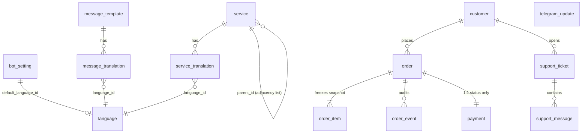

# Data Model — Rabet (رابط)

**Phase 03A — Database Architecture & Data Model Design (design only)**

This document specifies the PostgreSQL data model for Rabet: the entities, relationships,
integrity rules, business-journey support, infrastructure recommendation and migration
workflow.

> **Status:** **DESIGN ONLY.** No database exists, no schema files exist, no migration
> files exist and no dependencies are installed. Nothing in this document has been applied
> to any database. Phase 03B is the implementation phase and is explicitly **not** started
> by this document. See §13 "Prerequisites for Phase 03B".

Related: [ARCHITECTURE.md](./ARCHITECTURE.md) for the stack and ADRs,
[PROGRESS.md](./PROGRESS.md) for phase status.

---

## 1. Domain summary

Rabet is one Telegram bot selling digital services, operated by one administrator through a
mobile-first web dashboard. Customers browse a service catalog inside Telegram, place
orders and pay with **Telegram Stars** (required by Telegram for digital goods sold inside
bots — ADR-005). The merchant manages the catalog, reviews orders and payments, and
replies to support tickets from the dashboard.

The data model therefore serves five runtime surfaces:

| Surface | What it needs |
| --- | --- |
| Bot conversation | customer state, catalog browsing in the chosen language, order creation, ticket replies |
| Catalog management | arbitrarily nested service types, per-language names/instructions, activation, pricing |
| Order operations | immutable snapshots of what was sold, independent payment and fulfillment lifecycles, audit trail |
| Payments | provider events recorded as evidence before they are trusted; human review where applicable |
| Support | configurable categories, tickets, two-way messages over Telegram |

**Non-goals enforced by this design** (per the mandate): no multi-tenancy, no multi-bot,
no employee roles or granular permissions, no advanced analytics, no warehouse. The system
has exactly one bot and one administrator, and the schema says so by construction — there
is no `tenant_id`, no `bot_id` and no `role` column anywhere.

### Design principles applied

1. **Structure over noun-counting.** The mandate warns against a one-table-per-item
   checklist, so the design starts from the *journeys* and keeps a table only when it earns
   its place. Two collapses follow directly: the category hierarchy is the `service` table
   itself (no separate `category` table, §4.1), and support categories are a `text[]` on
   the settings singleton rather than a lookup table (§12.2). Conversely the model keeps
   *three* commerce tables (`order`, `order_item`, `order_event`) because requirement 4
   (snapshot) and requirement 9 (verified events) each demand a distinct, append-only
   home. Net result: **14 tables**, each with one clear owner.
2. **Constraints in the database, not only in the app.** Money is never a float; statuses
   are enumerated; the service tree cannot cycle; a sellable node cannot be a category; a
   duplicate Telegram update cannot be processed twice. Each of these is a `CHECK`, a
   unique index or a trigger, so a bug in the app layer cannot corrupt them.
3. **Write-once history, mutable catalog.** Anything a customer has already paid for is
   frozen at order time. Everything the merchant can still edit stays live.
4. **Store only the customer data the product needs.** No phone numbers, no email
   addresses, no geolocation, no marketing profiles (§9.2).
5. **Secrets never become rows.** The Telegram bot token, `AUTH_SECRET` and the admin
   password hash stay in environment variables, per the architectural rules. No table is
   designed to hold them.

---

## 2. Entity overview

Fourteen tables, grouped by domain (Configuration, Catalog, Content, People, Commerce,
Payments, Support, Integration).

| # | Table | Domain | Purpose | MVP? |
| --- | --- | --- | --- | --- |
| 1 | `bot_setting` | Configuration | Single-row settings store for the one bot | ✅ |
| 2 | `language` | Configuration | Enabled languages and the default language | ✅ |
| 3 | `service` | Catalog | Hierarchical catalog: categories *and* sellable services | ✅ |
| 4 | `service_translation` | Catalog | Per-language name/description/instructions | ✅ |
| 5 | `message_template` | Content | Editable bot message templates | ✅ |
| 6 | `message_translation` | Content | Per-language template bodies (fallback rules in §7.6) | ✅ |
| 7 | `customer` | People | A Telegram customer — minimal attributes only | ✅ |
| 8 | `order` | Commerce | One purchase: independent payment + fulfillment status | ✅ |
| 9 | `order_item` | Commerce | **Immutable snapshot** of what was sold and at what price | ✅ |
| 10 | `order_event` | Commerce | Verified state transitions and order audit history | ✅ |
| 11 | `payment` | Payments | Provider payment record + raw evidence, verified before trusted | ✅ |
| 12 | `support_ticket` | Support | A customer ticket with a configurable category | ✅ |
| 13 | `support_message` | Support | One message on a ticket (customer or admin) | ✅ |
| 14 | `telegram_update` | Integration | Deduplication / idempotency log for Telegram updates | ✅ |

> The mandate separates "support categories" from tickets. Configurable support categories
> are modelled as a `category` column on `support_ticket` constrained by the
> `support_category` values in `bot_setting` (§4.1), not as a 15th table — see §12.2 for
> why that is the right trade at MVP scale, and what would trigger promoting it later.

### Deferred / deliberately absent

| Candidate | Decision | Why |
| --- | --- | --- |
| `admin_user` / roles | **Absent.** One admin, declared by `ADMIN_EMAIL` / `ADMIN_PASSWORD_HASH` env vars | Already solved by Phase 02 (ADR-009). A table would add nothing and would imply accounts that do not exist. |
| `session` (revocation) | **Deferred.** JWT sessions remain stateless | ADR-009 records this as a deliberate Phase 03+ option. Now that a database is being designed, a revocation table *becomes possible* — see §12.2, but it is out of scope for the MVP schema. |
| `service_option` (variants) | **Deferred, designed for.** | Requirement 2 mentions configurable options "eventually". §12.3 shows the additive path so the design is not painted into a corner. |
| `bot` table | **Absent.** | Exactly one bot. Its token is a secret and belongs in env, not a table. |
| Analytics/funnel tables | **Absent.** | Explicitly out of scope (mandate item 10). Journey stages are inferred, not stored as a funnel (§7.4). |
| `payment_refund`, webhooks tables | **Deferred.** | Refunds and webhook delivery logs are Phase 08/09 concerns; `payment.evidence` already captures raw events. |

---

## 3. Relationship definitions

```
bot_setting  (singleton — one row, id = 1)
language     (independent; referenced by translation tables)

service  ──0..N──▶  service_translation   (a service has one row per enabled language)
service  ──0..N──▶  service               (self-reference: parent_id, adjacency list)
message_template ──0..N──▶ message_translation

customer ──0..N──▶  order
order    ──1..N──▶  order_item            (snapshot rows; write-once)
order    ──0..N──▶  order_event           (append-only audit)
order    ──1..1──▶  payment               (one order has exactly one payment row)
customer ──0..N──▶  support_ticket
support_ticket ──0..N──▶ support_message
telegram_update                                (standalone idempotency log)
```

Cardinality notes that matter for integrity:

- **`order` → `payment` is 1:1**, enforced by a `UNIQUE` constraint on
  `payment.order_id`. An order is created when the customer commits to a purchase, and its
  single payment row is created at the same time in the same transaction. The payment's
  *status* is what varies, not its existence. This is what makes "payment state and
  fulfillment state are independent" literally true in the schema (§7.5).
- **`order` → `order_item` is 1:N** even though the MVP bot flow buys one service per
  order. Designing for N items now costs one small table and avoids a destructive
  migration later; §12.3 covers it.
- **No relation is many-to-many.** The domain has no genuine M:N relationship at MVP
  scale, so no join table exists.

### Mermaid ER diagram



> Mermaid renders `bot_setting ||--o| language` as an optional relation because the
> settings row references the default language; the relation is advisory, not a hard FK on
> every read path (see §4.1).

---

## 4. Recommended entities and fields

Conventions used throughout (rationale in §7):

- Primary keys: `id uuid PRIMARY KEY DEFAULT gen_random_uuid()`. UUIDs are used because
  they are opaque (no order enumeration), conflict-free across branches, and let the bot
  generate IDs in webhook handlers safely.
- All timestamps: `timestamptz`, stored and read as **UTC** (`created_at`, `updated_at`,
  no local-time columns anywhere).
- Money: `numeric(18,2)`, never `real`/`double precision`. Currency is an ISO-4217-style
  `char(3)` code. Telegram Stars are `XTR`.
- Soft delete uses a nullable `deleted_at timestamptz`; queries filter it. Hard deletes are
  not used on business data (§7.9).

### 4.1 Configuration

#### `bot_setting` — exactly one row

The store for the one bot's configuration. Kept as **one row** (`CHECK (id = 1)`) rather
than a key/value map so the schema stays typed and self-documenting; the alternative is
discussed in §11.2.

| Column | Type | Constraints | Notes |
| --- | --- | --- | --- |
| `id` | `smallint` | `PRIMARY KEY`, `CHECK (id = 1)` | forces the singleton |
| `default_language_id` | `uuid` | `NOT NULL` FK → `language.id` | fallback language for all content (§7.6) |
| `currency` | `char(3)` | `NOT NULL`, `CHECK (currency IN ('XTR', 'SAR', 'USD', 'AED', 'EGP'))` | catalog/list currency. `XTR` = Telegram Stars |
| `display_name` | `text` | `NOT NULL` | shown in the bot profile area |
| `support_reply_time` | `text` | nullable | e.g. "within 24 hours" |
| `stars_to_currency_hint` | `text` | nullable | optional display hint for the merchant |
| `support_category` | `text[]` | `NOT NULL DEFAULT '{}'` | configurable support categories (§2) |
| `created_at` | `timestamptz` | `NOT NULL DEFAULT now()` | |
| `updated_at` | `timestamptz` | `NOT NULL DEFAULT now()` | trigger-maintained |

**Support categories as a text array.** The MVP needs a configurable, admin-editable list
of support categories so a customer can classify a ticket. Storing them as an array on the
singleton settings row means "edit the categories" is one dashboard form writing one row —
no second table, no orphaned-category cleanup, and the list is trivially read into the bot
inline keyboard. `support_ticket.category` is `text NOT NULL` constrained by the current
array via a `CHECK`-equivalent validation in the application write path (a trigger can
enforce it too; see §11.1 for the promotion criteria).

#### `language`

| Column | Type | Constraints | Notes |
| --- | --- | --- | --- |
| `id` | `uuid` | `PRIMARY KEY` | |
| `code` | `char(2)` | `NOT NULL UNIQUE` | ISO 639-1: `en`, `ar` |
| `label` | `text` | `NOT NULL` | display label, e.g. "English", "العربية" |
| `is_enabled` | `boolean` | `NOT NULL DEFAULT false` | `en` seeded `true` |
| `created_at` | `timestamptz` | `NOT NULL DEFAULT now()` | |

- `UNIQUE (code)` — one row per language code.
- The single default language lives in `bot_setting.default_language_id`, **not** as a
  boolean flag on `language`. That avoids the classic "two rows claim to be the default"
  bug: there is exactly one default because there is exactly one settings row.
- The rule that must hold: the referenced default language must itself be `is_enabled`.
  Enforced by the FK plus a write-path check, and called out in §8 as a
  data-consistency guard.

### 4.2 Catalog

#### `service` — self-referencing hierarchy (adjacency list)

One table holds **both** navigation-only nodes (categories) and sellable leaves
(services). Requirement 1 wants nesting to arbitrary depth; an adjacency list
(`parent_id → service.id`) is the simplest structure that delivers that, keeps all
tree operations to one table, and is fully supported by Postgres recursive CTEs.

| Column | Type | Constraints | Notes |
| --- | --- | --- | --- |
| `id` | `uuid` | `PRIMARY KEY` | |
| `parent_id` | `uuid` | nullable, `FK → service.id ON DELETE RESTRICT`, `CHECK (parent_id <> id)` | root nodes are NULL |
| `slug` | `text` | `NOT NULL UNIQUE` | stable dashboard/bot key, e.g. `social.telegram.premium` |
| `is_sellable` | `boolean` | `NOT NULL DEFAULT false` | **false = navigation-only node** |
| `is_active` | `boolean` | `NOT NULL DEFAULT false` | activation gate (requirement 2); independent of deletion |
| `sort_order` | `integer` | `NOT NULL DEFAULT 0` | ordering within the parent |
| `price` | `numeric(18,2)` | nullable, `CHECK (price >= 0)` | required when `is_sellable` (see constraint S2) |
| `currency` | `char(3)` | nullable, `CHECK (currency IN ('XTR','SAR','USD','AED','EGP'))` | required when `is_sellable` |
| `fulfillment_instructions` | `text` | nullable | what the merchant/bot does to deliver |
| `deleted_at` | `timestamptz` | nullable | soft delete |
| `created_at` | `timestamptz` | `NOT NULL DEFAULT now()` | |
| `updated_at` | `timestamptz` | `NOT NULL DEFAULT now()` | |

**Hierarchy integrity constraints (S1–S5):**

- **S1 — no self-parent:** `CHECK (parent_id <> id)`.
- **S2 — sellable ⇒ priced:** `CHECK ((is_sellable AND price IS NOT NULL AND currency IS NOT NULL) OR (NOT is_sellable AND price IS NULL AND currency IS NULL))`.
  This is the "no ambiguous pricing" rule: a navigation node can never carry a price and a
  sellable service can ever be price-less, at the database level.
- **S3 — no cycles, no invalid parents:** trigger `service_check_ancestry` fires
  `BEFORE INSERT/UPDATE` on `parent_id`. It walks the ancestor chain with a bounded
  recursive lookup and raises an exception if the new parent is the node itself, one of its
  own descendants, or a deleted node. (Bounded loop with a depth cap as a safety net; see
  §11.4 for the alternative — a `ltree`/materialised-path column.)
- **S4 — deleted ancestors are unreachable:** the read path filters
  `deleted_at IS NULL` **and** the ancestry trigger refuses to point a node at a deleted
  parent. Deletion of a node that still has live children is blocked by
  `ON DELETE RESTRICT` plus a `CHECK`-style guard (see §7.3).
- **S5 — sellable nodes are leaves:** trigger `service_sellable_is_leaf` rejects
  `is_sellable = true` when the node has children, and rejects adding a child to a
  sellable node. This is the crisp behavioural answer to the mandate's "navigation-only
  vs sellable" question: a node is *either* a category that groups children *or* something
  the customer can buy, never both, so there is never doubt about what a selection means
  or where the price comes from.

> **Deleted ancestors & orphaning.** If the merchant deletes a category, `RESTRICT` makes
> the delete fail loudly until the children are re-parented or deleted first. This is
> deliberate: silently orphaning services would make the catalog sell things the merchant
> believes are gone.

#### `service_translation`

Per-language content. The **fallback chain** is defined in §7.6.

| Column | Type | Constraints | Notes |
| --- | --- | --- | --- |
| `id` | `uuid` | `PRIMARY KEY` | |
| `service_id` | `uuid` | `NOT NULL`, `FK → service.id ON DELETE CASCADE` | |
| `language_id` | `uuid` | `NOT NULL`, `FK → language.id` | |
| `name` | `text` | `NOT NULL` | display name |
| `description` | `text` | nullable | |
| `instructions` | `text` | nullable | customer-facing activation/delivery instructions |
| `created_at` | `timestamptz` | `NOT NULL DEFAULT now()` | |
| `updated_at` | `timestamptz` | `NOT NULL DEFAULT now()` | |

- `UNIQUE (service_id, language_id)` — one translation per service per language.
- Application rule: a row for the **default language is required** before a sellable
  service can be activated. Enforced in the write path (see §7.6 and the validation
  matrix in §8), because a `CHECK` cannot see another table.

### 4.3 Content

#### `message_template`

Editable bot strings, keyed by a stable identifier so the bot code references a name, not
a row id.

| Column | Type | Constraints | Notes |
| --- | --- | --- | --- |
| `id` | `uuid` | `PRIMARY KEY` | |
| `key` | `text` | `NOT NULL UNIQUE` | e.g. `welcome`, `order_created`, `support_reply` |
| `description` | `text` | `NOT NULL` | tells the admin what the string is for |
| `created_at` | `timestamptz` | `NOT NULL DEFAULT now()` | |
| `updated_at` | `timestamptz` | `NOT NULL DEFAULT now()` | |

#### `message_translation`

| Column | Type | Constraints | Notes |
| --- | --- | --- | --- |
| `id` | `uuid` | `PRIMARY KEY` | |
| `template_id` | `uuid` | `NOT NULL`, `FK → message_template.id ON DELETE CASCADE` | |
| `language_id` | `uuid` | `NOT NULL`, `FK → language.id` | |
| `body` | `text` | `NOT NULL` | the message text, with `{{placeholders}}` |
| `created_at` | `timestamptz` | `NOT NULL DEFAULT now()` | |
| `updated_at` | `timestamptz` | `NOT NULL DEFAULT now()` | |

- `UNIQUE (template_id, language_id)`.

### 4.4 People

#### `customer` — minimal by design

Only what Telegram gives us plus what operations need (requirement 8).

| Column | Type | Constraints | Notes |
| --- | --- | --- | --- |
| `id` | `uuid` | `PRIMARY KEY` | |
| `telegram_id` | `bigint` | `NOT NULL UNIQUE` | Telegram user id; `bigint` is the safe type |
| `telegram_username` | `text` | nullable | volatile, may be unset |
| `first_name` | `text` | nullable | as provided by Telegram |
| `last_name` | `text` | nullable | |
| `language_code` | `char(2)` | nullable | Telegram's client language hint |
| `is_blocked` | `boolean` | `NOT NULL DEFAULT false` | set when Telegram reports the bot blocked |
| `first_seen_at` | `timestamptz` | `NOT NULL DEFAULT now()` | |
| `last_seen_at` | `timestamptz` | `NOT NULL DEFAULT now()` | |
| `created_at` | `timestamptz` | `NOT NULL DEFAULT now()` | |
| `updated_at` | `timestamptz` | `NOT NULL DEFAULT now()` | |

**Deliberately absent:** phone number, email, real name beyond what Telegram sends,
address, avatar, marketing consent, date of birth. Retention is handled in §9.2.

### 4.5 Commerce

#### `order`

| Column | Type | Constraints | Notes |
| --- | --- | --- | --- |
| `id` | `uuid` | `PRIMARY KEY` | |
| `customer_id` | `uuid` | `NOT NULL`, `FK → customer.id ON DELETE RESTRICT` | |
| `reference` | `text` | `NOT NULL UNIQUE` | short human/merchant-readable id, e.g. `RB-8F3K` |
| `payment_status` | `payment_status` | `NOT NULL DEFAULT 'pending'` | enum, §7.5 |
| `fulfillment_status` | `fulfillment_status` | `NOT NULL DEFAULT 'pending'` | enum, §7.5 |
| `total_amount` | `numeric(18,2)` | `NOT NULL`, `CHECK (total_amount >= 0)` | copied from the item snapshot |
| `currency` | `char(3)` | `NOT NULL`, `CHECK (currency IN ('XTR','SAR','USD','AED','EGP'))` | |
| `customer_note` | `text` | nullable | optional note captured in the bot |
| `created_at` | `timestamptz` | `NOT NULL DEFAULT now()` | |
| `updated_at` | `timestamptz` | `NOT NULL DEFAULT now()` | |

Postgres enum types (created once, owned by the schema):

```sql
CREATE TYPE payment_status     AS ENUM ('pending', 'paid', 'failed', 'refunded');
CREATE TYPE fulfillment_status AS ENUM ('pending', 'in_progress', 'fulfilled', 'cancelled');
```

`reference` is generated server-side, not from the client, and is `UNIQUE` so it can be
shown to the customer and quoted in support tickets without leaking a `uuid`.

#### `order_item` — the immutable snapshot

This table is requirement 4 made concrete. Each row freezes **what the customer actually
bought**, independent of later edits to `service` or `service_translation`.

| Column | Type | Constraints | Notes |
| --- | --- | --- | --- |
| `id` | `uuid` | `PRIMARY KEY` | |
| `order_id` | `uuid` | `NOT NULL`, `FK → order.id ON DELETE CASCADE` | cascade is safe: orders are never deleted (§7.9) |
| `service_id` | `uuid` | `NOT NULL`, `FK → service.id ON DELETE RESTRICT` | link kept for dashboard drill-down; `RESTRICT` blocks deleting a service that was ever sold |
| `service_slug` | `text` | `NOT NULL` | snapshot of `service.slug` |
| `name` | `text` | `NOT NULL` | snapshot of the **display name in the purchase language** |
| `unit_price` | `numeric(18,2)` | `NOT NULL`, `CHECK (unit_price >= 0)` | snapshot |
| `quantity` | `integer` | `NOT NULL DEFAULT 1`, `CHECK (quantity >= 1)` | |
| `currency` | `char(3)` | `NOT NULL` | snapshot |
| `terms_snapshot` | `jsonb` | `NOT NULL` | snapshot of applicable terms/instructions/attributes |
| `created_at` | `timestamptz` | `NOT NULL DEFAULT now()` | |

**Why `terms_snapshot jsonb`:** the applicable terms are open-ended (delivery window,
activation steps, Stars settlement notes). Freezing them as JSON keeps the schema stable
while the catalog evolves, and guarantees the order remains truthful even if the merchant
later rewrites the service's instructions or removes a term. See §7.7 for the full
snapshot strategy.

**Immutability:** an `UPDATE` on `order_item` is prohibited except for a whitelist of
non-business columns; see §7.7.

#### `order_event` — verified history

Append-only record of what actually happened. This is the table that satisfies
requirement 9 ("track verified events separately from inferred journey stages"): an
`order_event` row is only ever written after a *verified* state change, and the `order`
status columns are a derived projection of it (§7.4).

| Column | Type | Constraints | Notes |
| --- | --- | --- | --- |
| `id` | `uuid` | `PRIMARY KEY` | |
| `order_id` | `uuid` | `NOT NULL`, `FK → order.id ON DELETE CASCADE` | |
| `payment_status_from` | `payment_status` | nullable | null for the first event |
| `payment_status_to` | `payment_status` | nullable | |
| `fulfillment_status_from` | `fulfillment_status` | nullable | |
| `fulfillment_status_to` | `fulfillment_status` | nullable | |
| `actor` | `event_actor` | `NOT NULL` | enum: `customer`, `admin`, `system`, `telegram` |
| `reason` | `text` | nullable | free text: "Stars payment confirmed", "admin marked delivered" |
| `evidence` | `jsonb` | nullable | the raw payload that justified the transition |
| `created_at` | `timestamptz` | `NOT NULL DEFAULT now()` | |

- At least one of `*_status_to` must be non-null: `CHECK (payment_status_to IS NOT NULL OR fulfillment_status_to IS NOT NULL)`.
- Trigger `order_event_apply` runs `AFTER INSERT` and applies the transition to
  `order.payment_status` / `order.fulfillment_status`, so the projection can never drift
  from the audit log. The transition itself is validated *before* insert by
  `order_event_validate` (§7.5), so an illegal transition never lands.

### 4.6 Payments

#### `payment`

A payment row is **evidence first, verdict second**. It is created when an invoice is
issued and reaches `paid` only when a trustworthy event says so (requirement: record
payment evidence without assuming payment is verified).

| Column | Type | Constraints | Notes |
| --- | --- | --- | --- |
| `id` | `uuid` | `PRIMARY KEY` | |
| `order_id` | `uuid` | `NOT NULL UNIQUE`, `FK → order.id ON DELETE CASCADE` | **UNIQUE enforces the 1:1 with `order`** |
| `provider` | `text` | `NOT NULL DEFAULT 'telegram_stars'`, `CHECK (provider IN ('telegram_stars'))` | extensible; see ADR-005 |
| `provider_charge_id` | `text` | nullable, `UNIQUE` | Telegram Stars charge id (populated on confirmation) |
| `amount` | `numeric(18,2)` | `NOT NULL`, `CHECK (amount >= 0)` | |
| `currency` | `char(3)` | `NOT NULL`, `CHECK (currency IN ('XTR','SAR','USD','AED','EGP'))` | |
| `status` | `payment_status` | `NOT NULL DEFAULT 'pending'` | same enum as `order.payment_status` |
| `evidence` | `jsonb` | nullable | raw provider event(s): pre_checkout, successful_payment, refund |
| `reviewed_by_admin` | `boolean` | `NOT NULL DEFAULT false` | human-review flag where applicable |
| `created_at` | `timestamptz` | `NOT NULL DEFAULT now()` | |
| `updated_at` | `timestamptz` | `NOT NULL DEFAULT now()` | |

- `UNIQUE (order_id)` — one payment per order.
- `UNIQUE (provider_charge_id)` — a provider charge can be recorded exactly once. This is
  payment-level idempotency: a duplicate webhook replay cannot create a second payment
  row.
- Telegram Stars requires **no payment provider token** for digital goods (already noted
  in `.env.example`), so no token column exists.

### 4.7 Support

#### `support_ticket`

| Column | Type | Constraints | Notes |
| --- | --- | --- | --- |
| `id` | `uuid` | `PRIMARY KEY` | |
| `customer_id` | `uuid` | `NOT NULL`, `FK → customer.id ON DELETE RESTRICT` | |
| `category` | `text` | `NOT NULL` | must be a member of `bot_setting.support_category` |
| `subject` | `text` | nullable | optional; the first message often *is* the ticket |
| `status` | `ticket_status` | `NOT NULL DEFAULT 'open'` | enum: `open`, `waiting_on_customer`, `resolved`, `closed` |
| `opened_at` | `timestamptz` | `NOT NULL DEFAULT now()` | |
| `last_reply_at` | `timestamptz` | nullable | updated on each message |
| `closed_at` | `timestamptz` | nullable | set when `status` reaches `closed` |
| `created_at` | `timestamptz` | `NOT NULL DEFAULT now()` | |
| `updated_at` | `timestamptz` | `NOT NULL DEFAULT now()` | |

#### `support_message`

| Column | Type | Constraints | Notes |
| --- | --- | --- | --- |
| `id` | `uuid` | `PRIMARY KEY` | |
| `ticket_id` | `uuid` | `NOT NULL`, `FK → support_ticket.id ON DELETE CASCADE` | |
| `author` | `message_author` | `NOT NULL` | enum: `customer`, `admin` |
| `body` | `text` | `NOT NULL` | message text |
| `telegram_message_id` | `bigint` | nullable | the Telegram message id, used for reply threading and out-of-band dedup |
| `created_at` | `timestamptz` | `NOT NULL DEFAULT now()` | |

- `UNIQUE (ticket_id, telegram_message_id)` — the same Telegram message cannot be stored
  twice. This is support-side idempotency.

### 4.8 Integration

#### `telegram_update` — deduplication and idempotency

Every Telegram update received by the webhook is recorded here **before** any business
logic runs. Requirement 7 (deduplication + idempotent handling) is implemented by making
the insert the lock.

| Column | Type | Constraints | Notes |
| --- | --- | --- | --- |
| `id` | `uuid` | `PRIMARY KEY` | |
| `update_id` | `bigint` | `NOT NULL UNIQUE` | Telegram's update id; **the dedup key** |
| `update_type` | `text` | `NOT NULL` | `message`, `pre_checkout_query`, `successful_payment`, `callback_query`, … |
| `processed_at` | `timestamptz` | nullable | set once handling completes |
| `processing_error` | `text` | nullable | last error, for retries |
| `payload` | `jsonb` | nullable | the raw update, retained for debugging (retention in §9.2) |
| `created_at` | `timestamptz` | `NOT NULL DEFAULT now()` | |

Handling contract (see journey F, §6.6):

1. `INSERT INTO telegram_update (update_id, …) ON CONFLICT (update_id) DO NOTHING`
   returning whether a row was inserted.
2. If **nothing was inserted**, the update was already received — acknowledge and stop.
3. If inserted, run the business logic inside a transaction, then set `processed_at`.
4. If the business logic fails, the transaction rolls back (including the
   `telegram_update` row), so the next delivery is a genuine first attempt — no
   "processed but failed, now stuck" state. `processing_error` records transient failures
   that are retried instead of rolled back.

> The same one-row-insert-as-lock pattern is used for `payment.provider_charge_id` and
> `support_message.telegram_message_id`, so dedup is uniform across the three places
> Telegram can deliver something twice.

---

## 5. Indexing strategy

Every index below serves a query that exists in the MVP; nothing is speculative.

| Table | Index | Serves |
| --- | --- | --- |
| `service` | `UNIQUE (slug)` | bot/dashboard lookup by stable key |
| `service` | `(parent_id)` | tree traversal (children of a node) |
| `service` | `(is_active) WHERE deleted_at IS NULL` **partial** | catalog listing; excludes tombstones |
| `service_translation` | `UNIQUE (service_id, language_id)` | one translation per language; the read path |
| `message_template` | `UNIQUE (key)` | bot looks up strings by key |
| `message_translation` | `UNIQUE (template_id, language_id)` | fallback resolution |
| `customer` | `UNIQUE (telegram_id)` | upsert on first message; identity |
| `order` | `UNIQUE (reference)` | merchant/customer quoting |
| `order` | `(customer_id, created_at DESC)` | "my orders" list per customer |
| `order` | `(payment_status)`, `(fulfillment_status)` | dashboard work queues ("awaiting payment", "to ship") |
| `order_item` | `(order_id)` | order detail join |
| `order_event` | `(order_id, created_at)` | order history in chronological order |
| `payment` | `UNIQUE (order_id)` | enforces 1:1 |
| `payment` | `UNIQUE (provider_charge_id)` | payment idempotency |
| `support_ticket` | `(customer_id, status)` | open-ticket lookup per customer |
| `support_message` | `(ticket_id, created_at)` | message thread order |
| `support_message` | `UNIQUE (ticket_id, telegram_message_id)` | message dedup |
| `telegram_update` | `UNIQUE (update_id)` | the dedup lock |

Notes:

- Enum and boolean columns used for filtering (`is_active`, statuses) are indexed only
  where they are genuinely selective; low-cardinality columns alone are not indexed.
- `service.parent_id` gets a plain btree; the tree is shallow (a catalog), so a recursive
  CTE over the adjacency list is sufficient. A materialised path or `ltree` extension is
  the documented scale-up path (§11.4) and is **not** added now.
- Partial indexes (`WHERE deleted_at IS NULL`) keep the catalog indexes free of
  tombstones, so the dead rows the merchant has archived never slow the live listing.

---

## 6. Business journeys (in data terms)

Written to be reviewable by a Product Manager. Each step names the tables involved.

### 6.1 An administrator creating a nested service

The merchant opens **Services → New**, chooses a parent category and fills in the name,
price and instructions in the dashboard's working language.

1. `BEGIN`.
2. `INSERT INTO service (id, parent_id, slug, is_sellable, is_active, price, currency, …)`.
   `is_active` starts `false`, so nothing is customer-visible until the merchant turns it
   on.
3. `INSERT INTO service_translation (service_id, language_id, name, description, instructions)`
   for the default language (`bot_setting.default_language_id`).
4. Commit. **Triggers S1–S5 fire**: the ancestry check confirms the parent exists, is not
   a descendant of this node, is not deleted, and (because `is_sellable = true`) has no
   children. Constraint S2 confirms a price and currency are present.
5. The merchant activates it: `UPDATE service SET is_active = true`. The write path first
   verifies a default-language translation exists (§7.6); otherwise the activation is
   refused with a clear message — the customer can never be shown a nameless service.

The hierarchy is arbitrary depth because `parent_id` points at another `service` row;
nothing in the schema caps the depth, and the recursive CTE that renders the tree walks
as far as the data goes.

### 6.2 A customer selecting a sellable service

A customer taps through the bot menu: **Social → Telegram → Premium followers**.

1. The bot reads `service` children of the root, then children of the chosen node, using
   `service_translation` in the customer's language (`customer.language_code`), falling
   back to the default language per §7.6. Only `is_active = true AND deleted_at IS NULL`
   rows are offered (partial index from §5).
2. Because of **S5**, every selectable leaf is a *sellable leaf*: the customer can never
   be shown a category with a confusing price, and can never be shown a price-less row.
3. The bot shows `service_translation.name`, `description` and the `price`/`currency` from
   `service`.
4. Confirming starts checkout — journey continues at 6.4. No order row exists yet; the
   catalog is read-only from the customer's side.

### 6.3 An order preserving the price and terms after the service is edited

A month later the merchant raises the price of "Premium followers" from 500 to 700 Stars
and rewrites the instructions. **Orders already placed are untouched.**

1. The merchant's edit is `UPDATE service SET price = 700` plus an `UPDATE service_translation`.
   These touch only the catalog tables.
2. Historical orders are protected by construction: `order_item` holds its own copies of
   `name`, `unit_price`, `currency`, `service_slug` and a `terms_snapshot` jsonb. There is
   no join to `service` on the read path that could change those values.
3. The dashboard order view reads `order_item` directly, so order #RB-8F3K still shows
   **500 XTR** with the original instructions, while the catalog now sells at 700 XTR.
4. `order_item.service_id` still points at the service (`ON DELETE RESTRICT`), so a
   drill-down to the live catalog entry works when the merchant wants it — but the link is
   for navigation only, never a source of price or terms.
5. If the merchant later *deletes* the service, `RESTRICT` blocks the delete because an
   `order_item` row still references it. The sold history cannot be quietly severed.

### 6.4 Payment evidence being recorded without assuming it is verified

The customer pays with Telegram Stars inside the chat.

1. Telegram sends a `pre_checkout_query`. The bot `INSERT`s a `telegram_update` row
   (dedup) and creates/updates the `payment` row with `status = 'pending'` and the raw
   event in `evidence`. **No order is marked paid.**
2. Telegram then sends `successful_payment`. That is the *verified* event: it carries the
   Stars charge id.
3. The bot writes an `order_event` row with
   `payment_status_to = 'paid'`, `actor = 'telegram'`, `reason = 'Stars payment
   confirmed'` and the event payload in `evidence`. The `order_event_validate` trigger
   confirms `pending → paid` is a legal transition (§7.5), and the `order_event_apply`
   trigger sets `order.payment_status = 'paid'`.
4. In the same transaction, `payment` is set to `status = 'paid'`,
   `provider_charge_id = <Stars charge id>` (unique), and `evidence` gains the
   confirmation payload.
5. If the `successful_payment` update is **redelivered**, two guards fire:
   `telegram_update.update_id` rejects the duplicate outright, and
   `payment.provider_charge_id` being `UNIQUE` means the charge can be recorded once.
   The order cannot be double-paid.
6. **Fulfillment is untouched** through all of this: `order.fulfillment_status` stays
   `pending` until the merchant or an automation acts. Payment and fulfillment are two
   independent columns on `order`, backed by two independent event streams.

### 6.5 A support ticket being assigned a category and receiving replies

1. The customer types "my order never arrived". The bot offers the categories from
   `bot_setting.support_category` (e.g. `Order issue`, `Payment`, `Account`). The
   customer taps **Order issue**.
2. `INSERT INTO support_ticket (customer_id, category, status) VALUES (…, 'Order issue',
   'open')`, then `INSERT INTO support_message (ticket_id, author = 'customer', body, telegram_message_id)`.
   The unique `(ticket_id, telegram_message_id)` guarantees a replayed update cannot
   double-post the message.
3. The merchant sees the ticket in **Support**, reads it, and replies in the dashboard.
   `INSERT INTO support_message (author = 'admin', body)` and `UPDATE support_ticket SET
   status = 'waiting_on_customer', last_reply_at = now()`. The bot pushes the reply to
   the customer's Telegram chat.
4. The customer replies; the webhook dedups via `telegram_update`, appends a
   `customer` message, and flips status back to `open`.
5. The merchant resolves it: `status = 'resolved'` then `closed`, `closed_at = now()`.

The category is configurable at any time — the merchant edits
`bot_setting.support_category` in **Settings** and the bot menu reflects it immediately,
with no schema change and no orphan rows to clean up.

### 6.6 A customer's Telegram update being handled without duplicate processing

Telegram delivers update `4123456789` (a `successful_payment`). The webhook runs:

1. `INSERT INTO telegram_update (update_id = 4123456789, update_type, payload) ON
   CONFLICT (update_id) DO NOTHING`, then check the row count.
2. **First delivery:** a row is inserted. The handler runs the business logic (journey
   6.4) **inside the same database transaction** and sets `processed_at` on commit.
3. **Redelivery (Telegram retries, or the bot is redeployed mid-handling):** the insert
   conflicts, zero rows are inserted. The handler acknowledges `200 OK` and does nothing
   — no second order, no second payment, no duplicate support message.
4. **Transient failure (e.g. a downstream Telegram API call fails after our write):** the
   transaction is rolled back, taking the `telegram_update` row with it, so the next
   delivery is treated as the first. For failures we choose to retry rather than abort,
   `processing_error` records the cause and `processed_at` stays null until it succeeds.

This is the idempotency contract the mandate asks for, and the exact same one-row-lock
pattern protects `payment.provider_charge_id` and `support_message.telegram_message_id`.

---

## 7. Key constraints and integrity rules

### 7.1 Primary and foreign keys

- Every table has a `uuid` primary key (`gen_random_uuid()`), except `bot_setting`
  (`smallint`, `CHECK (id = 1)`).
- All FKs are explicit and declared with the delete behaviour below. No implicit join
  columns, no nullable "kind-of" references.

### 7.2 Unique constraints

- Natural uniqueness is enforced: `service.slug`, `language.code`, `message_template.key`,
  `customer.telegram_id`, `order.reference`.
- Relational uniqueness is enforced: `UNIQUE (service_id, language_id)`, `UNIQUE
  (template_id, language_id)`, `UNIQUE (ticket_id, telegram_message_id)`.
- Business-rule uniqueness: `UNIQUE (payment.order_id)` (one payment per order),
  `UNIQUE (payment.provider_charge_id)` (a charge recorded once), `UNIQUE
  (telegram_update.update_id)` (an update processed once).

### 7.3 Referential delete behaviour

| FK | Behaviour | Rationale |
| --- | --- | --- |
| `service_translation.service_id` → `service` | `CASCADE` | translations are owned content; meaningless without the service |
| `message_translation.template_id` → `message_template` | `CASCADE` | same |
| `order_item.service_id` → `service` | **`RESTRICT`** | a service that was ever sold must not be deleted |
| `order.customer_id` → `customer` | `RESTRICT` | a customer with orders is part of the financial record |
| `support_ticket.customer_id` → `customer` | `RESTRICT` | tickets outlive account state |
| `order_item.order_id` → `order` | `CASCADE` | safe because orders are never deleted (§7.9) |
| `order_event.order_id` → `order` | `CASCADE` | append-only audit, same reason |
| `payment.order_id` → `order` | `CASCADE` | same |
| `support_message.ticket_id` → `support_ticket` | `CASCADE` | a thread is one unit |
| `service.parent_id` → `service` | `RESTRICT` | prevents deleting a category that still has children |

`RESTRICT` (immediate) is used rather than `NO ACTION` (deferred) everywhere a block is
intended: the failure should surface at the moment of the offending statement, in a
dashboard form the merchant can act on.

### 7.4 Order history and auditability

- `order_event` is **append-only**. There is no `UPDATE` or `DELETE` path; a trigger
  raises on any attempt to modify or remove a row.
- `order.payment_status` and `order.fulfillment_status` are **projections** of the last
  applicable `order_event`. The `order_event_apply` trigger keeps them in sync, so the
  "current state" can never disagree with the "verified history".
- Verified events vs inferred stages (requirement 9): `order_event` rows are only written
  for things that actually happened (a confirmed Stars charge, an explicit merchant
  action). A journey stage like "the customer seems interested" is *never* written to the
  audit log; it can be computed from `order`/`customer` timestamps when an analytics
  phase wants it, which keeps the audit log trustworthy and small.

### 7.5 Payment / fulfillment state transitions

Allowed transitions (anything else is rejected by the `order_event_validate` trigger):

```
payment_status:     pending ──▶ paid ──▶ refunded
                       │
                       └────▶ failed

fulfillment_status: pending ──▶ in_progress ──▶ fulfilled
                       │                            ▲
                       └──▶ cancelled        (cancelled is terminal, no return)
```

- Terminal states (`paid`→`refunded` target, `fulfilled`, `cancelled`) cannot be left,
  except a `paid` order may be `refunded` by the merchant.
- Independence (requirement 5) is structural: the two columns sit side by side on
  `order`, each is driven by its own `order_event` rows, and the trigger above never
  couples them. A paid-but-not-fulfilled order and a fulfilled-but-payment-pending order
  are both representable — which is exactly the ambiguity a single combined status
  creates (ADR-004).
- The `payment` table uses the same `payment_status` enum, so the order's view and the
  payment's view of money can never diverge in vocabulary.

### 7.6 Translation fallback rules

Resolution order for any translatable content (service name, template body):

1. The row for the **requested** language (`customer.language_code`, or the dashboard's
   chosen language).
2. If absent, the row for `bot_setting.default_language_id` (English by default).
3. If absent, the read fails loudly in development and the bot falls back to a generic
   safe string in production — a name is **required** before a service can be activated
   (§6.1 step 5), so this third case cannot occur for a live service.

- The write path enforces rule 2's precondition: `UPDATE service SET is_active = true` is
  refused unless a default-language translation exists.
- Disabling a language (`language.is_enabled = false`) does not delete its translations;
  they simply stop being offered, and content falls back to the default. Deleting a
  language's rows is a later, explicit admin action.

### 7.7 Order snapshot strategy (requirement 4)

- The snapshot lives on `order_item` as **typed columns** (`name`, `unit_price`,
  `quantity`, `currency`, `service_slug`) plus `terms_snapshot jsonb` for the open-ended
  terms. Typed columns for the financial core mean prices remain queryable, summable and
  constraint-checked; JSON carries everything else.
- `order_item` rows are **write-once**. A trigger permits `UPDATE` only on columns that
  are not part of the sold truth (there are none in the MVP beyond the immutable ones, so
  effectively the trigger blocks all updates; it is written as a whitelist so a future
  non-business column can be added safely).
- `order.total_amount` is computed from the item snapshot at order creation and stored on
  `order`, so the merchant-facing total is stable and does not recompute against a
  catalog that may change.
- The service link `order_item.service_id` is for **navigation and reporting only**, and
  every consumer reads price/terms from the snapshot columns, never from `service`.

### 7.8 Idempotency requirements

Three independent locks, all the same pattern (`INSERT … ON CONFLICT DO NOTHING` and act
on whether a row was created):

1. `telegram_update.update_id UNIQUE` — update-level dedup (journey F).
2. `payment.provider_charge_id UNIQUE` — payment-level dedup (journey D).
3. `support_message.telegram_message_id UNIQUE` — message-level dedup (journey E).

Order creation is idempotent by construction rather than by a key: an order is only
created inside the transaction that also records its payment attempt, and the payment's
unique charge id means a retried purchase cannot spawn a second order.

### 7.9 Data retention, privacy and delete policy

- **No hard deletes of business data.** Orders, order events, payments, tickets and
  messages are retained; `support_message` and `order_event` rows are append-only.
- **Soft delete only on `service`** (`deleted_at`), with `RESTRICT` protecting sold and
  parented rows.
- **Customer data minimisation** is enforced by the schema (§9.2): only Telegram-provided
  identity attributes are stored. There is no column to put a phone number or email into.
- **`telegram_update.payload`** may contain message text, so it is short-lived: it is
  pruned on a schedule (a small, deferred housekeeping job — §12.4) after a retention
  window, keeping `update_id`/`update_type`/`processed_at` for the audit trail.
- A customer's "right to be forgotten" is satisfied by **anonymising** the `customer`
  row (nulling `telegram_username`, `first_name`, `last_name`) while **retaining** order
  and payment rows for the financial record — the schema is designed so that is possible
  (orders reference `customer_id`, not the denormalised name).

---

## 8. Data-consistency guards (summary matrix)

| Rule | Enforced by | Where |
| --- | --- | --- |
| One bot settings row | `CHECK (id = 1)` | `bot_setting` |
| Sellable ⇒ price + currency present; navigation ⇒ neither | `CHECK` S2 | `service` |
| No self-parent | `CHECK (parent_id <> id)` S1 | `service` |
| No cycles / invalid parents | trigger S3 | `service` |
| Deleted ancestors unreachable | trigger S3 + `RESTRICT` S4 + read filter | `service` |
| Sellable nodes are leaves | trigger S5 | `service` |
| One translation per service per language | `UNIQUE` | `service_translation` |
| Default-language name required before activation | write-path validation | `service` ↔ `service_translation` |
| Amounts non-negative | `CHECK` | `service.price`, `order.total_amount`, `order_item.unit_price`, `payment.amount` |
| Money never float | `numeric(18,2)` column type | all money columns |
| One payment per order | `UNIQUE (payment.order_id)` | `payment` |
| Charge recorded once | `UNIQUE (payment.provider_charge_id)` | `payment` |
| Legal status transitions only | `order_event_validate` trigger | `order_event` → `order` |
| Status columns never drift from history | `order_event_apply` trigger | `order_event` → `order` |
| History is append-only | trigger blocks `UPDATE`/`DELETE` | `order_event` |
| Snapshot is write-once | trigger whitelist | `order_item` |
| Update processed once | `UNIQUE (telegram_update.update_id)` | `telegram_update` |
| Support message stored once | `UNIQUE (support_message.telegram_message_id)` | `support_message` |
| Customer identity unique | `UNIQUE (customer.telegram_id)` | `customer` |

---

## 9. Security and privacy

### 9.1 Secrets and configuration

- **No secret is ever a column.** The Telegram bot token, `AUTH_SECRET`,
  `ADMIN_EMAIL`/`ADMIN_PASSWORD_HASH` remain environment variables (architectural rule;
  ADR-009). No table is designed to accept them, and no migration will create a column
  for them.
- `DATABASE_URL` (pooled) and `DATABASE_URL_UNPOOLED` are the only database credentials,
  held in Vercel environment variables and `.env.local`, never committed. `.env.example`
  documents the shape with placeholders only.
- The database user used by the app is the **least-privileged** role: DDL is not granted
  to it. Migrations run as a separate role (§10.5), so the runtime connection cannot
  alter the schema even if a code path tried.

### 9.2 Privacy

- **Storage minimisation.** `customer` holds only `telegram_id`, the username and the
  names Telegram provides, a language hint and operational flags. There is deliberately
  no phone, email, address, avatar or marketing column — requirement 8 made structural.
- **Message content retention.** `support_message.body` and `telegram_update.payload`
  contain customer-written text. Support messages are retained as the record of the
  service relationship; `telegram_update.payload` is pruned on a schedule (§12.4) to the
  audit minimum.
- **Erasure without destroying the ledger.** Because orders reference customers by id and
  the financial snapshot lives on `order_item`, a customer can be anonymised without
  touching order or payment history.
- **No analytics or profiling tables** (requirement 10); nothing tracks the customer
  across sessions beyond `first_seen_at`/`last_seen_at`.
- **Row-Level Security is not enabled.** With one admin and no roles, RLS adds complexity
  without a threat model; authorization is enforced in the application by the existing
  `requireAdmin()` layer (ADR-010). This is revisited in Phase 10.

### 9.3 Exposure surface

- The Telegram webhook endpoint is the only unauthenticated write path, and every path
  through it starts with the `telegram_update` dedup insert, which bounds the blast radius
  of a replayed or forged update to exactly one handling.
- All dashboard data access goes through `requireAdmin()`; the schema assumes a
  single trust level, which matches the single-admin MVP.

---

## 10. Database infrastructure recommendation

Based on the **current official documentation** (Neon docs, Supabase docs, Drizzle docs —
consulted as of October 2026).

### 10.1 Recommendation: Managed PostgreSQL on **Neon**, Free plan

| Criterion | Neon (chosen) |
| --- | --- |
| Real Postgres? | Yes — full Postgres, standard connection string |
| Vercel fit | Native; first-class Drizzle driver; `DATABASE_URL` + `DATABASE_URL_UNPOOLED` |
| Free tier | Generous and usable (see below) |
| Region | Multiple AWS regions; `aws-us-east-2` recommended to sit beside Vercel's default region |
| Serverless pooling | PgBouncer transaction mode, up to 10,000 client connections, `-pooler` hostname |
| Branching | Instant copy-on-write branches for dev/preview; schema-only branching available |
| Backups / recovery | Instant restore (6 h history on Free), 1 manual snapshot |
| Migration support | Standard Postgres → `drizzle-kit migrate` against the direct connection |

**Free-plan limits relevant to Rabet** (current docs): 100 projects, 10 branches per
project, 100 CU-hours of compute per project per month, autoscale up to 2 CU, **1 GB
storage per project (20 GB account-wide)**, 5 GB egress per project per month, scale to
zero after 5 minutes of inactivity. Exceeding CU-hours or egress **suspends the compute
until the next period** (data is not deleted); exceeding 1 GB makes writes that grow the
DB fail.

**Why this is the right fit:** Rabet's MVP load is tiny — one bot, one admin, low message
volume. 1 GB is ample for the 14 tables above at MVP scale; the real operational property
that matters is **scale-to-zero plus branching**, which gives a real development/preview
database per pull request for $0, which is precisely the isolation the mandate asks for.

### 10.2 Alternatives considered

| Provider | Verdict |
| --- | --- |
| **Supabase** | Strong product, but Free limits are tighter for this shape: 500 MB database, **projects paused after 1 week of inactivity** (a bot webhook must stay reachable), branching and PITR are paid. Better if the project later wants its Auth/Storage/Realtime bundle; Rabet does not. |
| **Vercel Postgres** | Neon under the hood with a Vercel-native UX. Convenient, but couples the database lifecycle to the hosting account, offers less direct control over branching and migration tooling, and the mandate keeps GitHub/Vercel as the deployer and the DB as an independent authoritative store. |
| **Railway / Render** | Solid managed Postgres, but the compute is always-on and metered hourly — no scale-to-zero and no free-tier branching. Cost accumulates during idle periods, which is the opposite of this workload's shape. |
| **Self-hosted Postgres on the VPS** | Rejected by the architecture: the VPS is a **development environment only**; production data must live in a managed store. Also loses branching and automated recovery. |
| **AWS RDS / Crunchy Cloud** | Capable, but provisioning, patching and networking overhead are disproportionate for a one-admin MVP, and no instant branching. |

**Decision:** Neon Free plan in `aws-us-east-2`, connected to Vercel with the
**Neon-managed Vercel integration** (keeps billing and control in Neon, and creates an
isolated `preview/<git-branch>` database branch per preview deployment, with automatic
branch cleanup when the Git branch is deleted).

### 10.3 Region placement and latency

Neon region is **fixed at project creation** and cannot be changed later. Vercel's default
function region is `iad1` (US East). Choosing `aws-us-east-2` keeps the app↔DB hop
intra-region, minimising per-query latency for the bot webhook and the dashboard. The
merchant's own latency is dominated by the mobile network, not the DB hop, so no
multi-region complexity is warranted (and none is built).

### 10.4 Connection strategy (serverless)

- **Application reads/writes:** pooled connection string (`-pooler` hostname) via the
  `@neondatabase/serverless` HTTP driver through Drizzle (`drizzle-orm/neon-http`).
  Serverless functions open short-lived connections; PgBouncer in transaction mode is
  designed for exactly this.
- **Migrations:** the **direct (unpooled)** connection (`DATABASE_URL_UNPOOLED`), because
  migration tooling and DDL must not go through transaction-mode pooling. This is the
  documented Neon guidance and it is why the integration injects both variables.
- **Known pooled-connection limitation:** session-level `SET`, `LISTEN/NOTIFY` and
  SQL-level `PREPARE` are unsupported over the pooled connection. The design uses none of
  these; Drizzle uses protocol-level prepared statements, which PgBouncer does support.

### 10.5 Environment isolation

| Environment | Database target | How it is created |
| --- | --- | --- |
| Local dev | A `dev` branch off `main` (or a local Postgres/docker container) | Neon CLI/API, schema-only or full branch |
| Preview (per PR) | `preview/<git-branch>` branch | **Automatically** by the Neon-managed Vercel integration, one per preview deployment, auto-deleted with the Git branch |
| Production | The `main` root branch | Created once; the only long-lived branch |

This satisfies the mandate's dev/preview/production isolation with zero manual toil, and
keeps the "no automatic Production migrations" rule meaningful because each preview
deployment gets its **own throwaway database**.

### 10.6 Backups and recovery

- Free plan: instant restore within a **6-hour history window** (capped at 1 GB of
  changes) and **1 manual snapshot**.
- Operational baseline for Phase 03B: take a **manual snapshot before each production
  migration** (the Free allowance of one is sufficient if the previous one is replaced).
- The design's small schema and soft-delete-only policy keep the data footprint well
  inside the 1 GB cap, so the free recovery window remains usable.
- Upgrade trigger (documented, not now): if the order volume makes the 6-hour window
  insufficient, move to the Launch plan for a 7-day history window and scheduled backups.

### 10.7 Cost risks

1. **Compute suspension, not data loss.** On Free, exhausting CU-hours or egress suspends
   the compute until the next billing period. Mitigation: the webhook handler is
   state-light, and the 5-minute scale-to-zero means idle periods cost nothing. Monitor
   usage in the Neon console; set a spending notification (paid plans).
2. **Storage cap is a hard write failure.** Exceeding 1 GB makes inserts/updates fail.
   Mitigation: the scheduled `telegram_update.payload` prune (§12.4) bounds the fastest-
   growing table; order snapshots are small by design.
3. **Branch sprawl.** Free allows 10 branches per project; the Vercel integration creates
   one per preview deployment. Mitigation: **automatic branch cleanup on Git branch
   deletion** is enabled, so branches do not accumulate. This is the single most
   important setting.
4. **No bill surprises by design.** The Free plan has no payment instrument on file, so
   the project cannot incur charges; the trade-off is the suspension behaviour above,
   which is acceptable and reversible.

---

## 11. Migration plan (Drizzle ORM + Drizzle Kit)

### 11.1 Tooling choice

**Drizzle ORM + Drizzle Kit** is appropriate and recommended:

- The codebase is TypeScript-strict and already uses Zod at trust boundaries; Drizzle is
  the natural, type-safe ORM for that stack and is already the recorded plan (README,
  ARCHITECTURE §2).
- Drizzle Kit's **codebase-first workflow with generated SQL files** ("Option 3" in the
  Drizzle docs) gives exactly what the mandate wants: the schema is TypeScript (source of
  truth in Git), and the artefact that touches production is **reviewable SQL committed
  to the repository**.
- `drizzle-kit push` is **not** used — the mandate forbids it against production, and
  generated-and-reviewed SQL files are a better fit for a one-admin commercial product.

### 11.2 Where files live

```
src/db/
├── schema/              # TypeScript schema = source of truth
│   ├── index.ts         # re-exports everything
│   ├── settings.ts      # bot_setting, language
│   ├── catalog.ts       # service, service_translation
│   ├── content.ts       # message_template, message_translation
│   ├── customer.ts      # customer
│   ├── order.ts         # order, order_item, order_event (+ enums)
│   ├── payment.ts       # payment
│   ├── support.ts       # support_ticket, support_message
│   └── telegram.ts      # telegram_update
├── client.ts            # drizzle({ client: neon(...) }) — pooled, serverless
└── enums.ts             # shared enum definitions

drizzle/                 # generated SQL migrations — committed to Git
├── meta/                # Drizzle's journal + snapshots (committed)
├── 0000_initial.sql
├── 0001_<name>.sql
└── ...

drizzle.config.ts        # Drizzle Kit config (dialect, schema path, out path)
scripts/migrate.ts       # thin runner: reads DATABASE_URL_UNPOOLED, runs drizzle migrate
```

- **TypeScript schema in `src/db/schema/`** (co-located with application code, covered by
  the existing `@/*` alias and the strict-mode typecheck that is already a CI gate).
- **Generated SQL in `drizzle/`** at the repository root (the conventional Drizzle
  output location), committed alongside `meta/` so the migration journal is reproducible.

### 11.3 How migrations are reviewed in GitHub

1. The developer edits `src/db/schema/*.ts`.
2. Runs `npx drizzle-kit generate` locally, which writes a new `drizzle/NNNN_<name>.sql`
   and updates `drizzle/meta/_journal.json` + the snapshot.
3. The developer **reads the generated SQL** (it is the thing that will touch production),
   adjusts the schema until the diff is additive and safe, then commits schema + migration
   + journal together in the same PR.
4. The PR description must include the generated SQL for any non-trivial change, and the
   reviewer explicitly checks it against §11.6's destructive-change rules.
5. CI (the existing workflow) continues to gate lint, typecheck, build and test, and adds
   a `drizzle-kit check` step to fail the PR if the committed schema and the committed
   migrations have drifted apart.

### 11.4 How migrations are tested on disposable databases

- **Locally:** spin a throwaway Postgres (docker) or a Neon **schema-only branch**, run
  `npm run db:migrate` against it, then run the test suite. Nothing is ever migrated
  against the developer's or production's data.
- **In CI (Phase 03B addition):** create a Neon branch via the Neon API/GitHub Action,
  run `drizzle-kit migrate` against it, run the migration-apply tests, then delete the
  branch. Because a branch is copy-on-write, this costs nothing in storage and cannot
  touch `main`.
- A dedicated test asserts the **full migration chain applies cleanly to an empty
  database** — i.e. `0000` through `HEAD` in sequence — which catches the classic failure
  where each migration works in isolation but the chain is broken.

### 11.5 Preview and production isolation

- **Preview:** each Vercel preview deployment receives its own `preview/<git-branch>`
  database branch from the Neon integration. Migrations for previews may be applied as an
  explicit build step *for the preview branch only*, which is safe precisely because it is
  a throwaway branch, not production.
- **Production:** migrations are **never** run by Vercel's build process and **never** by
  application startup. They are run by hand, by the operator, from the development VPS:

  ```bash
  # 1. take a manual snapshot in the Neon console
  # 2. run the migration against the PRODUCTION branch, direct connection
  DATABASE_URL="$DATABASE_URL_UNPOOLED" npm run db:migrate:prod
  # 3. smoke-test the deployment; roll back via the snapshot if needed
  ```

- Two scripts are planned (`db:migrate` and `db:migrate:prod`) rather than one, so the
  production variant can refuse to run without an explicit confirmation and can require
  the unpooled URL. Their configuration lives in two `drizzle.config.ts`-style files if
  needed (Drizzle Kit supports `--config=`), making the production path opt-in by
  construction.

### 11.6 Preventing destructive migrations

Rules enforced by review and tooling, not by trust:

- **Additive first.** New columns are added nullable or with a safe default; new tables
  are added; enums are extended (never reordered or have members removed).
- **No one-step destructive changes.** Dropping a column, removing an enum member,
  renaming a column, narrowing a type, or changing a `NOT NULL` is done as an
  **expand → migrate → contract** sequence across two releases: add the new shape, move
  the data in a backfill migration, then — only in a later release — remove the old shape
  once no code reads it.
- **Generated SQL is read by a human.** `drizzle-kit generate` output is reviewed in the
  PR; if the diff contains `DROP`, `ALTER … TYPE` or a rename, the PR is blocked until it
  is restructured per the rule above.
- **Migrations are immutable once merged.** A merged migration file is never edited; a fix
  is a new migration. CI can enforce this by failing if a diff touches a file under
  `drizzle/0000_*..` that already exists on `main`.
- **`drizzle-kit push` is not in any script, README or CI step**, and is not run against
  any environment — per the mandate.

### 11.7 Migration failure and recovery

- **Each migration runs in a transaction.** Drizzle wraps the applied SQL, so a failing
  statement rolls the migration back and it is **not** recorded in the
  `__drizzle_migrations` journal. The database is left at the last consistent state, not
  half-migrated.
- **The journal is the source of truth for what is applied.** Re-running `drizzle-kit
  migrate` after a fix picks up exactly the migrations that were not recorded, and does
  not re-apply completed ones.
- **Production recovery:** the pre-migration manual snapshot (§10.6) is the rollback
  target for a migration that applied but is wrong; the 6-hour instant-restore window is
  the fallback for one that failed partway and left the journal inconsistent.
- **No auto-retry in the deploy path.** A failed production migration stops the release;
  it is investigated and fixed with a new migration, never by re-running the failing one
  blindly.

### 11.8 What will be created in Phase 03B (not now)

For clarity, this phase creates **none** of the following: no `drizzle.config.ts`, no
`src/db/**`, no `drizzle/**` migrations, no new npm dependencies (`drizzle-orm`,
`drizzle-kit`, `@neondatabase/serverless`), no Neon project, no database connection.

---

## 12. Deferred functionality and open decisions

### 12.1 Deferred to later phases

| Item | Phase | Note |
| --- | --- | --- |
| Drizzle schema + first migration (`0000_initial.sql`) | **03B** | This document is the input |
| Order/business analytics, funnels | later / out of scope | requirement 10 |
| `service_option` (variants, e.g. quantity tiers) | 05+ | additive path in §12.3 |
| Refund flow beyond the `refunded` status | 08/09 | `payment.evidence` already stores the raw event |
| `telegram_update.payload` pruning job | 03B+ | housekeeping; retention in §7.9 |
| Session revocation / durable login counter | 03+ open decision (§12.2) | ADR-009 follow-up |
| Service-option snapshots on `order_item` | when options exist | `terms_snapshot jsonb` absorbs them |

### 12.2 Open decisions requiring product approval

1. **Catalog pricing currency.** Services are priced in Telegram Stars (`XTR`) because
   Telegram requires Stars for digital goods. Should the dashboard *also* show a merchant
   reference currency (e.g. SAR) for reporting, and if so, is the conversion stored or
   computed on display? Decision needed before Phase 05.
2. **Support category promotion.** Categories are a `text[]` on `bot_setting`. If
   categories ever need per-category SLAs, translations, or assignment rules, they should
   become a `support_category` table. Confirm the MVP list is flat and unstranslated.
3. **Payment human review.** `payment.reviewed_by_admin` exists. Which payment states
   require an explicit merchant sign-off before fulfillment proceeds (none, all, only
   above a Stars threshold)? This decides whether the `fulfillment` flow waits on the
   flag.
4. **Default-language policy on activation.** The design refuses to activate a sellable
   service that has no default-language name. If the merchant wants to go live in Arabic
   first, `bot_setting.default_language_id` must be changed first — confirm English stays
   the default (ADR-006).
5. **Message retention window.** How long should `support_message` bodies and
   `telegram_update.payload` be kept? Affects the prune job and the storage budget.
6. **Session revocation now or later.** With a database arriving, a `session` denylist
   (ADR-009's documented limitation) and a durable login-attempt counter (ADR-011) become
   cheap to add. Both are out of the MVP scope by design; confirm they stay deferred.
7. **Neon plan at launch.** The Free plan suspends compute when CU-hours/egress are
   exhausted. Confirm the product can tolerate a brief suspension window, or approve the
   Launch plan before public launch.

### 12.3 Design headroom (so later phases are additive)

- **Service options:** add a `service_option` table keyed to `service` (with its own
  `price`), and record the chosen option inside `order_item.terms_snapshot`. Because the
  snapshot is JSON, no order-history migration is needed when options arrive.
- **Multiple items per order:** `order_item` is already 1:N and `order.total_amount` is
  stored, so a basket-style flow is a bot-layer change, not a schema change.
- **More payment providers:** `payment.provider` is a constrained string; adding a value
  is an enum extension plus a modular provider module (ADR-005). No structural change.
- **More languages:** inserting a `language` row and translations; the fallback chain
  handles absence automatically.

### 12.4 Explicitly not designed

Multi-tenancy, multi-bot, employee roles/permissions, advanced analytics, warehouse-style
reporting, full-text search, read replicas, partitioning, and any form of cross-bot data
sharing. The schema contains no hook for them, by the mandate's item 10.

---

## 13. Prerequisites for Phase 03B

Exact prerequisites, so implementation can start without re-deciding anything:

1. **Product sign-off on the open decisions in §12.2**, at minimum the catalog pricing
   currency (item 1) and the payment human-review policy (item 3).
2. **A Neon account and project** created in `aws-us-east-2`, Free plan — no billing
   required. This is an account/provisioning action by the owner, not a code change.
3. **The Neon-managed Vercel integration** installed, linked to the one Vercel project,
   with **automatic branch cleanup enabled** (§10.7 item 3).
4. **`DATABASE_URL` and `DATABASE_URL_UNPOOLED` provisioned** in Vercel for the production
   environment (the integration injects preview variables automatically). Placeholder
   documentation already exists in `.env.example`.
5. **No dependency installed and no database created by Phase 03A.** Phase 03B installs
   `drizzle-orm`, `drizzle-kit` and `@neondatabase/serverless`; writes `src/db/schema/*`;
   generates `drizzle/0000_initial.sql`; and applies it to the `dev` branch first,
   following §11.5.
6. **A local throwaway Postgres** (docker or a Neon `dev` branch) so no developer ever
   migrates against shared data.

---

## 14. Validation: journeys and requirements coverage

Every mandate item traced to the part of the model that satisfies it.

| Mandate requirement | Where it is satisfied |
| --- | --- |
| 1. Nested types/subtypes to arbitrary depth | `service.parent_id` adjacency list + recursive CTE (§4.2); no depth cap |
| 2. Catalog editable from dashboard (categories, options, names, prices, instructions, activation) | `service` + `service_translation` are plain CRUD tables; activation is `is_active`; options deferred per §12.3 |
| 3. Service content supports translations | `service_translation` (§4.2) with fallback in §7.6 |
| 4. Orders preserve historical snapshots | `order_item` typed snapshot + `terms_snapshot` (§7.7) |
| 5. Payment and fulfillment states independent | two columns on `order`, two event streams, one enum each (§7.5, ADR-004) |
| 6. Configurable support categories, tickets, replies | `bot_setting.support_category` + `support_ticket` + `support_message` (§4.1, §4.7) |
| 7. Telegram dedup and idempotency | `telegram_update.update_id` + charge/message uniqueness (§7.8) |
| 8. Store only necessary customer data | `customer` has five Telegram attributes, nothing else (§4.4, §9.2) |
| 9. Verified events separate from inferred stages | `order_event` is verified-only; statuses are projections (§7.4) |
| 10. No multi-tenant/multi-bot/roles/analytics complexity | no such columns or tables exist (§12.4) |

Business journeys A–F from the mandate are walked end-to-end in §6.1–§6.6.

### Consistency review performed on this design

- **Missing relationships:** none found. Every journey reaches the tables it needs; the
  `bot_setting` singleton is referenced by the fallback rule and the support-category list.
- **Unnecessary tables:** `admin_user`, `session`, `bot`, `service_option` and
  category/lookup tables are deliberately absent with reasons (§2, §12.4).
- **Data consistency risks:** the status-projection drift risk is closed by the
  `order_event_apply` trigger; the translation-gap risk by the activation-time check; the
  orphaned-history risk by `RESTRICT` on `order_item.service_id`.
- **Migration risks:** destructive-change rules and the per-migration transaction are
  documented (§11.6, §11.7); the enum type usage means enum member *removal* is the main
  future hazard and is explicitly banned by the review rules.
- **Sensitive-data exposure:** no secret column exists; `telegram_update.payload` is the
  only customer-prose store and is pruned; customer anonymisation is possible without
  touching the ledger (§9).
- **Scalability:** the model targets one admin and one bot; the indexed query paths are
  listed in §5. Adjacency-list depth is unbounded; the documented scale-up path is a
  materialised path or `ltree` if catalog depth ever makes recursive CTEs slow — not
  needed at MVP.
