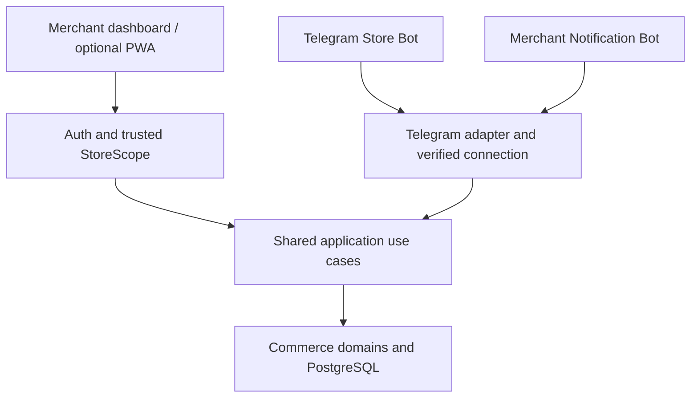

# Nokmel — Architecture Blueprint

**Version:** 1.3 · **Updated:** 27 November 2026 · **Status:** target architecture decisions; verify implementation per slice.  
**Use:** read only when the assigned task changes data, authorization, bots, orders, payments, inventory, deployments or channel behavior.

## Guardrails

- Keep one deployable **modular monolith** and one PostgreSQL database per environment. Do not add services or generic plugin/event frameworks without measured need.
- Resolve merchant access to a server-derived `StoreScope`. Never trust a browser-supplied store id, Telegram username, callback payload or unverified update as ownership proof.
- Dashboard, Store Bot and Merchant Notification Bot call the same validated commerce application use cases where the operation is shared. Transport adapters do not own commerce rules.
- Keep each store's catalog, carts, customers, orders, payments, inventory, bot connections and notifications isolated. Enforce scope in queries, writes, retries and deep links.
- Prefer additive, rehearsed migrations with explicit recovery evidence. A code rollback does not reverse a data migration.

## Target components

The target runtime is a Next.js modular monolith on Render with Neon PostgreSQL. The PWA is the dashboard's optional launch surface, not a separate backend or buyer-facing Mini App.

## Domain boundaries

- **Merchant/platform:** invitation, merchant identity, store membership, store settings and server-side feature entitlements.
- **Catalog:** product, description, images, category, availability, price and only the variants/stock model required by the pilot.
- **Commerce:** server-side cart, checkout, immutable order snapshots, inventory reservations and order events.
- **Payments:** store-level enabled methods and instructions, payment claims/reviews, provider evidence where a real provider exists. Order, payment and fulfillment statuses are separate.
- **Fulfillment:** manual preparation, shipment and delivery states; tracking reference only when entered by the merchant. No live carrier status without a carrier integration.
- **Channels:** Telegram buyer Store Bot, dashboard, and distinct merchant Notification Bot. Language, Telegram retries and callback identity stay in adapters; authorization and transitions stay server-side.
- **Support:** human contact configured by the merchant. No two-way in-app support relay in Starter.

## Hard correctness contracts

1. Recalculate product price, availability, delivery fee and store scope on the server at confirmation.
2. A successful checkout creates one order and one reservation. Idempotency and database constraints protect repeated callbacks and network retries.
3. Reservation commit/release is atomic and happens once for an allowed state transition.
4. COD at placement is awaiting collection. A submitted manual Vodafone Cash reference is a claim awaiting review, never proof of payment. Only an authorized merchant decision or authenticated provider evidence can advance payment state.
5. Failed notification delivery cannot roll back or hide a valid order. Outbox/retry behavior must be bounded and deduplicated.
6. Telegram edits preserve buyer context and receipts. Old callbacks re-read current state and cannot repeat a financial or inventory mutation.
7. Catalog content is independent of buyer UI locale. UI language changes interface text/direction only.
8. Credentials are encrypted or held in secret configuration, never returned to pages/actions or logs.

## Tiered architecture reading

- **Tier 0:** repository `AGENTS.md` only.
- **Tier 1:** `PRODUCT_BRIEF.md`, `CURRENT_STATE.md`, `ROADMAP.md`, `RELEASE_POLICY.md` for every implementation session.
- **Tier 2:** this blueprint plus only the relevant domain/UX document for the assigned capability.
- **Tier 3:** old phase handoffs and Rabet architecture/data-model documents for historical evidence only. Do not use them as current product scope or deployment instruction.

Before changing an established boundary, inspect the current code and tests and state `KEEP / REFACTOR / REWRITE / DELETE / BUILD` for the affected part. Do not restart a working flow or preserve an incorrect contract because of sunk cost.
