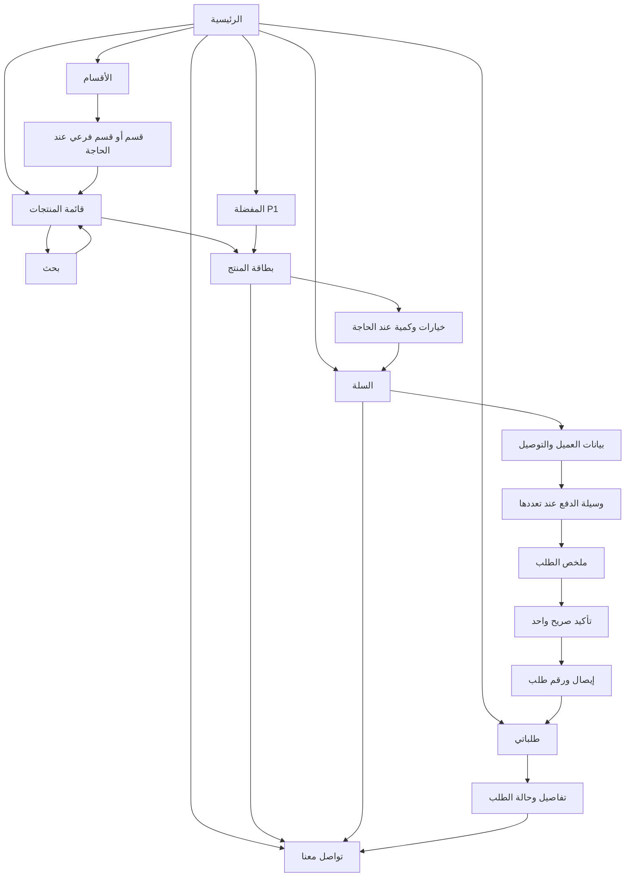
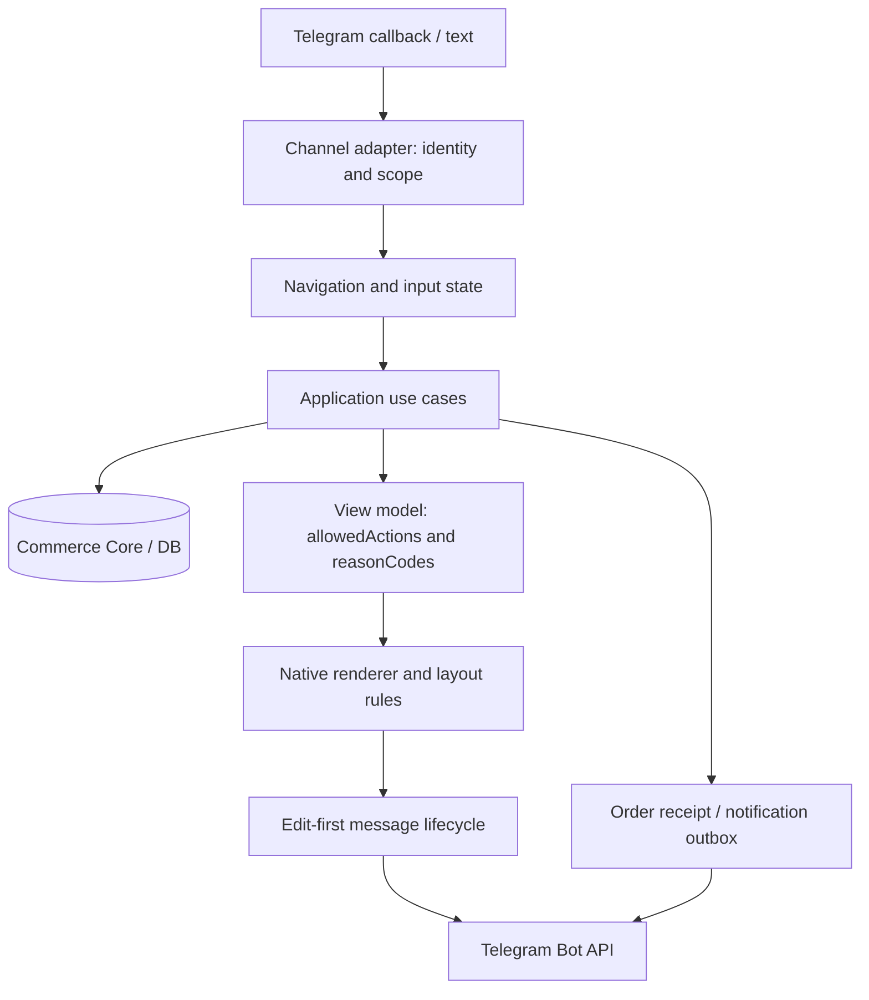
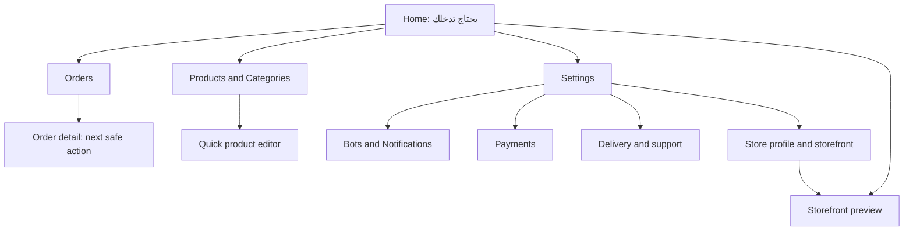

# نكمل | Nokmel — Storefront & Merchant UX Design System

**الإصدار:** 1.1 — 27 نوفمبر 2026 | **الحالة:** معتمد كمرجع P0 لتجربة أول إطلاق. التعديلات في الكود والنشر ما زالت تتطلب مساراتها وموافقاتها المعتادة.

## 1. الهدف والمرجعية

نكمل منصة تجارة حوارية Telegram-first، Invite-only في Starter، لتاجر يستطيع إدارة متجره من الهاتف ومشترٍ يستطيع إتمام الطلب دون حساب إضافي أو ذكاء اصطناعي إلزامي. هذه الوثيقة تفصّل تجربة الاستخدام ولا تستبدل قواعد التجارة أو الأمان.

المرجع: Final Product Strategy v2.5 §§6،9B–9D،9F–9I،9L،9N؛ Architecture Blueprint v1.2 §§7–8C؛ Discovery & MVP v1.2 §§6–6C،10؛ وسياسة النشر الخاصة بالمشروع. عند التعارض يُرفع القرار لصاحب المنتج قبل التنفيذ. حالة الكود الحالية تُراجع في `CURRENT_STATE.md` ولا تثبتها هذه الوثيقة.

## 2. عقد UX موحد

- Edit-first not Send-first: التنقل وتغيير الكمية والاختيارات لا تنتج رسائل جديدة إذا كان التعديل ممكنًا. الهدف صفر رسائل بوت إضافية في التنقل العادي بعد إنشاء الواجهة.
- Buttons-first للخيارات المحددة، والنص الحر للبحث والبيانات التي يسهل كتابتها. لا أوامر إجبارية ولا حوار مصطنع.
- إجراء رئيسي واحد واضح لكل حالة؛ رجوع حقيقي مع حفظ السياق؛ الرئيسية والسلة والدعم عند الحاجة.
- لا حذف لضمانات المخزون والدفع والتفويض والتأكيد النهائي لتقليل الضغطات.
- العربية RTL والإنجليزية LTR، نص قصير، لا الاعتماد على اللون وحده، دعم الوضع الليلي والتباين. تجنب الرسوم التزيينية التي تزاحم الوظيفة.
- حفظ المسودات والسلة وإظهار نتيجة الحفظ الحقيقية؛ رسائل الخطأ تحدد الإجراء التالي؛ لا نجاح وهمي عند انقطاع الشبكة.

## 3. تصميم واجهة المشتري في Telegram

### 3.1 الرئيسية — Store Welcome Card

Photo Message + Caption + Inline Keyboard. صورة اختيارية من التاجر، عنوان ترحيب قصير، وصف مختصر ومعلومات توصيل/دفع صحيحة فقط. عند غياب الصورة، رسالة نصية أو صورة افتراضية مناسبة حسب القالب المعتمد. لا نطلب من التاجر تصميم الأزرار.

```text
[ صورة غلاف المتجر ]
أهلًا بك في متجر نور
تسوق بسهولة — الدفع عند الاستلام متاح (إن كان مفعّلًا)
[           تصفح المنتجات           ]
[           تصفح الأقسام            ]
[ سلتي (2)         ][ المفضلة       ]
[ طلباتي           ][ تواصل معنا   ]
```

المفضلة جزء من IA المستهدفة؛ P1 مقترح ولا يظهر الزر قبل توفر الميزة. الأقسام تظهر عند وجود أقسام منشورة قابلة للتصفح. الدعم البشري P0 بمسار صالح، وبديل واضح عند تعذره؛ ليس صندوق محادثات مدمجًا. البحث P0 بحسب الاستراتيجية، متاح من تصفح المنتجات أو أمر اختياري. لا نضيف شاشة لغة إجبارية قبل التسوق؛ اعتماد اللغة المتاحة مع إمكانية تغييرها.

### 3.2 خريطة التنقل



الخريطة تبين المسارات الممكنة لا إجبار المستخدم على كل خطوة. كل شاشة فرعية تعيد المستخدم إلى سياقه السابق، والقائمة الرئيسية قابلة للوصول؛ السلة لا تضيع عند الرجوع أو الدعم. رابط منتج مباشر يفتح البطاقة دون المرور بالقوائم.

### 3.3 مواصفات الشاشات

| الشاشة | المحتوى | الإجراء الرئيسي | إجراءات ثانوية وسلوك |
|---|---|---|---|
| المنتجات | دفعة صغيرة من الأسماء والأسعار المتاحة، مؤشر صفحة | فتح منتج | بحث، السابق/التالي، السلة، رجوع؛ تحديث نفس الرسالة |
| الأقسام | الأقسام المنشورة فقط | فتح قسم | أقسام فرعية عند وجودها، عرض منتجات القسم، رجوع للأب |
| المنتج | صورة، اسم، سعر وعملة، توفر، وصف موجز | أضف للسلة | خيارات ومقاسات إن وجدت، كمية −/عدد/+، صور أخرى، اسأل البائع، مفضلة P1، رجوع |
| السلة | بنود وكميات وأسعار وإجمالي، توصيل معروف أو موضح أنه غير محدد | إتمام الطلب | تعديل كمية أو حذف بند، متابعة التسوق، الدعم؛ تأكيد إفراغ السلة |
| المفضلة P1 | منتجات محفوظة لنفس المتجر والمشتري | فتح المنتج | إزالة وإضافة بعد تحقق الخيارات والتوفر |
| بيانات الطلب | أقل حقول لازمة، بيانات سابقة عند توفرها بموافقة العميل | متابعة | تصحيح/رجوع، حفظ مسودة، مشاركة الهاتف عبر Reply Keyboard عند الحاجة مع بديل يدوي |
| التوصيل | عنوان ومنطقة ورسوم أو تقدير واضح | متابعة | تعديل دون فقد البيانات |
| الدفع | الوسائل المفعلة والمدعومة فقط | اختيار | إذا وسيلة واحدة تدمج في المراجعة؛ لا ادعاء دفع قبل التحقق |
| المراجعة | بنود، شحن، مبلغ نهائي إن كان معروفًا، وسيلة الدفع، بيانات العميل | تأكيد الطلب | تعديل البيانات والسلة دون إعادة الإدخال |
| النجاح | رقم الطلب والحالة الفعلية | متابعة الطلب | العودة للمتجر، اسأل البائع؛ إيصال مستقل غير قابل لإعادة الاستخدام كواجهة تصفح |
| طلباتي | أحدث طلبات المشتري في المتجر نفسه | تفاصيل الطلب | صفحات عند الحاجة، الحالة الفعلية لا تتبع حي مزعوم |
| الدعم | رابط بشري مصرح به، مرجع منتج/طلب آمن | اسأل البائع | رجوع للسياق، لا تمرير هاتف أو عنوان لرابط عام |
| فارغ/خطأ | سبب مختصر وخطوة تعافٍ | إعادة محاولة أو تصفح | رجوع آمن، عدم مضاعفة العملية |

في بطاقة المنتج يمكن تعديل الكمية والأزرار فقط، وعند تغير صورة المنتج يتم تعديل الوسائط. لا إرسال إشعار محادثة منفصل لكل إضافة للسلة؛ إشعار قصير من callback أو مؤشر ضمن البطاقة بعد نجاح العملية. لا إجبار على فتح السلة بعد الإضافة.

## 4. عقد Active Storefront Message — أساسي

لكل سياق محادثة خاصة (store + bot + chat + buyer) واجهة نشطة واحدة منطقيًا، مع فصل سجل الطلبات والإشعارات. لا نفترض إمكانية تثبيت موضع الفقاعة على شاشة العميل أو إزالة كل رسائل الإدخال. واجهة نصية أو وسائط حسب نوع الشاشة؛ لا تحويل قسري غير مدعوم.

| الحدث | سلوك Telegram adapter |
|---|---|
| أول دخول أو لا توجد واجهة صالحة | sendPhoto أو sendMessage مرة واحدة؛ حفظ message_id |
| تغيير الأزرار فقط | editMessageReplyMarkup |
| تغيير النص في رسالة نصية | editMessageText مع الأزرار عند الحاجة |
| تغيير وصف صورة | editMessageCaption مع الأزرار عند الحاجة |
| تغيير صورة | editMessageMedia مع الوصف والأزرار الملائمة |
| ضغط زر callback | answerCallbackQuery سريعًا؛ لا نجاح قبل نجاح العملية التجارية |
| حالة العرض لم تتغير | لا تعديل زائد؛ message not modified يعامل وفق النتيجة الفعلية |
| انتقال بين نوعي رسالة | تعديل إذا مدعوم في النسخة المستخدمة؛ وإلا استبدال مضبوط برسالة واحدة وتعطيل أزرار القديمة إن أمكن |
| رسالة حُذفت/غير قابلة للتعديل | استعادة الواجهة برسالة واحدة فقط تحت قفل/تسلسل مناسب؛ لا إرسال أعمى لكل خطأ |
| timeout أو rate limit | retry محدود مع backoff واحترام retry_after؛ لا fallback إرسال متكرر عند نتيجة مجهولة |
| طلب هاتف/عنوان/بحث | prompt مناسب ومدخل المستخدم؛ إزالة Reply Keyboard المؤقتة بعد الحاجة؛ لا إعادة كل القوائم |
| تأكيد طلب أو تغير مهم | رسالة إيصال/إشعار مستقلة لا تستبدلها عملية التصفح؛ منع تكرارها منطقيًا |
| زر في رسالة قديمة | تحقق من الهوية والسياق والإصدار؛ رفض العملية القديمة أو استئناف آمن دون إعادة تنفيذ شراء |

حالات مهمة: ضغط متكرر/متزامن، رد متأخر، إعادة تشغيل الخدمة، تبديل لغة، العودة من دعم، انتهاء جلسة، فقدان رسالة، فشل حفظ، عدم توفر صورة. لا يمكن ضمان exactly-once لإرسال Telegram عند timeout مبهم؛ نضمن عدم تكرار mutation التجارية، ونقلل تكرار العرض بمصالحة الحالة وعدم إعادة الإرسال بلا ضابط.

### 4.1 تصميم هندسي مرجعي (داخل modular monolith)



الحد الأدنى المنطقي لحالة العرض: activeMessageId، route، context (category/page/query/product)، back context، input mode، revision وrender fingerprint عند الحاجة. هذه أسماء مقترحة وليست schema مفروضًا. السلة والطلبات والدفع والمخزون مصدرها قاعدة البيانات وليس callback أو widget. callbacks قصيرة ضمن حد API (1–64 bytes)؛ لا بيانات شخصية فيها؛ تحقق خادمي لكل action من المتجر والمشتري والصلاحيات والحالة. تسلسل/إصدار يمنع أن يكتب render أقدم فوق الأحدث. استخدم idempotency لمعاملات الطلب، ومنع السباقات للكمية والمخزون. لا cache لبيانات متجر آخر؛ لا إعادة بناء عامة قبل audit.

## 5. لغة تصميم Telegram

صف كامل للإجراء الرئيسي؛ صفان/زرّان للإجراءات الثانوية حسب طول النص؛ ثلاثة عناصر للكمية. Primary أزرق للإجراء الرئيسي العام، Success أخضر للشراء/التأكيد، Danger أحمر للإجراءات المدمرة، Default للثانوي. دعم style وفق API/العميل مع fallback افتراضي؛ اللون ليس حامل المعنى الوحيد. لا تحكم دقيق في عرض/ارتفاع/خط الزر أو الثيم. صورة غلاف مقترحة 16:9 وصورة منتج دون قص معلومات مهمة؛ نسب الصور إرشادية وليست فرضًا على التاجر. Caption محدود حسب API؛ لا وصف مطوّل يزاحم الإجراء.

## 6. واجهة التاجر — Mobile-first Dashboard + PWA

### 6.1 IA المقترحة



اقتراح Mobile bottom navigation: الرئيسية، الطلبات، المنتجات، المزيد (الإعدادات والدفع والواجهة والأقسام من المنتجات). على Desktop نفس IA في sidebar؛ لا مسارات وظيفية مختلفة. إشعار التاجر يفتح طلبًا مصرحًا به مباشرة ولا يجبره على البحث عنه. لا نفترض تعديل الواجهة الحالية قبل فحصها.

### 6.2 الرئيسية — Exception-first

```text
نكمل                          [المتجر]
يحتاج تدخلك
[ 3 طلبات تنتظر القبول  > ]
[ 1 تحويل يحتاج مراجعة  > ]
[ عنوان يحتاج استكمالًا > ]
[ + إضافة منتج ]  [ معاينة المتجر ]
حالة الربط: بوت المتجر / الإشعارات
الرئيسية | الطلبات | المنتجات | المزيد
```

أولوية الحالات حسب قواعد العمل الفعلية: طلب يحتاج قبولًا، تحويل يحتاج مراجعة، عنوان ناقص، تعارض مخزون، إلغاء يحتاج تسوية. لا عدادات تزيينية ولا analytics متقدمة للإطلاق. كل بطاقة تقود إلى قائمة مفلترة أو إجراء موثوق. لا تظهر حالة غير مدعومة كأنها تعمل.

### 6.3 إعداد المتجر وعمليات التاجر

| المسار | عقد UX |
|---|---|
| Onboarding | دعوة ← ملف المتجر ← أول منتج ← ربط Store Bot ← معاينة/اختبار ← نشر. استكمال المسودة، مؤشر تقدم عند الحاجة، لا خطوات زائدة. الإشعارات اختيارية ولا تعطل الطلبات |
| المنتجات | قائمة بطاقات على الهاتف، بحث، سعر ومخزون وإتاحة، تعديل سريع. نموذج مختصر: صورة، اسم، سعر، قسم، مخزون/إتاحة؛ وصف وخيارات وصور أخرى وترجمات تحت المزيد. Draft افتراضي حتى الأهلية والنشر الصريح |
| الأقسام | إنشاء وتعديل وترتيب وأرشفة آمنة؛ لا عمق إجباري؛ أثر تعطيل القسم على المنتجات واضح |
| الطلبات | فلاتر الحالة الفعلية، بطاقة بها الرقم والوقت والإجمالي وحالة الدفع والتنفيذ والإجراء التالي |
| تفاصيل الطلب | سطر واحد للمهمة الرئيسية، بنود وبيانات توصيل ودفع منفصلان، سجل تدقيق. قبول/رفض، تجهيز، شحن، تسليم، تسجيل التحصيل، إلغاء بسبب؛ وفق allowedActions فقط |
| المدفوعات | COD ليس Paid عند الإنشاء؛ تحويل يدوي لا يعتبر مدفوعًا من صورة؛ روابط الدفع مشروطة بتكامل مثبت؛ تأكيدات المخاطر لا تُحذف |
| Storefront | إعداد الهوية والترحيب واللغة والدعم، معاينة فعلية حسب إمكانات Telegram، حفظ/نشر واضح؛ لا محرر flow معقد |
| Bots | بطاقتان منفصلتان Store Bot وNotification Bot، حالة اتصال وفحص وتعافي؛ الربط بالتوكن للإشعارات حسب مرجع Starter، وأي توسع Managed يحتاج اعتماد نطاقه |
| PWA | تثبيت اختياري، نفس الصلاحيات ومسارات الويب، رابط آمن من إشعار، لا كتابة offline أو كاش حساس |

### 6.4 Interaction design للـDashboard

- حفظ في المكان نفسه مع feedback وعدم إعادة تحميل الصفحة الكاملة بلا داعٍ؛ لا فقد للـdraft أو تغير scroll عند refresh. تحديث قائمة/بطاقة بعد نجاح الخادم فقط، مع حماية ضد نتائج متأخرة وتعارض تعديلات.
- CTA رئيسي ظاهر قابل للوصول بالإبهام ولا يغطيه keyboard؛ حقول بأنواع إدخال مناسبة، validation بجانب الحقل، عدم محو المدخلات عند الخطأ. تأكيد للعمليات الحساسة فقط.
- حالات موحدة loading/saving/saved/error/empty/offline، لا شاشة فارغة أثناء التحميل؛ إظهار سبب منع الإجراء.
- أهداف تصميم مقترحة للويب: touch targets 44–48 CSS px حيث أمكن، تباين WCAG AA، مسافات منتظمة 4/8/12/16/24؛ دعم RTL الحقيقي. ألوان نكمل من نظام الهوية المعتمد بعد تدقيقه، لا اختراع palette جديدة هنا.
- دعم الرجوع واستئناف المهمة، روابط عميقة store-scoped، لا إظهار بيانات حساب سابق، وdesktop تحسين عرض لا شرط تشغيل.

## 7. التخصيص: التاجر مقابل نكمل

| العنصر | الملكية والحدود |
|---|---|
| اسم المتجر/شعار/غلاف/ترحيب/وصف | محتوى التاجر ضمن قيود Telegram والتحقق |
| منتجات وصور وأسعار وأقسام وترتيبها | التاجر ضمن الصلاحية وقواعد النشر |
| اللغة والعملة | إعداد التاجر ضمن المدعوم؛ اختيار اللغة للمشتري حيث متاح |
| وسائل دفع وتوصيل ورسوم ودعم وسياسات | إعداد التاجر ضمن إمكانيات صحيحة ومعتمدة |
| ظهور قسم أو مفضلة | محسوب من البيانات والـentitlements؛ toggle للمفضلة عند تنفيذها P1 |
| اختيار قالب عرض إضافي | مستقبل مشروط بأدلة؛ لا محرر حر في Starter |
| ترتيب الإجراءات الرئيسية ومعنى الألوان والرجوع | ثابت من نكمل |
| عرض السعر والعملة والحالة، checkout، الأخطاء | ثابت من نكمل مع تكيف حسب المهمة والوسائل المتاحة |
| التفويض والمخزون والدفع وإنشاء الطلب | ثابت خادميًا وغير قابل لتجاوز التاجر |

## 8. Widgets / Rich Messages / Mini App

Native Telegram هو baseline. لا تعتمد وظائف الشراء الأساسية على Widgets. Widgets اسم ملتبس بين مكونات الرسائل وTelegram web widgets؛ يلزم إثبات API ونسخة العميل عمليًا قبل اعتماد أي ادعاء بقدراتها. إن كانت مكونات رسائل تفاعلية متاحة، ففوائدها المحتملة: كمية وخيارات أكثر سلاسة، حالة مرئية وتفاعل محلي؛ المخاطر: توافق وإصدارات وقيود حجم/شبكة/مدخلات، تكلفة QA وصيانة، فقد السياق. لا أرقام حدود غير متحققة في هذا المرجع. Rich Messages كذلك تجربة اختيارية بعد إثبات دعمها. Mini App واجهة منفصلة مستقبلية للكتالوجات الكبيرة؛ تشارك نفس use cases والسلة والطلبات، ولا تعيد كتابة Commerce Core. اختبار صغير على Staging + native fallback + مقارنة نجاح المهمة قبل قرار تبنّي أي تقنية.

## 9. خطة التنفيذ والقبول

**P0 المعتمد لأول إطلاق:** audit للواجهات الحالية ومسارات send/edit، توحيد render lifecycle، الرئيسية والمنتجات والأقسام والبحث وبطاقة المنتج والسلة وcheckout وطلباتي والدعم البشري؛ تجربة التاجر وإجراءات Needs Attention وPWA ضمن النطاق المعتمد. نفّذ P0 في دفعات مترابطة، مع التحقق من الموجود قبل إعادة بنائه. **P1 المؤجل:** المفضلة والتصفية المتقدمة ومعارض إضافية حسب الحاجة؛ استكشاف Widgets مستقل. **لاحقًا:** Mini App وMeta وLLM وغيرها وفق الاستراتيجية.

| اختبار | شرط القبول |
|---|---|
| الرئيسية → قسم → منتج → التالي → كمية → رجوع | صفر رسائل بوت جديدة للتنقل عندما يكون التعديل ممكنًا، ونفس message_id في الانتقالات المتوافقة |
| عشر ضغطات كمية متتابعة | قيمة نهائية صحيحة بلا lost update أو رسائل جديدة أو render قديم |
| تغيير النص/الأزرار/الصورة | استخدام طريقة edit الملائمة؛ لا رفع صورة من جديد دون حاجة |
| حذف الرسالة أو عدم قابلية التعديل | استعادة واحدة مضبوطة؛ الأزرار القديمة لا تنفذ عمليات خطرة |
| timeout/rate limit/restart | لا تكرار order أو cart mutation لنفس العملية؛ لا spam؛ تعافٍ واضح |
| بحث بدون نتائج / سلة فارغة / نفاد مخزون | طريق تعافٍ واضح بلا dead end |
| العودة من الدعم / إغلاق التطبيق | استرجاع السلة والسياق المسموح، لا تسريب متجر آخر |
| checkout وCOD | ملخص واضح وتأكيد صريح واحد؛ رقم طلب واحد؛ حالة غير Paid؛ إيصال منفصل |
| تاجر يضيف منتجًا ويعدل سعره | لا فقد draft، حفظ حقيقي، لا reload غير لازم، صلاحيات صحيحة |
| تاجر يقبل/يلغي/يشحن/يسلم | next action مطابق لحالة الخادم وسجل تدقيق؛ لا ضغط متكرر يكرر العملية |
| الهاتف | Android فعلي Telegram + dashboard browser/PWA، RTL/LTR، شبكة ضعيفة وkeyboard؛ لا CTA مقصوص |
| العزل | متجران ومشتريان، callbacks قديمة وروابط عميقة، لا وصول أو تعديل عابر للحدود |

اختبارات unit/integration وCI وdesktop/browser automated أولًا وبالتوازي مع تطوير slices؛ اختبارات Telegram الحقيقية وAndroid/PWA منفصلة حسب سياسة تسريع العمل، لكنها تبقى بوابة إطلاق عند الحاجة بحسب وثائق المشروع. لا تعتبر محاكاة المتصفح بديلًا كاملًا عن Telegram الحقيقي. لا merge أو migration أو نشر Production بموجب هذه الوثيقة؛ سياسة النشر والموافقات قائمة.

### القياس

مقاييس المشتري: نجاح المهمة، زمن إتمامها، عدد الرسائل الجديدة لكل تنقل، الضغطات المكررة، حقول الإدخال، أخطاء/استعادة، نجاح الدعم وبقاء السلة، ترك checkout. مقاييس التاجر: زمن إضافة منتج/قبول طلب/مراجعة تحويل/شحن/استفسار، فقد مسودة، تبديل التطبيقات، نجاح الهاتف فقط. baseline أولًا ثم أهداف قابلة للقياس؛ لا ادعاء uplift دون Pilot. سجلات مختصرة بلا هاتف/عنوان/توكن. تجربة 5–8 مشترين على الأقل كعينة استكشافية بحسب مرجع Discovery، لا عينة إحصائية.

## 10. المراجع وملاحظات القرار

- Telegram Bot API: https://core.telegram.org/bots/api — sendPhoto, editMessageText, editMessageCaption, editMessageMedia, editMessageReplyMarkup, answerCallbackQuery.
- Telegram Bot Features: https://core.telegram.org/bots/features — inline keyboards and editing.
- Telegram Bot Guidelines: https://core.telegram.org/bots/guidelines — قوائم وتنقل بلا رسائل جديدة.
- مبادئ UX المشار إليها في استراتيجية المشروع: Baymard checkout/product discovery، NN/g progressive disclosure؛ ليست إثباتًا لتحسن Nokmel.
- قرارات UI صغيرة مثل ترتيب الأزرار الثانوية وتوزيع mobile nav تُحسم أثناء تنفيذ الشريحة مع الحفاظ على P0. المفضلة P1. لا تُختبر Widgets إلا كتجربة مستقلة. هذا التصميم يحدد الهدف ولا يمثل حالة تنفيذ مؤكدة.


### قرار واعتماد 27 نوفمبر 2026

اعتمد صاحب المنتج أن يقدم أول إطلاق تجربة Telegram Storefront وMerchant UX الواردة هنا ضمن P0، مع فصل قبول الويب عن قبول تثبيت PWA على جهاز فعلي. اختبارات desktop/browser وTelegram Web تسبق العمل اليومي لكل PR. اختبارات الجهاز الفعلي موثقة منفصلة، ولا توقف التطوير أو مراجعة الدمج. لا يعني الاعتماد أن كل بند منفذ، ولا يرفع المفضلة أو أي بند P1 إلى نطاق الإطلاق.
