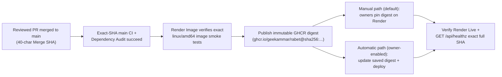

# Rabet — Render Image Deployment & Cutover Runbook

> **Scope:** Single-store Rabet runtime (`geekammar/Rabet`) deployed as an **immutable GHCR container image** on a **Render Starter Web Service** in **Ohio (`us-east`)** inside the owner's **Hobby** workspace, connected to the existing **Neon `Rabet_prod`** PostgreSQL database and Telegram bot.
>
> **Separation of Concerns:** GitHub Actions builds, smoke-tests, and publishes immutable `linux/amd64` images to GitHub Container Registry (`ghcr.io`). Render runs the reviewed `@sha256:...` digest directly (`node server.js`) with **no** `npm install`, compilation, or database migrations at container startup.
>
> **Automation is off by default.** The existing manual publish path is unchanged. Automatic main-branch release + Render promotion exists in the workflow but is disabled until the owner sets the repository variable `RABET_AUTO_DEPLOY_ENABLED=true` after Checkpoint B and PR review. When enabled, the Render API key is available only to the `deploy-render` job through the protected `render-production` environment; no Render credential is visible to build, test, or GHCR publication jobs.

---

## 1. End-to-End Provenance: Merge SHA → GHCR Digest → Running Render Digest

Every production candidate follows an auditable three-link chain:



### Step 1 — Record the Verified `main` Merge SHA

1. Merge the reviewed PR into `main` on GitHub.
2. Record the exact 40-character commit SHA on `main`:
   ```bash
   git fetch origin main
   git rev-parse origin/main
   ```
3. Confirm all three required workflows succeeded on `main` for that exact SHA:
   - **CI** (`.github/workflows/ci.yml` — `push` event on `main`) — `verify`, `db`, `browser`, and `baseline-touch` all `success`.
   - **Dependency Audit** (`.github/workflows/audit.yml` — `push` event on `main`) — production dependency gate `clean` (`0` vulnerabilities) and full-tree validation `success`.
   - **Render Image** (`.github/workflows/render-image.yml` → `verify-image` job) — `success`.

### Step 2 — Manually Publish the Immutable Image to GHCR

1. Open **GitHub → Actions → Render Image → Run workflow**.
2. Set:
   - **Use workflow from:** `Branch: main`
   - **`expected_sha`:** paste the exact 40-character `main` commit SHA.
   - **`confirm`:** type `PUBLISH_RENDER_IMAGE` (exact match).
3. Before granting `packages: write`, the workflow (`prepare-release` + `scripts/ghcr-release-gate.mjs`) automatically enforces:
   - `GITHUB_EVENT_NAME == "workflow_dispatch"` and `GITHUB_REF == "refs/heads/main"`.
   - Checked-out `HEAD` equals `expected_sha` **and** matches current `origin/main` (stopping stale releases).
   - The latest `push` run of **`CI` (`ci.yml`)** on `main` for `expected_sha` completed with `conclusion == "success"`.
   - The latest run of **`Dependency Audit` (`audit.yml`)** on `main` for `expected_sha` completed with `conclusion == "success"`.
   - The exact `linux/amd64` image passes the full container smoke-test suite (`scripts/test-container-smoke.mjs`).
   - Immediately before registry access, `origin/main` is checked a second time so a release superseded mid-run stops cleanly.
   - **Idempotent retry protection:** `publish` inspects `ghcr.io/geekammar/rabet:sha-<expected_sha>` via the GHCR OCI v2 API before pushing, distinguishing a genuine missing tag (`404 NAME_UNKNOWN` / `MANIFEST_UNKNOWN`) from registry authentication (`401`/`403`) or network/`5xx` errors. If `sha-<expected_sha>` already exists, it cryptographically verifies `linux/amd64`, `org.opencontainers.image.revision`, `org.opencontainers.image.source`, and `RABET_BUILD_SHA` and reuses the existing `@sha256:...` digest **without overwriting the tag** (or fails closed on any provenance mismatch).
4. Copy the emitted **Immutable GHCR Digest Reference** from the workflow run summary:
   ```text
   ghcr.io/geekammar/rabet@sha256:<64-hex-digest>
   ```
   *(Always deploy by `@sha256:...` digest, never by a mutable tag. Previous `sha-<commit>` tags and `@sha256:...` digests remain retained in GHCR for rollback.)*

### Step 3 — Promote the Digest on Render and Verify Running Identity

1. In the [Render Dashboard](https://dashboard.render.com), select the Rabet Web Service (or create it per §2 below).
2. Paste the exact `ghcr.io/geekammar/rabet@sha256:<64-hex-digest>` reference into **Image URL** and save/deploy.
3. Once Render reports the deploy **Live**, verify both:
   - **Render Dashboard → Events / Settings:** deployed image matches the exact `@sha256:<64-hex-digest>`.
   - **HTTP Liveness Probe:** `GET https://<origin>/api/healthz` returns HTTP `200` with:
     ```json
     {
       "status": "ok",
       "sha": "<exact-40-char-merge-sha>"
     }
     ```

---

## 1A. Automatic Main-Branch Release (Owner-Activated, Off by Default)

Automatic release uses the same `prepare-release` and `publish` jobs as the manual path, plus a final `deploy-render` job. It is disabled unless the repository variable **`RABET_AUTO_DEPLOY_ENABLED`** is exactly `true`. Pull-request runs only build and smoke-test; they never publish or deploy.

### 1A.1 Release sequence for a push/merge to `main`

1. `release-gate-tests` runs the GHCR, Render, and workflow-contract fixtures (`tests/ghcr-release-gate.test.ts`, `tests/render-deploy-gate.test.ts`, `tests/render-image-workflow.test.ts`).
2. `verify-image` builds and smoke-tests the PR/main image without publication permissions.
3. `prepare-release` resolves `github.sha`, verifies it is still current `origin/main`, then **waits** for the exact-SHA `push` CI run and Dependency Audit run to complete successfully. Missing, failed, canceled, or timed-out gates fail closed. After the gates pass it re-checks `origin/main`, builds the release image, runs the existing container smoke suite, and uploads the verified archive.
4. `publish` re-checks `origin/main`, publishes or reuses the immutable `sha-<SHA>` GHCR tag, verifies provenance, and emits the final `@sha256:...` manifest digest plus the linux/amd64 **image config digest** used by Render for its resolved `image.sha`.
5. `deploy-render` re-checks `origin/main` again. On the automatic path it first reads the **currently live revision** from `/api/healthz` and compares migration inputs (`drizzle/**`, `drizzle.config.ts`) between that live SHA and the verified SHA. It blocks automatic promotion if migrations differ or the live revision/comparison cannot be established. It then:
   - reads the existing Render service and refuses anything other than the configured image-backed `web_service`;
   - updates the service's **saved image reference** (`PATCH /v1/services/{serviceId}` → `image.imagePath`) to the immutable digest;
   - deploys that same digest with `POST /v1/services/{serviceId}/deploys` → `imageUrl`;
   - polls `GET /v1/services/{serviceId}/deploys/{deployId}` until `live`, verifies the deploy's **pinned `image.ref`** exactly and cross-checks Render's resolved `image.sha` against the GHCR config/manifest digest, then polls `GET /api/healthz` until it returns the exact full 40-character SHA;
   - fails the run if Render fails, the deploy is superseded/canceled, the pinned reference or resolved image differs, the health SHA differs, migration inputs changed, or `origin/main` moves before promotion.

The workflow writes a **success summary only after** the Render deploy is Live and `/api/healthz` matches. A failed or stale run writes a failure summary and exits non-zero.

### 1A.2 Why both the live digest and the saved image reference are updated

Render's official documentation distinguishes the two references:

- Triggering a deploy with an `imageUrl` uses that image **for that deploy**, but [future manual deploys continue to use the image stored in the service settings](https://render.com/docs/deploying-an-image#triggering-a-deploy). Updating only the live deploy would let a later dashboard **Deploy latest reference** silently redeploy an older saved tag.
- [Update service](https://api-docs.render.com/reference/update-service) accepts an `image` object (`ownerId`, `imagePath`, optional `registryCredentialId`) and its documentation states that configuration changes are **not deployed automatically**. Therefore the workflow updates the saved reference first, then explicitly triggers the deploy with the same digest.

Render's deploy object also exposes two different fields, confirmed against the live service response and the [Retrieve deploy](https://api-docs.render.com/reference/retrieve-deploy) contract:

- `image.ref` is the image reference used for that deploy. Because this workflow always passes an immutable `@sha256:<manifest digest>` reference, it must match that pinned reference exactly.
- `image.sha` is the SHA Render resolved the image to. A real live deploy returned `image.ref` pinned to the GHCR manifest digest (`8bd590f2…`) while `image.sha` was the pulled image ID/config digest (`7f2fa1b2…`). They are **not required to be equal**. The helper therefore treats `image.ref` as authoritative, rejects a missing/wrong pinned reference, and cross-checks `image.sha` against the GHCR manifest config digest (or the manifest digest) emitted by `publish`.

**Saved reference vs live deploy:** restoring the saved image reference after a failed promotion only changes what a *future* manual deploy will pull. It does **not** revert the container that is already Live. Reverting Live requires deploying or rolling back the previous digest and verifying `/api/healthz`, as in §6.3. Canceling a pending deploy similarly prevents a new rollout; it is not a rollback of the current Live container.

Official mechanism references:

- [Deploy a prebuilt Docker image](https://render.com/docs/deploying-an-image)
- [Update service](https://api-docs.render.com/reference/update-service)
- [Trigger deploy](https://api-docs.render.com/reference/create-deploy)
- [Retrieve deploy](https://api-docs.render.com/reference/retrieve-deploy)
- [Cancel deploy](https://api-docs.render.com/reference/cancel-deploy)

If a promotion fails after the saved reference was changed, `scripts/render-deploy-gate.mjs` restores the previous saved image reference **only if the saved reference is still the one this run wrote**. It never overwrites a newer reference written by another run. The previously live container is left in place by Render's zero-downtime failure behavior; if a bad image did reach Live, use the manual rollback procedure in §6.3.

### 1A.3 Stale and overlapping runs

- The workflow-level concurrency group `render-image-release-main` serializes push and manual release runs; `cancel-in-progress` is `false` so an in-flight Render deploy is not abruptly canceled by GitHub.
- `origin/main` is re-checked before release gates, after gates, before GHCR publication, before Render mutation, and before the deploy request. A run whose SHA is no longer current `origin/main` stops without promoting.
- While a Render deploy is pending, the helper re-checks `origin/main`; if it moved, the helper calls the Render cancel-deploy endpoint and fails with `STALE_MAIN`. A deploy that has already become `deactivated` (superseded by another deploy) fails as well.
- Render itself allows only one deploy per service at a time. Keep the workspace **Overlapping Deploy Policy** on **Wait** (recommended for workspaces created on/after 2025-07-14) or confirm the owner's policy before enabling automation. See [Handling overlapping deploys](https://render.com/docs/deploys#handling-overlapping-deploys).
- A completed successful Render deploy for the exact then-current main SHA is not retroactively failed if main moves afterward; the newer main run is serialized after it and will promote the newer SHA.

### 1A.4 Manual path remains available

Manual **Render Image → Run workflow** still requires `expected_sha` plus `PUBLISH_RENDER_IMAGE`, publishes exactly as before, and does **not** deploy by default. Set the optional `deploy_to_render` boolean to `true` only when the owner intentionally wants that manual run to use the same Render pinned-digest/Live/health verification. The manual promotion path deliberately skips the automatic migration comparison; the owner is responsible for the separate migration procedure first.

Automatic release performs **no database migration, backfill, Telegram change, or admin credential change**. On automatic promotion the helper compares `drizzle/**` and `drizzle.config.ts` between the verified SHA and the currently live SHA; any difference, or an unknown/unreachable live revision, blocks automatic promotion. A release that requires a production schema change must stay under the existing manual Neon migration procedure (`neon-prod-migrate.yml`: inspect → record restore point → migrate), followed by the owner-approved manual release path.

---

## 2. Render Web Service & GHCR Registry Configuration

Reference: [Render — Deploying an Image](https://render.com/docs/deploying-an-image)

### 2.1 Service Settings

| Setting | Value | Rationale |
| --- | --- | --- |
| **Workspace** | Owner's **Hobby** workspace | Confirmed account & credit target |
| **Service Type** | **Web Service** → **Deploy an existing image from a registry** | Runs prebuilt GHCR image; no source build on Render |
| **Region** | **Ohio (`us-east`)** | Target region near `us-east` Neon `Rabet_prod` |
| **Instance Type** | **Starter** (1 instance) | Persistent container with zero spin-down cold starts so Telegram webhooks respond well within deadline |
| **Image URL** | `ghcr.io/geekammar/rabet@sha256:<digest>` | Pinned immutable digest from GitHub Actions summary |
| **Port / Host** | Default `PORT=10000` (injected by Render), bound to `0.0.0.0` | `Dockerfile` sets `HOSTNAME=0.0.0.0` and `CMD ["node", "server.js"]`, which respects any Render-supplied `PORT` |
| **Start Command** | *(Leave blank — use image default)* | Runs `node server.js` as non-root user `nextjs` (`1001:1001`); zero install, build, or migration on boot |
| **Health Check Path** | `/api/healthz` | Returns `200 OK` (`Cache-Control: no-store`) without contacting Neon or Telegram |
| **Auto-Deploy** | **Off / Manual digest promotion** | Every deploy promotes a reviewed `@sha256:...` digest |

### 2.2 GHCR Registry Access

1. **First-push package visibility:** Even when the GitHub repository (`geekammar/Rabet`) is public, GitHub Container Registry creates new personal container packages (`ghcr.io/geekammar/rabet`) as **Private** by default on first push.
2. **Recommended setup (keep GHCR package Private + read-only credential on Render):**
   - Generate a dedicated GitHub Personal Access Token (classic) on the owner account with **only** the **`read:packages`** scope (do **not** grant `write:packages`, `delete:packages`, `repo`, or `workflow`).
   - In Render service creation / **Settings → Registry Credentials**, add a credential:
     - **Registry:** `GitHub Container Registry (ghcr.io)`
     - **Username:** `geekammar`
     - **Password / Token:** `<read:packages PAT>`
   - Render validates pull access to `ghcr.io/geekammar/rabet@sha256:...` before creating or updating the service.
3. **Verification before service creation:** From any machine without ambient repo tokens, verify pullability with that `read:packages` token (or inspect package settings at `https://github.com/users/geekammar/packages/container/package/rabet`).

### 2.3 Owner-Only Activation Checklist (First Supervised Deploy vs Ongoing Unattended)

Do **not** enable unattended deployment until Checkpoint B has been accepted, the release PR has been reviewed, and one supervised deployment has succeeded. The default state is off: no repository variable is set and the `deploy-render` job never runs.

#### A. Verify the Render target settings before touching automation

1. In the Render Dashboard confirm:
   - the service is a **Web Service** with runtime **image** (image-backed), not Git-backed;
   - the service is **not suspended**;
   - **Auto-Deploy is Off** / manual;
   - **Health Check Path** is `/api/healthz`;
   - the saved Image URL is `ghcr.io/geekammar/rabet@sha256:<known-good-digest>` (or a `sha-<commit>` tag during initial setup);
   - a working `read:packages` registry credential is attached if the GHCR package is private;
   - the workspace **Overlapping Deploy Policy** is **Wait** (recommended) or otherwise understood.
2. Run the read-only target check from a checked-out `main` with the owner's environment values exported in a secure shell:
   ```bash
   EXPECTED_SHA="$(git rev-parse HEAD)" \
   IMAGE_REPO="geekammar/rabet" \
   IMAGE_DIGEST="ghcr.io/geekammar/rabet@sha256:<known-good-digest>" \
   RENDER_SERVICE_ID="<srv-id>" \
   RENDER_HEALTH_URL="https://<origin>/api/healthz" \
   node scripts/render-deploy-gate.mjs check-target
   ```
   Confirm the output reports `runtime: "image"`, `suspended: "not_suspended"`, `autoDeployTrigger: "off"` (or `autoDeploy: "no"`), `healthCheckPath: "/api/healthz"`, the expected service/image repository, and `mutationPerformed: false`. This command performs reads only.

#### B. Create the protected GitHub environment and understand plan limits

1. GitHub → repository **Settings → Environments → New environment**: `render-production`. Create it **before** enabling automation; a workflow referencing a missing environment can create it implicitly without protection rules.
2. Add environment **secret** `RENDER_API_KEY`: a Render API key from the owner account. Keep it only in this environment; never put it in repository secrets, `.env`, docs, or logs.
3. Add environment **variables**:
   - `RENDER_SERVICE_ID` — the existing `srv-...` service ID.
   - `RENDER_HEALTH_URL` — the exact HTTPS health URL, e.g. `https://<origin>/api/healthz`.
4. Configure protection appropriate to the repository's GitHub plan:
   - **Public repository:** required reviewers are available on GitHub Free, Pro, and Team. Add the owner as a required reviewer and consider enabling **Prevent self-review**.
   - **Private repository:** required reviewers are only available on GitHub Enterprise. GitHub Free/Pro/Team can create environments and use environment secrets for private repositories, but **cannot require reviewers**. See [Deployments and environments](https://docs.github.com/en/actions/reference/workflows-and-actions/deployments-and-environments#required-reviewers).
   - If required reviewers are unavailable, do **not** enable unattended automatic deployment. Keep `RABET_AUTO_DEPLOY_ENABLED` unset and use the supervised manual dispatch in step C. The environment still scopes the secret, but it is not an approval gate.
   - Consider limiting deployment branches to `main` on plans where deployment branch rules are available.

#### C. First supervised deployment (automatic switch still OFF)

1. If this release needs a schema change, complete the existing owner-approved Neon migration workflow first; automatic promotion is not used for schema changes.
2. Keep `RABET_AUTO_DEPLOY_ENABLED` unset. Run **Render Image → Run workflow** on `main` with the exact SHA, `PUBLISH_RENDER_IMAGE`, and `deploy_to_render = true`. This manual path is owner-supervised and skips the automatic migration comparison, so the owner must have already handled any migration.
3. Watch `deploy-render` to completion. Confirm:
   - the Render deploy reaches **Live**;
   - the deploy's pinned `image.ref` is the emitted immutable digest;
   - the saved Render Image URL is the same digest;
   - `/api/healthz` returns the exact full SHA.
4. Record that live SHA and digest as the known-good baseline. The automatic path uses the live `/api/healthz` SHA as the comparison point for migration changes, so **do not enable unattended deployment until a live revision with a full SHA exists**.

#### D. Ongoing unattended deployment (owner enables only after C succeeds)

1. GitHub → repository **Settings → Secrets and variables → Actions → Variables → New repository variable**:
   - Name: `RABET_AUTO_DEPLOY_ENABLED`
   - Value: `true`
2. Subsequent pushes to `main` release only after exact-SHA CI + Audit success, exact image smoke tests, an immutable GHCR digest, a live revision/migration comparison that establishes no migration changes, a successful Render Live promotion, and the exact `/api/healthz` SHA.
3. To disable automatic deployment immediately, delete the variable or set it to anything other than `true`. In-flight runs still re-check `origin/main`, and a pending Render deploy is canceled if `origin/main` moves; a deploy already Live is not reverted by disabling the variable.
4. If a future release needs migration changes, keep automation off: run the manual Neon migration procedure, then perform another supervised manual dispatch (step C), then re-enable the variable only if desired.

**Credential scope:** `packages: write` exists only on `publish`. `RENDER_API_KEY` exists only on `deploy-render` through the `render-production` environment. Build and smoke-test jobs get neither. No migration, Neon, Telegram, or admin credential is used by this workflow.

---

## 3. Environment Variables, Build-Time vs Runtime, and Reverse-Proxy URL Handling

### 3.1 URL & Reverse-Proxy Architecture Review

1. **Notification URL resolution order (`src/lib/telegram/seller-notifications.ts`):**
   `getTrustedDashboardInquiryUrl()` checks environment variables in exact order:
   ```text
   1. process.env.APP_URL
   2. process.env.NEXT_PUBLIC_APP_URL
   3. process.env.AUTH_URL
   ```
   In `NODE_ENV=production`, it requires `https:` and rejects `localhost`, `127.*`, `0.0.0.0`, and `::1`.
2. **Why `NEXT_PUBLIC_APP_URL` is build-time while `APP_URL` and `AUTH_URL` are runtime:**
   - Next.js inlines `process.env.NEXT_PUBLIC_*` references during `next build`. Because the GHCR image is built once on `main` without baking environment-specific URLs into the image, `NEXT_PUBLIC_APP_URL` is intentionally **unset at Docker build time**; setting `NEXT_PUBLIC_APP_URL` only at runtime on Render will **not** update compiled bundles.
   - `APP_URL` and `AUTH_URL` have no `NEXT_PUBLIC_` prefix and are evaluated from `process.env` at **runtime** on every request.
3. **Reverse-proxy host, scheme, and redirect safety on Render:**
   - Render terminates public HTTPS at its edge proxy and forwards HTTP to the container on `0.0.0.0:$PORT` with `Host` and `X-Forwarded-Proto: https`.
   - Inside standalone `server.js`, Next.js initializes internal request URLs from `HOSTNAME:PORT` (`0.0.0.0:10000`) unless overridden.
   - Setting **`AUTH_URL=https://<canonical-public-origin>`** at runtime on Render does three essential things simultaneously in `next-auth@5.0.0-beta.32`:
     1. Enables `trustHost` (`!!process.env.AUTH_URL`) without needing `VERCEL=1`.
     2. Rewrites `req.nextUrl.origin` via `reqWithEnvURL()` before `src/proxy.ts` runs, guaranteeing signed-out dashboard redirects go to `https://<canonical-public-origin>/login` (never `https://0.0.0.0:10000/login` and never an attacker-supplied `X-Forwarded-Host`).
     3. Pins Auth.js action URLs (`csrf`, `signin`, `callback`, `signout`, `session`) to `https://`, ensuring the session cookie uses the `__Secure-authjs.session-token` (`Secure; HttpOnly; SameSite=Lax`) contract.
   - Next.js Server Actions (`POST /login`) compare the browser `Origin` header host against the incoming `Host` / `X-Forwarded-Host` header. Attaching any custom domain directly under **Render → Settings → Custom Domains** preserves matching `Host` and `Origin` end-to-end.
4. **Build-time secret hygiene:**
   - `Dockerfile` passes **no** `AUTH_SECRET` (real or synthetic) during `npm run build`, and CI verifies `Config.Env` and `/app` inside the built image contain zero secrets and zero `.env*` files.

### 3.2 Production Environment Variable Matrix (Render Dashboard)

Configure these as individual Environment Variables on the Render Web Service (never commit `.env` files or use shared preview groups):

| Variable | Phase / Stage | Required | Safe Source / Format |
| --- | --- | --- | --- |
| `APP_URL` | Checkpoint A+ | **Yes** | Exact HTTPS public origin with no trailing slash (e.g., `https://admin.example.com`, or `https://<service>.onrender.com` during Checkpoint A). Checked **1st** by seller notification links. |
| `AUTH_URL` | Checkpoint A+ | **Yes** | Exact same HTTPS public origin as `APP_URL`. Required for Auth.js reverse-proxy host/scheme handling, `__Secure-` cookies, and safe `/login` redirects. |
| `AUTH_SECRET` | Checkpoint A+ | **Yes** | Fresh 32-byte random base64 secret generated locally via `openssl rand -base64 32` (or existing production secret if preserving session continuity is explicitly desired; a fresh secret is recommended on host migration). |
| `ADMIN_EMAIL` | **Checkpoint B+** *(withhold until ingress is accepted — see §4)* | **Yes (at Checkpoint B)** | Owner's single administrator sign-in email. Leave **unset** during public Checkpoint A so `getAdminConfig()` fails closed. |
| `ADMIN_PASSWORD_HASH` | **Checkpoint B+** *(withhold until ingress is accepted — see §4)* | **Yes (at Checkpoint B)** | Argon2id PHC string (`$argon2id$...`) generated locally via `node scripts/generate-admin-hash.mjs`. Never store plaintext passwords. Wrap carefully / paste exact value in Render UI without shell expansion. |
| `RABET_OPERATOR_ACCESS_KEY` | **Before the first image with the operator gate** | **Yes (for admin login)** | High-entropy 32-byte random value, base64 encoded (`openssl rand -base64 32`). Used as the HTTP Basic password with the fixed non-secret username `operator` for `/login` and the credentials callback. Keep it out of URLs, logs and the repository. Rotating it invalidates the browser's cached Basic credential; the admin then re-enters the new key. |
| `DATABASE_URL` | Checkpoint B+ | **Yes (at Checkpoint B)** | Existing Neon **`Rabet_prod` pooled** connection string (`-pooler` hostname) with `?sslmode=require`, e.g. `postgresql://<role>:<password>@ep-cool-pooler-12345.us-east-2.aws.neon.tech/<dbname>?sslmode=require`. *(Never use `Rabet_dev`.)* |
| `TELEGRAM_BOT_TOKEN` | Checkpoint C *(or pre-staged before webhook switch)* | **Yes (at Checkpoint C)** | Existing production customer bot token from `@BotFather` / current production vault. |
| `TELEGRAM_WEBHOOK_SECRET` | Checkpoint C *(or pre-staged before webhook switch)* | **Yes (at Checkpoint C)** | Existing `secret_token` registered on the production Telegram webhook (preserve to avoid rejecting in-flight updates during cutover, or rotate atomically inside one `setWebhook` call). |
| `TELEGRAM_SELLER_NOTIFICATION_BOT_TOKEN` | Optional (Checkpoint C) | Only if seller notifications are enabled | Existing seller-notification bot token (`src/lib/telegram/seller-notifications.ts`). |

**Variables that MUST remain UNSET on Render Production:**
- `MANUAL_PAYMENT_PROTOTYPE_ENABLED` — synthetic prototype flag; never enable in Production (ADR-005 / ADR-013).
- `RABET_TEST_PG_URL` — test-only cluster variable.
- `NEXT_PUBLIC_APP_URL` — build-time variable; not relied upon at runtime (use `APP_URL` + `AUTH_URL`).

---

## 4. Admin Ingress Protection Review (ADR-011) & Direct-Origin Bypass Assessment

### 4.1 Code Review of Credential Entry & Boundary Paths

ADR-011 originally shipped **no in-application login rate limiter** and relied on Argon2id cost (`19 MiB`, `timeCost: 2` on every attempt including unknown emails), single-admin fail-closed config, and external edge protection. The current Render branch closes that gap with an independent operator access gate plus a durable PostgreSQL limiter (migration `0007_admin_login_throttle`), while still keeping the Argon2id cost. Reviewing the codebase confirms **two** HTTP entry paths invoke `verifyAdminCredentials()` (`src/lib/auth/credentials.ts`), which is where the shared attempt is counted:

1. **Login Server Action (`src/app/actions/auth.ts` → `login()`):**
   - Invoked by `<LoginForm />` as `POST /login` carrying a `Next-Action` header.
   - Validates `email`/`password` with `signInSchema`, constrains `callbackUrl` via `safeLoginRedirect()`, and calls Auth.js `signIn("credentials", ...)` → `verifyAdminCredentials()`.
   - Note: In Next.js App Router, a client holding the compiled action ID can send a `Next-Action` `POST` to any route handled by the App Router unless an edge policy or origin check gates non-webhook routes.
2. **Auth.js Credentials Callback (`src/app/api/auth/[...nextauth]/route.ts`):**
   - Invoked at `POST /api/auth/callback/credentials` (excluded from `src/proxy.ts` matcher so unauthenticated sign-in works).
   - Enforces Auth.js double-submit CSRF cookie/token (`MissingCSRF` on mismatch) before calling `Credentials.authorize()` → `verifyAdminCredentials()`.

**Operator access gate (independent of the admin identity):**
- `src/proxy.ts` requires HTTP Basic access for `/login` and `POST /api/auth/callback/credentials` before Auth.js, the limiter or Argon2 runs. The username is the fixed non-secret `operator`; the password is `RABET_OPERATOR_ACCESS_KEY` from the runtime environment. Mobile browsers prompt natively over Render HTTPS, and the login Server Action carries the same header.
- Missing, malformed, wrong or unconfigured access all return the same `401` with `WWW-Authenticate: Basic` and `Cache-Control: no-store`. A rejected request performs **zero throttle writes and zero Argon2 calls**; repeated anonymous submissions therefore cannot spend the owner's five-attempt budget.
- The Server Action also re-checks the header itself, so a compiled action id posted through another route cannot bypass the gate. The key is never placed in a URL or committed file and is not logged.
- Public pages, `/api/healthz` and `/api/telegram/webhook` remain outside this gate.

**Shared durable login budget (migration `0007_admin_login_throttle`):**
- `verifyAdminCredentials()` calls `consumeLoginAttempt()` (`src/lib/auth/login-throttle.ts`) exactly once per submitted credential pair, **before** the Argon2 verification. Both paths above therefore draw from one budget; neither path keeps a second counter.
- **Limit and window:** 5 attempts per 15 minutes, fixed window anchored at the first attempt. A verified credential pair resets the row. After the window expires the next attempt starts a fresh budget, so the administrator can retry without operator action. Five attempts covers normal typo/caps-lock retries; the window caps a remote guesser at 20 attempts/hour even under concurrency.
- **Atomicity:** the decision is one `INSERT … ON CONFLICT DO UPDATE … RETURNING` statement. PostgreSQL serializes writers on the singleton row, so concurrent requests cannot all pass on the same count.
- **Bounded storage and source independence:** one row (`id = 1`) holds `attempt_count` and `window_started_at`. No row is created per submitted email or IP, no client-controlled proxy header is read, and the count is capped at the budget plus one, so the table cannot grow or overflow.
- **Fail closed:** a missing table, missing `DATABASE_URL`, or unreachable database denies the attempt before Argon2 runs. The response stays the generic “Incorrect email or password.”; no credential, hash or connection string is logged.
- This guard covers only admin credential verification. Public pages, `/api/healthz` and `/api/telegram/webhook` do not touch it.

**Protected Dashboard & Cache Boundaries:**
- Every dashboard path (`/overview`, `/products`, `/categories`, `/storefront`, `/catalog`, `/payment-methods`, `/inquiries`, `/customers`, `/bot-content`, `/telegram`, `/settings`) is gated twice (ADR-010): optimistically in `src/proxy.ts` and authoritatively via `await requireAdmin()` in `src/app/(dashboard)/layout.tsx`, Server Actions, and `/api/admin`.
- `next.config.ts` statically applies `Cache-Control: private, no-store, must-revalidate` and `Pragma: no-cache` to all 11 dashboard route trees, preventing browser and CDN/proxy caching of personalized responses.

**Public Webhook & Health Boundaries:**
- `POST /api/telegram/webhook` **must remain publicly reachable** from Telegram's delivery servers without interactive login or Cloudflare Access human challenges. It enforces constant-time `X-Telegram-Bot-Api-Secret-Token` verification (`safeCompareSecret` in `src/lib/telegram/webhook.ts`) **before** parsing JSON, touching Neon, or calling Telegram (`401 Unauthorized` on missing/wrong secret; `503` if unconfigured).
- `GET /api/healthz` is excluded from `src/proxy.ts` so Render's internal health probe succeeds without authentication or database queries.

### 4.2 Direct-Origin Bypass Assessment & Exact Blocker on Render Hobby + Starter

> [!WARNING]
> **Deployment-only configuration on Render Hobby + Starter CANNOT prevent direct-origin bypass.** The origin-side login limiter added in this branch bounds credential guessing on both credential paths even through the direct origin, but it does not restrict who can reach the dashboard. Keep the remaining ingress hardening (Cloudflare Access and origin-JWT verification) as the control that decides *who* may reach the service; do not treat an edge-only rule as covering the `*.onrender.com` origin.

Why deployment-only changes fall short on Render Hobby + Starter:

1. **No native Render WAF or rate limiting** exists for Web Services on Hobby/Starter.
2. **No Render Inbound IP Allowlist** exists on Hobby/Starter Web Services (restricting inbound traffic to Cloudflare IP ranges requires a Render **Scale** or **Enterprise** plan).
3. **No custom client mTLS (Cloudflare Authenticated Origin Pulls)** can be configured on Render's managed TLS termination layer on Hobby/Starter.
4. **Why disabling `*.onrender.com` alone does not stop direct-origin bypass:**
   Even if an owned custom domain (e.g., `rabet.example.com`) is proxied (orange-clouded) through **Cloudflare Access + Cloudflare WAF Rate Limiting** and the default `<service>.onrender.com` subdomain is disabled (`renderSubdomainPolicy: disabled` / Render Dashboard toggle), Render terminates TLS for `rabet.example.com` on Render's public anycast ingress IP (`216.24.57.1`). An attacker can send requests directly to Render's IP with matching TLS SNI and `Host: rabet.example.com`:
   ```bash
   curl --resolve rabet.example.com:443:216.24.57.1 https://rabet.example.com/api/auth/callback/credentials -X POST ...
   ```
   That request bypasses Cloudflare WAF and Cloudflare Access completely and reaches Rabet's origin directly.

### 4.3 Smallest Viable Render Ingress Option & Proposed Follow-Up

**Recommended Architecture (Cloudflare Access on an Owned Custom Domain + Origin JWT Verification Follow-Up):**

1. **Edge Layer (Cloudflare Free + Zero Trust Access Free on owned custom domain `rabet.example.com`):**
   - Attach `rabet.example.com` under **Render → Settings → Custom Domains**, verify TLS in DNS-only mode (no `AAAA` records), then enable Cloudflare Proxy (**Orange Cloud**) with SSL/TLS mode **Full (Strict)**, and disable the `<service>.onrender.com` subdomain in Render.
   - Configure **Cloudflare Access** self-hosted application for `rabet.example.com`:
     - **Policy 1 (Bypass):** path `rabet.example.com/api/telegram/webhook` → Action **Bypass** (`Everyone`), leaving Telegram's `X-Telegram-Bot-Api-Secret-Token` validation authoritative.
     - **Policy 2 (Allow Owner Only):** entire `rabet.example.com/*` (covering `/login`, `/api/auth/*`, `/overview`, all dashboard paths, and Server Actions) → Action **Allow** restricted to the owner's email OTP / identity provider.
   - Configure **Cloudflare Cache Rule** respecting origin `Cache-Control` (Bypass cache for `/login`, `/api/*`, and all dashboard paths).
   - Optionally add a **Cloudflare WAF Rate Limiting Rule** on `POST` where URI Path is in `{"/login", "/api/auth/callback/credentials"}` (5 requests / 60s per IP).
2. **Smallest Code Follow-Up Required to Close Direct-Origin Bypass (~35 lines, separate focused PR):**
   - Verify Cloudflare Access's asymmetrically signed `Cf-Access-Jwt-Assertion` request header against `https://<CF_ACCESS_TEAM_DOMAIN>/cdn-cgi/access/certs` (`POLICY_AUD = CF_ACCESS_POLICY_AUD`) in `src/proxy.ts` (and before `verifyAdminCredentials()` so `/api/auth/callback/credentials` is also covered) whenever `CF_ACCESS_POLICY_AUD` is set, exempting only `/api/healthz` (Render internal probe) and `/api/telegram/webhook` (`X-Telegram-Bot-Api-Secret-Token`).
   - With that check in place, any direct-to-Render `curl --resolve` bypass lacks a valid Cloudflare-signed JWT and is rejected with `403 Forbidden` at the origin before Argon2 or Auth.js runs.
   - *(The no-custom-domain alternative is now implemented in this branch: the durable PostgreSQL limiter inside `verifyAdminCredentials()` closes ADR-011 across both `POST /login` and `POST /api/auth/callback/credentials` even on `*.onrender.com`. Cloudflare Access/origin-JWT verification remains a separate later hardening step, because it also governs non-credential access.)*

### 4.4 How to Verify Ingress Once Applied

Run all four checks from an unauthenticated external terminal before loading real `ADMIN_EMAIL` / `ADMIN_PASSWORD_HASH` / `RABET_OPERATOR_ACCESS_KEY`:

1. **Default `onrender.com` subdomain blocked:**
   ```bash
   curl -i https://<service>.onrender.com/login
   # Expected: 404 / connection refused / disabled subdomain response
   ```
2. **Cloudflare Access blocks unauthenticated public entry on custom domain:**
   ```bash
   curl -i https://rabet.example.com/login
   curl -i -X POST https://rabet.example.com/api/auth/callback/credentials
   # Expected: 302 redirect to Cloudflare Access login / 403 (never Rabet HTML)
   ```
3. **Direct-origin bypass blocked at Render origin IP:**
   ```bash
   RENDER_ORIGIN_IP="$(dig +short <service>.onrender.com | head -n1)"
   curl -i --resolve "rabet.example.com:443:${RENDER_ORIGIN_IP}" https://rabet.example.com/login
   curl -i --resolve "rabet.example.com:443:${RENDER_ORIGIN_IP}" -X POST https://rabet.example.com/api/auth/callback/credentials
   # Expected (after origin-verification follow-up): 403 Forbidden (never 200 or 302 MissingCSRF)
   ```
4. **Credential entry requires operator access:** a direct request to `/login` or `POST /api/auth/callback/credentials` without the operator Basic credential returns `401` with `WWW-Authenticate: Basic` and performs no login-throttle write. With the correct key, the normal admin login flow continues.
5. **Telegram webhook remains publicly reachable and enforces its secret:**
   ```bash
   # Missing secret -> 401 Unauthorized (reaches origin through Access Bypass, rejected by Rabet)
   curl -i -X POST https://rabet.example.com/api/telegram/webhook \
     -H "Content-Type: application/json" \
     -d '{"update_id":1}'
   ```

### 4.5 Rollout Order for Admin-Login Throttling (Migration `0007`)

The limiter **fails closed** when its table is missing, so apply the additive database migration before promoting a new image. The old image ignores the extra table; the new image needs it.

1. **Merge the reviewed PR to `main`.** Record the exact 40-character merge SHA.
2. **Inspect production first (read-only).** GitHub → Actions → **Neon PROD database** (`.github/workflows/neon-prod-migrate.yml`) → Run workflow → branch `main` → mode `inspect`. The runner verifies the target identity, refuses drift, validates the supported prior release (`0006_tenant_ownership_expansion`) and reports `0007_admin_login_throttle` as pending. No DDL or ledger writes happen.
3. **Record a verified restore point**, then run the same workflow in `migrate` mode from `main` and type `MIGRATE_RABET_PROD` exactly. The approved runner executes `npm run db:migrate` against the unpooled Production URL from the `Production` GitHub Environment, then re-inspects the live schema, ledger hashes/objects and the new singleton table. It never runs `drizzle-kit push` and never migrates from the application image or at boot.
4. **Confirm the runner reports the full chain applied** (8 migrations, `admin_login_throttle` present, prior tables/data intact) before continuing.
5. **Configure `RABET_OPERATOR_ACCESS_KEY` on Render before promoting the image.** Generate it locally with `openssl rand -base64 32` and paste it into the Render environment. The previous image ignores the variable; the new image fails closed until it is present. Never put the key in a URL, command history, ticket or log.
6. **Publish and promote the image.** Run **Render Image** with the exact `main` SHA and `PUBLISH_RENDER_IMAGE`, then pin the emitted `ghcr.io/geekammar/rabet@sha256:...` digest on Render. The image smoke test uses isolated PostgreSQL and exercises missing/invalid operator access, then invalid and valid logins through the real limiter.
7. **Acceptance after deploy:** `/login` prompts for Basic access with username `operator`; missing/wrong access gets `401` without spending the budget; the correct access plus admin login succeeds; five wrong attempts followed by the correct password are rejected; the same correct password succeeds after the 15-minute window expires; `/api/healthz` and the Telegram webhook remain unaffected. Until these pass, do not change Telegram, DNS or branding.

---

## 5. Three Separate Acceptance Checkpoints

Never combine boot verification, database verification, and live Telegram cutover into a single unverified jump.

### Checkpoint A — Image Boots and Serves HTTP (No Admin Credentials, No Live Cutover)

**Preconditions:** Service created in Ohio (`Starter`), pinned to reviewed `ghcr.io/geekammar/rabet@sha256:...` digest, only `APP_URL`, `AUTH_URL`, `AUTH_SECRET`, and `RABET_OPERATOR_ACCESS_KEY` set. `ADMIN_EMAIL`, `ADMIN_PASSWORD_HASH`, `DATABASE_URL`, and `TELEGRAM_*` remain **unset**.

**Verify:**
1. Render deploy reaches **Live** and internal health check passes.
2. `curl -sS https://<origin>/api/healthz` returns `200` with `{"status":"ok","sha":"<40-char-sha>"}` and `Cache-Control: no-store`.
3. `GET https://<origin>/` returns `200` with styled landing page (`/_next/static/*.css` returns `200`).
4. `GET https://<origin>/manifest.webmanifest` and `/icons/icon-192x192.png` return `200`.
5. `GET https://<origin>/overview` redirects (`302`) to `https://<origin>/login` (confirming `AUTH_URL` reverse-proxy origin resolution).
6. `GET https://<origin>/login` without the operator Basic credential returns `401` with `WWW-Authenticate: Basic`; with the operator credential it renders `"Sign-in is unavailable"` (confirming fail-closed admin config).
7. `POST https://<origin>/api/telegram/webhook` returns `503` (`{"error":"Telegram webhook is not configured."}`).

### Checkpoint B — Authenticated Dashboard Reads Expected Neon Database (Read-Only Check)

**Preconditions:** Reviewer has accepted admin ingress (§4). Configure `DATABASE_URL` (existing `Rabet_prod` `-pooler` URL with `?sslmode=require`), `ADMIN_EMAIL`, `ADMIN_PASSWORD_HASH`, and `RABET_OPERATOR_ACCESS_KEY` on Render. **Do not** switch the Telegram webhook yet.

> [!IMPORTANT]
> `GET /api/healthz` deliberately **never** connects to Neon. Actual Neon `Rabet_prod` connectivity is proven exclusively through the **read-only authenticated dashboard check** below.

**Verify (strictly read-only — do not submit settings/catalog forms):**
1. Open an incognito browser window to `https://<origin>/login`. Enter the HTTP Basic operator access (`operator` + the configured key), then sign in with the administrator credentials:
   - Confirm redirect lands on `https://<origin>/overview`.
   - In DevTools → Network / Application, confirm cookie `__Secure-authjs.session-token` has `Secure`, `HttpOnly`, and `SameSite=Lax`, and `/overview` response headers carry `Cache-Control: private, no-store, must-revalidate` and `Pragma: no-cache`.
3. **Prove real `Rabet_prod` read connectivity on `/overview` and `/settings`:**
   - `/overview` renders `OverviewData.kind === "ready"` showing the existing **`Rabet_prod` store display name** and exact product, category, payment-method, and active-inquiry counts (confirming neither `"Database setup required"` nor `"The database is not reachable right now"` appears).
   - Navigate to `/settings` and `/inquiries` (read-only page loads) and confirm existing `Rabet_prod` configuration and historical inquiries match expected production state.

### Checkpoint C — Live Telegram Bot Cutover (Owner-Approved Execution Only)

**Preconditions:** Checkpoints A and B passed. Set `TELEGRAM_BOT_TOKEN`, `TELEGRAM_WEBHOOK_SECRET` (matching the currently registered `secret_token`), and (if used) `TELEGRAM_SELLER_NOTIFICATION_BOT_TOKEN` on Render. Confirm `APP_URL` and `AUTH_URL` equal the final HTTPS origin.

#### C.1 Inspect & Record Existing Webhook State Before Cutover

Run from a secure operator shell (keeping `TELEGRAM_BOT_TOKEN` in an unlogged shell variable, never on the command line history):

```bash
curl -sS "https://api.telegram.org/bot${TELEGRAM_BOT_TOKEN}/getWebhookInfo" | jq .
```

Record:
- Previous `result.url`
- `result.pending_update_count`
- `result.max_connections` (if customized; Telegram default is `40`)
- `result.allowed_updates` (if explicitly set)
- `result.has_custom_certificate`

#### C.2 Switch Webhook While Preserving Pending Updates & Existing Settings

Call `setWebhook` with **`drop_pending_updates=false`** and the preserved `secret_token` (plus any previously configured `allowed_updates` / `max_connections`):

```bash
curl -sS -X POST "https://api.telegram.org/bot${TELEGRAM_BOT_TOKEN}/setWebhook" \
  -H "Content-Type: application/json" \
  -d "$(jq -n \
    --arg url "${APP_URL}/api/telegram/webhook" \
    --arg secret "${TELEGRAM_WEBHOOK_SECRET}" \
    '{
      url: $url,
      secret_token: $secret,
      drop_pending_updates: false
    }')" | jq .
```
*(If step C.1 showed explicit `allowed_updates` or non-default `max_connections`, include those exact fields in the JSON body above.)*

Because Rabet's `telegram_update` table claims each `update_id` atomically (`claimTelegramUpdate`), any update redelivered across the cutover boundary is safely deduplicated without duplicate customer messages or duplicate inquiries.

#### C.3 Post-Cutover Live Verification Checklist

1. **Webhook health & queue drain:**
   ```bash
   curl -sS "https://api.telegram.org/bot${TELEGRAM_BOT_TOKEN}/getWebhookInfo" | jq '{url: .result.url, pending_update_count: .result.pending_update_count, last_error_date: .result.last_error_date, last_error_message: .result.last_error_message}'
   ```
   Confirm `url` matches `${APP_URL}/api/telegram/webhook`, `last_error_message` is null/absent, and `pending_update_count` drains to `0`.
2. **Webhook secret gate on live endpoint:**
   Confirm `POST ${APP_URL}/api/telegram/webhook` without `X-Telegram-Bot-Api-Secret-Token` returns `401 Unauthorized`.
3. **Live customer bot check:**
   From a test Telegram account, send `/start`, browse a category/product, and open or reply to a test inquiry; confirm prompt bot responses and dashboard inbox visibility.
4. **Seller notification deep-link check:**
   Trigger a seller notification (or inspect the delivered notification button `"View Inquiry in Dashboard"` / `"عرض الاستفسار في لوحة التحكم"`) and confirm the button URL starts with `https://<new-origin>/inquiries/<id>` (proving `APP_URL` resolution on the new origin).
5. **Fresh admin login check:**
   Sign out from the dashboard, confirm `/overview` redirects to `/login`, and complete a fresh login on the new origin.
6. **Mobile PWA verification on the new origin:**
   - Confirm `https://<new-origin>/manifest.webmanifest` (`start_url: "/overview"`, `display: "standalone"`) and all icons (`/icons/icon-192x192.png`, `/icons/icon-512x512.png`, maskable icons, `/icons/apple-touch-icon.png`) load `200 OK`.
   - Install / re-add the PWA to the mobile home screen on the new origin (existing home-screen shortcuts bound to the old Vercel domain must be replaced because PWA scope is origin-bound), launch in standalone mode, verify safe-area layout, and confirm `navigator.serviceWorker.getRegistrations()` remains empty (ADR-008).

---

## 6. Monitoring, Digest Rollback, and First-Deploy Stop Procedure

### 6.1 Verifying the First Live Automatic Deployment

Use this after the owner enables `RABET_AUTO_DEPLOY_ENABLED` and a reviewed merge SHA reaches `main`. Do not treat GitHub job success alone as proof; verify the running service.

1. **Open the Render Image workflow run for the exact merge SHA.** Confirm `release-gate-tests`, `verify-image`, `prepare-release`, `publish`, and `deploy-render` are all `success`, and that the `deploy-render` job was approved through the `render-production` environment if reviewers are required.
2. **Record the evidence from the run:**
   - verified `main` SHA (40 characters);
   - immutable GHCR digest `ghcr.io/geekammar/rabet@sha256:<digest>`;
   - Render deploy ID and final status `live`;
   - verified `main` CI and Dependency Audit run URLs.
3. **Verify Render's live and saved references:**
   - **Render Dashboard → Events / Deploys:** the deploy for that ID is **Live** and its image is the exact `@sha256:<digest>`.
   - **Render Dashboard → Settings → Image URL:** the saved image reference is the same exact `@sha256:<digest>` (this is what a later manual **Deploy latest reference** will use).
   - Optional API read-only check (never paste the key into logs):
     ```bash
     curl -sS -H "Authorization: Bearer ${RENDER_API_KEY}" \
       "https://api.render.com/v1/services/${RENDER_SERVICE_ID}" \
       | jq '{suspended, imagePath, dashboardUrl}'
     ```
4. **Verify the live SHA over HTTPS:**
   ```bash
   curl -i -sS "https://<origin>/api/healthz"
   # HTTP/2 200
   # cache-control: no-store
   # {"status":"ok","sha":"<exact-40-char-merge-sha>"}
   ```
   A missing `sha`, a short SHA, an older SHA, or a non-`200` response means the release is not accepted.
5. **Verify the normal safety surfaces:** `/` and compiled CSS return `200`, `/manifest.webmanifest` and icons return `200`, signed-out `/overview` redirects to `/login`, and the Telegram webhook behaves as expected for the current checkpoint. Do not change Telegram/DNS/branding as part of image verification.

### 6.2 Ongoing Monitoring

- **Render Health Checks & Auto-Restart:** Render probes `GET /api/healthz` continuously; non-2xx/3xx responses mark the container unhealthy and restart or halt rollout automatically.
- **Render Logs & Metrics:** Monitor **Render Dashboard → Logs, Events, and Metrics** for memory headroom (Starter provides 512 MiB RAM; Argon2id uses ~19 MiB per login verification), HTTP 5xx spikes, or container exits.
- **Telegram Delivery Health:** Periodically check `getWebhookInfo` (`pending_update_count`, `last_error_date`, `last_error_message`) or the dashboard `/telegram` diagnostics page.
- **Neon Console:** Monitor `Rabet_prod` active compute status and error rates in the Neon Dashboard.

### 6.3 Standard Rollback to the Previous Known-Good Digest

Because `render-image.yml` publishes immutable `sha-<commit>` tags and never overwrites or prunes prior digests in GHCR, the previous digest remains available.

> [!IMPORTANT]
> A saved-image `PATCH` is **not** a live rollback. It only changes what a later manual deploy will pull. The workflow's failure-time restore of the saved reference is likewise not a revert of the Live container. To restore Live service, explicitly deploy the previous digest (dashboard Save / Deploy or the PATCH + deploy calls below) and verify `/api/healthz`.

1. Identify the last known-good `ghcr.io/geekammar/rabet@sha256:<previous-digest>` and its full commit SHA from **Render Dashboard → Events**, the previous **GitHub Actions → Render Image** summary, or GHCR package versions.
2. **Roll back both Render references.** Use either:
   - **Dashboard:** **Render → Settings → Image URL**, paste the previous `@sha256:<previous-digest>`, then **Save / Deploy**. Saving updates the saved image reference; deploying makes it live.
   - **API (same two-step mechanism as automation):**
     ```bash
     PREVIOUS_DIGEST="ghcr.io/geekammar/rabet@sha256:<previous-digest>"
     curl -sS -X PATCH \
       -H "Authorization: Bearer ${RENDER_API_KEY}" \
       -H "Content-Type: application/json" \
       "https://api.render.com/v1/services/${RENDER_SERVICE_ID}" \
       -d "$(jq -n --arg imagePath "${PREVIOUS_DIGEST}" \
         '{image:{ownerId:"<owner-id>",imagePath:$imagePath}}')"
     curl -sS -X POST \
       -H "Authorization: Bearer ${RENDER_API_KEY}" \
       -H "Content-Type: application/json" \
       "https://api.render.com/v1/services/${RENDER_SERVICE_ID}/deploys" \
       -d "$(jq -n --arg imageUrl "${PREVIOUS_DIGEST}" '{imageUrl:$imageUrl}')"
     ```
     If the service uses a registry credential, preserve its `registryCredentialId` in the PATCH body exactly as the automation does. The `POST /services/{serviceId}/rollback` endpoint can roll back a prior deploy, but it does not replace the saved image reference; prefer the explicit update-and-deploy path so a later manual redeploy cannot silently return to the bad digest.
3. Wait for Render to report the rollback deploy **Live** (zero-downtime rolling replacement).
4. Verify `GET https://<origin>/api/healthz` returns HTTP `200` with `"sha": "<previous-40-char-sha>"`, confirm Render Settings shows the previous digest as the saved Image URL, and check `getWebhookInfo`.

### 6.4 First-Deploy Stop Procedure (No Prior Healthy Render Digest & Vercel Still Disabled)

If the **initial** Render deployment encounters a critical failure when **no** previously healthy Render digest exists and the old Vercel deployment remains disabled:

1. **Failure during Checkpoint A or B (Telegram webhook has NOT been pointed at Render yet):**
   - In **Render Dashboard → Settings → Suspend Web Service**, suspend the service immediately so no public traffic is served.
   - Customer Telegram state is unaffected because the webhook was not switched.
   - Diagnose and fix on a new reviewed PR → publish a new GHCR digest → resume from Checkpoint A.
2. **Failure during Checkpoint C (after `setWebhook` pointed Telegram at Render, with no fallback host active):**
   - **Preserve customer updates — NEVER run `deleteWebhook` with `drop_pending_updates=true`!**
   - Pause incoming webhook delivery **without losing queued customer messages** by calling `deleteWebhook` with `drop_pending_updates=false`:
     ```bash
     curl -sS -X POST "https://api.telegram.org/bot${TELEGRAM_BOT_TOKEN}/deleteWebhook" \
       -H "Content-Type: application/json" \
       -d '{"drop_pending_updates": false}' | jq .
     ```
     Telegram will hold pending customer updates safely in its server queue (up to 24 hours) without hammering the broken endpoint.
   - Suspend the Render Web Service (**Settings → Suspend Web Service**).
   - Once a fixed PR is merged, smoke-tested, published to GHCR as a new `@sha256:...` digest, and verified through Checkpoints A and B on Render, re-enable the webhook via `setWebhook` with `drop_pending_updates=false` (§5 C.2) so all queued customer updates drain cleanly into `Rabet_prod`.
