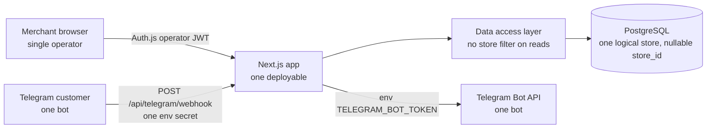
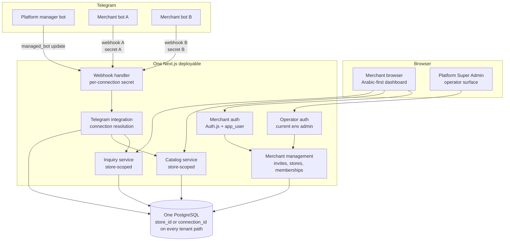
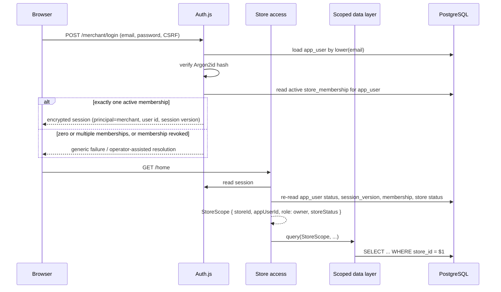
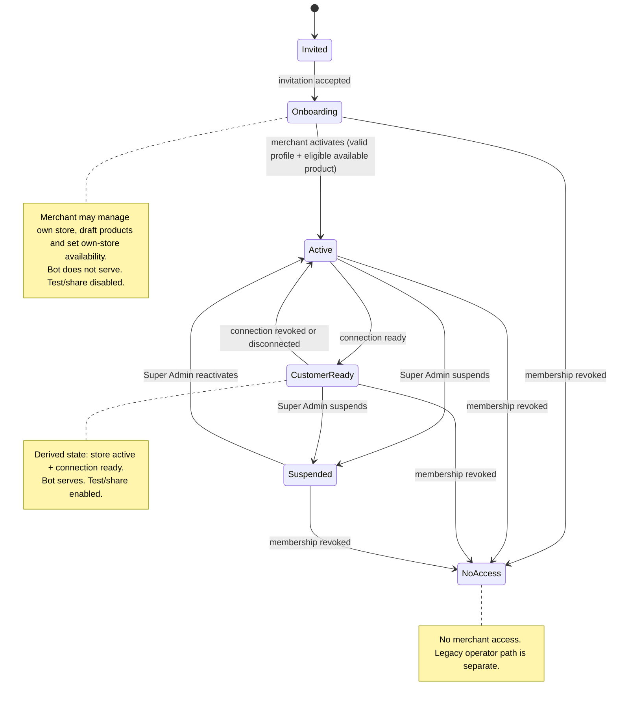
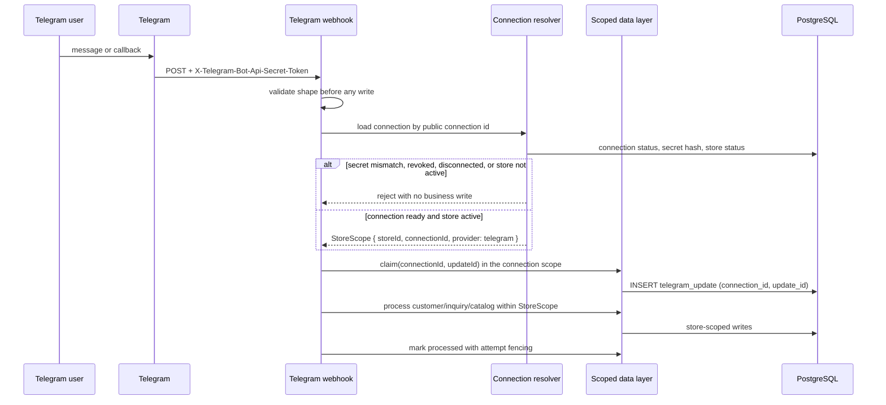
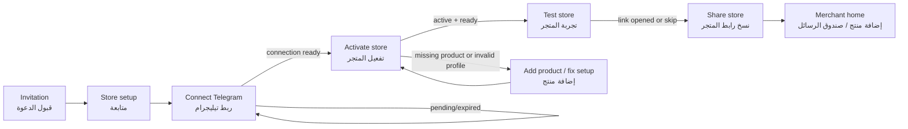

# Rabet SaaS MVP — Target Architecture, Ownership and Mobile Merchant Experience

**Status:** design proposal only. Nothing in this document is implemented by this
PR. No application runtime, database schema, migration, backfill SQL, deployment
workflow, authentication behavior, Telegram credential or production data is
changed.

**Repository baseline:** `main` at
`bab0649213461d9df7747a75b54c689e7f9377ef` (2026-11-18).

**Related documents:**

- [SAAS_MVP_DELIVERY_AND_BACKFILL.md](./SAAS_MVP_DELIVERY_AND_BACKFILL.md) —
  contract gates, backfill readiness, cutover and the first implementation PR.
- [S1.3A_SAAS_DATA_ARCHITECTURE.md](./S1.3A_SAAS_DATA_ARCHITECTURE.md) — the
  transitional ownership contract that this design replaces.
- [S1.2_TENANT_OWNERSHIP.md](./S1.2_TENANT_OWNERSHIP.md) — nullable ownership
  expansion and the backfill artifacts.
- [ARCHITECTURE.md](./ARCHITECTURE.md) — current stack and ADRs.

This design is grounded in the repository at the baseline above. Production
runtime state, live Telegram behavior and live database contents are **not**
verified here; those gaps are recorded in §3.7 and in the delivery document.

---

## 1. Decision summary

1. **One deployable application and one PostgreSQL database.** Keep the Next.js
   modular monolith and the current Render service (Git-backed Docker runtime).
   GHCR image promotion is an earlier deployment path, not the current service
   source. No microservices, plugin framework, generic event bus or speculative
   channel abstraction.
2. **Invitation-only MVP.** A platform Super Admin creates a store and invites
   one merchant. A merchant account manages exactly one store. There is no
   public signup, store switcher, agency dashboard, staff role or billing.
3. **Two trusted paths to a store.** A dashboard request resolves an
   authenticated `app_user` through an active `store_membership`. An incoming
   Telegram update resolves a verified `telegram_connection` through its
   per-connection webhook credential. Neither path accepts a browser-supplied
   store id or an unverified payload as ownership proof.
4. **Replace the legacy resolver.** `resolveLegacyStoreContext()` is a
   single-store transition guard, not tenant isolation. It fails closed when a
   second store exists. Reads are not store-scoped today. The target passes an
   explicit, server-derived `StoreScope` through every read, write, relation,
   webhook and retried-work path.
5. **Replace singleton configuration.** `bot_setting` and
   `seller_notification_setting` are one row globally. They become one row per
   store; enabled languages become a per-store mapping. `language` remains
   shared reference data.
6. **Replace global business identity keys where tenancy requires it.**
   `customer.telegram_id`, `telegram_update.update_id`, category/product slugs,
   message-template keys and seller-notification delivery keys become
   store-scoped or connection-scoped. Public inquiry references may remain
   globally unique because they are customer-facing support identifiers.
7. **Model one Telegram connection per store, with per-connection webhook
   identity and per-connection update deduplication.** The current single
   environment token and single global webhook are a one-bot compatibility
   path, not the target.
8. **Managed Bot provisioning is gated by an unverified correlation proof.**
   Official Telegram behavior gives us the creating Telegram user and the new
   bot, but no custom correlation parameter, no event attempt id and no stable
   bot name. Creator identity is necessary but not sufficient proof of the exact
   provisioning attempt. Automatic linking requires one unambiguous pending
   attempt; every late, duplicate, expired or otherwise ambiguous event fails
   closed to review or an approved fallback. The correlation status remains
   **UNVERIFIED** until the test-bot spike passes.
9. **Store lifecycle is explicit.** A merchant membership grants access to the
   merchant's own store while it is `onboarding`, `active` or `suspended`
   (read-only when suspended). New products are draft-first. During onboarding,
   the authorized owner may explicitly make a valid own-store product available.
   Activation requires a valid profile and at least one eligible available
   product. Customer-facing serving, testing and sharing require store `active`
   plus a `ready` Telegram connection. Membership authorization is not the same
   as customer readiness.
10. **Arabic-first mobile onboarding and three frequent tasks.** The merchant
    sees invite, setup, connect, activate, test and share as one linear journey,
    then a home screen centered on add product, edit price/availability and
    review an inquiry. Advanced catalog, button trees, bot content and payment
    methods stay secondary.
11. **The first implementation slice is a catalog tenancy seam, not an auth or
    UI slice.** It adds store-scoped product listing and availability update,
    exercised only through the PostgreSQL fixture infrastructure with two
    stores. Merchant invitations, credentials, sessions and UI are later; no new
    production route and no browser-supplied store id are introduced.
12. **No isolation claim from this design or from the existing backfill.** A
    successful backfill proves legacy rows at a point in time. It does not prove
    tenant isolation, and it must not be used to justify a second production
    store.

---

## 2. MVP boundary

### 2.1 In scope

| Capability | MVP behavior |
| --- | --- |
| Platform administration | Super Admin creates one store per merchant, sends a single-use invitation, can suspend a store |
| Merchant identity | Invitation acceptance, password sign-in, session revocation, one active store membership |
| Store setup | Store name, slug, currency, display name, default language and enabled languages |
| Telegram connection | Merchant connects one Managed Bot to their store through the platform manager bot; exactly one active connection per store |
| Customer catalog | Existing category/product/button-tree model, per-store scoped |
| Customer inquiries | Existing inquiry and two-way message model, per-store scoped |
| Merchant dashboard | Arabic-first mobile home; add product; edit price/availability; read and reply to inquiries; share/test when the store is customer-ready |
| Languages | Existing English/Arabic content and fallback behavior, with per-store enablement |
| Storefront menu | Existing configurable five-entry menu, per-store scoped |

### 2.2 Explicitly out of scope

- Public signup, self-service store creation, store switching, multiple stores
  per merchant, agency dashboards, staff roles or permissions.
- Billing, subscriptions, invoices, orders, checkout, real payments, Telegram
  Stars or payment-provider integrations.
- WhatsApp or any second customer channel. The channel boundary is documented
  only so the current design does not block a later provider.
- Per-store outbound seller notifications as a merchant-facing MVP feature.
  Existing notification code is kept but scoped and left for a later milestone.
- A dashboard or runtime prototype for this design.

---

## 3. Current state: confirmed evidence

### 3.1 Current runtime



The current Render service is **Git-backed** from `geekammar/Rabet`, branch
`main`, with a Docker runtime, `autoDeployTrigger=checksPass` and
`healthCheckPath=/api/healthz`. Reviewer-observed live revision:
`bab0649213461d9df7747a75b54c689e7f9377ef`, triggered by `service_updated`. That
observation describes the current configuration and live revision; it is not
evidence that an automatic deploy will occur on a later merge. The earlier
immutable-GHCR-image promotion path is **not** the current service source. The
service uses the existing Neon `Rabet_prod` database. See
`docs/RENDER_DEPLOYMENT.md` §1–§2, but do not treat that runbook's image-promotion
path as the current wiring. The legacy application is still one store, one bot
and one environment-configured administrator; the target SaaS architecture below
is separate.

### 3.2 Actual merchant-side catalog read

The trace below is the real code path at the baseline.

1. `src/app/(dashboard)/products/page.tsx:18-22` calls `requireAdmin()` and
   `loadCatalogAdminViewData()`.
2. `src/lib/catalog/load-admin-data.ts:29-66` checks the `bot_setting` singleton
   (`isConfigured`, `readSettings`) and then calls `listLanguages`,
   `resolveDefaultLanguage`, `listCatalogCategories` and `listCatalogProducts`.
3. `src/lib/data/catalog.ts:163-234` (`listCatalogCategories`) selects from
   `category` with only `deleted_at IS NULL`; its translation query at
   `catalog.ts:185-195` has no tenant predicate.
4. `src/lib/data/catalog.ts:239-321` (`listCatalogProducts`) selects from
   `product` with only `deleted_at IS NULL` and an optional category id; its
   translation query at `catalog.ts:268-279` has no tenant predicate.
5. `src/components/dashboard/catalog/products-admin.tsx` renders every returned
   row. The page therefore reads every store's catalog if more than one store
   exists.

The same global pattern appears in `listPaymentMethods`
(`src/lib/data/payment-methods.ts:150`), `listTemplates`
(`src/lib/data/templates.ts:167`), `listSellerInquiries`
(`src/lib/data/seller-inbox.ts:133`) and the overview loader
(`src/lib/dashboard/overview.ts:29-75`). The repository-wide inventory is
recorded in §3.5.

**Proof that this is intentional compatibility, not isolation.**
`tests/db/tenant-ownership.test.ts:868` ("keeps historical NULL rows visible
before and after mixed writes") and the S1.3-A document §8 explicitly state that
reads are not filtered. No test asserts two-store read isolation because no such
contract exists.

### 3.3 Actual merchant-side catalog write

1. `src/app/actions/catalog.ts:712-717` (`createProductAction`) calls
   `requireAdmin()` before reading any input.
2. Validation produces `categoryId`, `slug`, price and translations
   (`catalog.ts:712-1040`).
3. `src/app/actions/catalog.ts:1047` calls
   `createCatalogProduct(db, input)`.
4. `src/lib/data/catalog.ts:846-892`:
   - `resolveLegacyStoreIdForWrite(db)` at `catalog.ts:851` reads **all** store
     rows.
   - A missing store yields `null`; exactly one store with the hard-coded
     identity `legacy-store / Rabet Legacy Store / active` yields its id; more
     than one store or a different identity throws `TENANT_CONTEXT_INVALID`
     (`src/lib/data/store-context.ts:56-118`).
   - The target category is loaded and checked with
     `assertOwnershipCompatible` (`catalog.ts:869`), which tolerates a `NULL`
     side (`store-context.ts:125-131`).
   - The product insert stamps the resolved id or `NULL` (`catalog.ts:884-892`).
5. The later read-back `readCatalogProduct` (`catalog.ts:399`) reads by id only.

The write path is transactional and ownership-preserving, and its tests are
strong: `tests/db/tenant-write-ownership.test.ts:248` (stamp all eight roots),
`:366` (ownership preserved on every update), `:482` (runtime updates do not
backfill history), `:218` (different non-null owners rejected). It is still not
a multi-store contract: the resolver refuses a second store, and `NULL`
compatibility is deliberate.

### 3.4 Actual customer Telegram update

1. `src/app/api/telegram/webhook/route.ts:3-5` delegates to
   `handleTelegramWebhookRequest`.
2. `src/lib/telegram/webhook.ts:331-359` reads one process-wide
   `TELEGRAM_BOT_TOKEN` and one `TELEGRAM_WEBHOOK_SECRET`, then verifies the
   `X-Telegram-Bot-Api-Secret-Token` header with constant-time comparison.
3. `webhook.ts:375-399` validates the update shape and callback grammar before
   any database write; `webhook.ts:423-427` calls `claimTelegramUpdate`, whose
   insert conflicts on the globally unique `telegram_update.update_id`
   (`src/db/schema/telegram.ts:43`,
   `src/lib/data/telegram.ts:67-160`). The claim is stamped with the legacy
   store id or `NULL`.
4. `webhook.ts:467-490` dispatches to `handleIncomingMessage` or
   `handleCallbackQuery`.
5. `src/lib/telegram/inquiry-journey.ts:828-860` calls `upsertCustomer`, which
   conflicts on the globally unique `customer.telegram_id`
   (`src/db/schema/customer.ts:39`, `src/lib/data/customer.ts:28-68`), then reads
   the singleton settings row (`src/lib/data/settings.ts:139-166`).
6. For free text, `inquiry-journey.ts:1036` calls
   `routeAndAppendCustomerText`. That function calls the private
   `assertInquiryOwnership` (`src/lib/data/inquiry.ts:143-184`), then runs a
   customer-scoped CTE batch (`inquiry.ts:916-1040`) that appends the message,
   binds a durable receipt and may create a notification outbox row.
7. `webhook.ts:494-505` marks the update processed only if the attempt still
   owns the claim. Lease recovery, failure fencing and retries are already
   covered by `tests/db/telegram-journey.test.ts:1153`, `:1208`, `:1514`,
   `:1579` and `:1643`.

This path has no notion of a Telegram connection or receiving bot id. It derives
the store only from the process environment and the legacy resolver.

### 3.5 Findings that block a second store

| # | Finding | Evidence | Impact |
| --- | --- | --- | --- |
| F1 | **Every read is global or key-only.** No SQL `WHERE store_id = ...` exists under `src/`. | `catalog.ts:178`, `:261`; `seller-inbox.ts:192-225`; `payment-methods.ts:159-170`; `templates.ts:168`; `dashboard/overview.ts:50-59` | Two stores would see each other's catalog, inquiries, templates and counts in the dashboard. |
| F2 | **One legacy resolver.** More than one store fails every write path that calls it; seller-inbox and delivery-retry paths do not call it at all. | `store-context.ts:74-95`; test `tenant-write-ownership.test.ts:205`; `seller-inbox.ts:526`, `:779` | Creating a second production store today breaks the stamped write paths while leaving other paths unscoped. |
| F3 | **Settings are singletons.** `bot_setting` and `seller_notification_setting` are constrained to `id = 1`. | `src/db/schema/settings.ts:41`, `:76-78`; `src/db/schema/seller-notifications.ts:51`, `:78-81`; `settings.ts:158`; `seller-notifications.ts:118` | One store's identity, currency, language and notification configuration would apply to all stores. |
| F4 | **Global Telegram uniqueness.** `customer.telegram_id` and `telegram_update.update_id` are globally unique. | `src/db/schema/customer.ts:39`; `src/db/schema/telegram.ts:43`; `customer.ts:60`; `telegram.ts:96` | The same person cannot be a customer of two stores; two bots cannot receive the same update id without colliding. |
| F5 | **Global business identity.** Category slug, product slug, template key and delivery reference are globally unique. | `src/db/schema/catalog.ts:68`, `:161`; `src/db/schema/content.ts:35`; `src/db/schema/seller-notifications.ts:110` | Two merchants cannot use the same natural slug/key, and template creation can return another store's row (`templates.ts:242-251`). |
| F6 | **Implicit inquiry ownership.** `inquiry` and `inquiry_message` have no `store_id`; ownership is inferred from the customer. | `src/db/schema/inquiry.ts:68-78`; `inquiry.ts:143-184` | Reads by inquiry id and seller-inbox writes (`seller-inbox.ts:526`, `:779`, `:1188`, `:1422`) do not re-check the store. |
| F7 | **Notification work is global.** Delivery rows derive from inquiries; maintenance scans are not store-scoped. | `seller-notifications.ts:1207-1258` | A second store's retries or revision cancellation can touch another store's deliveries. |
| F8 | **NULL compatibility is still active.** Any `NULL` ownership side is treated as compatible. | `store-context.ts:125-131`; `catalog.ts:520`, `:869` | New owned rows can attach to historical unowned rows; this is a transition rule, not isolation. |
| F9 | **One bot identity is process-wide.** The webhook has no connection id; the secret is one environment value. | `webhook.ts:335-359` | There is no trustworthy way to map an inbound update to one of two bots or stores. |
| F10 | **Merchant auth and invitations do not exist.** `app_user` stores identity only; the only login is the environment-backed operator. | `src/db/schema/tenant.ts:26-32`, `:91-123`; `src/auth.ts`; `src/lib/auth/session.ts` | There is no dashboard identity that can own a store membership. |
| F11 | **Backfill is point-in-time.** It refuses a second store and does not add `NOT NULL`, composite FKs or runtime scoping. | `docs/backfill/legacy-store-backfill.sql:300-336`, `:350-357`; `S1.3A_SAAS_DATA_ARCHITECTURE.md` §11 | A successful backfill is not tenant isolation. |
| F12 | **The backfill preservation snapshot is incomplete for content.** Translations, product names/prices, inquiry snapshots and message bodies are counted or linked, not content-hashed. | `legacy-store-backfill.sql:163-290`, `:466-593` | A content change that keeps counts and links equal could pass postflight. See the delivery document. |

### 3.6 The eight direct ownership roots and derived inheritance

| Root | Direct `store_id` | Derived records and inheritance | Current enforcement | Target |
| --- | --- | --- | --- | --- |
| `bot_setting` | Yes | None; references global `language` | Singleton `id = 1` | One row per store; default language points into per-store enabled set |
| `category` | Yes | `category_translation` via `category_id`; child categories via `parent_id` | Root stamped; parent compatibility checked with NULL tolerance | `NOT NULL`; per-store slug; composite `(store_id, parent_id)` ownership |
| `product` | Yes | `product_translation` via `product_id`; `product_action` via immutable `product_id`; action translations via action | Root stamped; category compatibility checked | `NOT NULL`; per-store slug; composite `(store_id, category_id)` FK; all action targets store-checked |
| `payment_method` | Yes | `payment_method_translation` via `payment_method_id` | Root stamped; edit preserves | Per-store config; dormant in MVP UI |
| `message_template` | Yes | `message_translation` via `template_id` | Root stamped; key globally unique | Per-store key uniqueness; store-scoped lookup and create |
| `customer` | Yes | `inquiry` via `customer_id`; `inquiry_message` via inquiry; `seller_notification_delivery` via inquiry | Root stamped; global Telegram id; inquiry creation checks relationships | `NOT NULL`; `(store_id, telegram_id)` identity; inquiry materializes `store_id` |
| `seller_notification_setting` | Yes | None; deliveries derive from inquiries, not this row | Singleton `id = 1` | One row per store; defer merchant enablement |
| `telegram_update` | Yes | None; receipt JSON references inquiry ids | Global `update_id`; stamped with legacy store | `(connection_id, update_id)` dedup; `store_id` derived from connection |

Derived tables that must be scoped explicitly in the target:
`category_translation`, `product_translation`, `product_action`,
`product_action_translation`, `payment_method_translation`,
`message_translation`, `inquiry`, `inquiry_message` and
`seller_notification_delivery`. The current backfill verifies these relationships
at cutover (`legacy-store-backfill.sql:400-459`) but does not enforce them as
database constraints.

### 3.7 Confirmed facts, assumptions and evidence gaps

**Confirmed from repository evidence**

- S1.1, S1.2 and S1.3-A are merged on `main`; migration `0006` adds eight
  nullable `store_id` roots; migration `0007` adds the operator login throttle.
- No runtime read filters by `store_id`; the catalog, settings, customer,
  template, payment-method and Telegram-claim writes resolve the legacy store
  context and fail closed on more than one store. Seller-inbox and delivery
  maintenance paths do not resolve it and remain unscoped.
- No merchant invitation, merchant session, store membership enforcement or
  Telegram connection model exists in application code.
- The existing backfill and verification SQL are present, atomic and exercised
  on disposable PostgreSQL by the `tests/db/tenant-*` suites.
- The current production service is a Git-backed Render Docker service
  (`geekammar/Rabet`, branch `main`, `autoDeployTrigger=checksPass`,
  `healthCheckPath=/api/healthz`) on Neon `Rabet_prod` with one Telegram bot.
  The earlier GHCR image-promotion path is separate.

**Assumptions not verified here**

- Production has migrations through `0006` applied and exactly one store row.
  The repository documents this but this session has no production access.
- The production bot is the only active customer bot and its current webhook
  secret/token are available to the operator.
- A verified Neon restore point or branch snapshot can be created before any
  cutover.
- The legacy store's ownership is intentionally undecided; it is retained as an
  operator-managed store until C1 and a separate approved cutover.

**Evidence gaps**

- No production database, credentials, webhook state or deployed SHA was
  inspected. No production SQL was run.
- Live Telegram Managed Bot behavior was not exercised. The correlation design
  is therefore **UNVERIFIED** (§8.3).
- No two-store read-isolation test exists; the target tests are proposed in the
  delivery document.
- The existing backfill has no dry-run artifact and its content-preservation
  proof is weaker than its comments imply (§3.5 F12; delivery document §3).
- The live lock duration of the backfill on `Rabet_prod` is unknown.

---

## 4. Target architecture

### 4.1 Target runtime



### 4.2 Module boundaries

| Boundary | Responsibility | Reuses | Must not do |
| --- | --- | --- | --- |
| Merchant management | invitations, merchant identity, membership, store lifecycle, connection records | `app_user`, `store`, `store_membership` | Read catalog or inquiry data for authorization |
| Catalog | categories, products, translations, button trees, storefront menu | existing catalog modules and editors | Trust a store id from a form or URL |
| Inquiries | inquiry lifecycle, messages, seller replies, status transitions | existing inquiry/seller-inbox modules | Read an inquiry by id without a store predicate |
| Telegram integration | connection resolution, managed-bot provisioning, webhook validation, transport | existing grammY-free transport and journey code | Know about dashboard sessions |
| Platform operations | operator login, migrations, deployment gates | current `requireAdmin()` and `admin_login_throttle` | Impersonate a merchant |

No new service, queue, event bus or generic repository is introduced. The
boundaries are modules in the same deployable and the same database.

### 4.3 Trusted path A — merchant dashboard



Rules:

- The session contains the `app_user` id and `session_version`, not an
  authoritative `store_id`. Every request re-reads the active membership and
  store status from PostgreSQL, so revocation is denied immediately and
  suspension becomes read-only without waiting for JWT expiry.
- MVP expects exactly one active membership. Zero or more than one fails closed;
  there is no selector and no "first membership" fallback.
- A dashboard URL may contain a store slug or id as a **hint**. It is compared
  with the resolved scope; a mismatch is a 404, never a switch. Hidden form
  fields and `FormData` store ids are ignored.
- `requireMerchantScope()` is the only dashboard resolver. It returns a branded
  `StoreScope` for `onboarding` and `active` stores, and a read-only scope for
  `suspended`. Data functions require that type. A raw `string` store id cannot
  be passed accidentally without an explicit cast.
- `requireCustomerReadyScope()` is a separate server check for customer-facing
  actions. It requires `store.status = 'active'` and a `ready` connection; it is
  not implied by merchant membership.
- The current operator login remains a deployment/operations gate. It is not a
  merchant identity and does not grant access to merchant-owned stores. During
  the transition it may continue managing the operator-managed legacy store
  through the existing dashboard. That legacy store remains on the current path
  until a separate ownership decision and approved cutover.

#### 4.3.1 Store lifecycle and access

`store.status` already has `onboarding`, `active` and `suspended`
(`src/db/schema/tenant.ts:35-42`). "Customer-ready" is derived, not a fourth
status.

| State | Merchant membership | Merchant dashboard access | Customer bot | Test/share | Inquiries |
| --- | --- | --- | --- | --- | --- |
| Invited, not accepted | None yet | Invitation page only | No connection | No | None |
| `onboarding` | Active owner | Setup, store profile, draft-first catalog CRUD including explicit own-store product availability, languages/storefront, Telegram connection setup | Does not serve; webhook rejects (connection may be pending or ready) | Disabled | Empty until a customer can reach the bot |
| `active`, no ready connection | Active owner | Full own-store management, including product availability | Does not serve | Disabled | Existing history only |
| `active`, ready connection | Active owner | Full own-store management | Serves the store | Enabled | Live; merchant reads and replies |
| `suspended` | Active owner | Sign-in and read-only notice; no writes | Webhook rejects | Disabled | Read-only |
| Membership revoked | Revoked | No merchant access | Per connection state | Disabled | No access |
| Legacy operator-managed | No merchant membership | Current operator dashboard only | Current single bot | Not part of merchant flow | Current operator flow |

Activation is a merchant action that requires the store profile to be valid and
at least one **eligible available product**: `store_id` matches the scope,
`deleted_at IS NULL`, `is_active = true`, and its category belongs to the same
store. Customer readiness additionally requires a ready Telegram connection.
New products are created draft-first; the owner explicitly publishes or makes a
product available while onboarding. This keeps onboarding productive without
exposing a half-built store to customers.



`CustomerReady` is a derived access state, not a value of `store.status`.
`NoAccess` is the result of an active membership being revoked, not a new store
status.

#### 4.3.2 Merchant membership versus platform roles

| Principal | Identity source | Allowed | Not allowed |
| --- | --- | --- | --- |
| Merchant owner | `app_user` + active `store_membership` | Manage exactly one own store; onboarding, catalog, inquiries, connection, test/share when customer-ready; read-only when suspended | Platform administration, another store, store switching, staff roles |
| Platform Super Admin | `app_user.platform_role = 'super_admin'` | Create a store, send/revoke invitations, suspend/reactivate a store, view store lifecycle metadata | Read merchant catalog/inquiries, use a merchant bot token, impersonate a merchant, bypass membership |
| Deployment operator | Current environment-configured operator login | Deploy, migrate, inspect, operate the runtime; continue managing the operator-owned legacy store during transition | Automatically become a merchant or Super Admin; grant product permissions |
| Merchant staff | Not in MVP | None | Any store access |

The legacy store is not converted into a merchant store by this design. It
remains operator-managed until D1 is decided and a separate cutover is approved.

### 4.4 Trusted path B — incoming Telegram update



Rules:

- The webhook URL contains a random public connection id, not a store id. The
  connection row is the only mapping to a store.
- The per-connection `secret_token` is verified constant-time before JSON
  parsing, database access or Telegram calls. A missing or wrong secret returns
  the same generic 401.
- The update's payload does **not** prove which bot received it. The connection
  row and its secret do.
- A connection resolves to exactly one store by foreign key. A revoked,
  disconnected, suspended-store or unknown connection fails closed.
- Update deduplication is `(connection_id, update_id)`, so two bots can receive
  their own `update_id` sequences without colliding. Customer identity is
  `(store_id, telegram_id)`.
- Background retries re-load the same connection and re-check its status. A
  retry cannot complete after the connection is revoked.

### 4.5 Where scoping is enforced

| Path | Enforcement point | Failure mode |
| --- | --- | --- |
| Merchant sign-in | `app_user` credential + exactly one active membership; onboarding is allowed, suspended is read-only | Generic failure or read-only scope |
| Dashboard page read | `requireMerchantScope()` then every query takes `StoreScope` | Redirect to login or generic not-found |
| Dashboard write in `onboarding` | `requireMerchantScope()` allows own-store draft/catalog/setup writes, including explicit product availability | No write if suspended/revoked; generic error |
| Customer-facing action | `requireCustomerReadyScope()` (store `active` + connection `ready`) | Test/share/serving disabled until ready |
| Record lookup by id | Query includes `store_id = scope.storeId`; a foreign id is indistinguishable from missing | 404 |
| Relation write (product/category, action targets, inquiry customer/product) | Same-store composite FK where possible; explicit check where a composite FK is impractical | Constraint or `CROSS_STORE_REFERENCE` |
| Telegram webhook | Connection id + secret -> store; claim and all writes use that scope | 401/404 with no business write |
| Retried webhook | Same connection re-validation before completion; attempt fencing retained | Retry fails closed |
| Seller notification retry | Delivery row carries `store_id`/`connection_id`; worker claims within one store | Delivery not claimed by another store |
| Public store link | Bot username resolves a ready connection; no store id is trusted | Unknown bot shows no store |
| Admin/support | Super Admin operates on store lifecycle, not on merchant business rows | No implicit tenant read |

### 4.6 Store-specific identity and uniqueness

| Key | MVP decision | Reason |
| --- | --- | --- |
| `store.slug` | Global unique | Public identity; one canonical store address |
| `category.slug` | Unique per store | Two merchants may both have `design` |
| `product.slug` | Unique per store | Same reason |
| `message_template.key` | Unique per store | Template keys are internal to one store's bot content |
| `customer.telegram_id` | Unique per `(store_id, telegram_id)` | Same Telegram user may buy from two independent stores |
| `telegram_update.update_id` | Unique per `(connection_id, update_id)` | Each bot has its own update sequence |
| `inquiry.reference` | Globally unique | Customer-facing support identifier; still store-scoped on read |
| `seller_notification_delivery.reference` | Globally unique | Opaque retry id; still store-scoped on read/write |
| `language.code` | Global unique reference data | Shared ISO code table |
| Enabled languages | `(store_id, language_id)` in a store mapping | One store may enable Arabic while another does not |
| `bot_setting` | One row per store | Store identity, currency, display name and default language are per store |
| `seller_notification_setting` | One row per store | Per-store destination and verification state; feature deferred |
| `store_membership` | Many-to-many schema, one active membership enforced by MVP service | Preserves future flexibility without enabling switching |

**Replacement, not coexistence.** Adding `UNIQUE(store_id, slug)` while the old
global `UNIQUE(slug)` remains does not allow same-slug rows across stores:
PostgreSQL enforces both. The Phase 5 reviewed migration must add the
store-scoped replacements, verify ownership and key integrity, scope the affected
reads/writes, and then remove the old global enforcement before the matching
staging collision tests and before store #2 is enabled. The migration and
operator runbook are separate reviewed artifacts.

`telegram_update.update_id` is **connection-scoped**, not store-scoped: the
replacement is `UNIQUE(connection_id, update_id)` because each bot has its own
update sequence. A store-scoped key would be the wrong model.

**Pre-pilot catalog ordering.** The current
`category_root_sort_order_idx` is global on `(sort_order) WHERE parent_id IS
NULL` (`src/db/schema/catalog.ts:99-101`). It prevents two stores from
independently using root order `0`. The later design intends
`UNIQUE(store_id, sort_order)` for roots (and keeps sibling ordering scoped by
the globally unique parent id). This is a pre-pilot catalog concern; its schema
change belongs to a separate reviewed migration and must be in force before
store #2.

### 4.7 Transaction and idempotency model

Keep the existing rules from ADR-015 and S1.3-A:

- One explicit read for context, then `db.batch([...])` for atomic multi-step
  writes; no interactive transaction on Neon HTTP.
- Every write is idempotent at its own site: update claim, active inquiry partial
  index, message dedup, notification outbox uniqueness.
- External Telegram sends happen after commit, with the message row as durable
  state (`pending -> sent | failed`).
- The new dedup keys are narrower, not a second mechanism:
  `(connection_id, update_id)`, `(store_id, telegram_id)`,
  `(store_id, category_slug)`, `(store_id, product_slug)`,
  `(store_id, template_key)`.

### 4.8 Channel boundary for a future WhatsApp

Only the boundary Telegram actually needs is defined now: a Telegram connection
module, a Telegram webhook endpoint and the existing store/catalog/inquiry
services.

| Concern | Shared with a future channel | Must stay provider-specific |
| --- | --- | --- |
| Store resolution | Store id, store status, merchant membership | How a provider account is proven to belong to a store |
| Identity | Internal customer id and inquiry history | Telegram user id vs WhatsApp phone number; provider profile fields |
| Webhook validation | Constant-time secret/signature check, raw-body validation before writes | Telegram `X-Telegram-Bot-Api-Secret-Token` vs Meta challenge/signature headers |
| Credentials | Encrypted-at-rest, key-versioned, server-only | Bot token + managed-bot lifecycle vs WABA token/app secret |
| Message presentation | Localized templates and fallback chain | Inline keyboards/callback data vs WhatsApp interactive/template messages and 24-hour window |
| Provider policy | Store-level enable/disable, audit trail | Telegram Bot terms/Stars rules vs WhatsApp template approval and messaging limits |
| Delivery dedup | `(connection_id, provider_update_id)` | Provider update identifier format |

A future WhatsApp connection can reuse the store, catalog, inquiry and outbox
domains. It must not reuse Telegram's managed-bot provisioning, callback-token
grammar, message-size assumptions or credential model. No plugin framework or
generic channel event bus is justified by one provider.

### 4.9 Plan-capability boundary (future, not implemented)

Tenant authorization and plan capability answer different questions:

- **Tenant authorization:** who may manage this store? It is answered by the
  authenticated `app_user`, the active membership and the resolved `StoreScope`.
- **Store capability:** is this feature available to this store? It will be a
  server-side capability evaluated for the store, for example
  `product_image_upload` or a catalog size limit.

A future capability check must run in the server action/API that performs the
work, not only in the dashboard that renders the button. Presentation may hide an
unavailable action, but the server remains authoritative. A browser cannot
supply or upgrade a capability.

This PR defines no plan names, prices, billing, subscriptions, permission engine
or schema. It records only the separation so tenant scoping is not later mistaken
for entitlement.

---

## 5. Target data model changes (design only, not implemented)

These are **proposed** additions and constraints for later approved migrations.
No SQL is authored or run by this PR.

1. **Merchant credential and invitation**
   - Add password hash metadata and credential state to `app_user` (or a
     one-to-one credential table) using the existing Argon2id library.
   - Add `merchant_invitation`: store id, invited email, single-use token hash,
     expiry, accepted/revoked timestamps, inviter, optional last-sent timestamp.
   - Accepting an invitation creates or reuses `app_user`, creates exactly one
     active `store_membership`, and consumes the token atomically.
   - Store lifecycle stays `onboarding`, `active` or `suspended`; customer-ready
     is derived from `active` + a ready connection. No fourth status and no plan
     capability schema are introduced.
2. **Telegram connection**
   - Add `telegram_connection`: store id, provider `telegram`, public connection
     id, status (`pending`, `provisioning`, `ready`, `needs_review`, `revoked`,
     `disconnected`), attempt id and state, bot user id, bot username, encrypted
     bot token, token key version, webhook secret hash, manager update id, creator
     Telegram user id, timestamps.
   - Partial unique indexes: one non-revoked connection per store; one bot user
     id globally; one active pending correlation per creator Telegram user.
   - An attempt history is retained so a late event can be identified as
     ambiguous rather than silently attached to a newer attempt.
3. **Per-store configuration**
   - Replace the `bot_setting` singleton with `UNIQUE(store_id)` and remove the
     `id = 1` check.
   - Replace the `seller_notification_setting` singleton with `UNIQUE(store_id)`.
   - Add `store_language(store_id, language_id, is_enabled)`; keep `language` as
     shared reference data. Retire the global enabled flag after migration.
4. **Per-store business keys**
   - Replace global category/product slug uniqueness with
     `(store_id, slug)`.
   - Replace global template-key uniqueness with `(store_id, key)`.
   - Replace `customer.telegram_id` uniqueness with `(store_id, telegram_id)`.
   - Replace `telegram_update.update_id` uniqueness with
     `(connection_id, update_id)`; this key is connection-scoped, not
     store-scoped.
   - Replace the global root-category sort-order index with a store-scoped root
     order. These are **replacements**, not additive coexistence: the old global
     constraint must be removed in the reviewed Phase 5 migration after
     ownership/key integrity and scoped reads/writes are verified, and before
     store #2.
5. **Inquiry ownership**
   - Materialize `inquiry.store_id` for indexed scoping.
   - Enforce `(store_id, customer_id)` and `(store_id, product_id)` ownership
     with composite foreign keys or triggers.
   - Keep `inquiry_message` and `seller_notification_delivery` derived, but
     require store-scoped reads and writes.
6. **Final constraints**
   - `NOT NULL` on all eight root `store_id` columns after the legacy store is
     backfilled and no `NULL` remains.
   - Composite ownership foreign keys where a dependent row can otherwise point
     across stores.
   - Replacements for the old global business-key constraints are in force and
     the old enforcement is removed before store #2, as gated in the delivery
     document Phase 5. Contract names and migration order are approved there
     before implementation.

---

## 6. Material component decisions

| Component | Decision | Evidence | User impact | Transition dependency | Deletion condition |
| --- | --- | --- | --- | --- | --- |
| `store`, `app_user`, `store_membership` schema | **Keep** | `src/db/schema/tenant.ts`; `tests/db/tenant-identity.test.ts` | Store and identity foundation already exists | Add credential/invitation fields; no destructive rewrite | None |
| Legacy `resolveLegacyStoreContext` | **Replace** | `src/lib/data/store-context.ts:56-118`; fails closed on two stores | Removes the single-store write outage risk | Scoped catalog slice + merchant/webhook scope sources + production backfill/verification | Delete when no `NULL` ownership remains and all runtime paths use explicit scopes |
| Eight `store_id` roots | **Keep, tighten** | `drizzle/0006_tenant_ownership_expansion.sql`; `tests/db/tenant-ownership.test.ts:341` | Preserves existing ownership data | Backfill, `NOT NULL`, composite FKs | None |
| Global catalog reads (`listCatalogCategories`, `listCatalogProducts`, `readCatalog*`) | **Refactor** | `src/lib/data/catalog.ts:163`, `:239`, `:326`, `:399` | Merchant sees only their catalog | First slice adds `listCatalogProductsForStore`, `StoreScope` and an explicit category-ownership gate; existing global functions stay until all callers migrate | Old signatures removed when all callers pass scope, after backfill and the scoped-read switch |
| `updateCatalogProduct` availability path | **Refactor** | `src/lib/data/catalog.ts:1107` | Owner can explicitly make an own-store draft product available while onboarding | First slice adds `updateCatalogProductAvailabilityForStore` with a `store_id` predicate; existing path stays | Old path removed when all callers pass scope, after backfill and the scoped-read switch |
| Catalog write ownership checks with NULL tolerance | **Replace** | `assertOwnershipCompatible` at `store-context.ts:125-131`; called from `catalog.ts` etc. | Cross-store relations become impossible | Backfill completes; no `NULL` rows | Remove NULL tolerance after `NOT NULL` |
| `bot_setting` singleton | **Replace** | `src/db/schema/settings.ts:41`, `:76-78`; `settings.ts:139` | Merchant edits their own store identity, currency and language | Per-store settings migration and UI scoping | Old singleton table shape removed after all stores migrated |
| `seller_notification_setting` singleton | **Replace** | `src/db/schema/seller-notifications.ts:51`, `:78-81` | Later milestone; current code stays dormant | Per-store row; deferred merchant enablement | Later notification milestone |
| Global `language.is_enabled` | **Refactor** | `src/db/schema/settings.ts:102`; `languages.ts:105` | One merchant can enable Arabic without changing another | `store_language` additive mapping | Remove global flag after all stores mapped |
| Global category/product slug and root-order constraints | **Replace** | `src/db/schema/catalog.ts:68`, `:99-101`, `:161` | Two stores can use their own slugs and root ordering | Phase 5 reviewed migration; scoped reads/writes | Drop old global enforcement only after replacements are in force, scoped code is verified and before store #2 |
| `customer.telegram_id` global unique | **Replace** | `src/db/schema/customer.ts:39`; `customer.ts:60` | Same Telegram user can be a customer of two stores | Per-store identity and customer lookup | Drop old unique index in the Phase 5 reviewed migration after replacement/scoped code are verified, before store #2 |
| `telegram_update.update_id` global unique | **Replace** | `src/db/schema/telegram.ts:43`; `telegram.ts:96` | Two bots can operate without dedup collisions | Connection model and per-connection claim | Drop old unique index in the Phase 5 reviewed migration; replacement is `(connection_id, update_id)`, before store #2 |
| Telegram webhook handler | **Refactor** | `src/lib/telegram/webhook.ts:331-550` | Each store's bot reaches its own store | Connection resolver, per-connection secret, scoped claim | Old single-route handler removed after one bot per store |
| Telegram catalog/inquiry journeys | **Keep** | `src/lib/telegram/catalog-journey.ts`, `inquiry-journey.ts`; proven by `tests/db/telegram-journey.test.ts` | Preserves customer experience and tests | Scope every read/write with connection store | None |
| Seller inbox reads/writes | **Refactor** | `src/lib/data/seller-inbox.ts:133`, `:368`, `:526`, `:779`, `:1188`, `:1422` | Merchant can only open and answer their inquiries | `StoreScope`; inquiry `store_id` | Old unscoped functions removed |
| Notification outbox | **Keep, scope, defer** | `src/db/schema/seller-notifications.ts`; `seller-notifications.ts` | No merchant-facing change in MVP | Per-store delivery scope; later milestone | Later notification milestone |
| Catalog/products/inquiries dashboard UI | **Refactor, reuse** | `src/components/dashboard/catalog/*`, `src/components/dashboard/inquiries/*` | Familiar screens, mobile-first quick actions | Scoped loaders, Arabic/RTL strings, draft handling | None |
| Advanced catalog and button-tree editor | **Keep as advanced** | `src/components/dashboard/catalog/product-action-editor.tsx`; tests `tests/db/product-actions-persistence.test.ts` | Power users keep full control | Scope all product/action reads | None |
| Payment methods and manual-payment prototype | **Retire from MVP navigation** | `src/lib/payment-methods/*`; `payment-methods.ts`; `MANUAL_PAYMENT_JOURNEY_PROTOTYPE.md` | Merchant sees a smaller MVP | Scope if retained internally; no product surface | Delete when the payment/checkout decision is made |
| Static Customers page | **Retire from MVP navigation** | `src/app/(dashboard)/customers/page.tsx` (static empty state) | No misleading empty screen | None | Delete or replace in a later CRM phase |
| Current operator login and throttle | **Keep** | `src/auth.ts`; `src/lib/auth/login-throttle.ts`; ADR-011 revision | Platform operator behavior unchanged | Add merchant principal without weakening operator gate | None |
| Store switching, agency dashboards, staff roles, public signup | **Retire from MVP** | Product boundary in this document; S1.3-A §1 | Clear one-store, one-owner experience | None | Product decision to revisit |
| WhatsApp and generic channel framework | **Retire from MVP** | `docs/PROGRESS.md` line 1370 ("future direction only") | No unused abstraction | Later provider design | Not scheduled |

---

## 7. Mobile merchant experience

### 7.1 Experience principles

- **Arabic-first, RTL by default.** New merchant surfaces use Arabic labels and
  `dir="rtl"`; English remains available. Customer content keeps `dir="auto"`.
  The existing English-only dashboard is reused for advanced screens until they
  are localized.
- **One primary action per screen.** Secondary actions are text buttons or
  collapsed under "خيارات متقدمة".
- **Phone-first sizing.** Reviewed at 360 px width first, then 390, 430 and
  tablet. Interactive targets are at least 44 × 44 CSS px. No horizontal scroll.
- **The browser is not the source of truth.** Pending Telegram work and onboarding
  progress live on the server. Closing the tab or the phone cannot create a
  half-connected store.
- **Draft-first products.** A new product starts inactive. Publishing or making a
  product available is an explicit own-store action, available during onboarding
  to the authorized owner.
- **One store, no switcher.** The store name is shown in the header; there is no
  store picker.

### 7.2 Screen-by-screen journey

The journey begins while the store is `onboarding`. The merchant can use the
dashboard and manage the catalog before customer readiness; activation happens on
Screen 4. Only the test and share actions wait for the customer-ready state
(store `active` + `ready` connection) defined in §4.3.1.

#### Screen 1 — Invitation

| Item | Design |
| --- | --- |
| Purpose | Prove the invited email and create the merchant account |
| Minimum inputs | Email (prefilled from invitation), password, password confirmation |
| Primary action | `قبول الدعوة وإنشاء الحساب` (Accept invitation and create account) |
| Defaults | Invited email, store name and language shown read-only; no public signup link |
| Success | Account created, membership created, store status `onboarding`, redirect to setup |
| Waiting | Button disabled with `جارٍ التحقق…`; no duplicate submit |
| Failure | One generic message for invalid/expired/used token: `هذه الدعوة غير صالحة أو منتهية. اطلب دعوة جديدة من مسؤول المنصة.` Password errors are field-level |
| Resume | A consumed invitation cannot be replayed. If the browser closes after acceptance, the merchant signs in at `/app/login`; the session resumes the same onboarding step |

#### Screen 2 — Store setup

| Item | Design |
| --- | --- |
| Purpose | Create the minimum store identity needed by the catalog and bot |
| Minimum inputs | Store name, display name, slug, currency, default language |
| Primary action | `متابعة` (Continue) |
| Defaults | Store name from invitation; slug generated from the name and editable; currency from the platform default with the current allowlist; English default, Arabic optional |
| Success | Store is saved idempotently and remains `onboarding`; the merchant sees `تم حفظ بيانات المتجر` and continues to Telegram |
| Waiting | Inline progress; the button shows `جارٍ الحفظ…`; no full-page spinner |
| Failure | Field-level validation; a save conflict keeps the entered values and offers retry |
| Resume | Server stores the store row and onboarding step; reopening returns to the same step. A local draft is an extra safety net, never the source of truth |

#### Screen 3 — Connect Telegram

| Item | Design |
| --- | --- |
| Purpose | Connect exactly one Managed Bot to this store |
| Minimum inputs | None after setup; Telegram confirmation is provider-required |
| Primary action | `ربط تيليجرام` (Connect Telegram) |
| Defaults | Suggested bot name and username derived from the store; both editable by Telegram and never used as proof |
| Success | `تم ربط البوت` with the bot `@username`; the connection is ready. The store may still be `onboarding`; customer serving and test/share wait for customer readiness (activation + ready connection) |
| Waiting | `بانتظار تأكيد تيليجرام…` with a refresh action and a short explanation; server-side pending state expires in 15 minutes |
| Failure | Cancelled, denied or expired: `لم يكتمل الربط. يمكنك المحاولة مرة أخرى.` A second attempt starts a new pending correlation; the old one is revoked |
| Resume | The pending connection is server-side. Closing the tab, losing the session or returning from Telegram reopens the same step and polls/refreshes the same pending connection |

#### Screen 4 — Activate and test the store

| Item | Design |
| --- | --- |
| Purpose | Activate the store for customers, then see the real customer experience |
| Minimum inputs | At least one eligible available own-store product; the store profile must be valid |
| Primary action | `تفعيل المتجر` (Activate store) while `onboarding`; after activation, `تجربة المتجر` (Try the store) |
| Defaults | If the catalog is empty or has no eligible available product, `إضافة أول منتج` / `نشر المنتج` is the prerequisite action. The test link is `https://t.me/<bot_username>` |
| Success | `تم تفعيل المتجر`; the test link opens Telegram. Returning shows `تم فتح المتجر`; the first inbound `/start` can later mark the connection `verified` |
| Waiting | Activation shows `جارٍ التفعيل…`; if the store is active but the connection is not ready, the screen shows `بانتظار ربط تيليجرام` instead of the test link |
| Failure | Activation failure keeps the store `onboarding` with field-level reasons. If Telegram is unavailable, the link remains visible and copyable |
| Resume | Activation and `test_opened_at` are server-side. Reopening the dashboard shows the same state. A failed or skipped test does not deactivate the store |

#### Screen 5 — Share the store

| Item | Design |
| --- | --- |
| Purpose | Give the merchant the public store link after the store is customer-ready |
| Minimum inputs | None |
| Primary action | `نسخ رابط المتجر` (Copy store link) |
| Defaults | `https://t.me/<bot_username>`; a native share action is secondary |
| Success | Toast `تم نسخ الرابط`; the URL remains selectable if the clipboard is unavailable |
| Waiting | Not applicable |
| Failure | Show the link in a read-only field with `تعذر النسخ. حدد الرابط وانسخه يدوياً.` |
| Resume | The link is derived from the ready connection and is always available on the home screen once the store is customer-ready |

The share card appears on the Done screen only when the store is customer-ready
(store `active` + connection `ready`) and after **either** the merchant taps the
test link **or** taps `تخطي التجربة` (Skip test). It is not hidden behind a
successful Telegram message. This makes "first test moment" and "share moment"
measurable without pretending we can observe the merchant's Telegram app.



The flow shows the default order (connect, then activate). Activation itself
requires a valid profile and one eligible available product; the test and share
nodes additionally require the ready connection. A merchant who activates before
connecting sees the test/share actions in their locked "waiting for Telegram"
state.

### 7.3 The working dashboard

While the store is `onboarding`, the merchant can already use catalog and setup
tools, including draft product creation and explicit own-store availability; the
share/test cards show a locked state with the missing readiness step. A suspended
store shows the same shell read-only.

The first visible level is deliberately small:

| First level | Advanced (secondary) |
| --- | --- |
| `إضافة منتج` (Add product) | Categories and nested catalog tree |
| `صندوق الرسائل` (Inbox) with an unread count | Bot content and message templates |
| Store status and share link card | Storefront menu order |
| Recent inquiries with one-tap reply | Payment methods (hidden in MVP) |
| Connection status (`متصل` / `غير متصل`) | Seller notification settings (later milestone) |

#### Add a product

- Opens a bottom sheet or a focused page, not the full catalog editor.
- Minimum: name, price, category. Category defaults to the last used category;
  if none exists, offer `إنشاء قسم` inline.
- New products are always **draft-first** and start unavailable. The primary
  action saves a draft (`حفظ كمسودة`); the owner then explicitly publishes or
  makes the product available (`نشر` / `إتاحة في المتجر`). During onboarding this
  explicit availability action is allowed for a valid own-store product. The
  store cannot activate until at least one eligible available product exists.
- Advanced fields: slug (auto-generated), description, details, translations,
  button tree.
- Success: `تمت إضافة المنتج` and the product is visible in the merchant list as
  a draft; it is not customer-visible until explicitly published/available.
- Failure: inline validation; no partial product. The form keeps its values.
- Draft: saved locally per store and user for 7 days; cleared on successful save.

#### Edit price or availability

- Tap a product row -> compact sheet with price and availability.
- Primary: `حفظ` (Save). Success: `تم الحفظ`. Failure: `تعذر الحفظ. حاول مرة أخرى.`
- The sheet shows the last server value and warns if another device saved first.
  A later UI implementation may use `updated_at` as a version check; no silent
  last-write-wins across devices.

#### Review and reply to an inquiry

- Home -> `صندوق الرسائل` -> thread. The list shows reference, customer name and
  the last message preview.
- Primary in the thread: `إرسال الرد` (Send reply). Secondary: status change
  (`تم الحل` / Resolved).
- Minimum input: reply text. Empty replies are rejected locally and on the server.
- Success: the reply appears with `تم الإرسال`; a failed send remains retryable
  and is never shown as sent.
- The customer's message and product context are visible above the composer.
  Long content scrolls; the composer stays reachable above the keyboard.

#### Empty, waiting and failure states

| Surface | Empty | Waiting | Failure |
| --- | --- | --- | --- |
| Products | `لا توجد منتجات بعد` with `إضافة أول منتج` | Skeleton row, not a blank screen | `تعذر تحميل المنتجات` with retry |
| Inquiries | `لا توجد رسائل بعد` with a short explanation that messages appear when customers ask | Skeleton list | `تعذر تحميل الرسائل` with retry |
| Categories | `لا توجد أقسام بعد` with `إنشاء قسم` | Skeleton | Retry |
| Connection | `لم يتم ربط تيليجرام بعد` | `بانتظار تأكيد تيليجرام…` | Expired/cancelled explanation and retry |
| Store | `المتجر غير جاهز للمشاركة` | Setup progress | Field-level errors |

### 7.4 Validation, drafts and interruptions

- Validate on blur and on submit; keep the server as the authority. Zod schemas
  are reused from the existing catalog and settings modules.
- Draft keys: `rabet:draft:<storeId>:<appUserId>:<surface>`; values are plain
  form data, never tokens or customer prose from another store.
- On returning from Telegram with a lost tab: sign in again; the server resolves
  the same store and the same pending connection. If the pending connection has
  expired, show the retry state, not a new phantom connection.
- On a lost session: the pending connection remains server-side and is scoped to
  the merchant. A different merchant cannot claim it.
- No service worker caching of authenticated data (ADR-008 remains).

### 7.5 RTL and narrow-phone behavior

- `dir="rtl"` on merchant surfaces; logical CSS properties (`ms-*`, `me-*`,
  `start-*`, `end-*`) rather than left/right.
- Prices, phone-like ids and bot usernames use `dir="ltr"` inline.
- Arabic labels wrap; no fixed-width buttons. The primary action is full-width
  above the safe-area inset on narrow screens.
- The sticky header shows the store name and connection status, not a store
  switcher.
- Tested at 360 px with the keyboard open; the composer and save buttons remain
  visible.

### 7.6 Measurable acceptance checks

**Eligible Telegram linking path (merchant-side taps).** Starting from the
authenticated dashboard home with the connection not yet ready:

| Step | Merchant taps | Notes |
| --- | --- | --- |
| Open connect screen | 1 (`ربط تيليجرام`) | |
| Start provisioning | 2 (`ربط البوت`) | Opens Telegram |
| Return/refresh readiness | 3 (`تحقق من الربط`) | Auto-poll may reduce this to 2 |
| **Merchant-side total** | **≤ 3** | Excludes OS app switching |

**Separately counted identity-verification steps:** possession of the invited
email, invitation acceptance, password creation, and the merchant sign-in if the
session was lost. These are not part of the Telegram linking count.

**Separately counted Telegram-required steps (not merchant dashboard taps):**
open the manager bot link, confirm the suggested bot name, confirm the suggested
username, confirm creation, and any Telegram security prompt. These are provider
steps and must not be compressed into a false dashboard tap count.

**Other acceptance checks**

- Onboarding access: an authenticated merchant with an active membership can
  sign in, save store setup, create/edit draft own-store products, explicitly
  make a valid own-store product available, and start the Telegram connection
  while the store is `onboarding`.
- First test moment: `تجربة المتجر` is enabled only when the store is `active`
  and the connection is `ready`; activation requires a valid profile and at least
  one eligible available product.
- Share moment: the share card is shown only in the customer-ready state and
  after the test link is opened or the merchant skips the test; the link is
  `https://t.me/<bot_username>` and is copyable.
- Membership versus platform role: a merchant cannot invoke Super Admin actions;
  a Super Admin cannot read merchant catalog/inquiries or impersonate a merchant.
- Suspended store: merchant access is read-only; test/share and customer serving
  are disabled.
- Legacy store: it remains operator-managed and is not pulled into the merchant
  onboarding flow before D1 and the approved cutover.
- Add product: ≤ 2 taps from home to the form, plus typing; save-as-draft is one
  tap and explicit publish/availability is one additional tap. Draft-first is
  required; a new product never starts available.
- Edit price/availability: ≤ 3 taps from home to a saved change, plus typing.
- Reply to an inquiry: ≤ 3 taps from home to send, plus typing.
- RTL: no horizontal overflow at 360 px; all primary targets ≥ 44 px.
- Failure: every server action has a safe, generic error and a retry path; no
  token, SQL or customer prose leaks into an error surface.
- Resume: after closing the browser during the Telegram wait, signing in returns
  to the same pending connection or its explicit expired state. Onboarding
  progress and activation state survive the interruption.

---

## 8. Telegram Managed Bot provisioning

### 8.1 What Telegram officially documents

Sources:

- <https://core.telegram.org/bots/features#managed-bots>
- <https://core.telegram.org/bots/api>
- <https://core.telegram.org/bots/api#managedbotupdated>
- <https://core.telegram.org/bots/api#getmanagedbottoken>
- <https://core.telegram.org/bots/api#setwebhook>

Confirmed behavior, re-checked against the current official pages on
2026-11-18 while writing this revision:

- A manager bot must have Bot Management Mode enabled in BotFather's Mini App.
- A user can be sent a creation link in the form
  `https://t.me/newbot/{manager_bot_username}/{new_username}?name={new_name}`.
  Both the username and display name are **pre-filled but editable**.
- When the user confirms, the manager bot receives a `managed_bot` update with a
  `ManagedBotUpdated` object containing `user` ("User that created the bot") and
  `bot` (the new bot).
- The current Update documentation describes `managed_bot` as "A new bot was
  created to be managed by the bot, or token or owner of a managed bot was
  changed". `ManagedBotUpdated` itself does not expose a separate event kind or
  attempt id.
- `getManagedBotToken` returns the token for a managed bot by `user_id`.
  `replaceManagedBotToken` revokes the current token and returns a new one.
- A bot can also send a reply-keyboard button with `request_managed_bot`
  (`KeyboardButtonRequestManagedBot`), which asks the user to create and share a
  bot managed by the current bot.
- `setWebhook` accepts a `secret_token` (1–256 characters, `A-Z a-z 0-9 _ -`);
  Telegram sends it in `X-Telegram-Bot-Api-Secret-Token` on every request.

Not documented as a correlation mechanism:

- `ManagedBotUpdated` does **not** echo the `request_id` from
  `KeyboardButtonRequestManagedBot`.
- There is no documented custom `start` parameter on the `newbot` creation link.
- The bot's final name and username can be edited, so neither is proof.
- The creator user identifies a Telegram account, not the exact Rabet
  provisioning attempt. `managed_bot` also carries token-change and owner-change
  events, not only creation.

### 8.2 Proposed provisioning flow

```mermaid
sequenceDiagram
  participant M as Merchant dashboard
  participant S as Rabet server
  participant MB as Manager bot
  participant U as Merchant Telegram
  participant T as Telegram
  participant N as New managed bot

  M->>S: POST /telegram/connect (authenticated merchant)
  S->>S: create pending attempt A + nonce hash + 15 min expiry
  S-->>M: deep link t.me/<manager_bot>?start=connect_<nonce>
  M->>U: open deep link
  U->>MB: /start connect_<nonce>
  MB->>S: validate nonce, bind creator user id to attempt A
  MB-->>U: creation link / request_managed_bot button
  U->>T: confirm name and username
  T->>MB: managed_bot update {user=creator, bot=new bot}
  MB->>S: forward event (server-to-server) or process in same app
  S->>S: dedup event; require creator match; check A/B ambiguity
  alt exactly one unambiguous pending attempt for this creator
    S->>T: getManagedBotToken(user_id=bot.id)
    S->>T: getMe with token (verify bot id/username)
    S->>T: setWebhook(per-connection URL, secret_token)
    S->>T: getWebhookInfo (verify URL)
    S->>S: mark ready for that attempt only
  else late, duplicate, expired, owner/token-change, or ambiguous
    S->>S: quarantine event; do not fetch token or register webhook
    S-->>M: needs operator review or approved fallback
  end
  opt connection is ready
    M->>S: poll/refresh status
    S-->>M: ready + @username
    Note over M,S: Share remains disabled until store is active
  end
```

The manager bot may live in the same deployable and use the same database. The
"forward event" step is not a network hop if provisioning is handled by the
manager bot's own webhook in the same application.

### 8.3 Correlation proof: status UNVERIFIED

**Creator identity is necessary, not sufficient**

The documented event can prove that a `managed_bot` update came from a Telegram
account that we previously bound to a pending attempt. It does **not** prove that
the event belongs to that exact attempt:

- `ManagedBotUpdated` has no attempt id, nonce or `request_id`.
- `user` is "User that created the bot"; it does not identify which Rabet
  provisioning attempt the new bot belongs to.
- The same `managed_bot` update type also covers token and owner changes, not
  only creation.
- A late event from attempt A can arrive while attempt B is pending for the same
  Telegram account. With the documented fields, A and B are not distinguishable.

The proposed automatic-link proof is therefore all of the following:

1. The merchant is authenticated and has exactly one store.
2. The server creates pending attempt A with a random nonce and binds it to that
   store and merchant.
3. The merchant opens the manager bot with the nonce. The manager bot verifies the
   nonce, the pending state and the store, then records the **Telegram user id**
   that sent `/start` as A's `creator_user_id`.
4. The creation UI is only sent to that Telegram chat.
5. When the `managed_bot` event arrives, its `user.id` equals the creator id of
   **exactly one** active, unexpired, unambiguous attempt. There is no other
   active, expired-but-possible or canceled attempt for that creator inside the
   defined ambiguity window.
6. The event has not already been consumed by another attempt, the bot id is not
   bound to another store, and the event is not an owner/token-change event that
   contradicts a fresh creation.
7. The bot id and username are taken from the event only as data to verify with
   `getMe`; they are never proof of store ownership.
8. The token is fetched only after steps 5–7, and `getMe` returns the same bot id
   and username.

**Fail-closed rule for ambiguous events**

If any of the following is true, the event is **not** auto-linked. The
connection stays unready, no token is fetched, no webhook is registered, and the
event is recorded for operator review or an approved fallback:

- zero or more than one candidate pending attempt for the creator;
- a late event that could belong to a canceled, expired or superseded attempt;
- duplicate delivery to a different attempt;
- an ownership or token-change event, or a bot id already bound elsewhere;
- a creator mismatch, missing creator, or `getMe` mismatch;
- the event arrives after attempt expiry;
- the manager bot cannot prove which attempt the event belongs to.

**Why the correlation remains UNVERIFIED**

- No live test proves `ManagedBotUpdated.user.id` is always the Telegram account
  that opened the manager-bot deep link, especially if the link is forwarded or
  creation happens on another device/account.
- No live test proves delivery timing, duplicate delivery, late events across
  attempts, or the exact behavior after editing the suggested name/username.
- No live test proves how token-change and owner-change events populate `user`
  and whether they can be distinguished from creation.
- `getManagedBotToken` accepts only a bot `user_id`; it does not prove which Rabet
  store initiated the creation.

**Evidence that would justify automatic linking:** a passing spike that shows all
of the following for two accounts and two attempts: event delivery; creator id
stability; no attempt-id ambiguity in late/duplicate cases; edited names still
link by bot id; token/owner-change events are distinguishable or fail closed;
`getManagedBotToken`, `getMe`, `setWebhook` and `getWebhookInfo` agree. Until
then, automatic linking is not approved.

**Outcomes requiring an explicit fallback design decision:** multiple candidate
attempts; late event from canceled/expired attempt A while B is pending;
duplicate events across attempts; owner/token-change event; creator mismatch;
missing creator; event after expiry; `getMe`/token mismatch. The fallback options
are operator-assisted provisioning (operator creates/attaches the bot and enters
the token server-side), an operator approval queue, or no bot provisioning in the
first pilot. Never accept a merchant-supplied bot token from the browser.

### 8.4 Smallest test-bot spike (not run in this session)

Objective: prove or falsify the correlation and lifecycle before implementation.
This PR does not run it.

1. Create one disposable manager bot with Bot Management Mode enabled in a test
   workspace. Do not use production.
2. Run a local HTTPS endpoint that records raw updates for the manager bot.
3. With two test Telegram accounts, create two managed bots through the manager
   bot. Edit the name and username in one flow.
4. Confirm:
   - the `managed_bot` update is delivered to the manager bot;
   - `ManagedBotUpdated.user.id` equals the account that opened the deep link;
   - the event still arrives after a name/username edit and can still be linked
     by bot id, not by name;
   - `getManagedBotToken` succeeds for the new bot id;
   - `setWebhook` with a per-test secret succeeds and `getWebhookInfo` matches;
   - duplicate delivery is observable and deduplicable;
   - a **late event from canceled/expired attempt A** can arrive while attempt B
     is pending for the same Telegram account, and the event payload alone cannot
     distinguish A from B;
   - an ownership-change or token-change `managed_bot` event is observable and
     distinguishable from a fresh creation, or is safely quarantined;
   - the manager bot receives enough evidence to enforce the fail-closed rule.
5. Record whether a user can complete creation without opening the deep link. If
   yes, the user-id binding is necessary but still not attempt proof, so an
   ambiguous event must fail closed.
6. Destroy the test bots and endpoint. No production bot, webhook or credential is
   touched.

The spike outcome must state one of: automatic linking approved for a defined
unambiguous case; automatic linking rejected and fallback chosen; or a specific
new question that needs a product/security decision.

### 8.5 Lifecycle, cancellation and duplicates

Proposed connection states:

```text
pending -> provisioning -> ready -> revoked | disconnected
   |             |
   |             +-> needs_review -> provisioning | revoked
   +-> expired
```

- **One pending correlation per store** and **one per creator Telegram user**.
  Starting a second attempt revokes the first nonce and leaves the old state
  auditable, but the late-event ambiguity remains until the spike proves a safe
  rule.
- **Expiry:** 15 minutes. An expired pending connection cannot be completed by a
  late event. The merchant sees a retry action.
- **Cancellation:** no event or a dismissed Telegram window leaves the pending
  state to expire. The store is not marked ready and no token is fetched.
- **Late event from attempt A while attempt B is pending:** treat as ambiguous,
  quarantine, and fail closed. Do not attach the event to B and do not revive A
  without an approved operator decision.
- **Duplicate events:** deduplicate on the manager bot's `update_id` and on the
  bot id. A duplicate that resolves to the same unambiguous attempt is a no-op; a
  duplicate that could belong to a different attempt is ambiguous and fails
  closed.
- **Out-of-order events:** only forward transitions are allowed. A token retrieved
  before the correlation check is never accepted. A late event after expiry is
  ignored and queued for review, not auto-linked.
- **Edited name/username:** never used for matching. The link decision uses the
  bot id and the creator/attempt checks.
- **Ownership or token change:** `managed_bot` also covers these events. An
  owner-change event invalidates the connection and requires review; a
  token-change event requires re-verification/rotation before the connection is
  ready again. Neither is silently treated as a fresh creation.
- **Retries:** `getManagedBotToken`, `getMe`, `setWebhook` and `getWebhookInfo`
  are idempotent and retryable with bounded backoff. A failed webhook
  registration leaves the connection `provisioning`, not `ready`.
- **Second connection attempt:** if a connection is `ready`, the merchant must
  explicitly disconnect first. Disconnect revokes the webhook, marks the
  connection `disconnected`, and never silently creates a second active bot.
- **Second merchant:** a bot id already connected to another store is rejected
  globally.

### 8.6 Server-only token and secret handling

- The bot token is never returned to the browser, never placed in a React prop,
  never logged and never stored in plaintext. It is encrypted at rest with
  AES-256-GCM and a versioned server-only key
  (`TELEGRAM_CONNECTION_TOKEN_KEY` / key id). Decryption happens only in the
  server-only Telegram transport.
- The webhook secret is generated server-side with at least 256 bits of entropy
  from the allowed character set. The database stores a SHA-256 hash (or an
  encrypted value) only. Verification hashes the incoming header and compares in
  constant time.
- The manager bot token remains an operator-managed environment secret. It is
  never stored per merchant and never sent to a merchant client.
- Rotation: `replaceManagedBotToken` -> new token -> `setWebhook` with a new
  secret -> atomic connection update. The old webhook secret is invalid after
  the update. If rotation fails midway, the connection stays `provisioning` and
  the previous token is not assumed valid.
- Logs redact tokens, secrets, connection URLs and raw update bodies. Error
  messages use the existing safe-diagnostic vocabulary.
- A connection token is decrypted only for outbound calls in the same store
  scope. A worker that retries a send re-reads the connection and refuses a
  revoked or disconnected connection.

### 8.7 Webhook identity boundary and readiness

**Identity boundary**

- URL: `/api/telegram/webhook/<connection_public_id>`, where the id is random and
  does not encode a store id.
- Load the connection by public id, require `provider = telegram`, require status
  `ready`, require the store to be active, and compare the secret in constant
  time.
- All update claims and business writes use the connection's store.
- The payload's `from`, `chat`, bot mentions or callback data never authorize a
  store.
- Allowed update types are restricted to what the product uses (`message`,
  `callback_query`, and the manager bot's `managed_bot` on its own endpoint).

**Readiness condition**

A connection is `ready` only when all of these are true:

1. The `managed_bot` event resolves to exactly one unambiguous pending attempt
   and its creator user id matches that attempt.
2. The event can be established as a fresh creation, not an owner/token-change
   event, using documented fields or the approved spike; if the kind cannot be
   distinguished, fail closed. The bot id is not already bound to another store.
3. `getManagedBotToken` succeeds for the bot id.
4. `getMe` with the token returns the same bot id and a username.
5. `setWebhook` succeeds for the per-connection URL with a fresh secret.
6. `getWebhookInfo` reports the same URL and no active error.
7. The connection row is not revoked, disconnected or in `needs_review`. The
   store may still be `onboarding`; customer serving separately requires
   `store.status = 'active'` (customer-ready).

`ready` does **not** prove that a customer message can be delivered, and it does
not activate the store. The merchant test step can later record `verified_at`
when the bot receives its first private `/start`. Test and share are enabled only
in the derived customer-ready state (store `active` + connection `ready`). This
distinction must be shown honestly in the UI: `تم ربط البوت` vs
`تم تفعيل المتجر` vs `تم اختبار المتجر`.

### 8.8 Open decisions for Telegram

- Whether the manager bot is a separate bot from any future seller-notification
  bot, and where its token is held.
- Whether provisioning uses the `newbot` link or the `request_managed_bot`
  keyboard button. The spike should test both.
- Whether an operator must approve a newly created bot before it becomes `ready`
  (recommended for the first pilot).
- Whether a merchant may disconnect and reconnect a bot without operator help in
  the MVP.
- The precise evidence retained for a connection audit (event id, creator user
  id, bot id, bot username, event kind if derivable, timestamps; never the
  token).
- The ambiguity window and whether a late event from attempt A can ever be
  auto-linked when attempt B is pending. The recommended default is no.
- The fallback policy if the correlation spike fails or an ambiguous event
  occurs: operator-assisted provisioning, an operator approval queue, or no
  provisioning in the first pilot.
- How owner-change and token-change events are surfaced to the merchant without
  exposing provider internals.

---

## 9. Owner decisions (open unless marked confirmed)

| # | Decision | Why it blocks | Recommended default |
| --- | --- | --- | --- |
| D1 | Who owns the legacy store after cutover: the first invited merchant, or the operator | Determines membership, invitation and backfill timing | Keep it operator-managed until C1 and a separate approved cutover; do not auto-invite the merchant |
| D2 | Is one active membership per merchant enforced in the service only, or also by a partial unique index | Affects schema and future multi-store flexibility | Service-enforced for MVP; no destructive global unique |
| D3 | Does Super Admin read merchant catalog/inquiry data | Privacy and support expectations | No business-data access in MVP; store lifecycle only |
| D4 | Product creation default | Current schema products are born inactive; MVP must stay draft-first | **Confirmed:** create draft/unavailable; explicit own-store publish/availability action; no active-on-save |
| D5 | Arabic-first scope: new onboarding only, or the whole dashboard | Localization effort and consistency | New onboarding and frequent tasks first; advanced screens follow |
| D6 | Managed Bot correlation acceptance | Blocks provisioning implementation | Require the test-bot spike; auto-link only an exactly-one-unambiguous-attempt case; otherwise operator-assisted fallback or review queue |
| D7 | Per-store settings and language migration shape | Blocks per-store configuration | Additive `store_language` and per-store settings rows; no destructive rewrite |
| D8 | Inquiry materialized `store_id` vs pure derivation | Affects read performance and constraint design | Materialize `store_id`, keep derived messages |
| D9 | Seller notifications in MVP | Not in product scope | Keep code dormant and scoped; enable in a later milestone |
| D10 | Payment methods visibility | Not in product scope | Hide from merchant navigation; retain code until the checkout decision |
| D11 | Store activation authority | Determines the lifecycle boundary | Merchant activation after valid profile + one eligible available product; Super Admin only suspends/reactivates |

---

## 10. What this design does not claim

- It does not claim that the current deployment is tenant-isolated.
- It does not claim that a successful legacy backfill makes two stores safe.
- It does not claim that the Managed Bot correlation is proven.
- It does not claim that production has a verified restore point, an applied
  migration chain or a drained webhook queue.
- It does not ship a dashboard, schema, migration, Telegram connection or
  prototype runtime.

Those claims belong to the implementation PRs and their evidence, which are
sequenced in
[SAAS_MVP_DELIVERY_AND_BACKFILL.md](./SAAS_MVP_DELIVERY_AND_BACKFILL.md).
