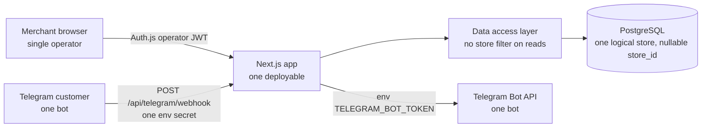
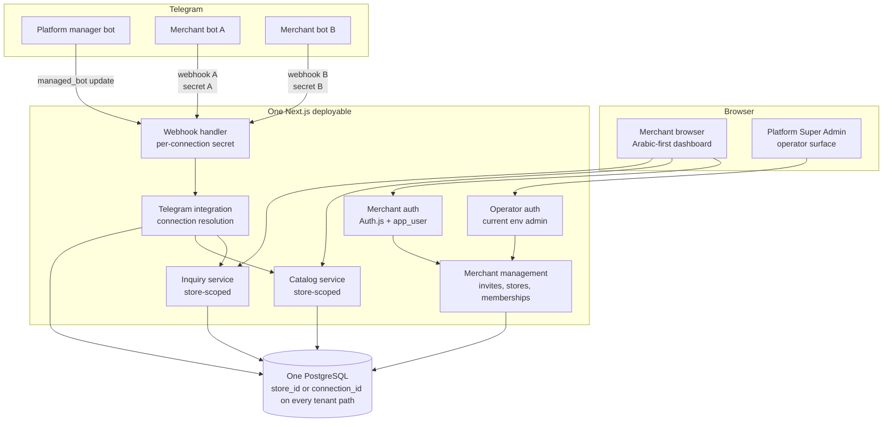
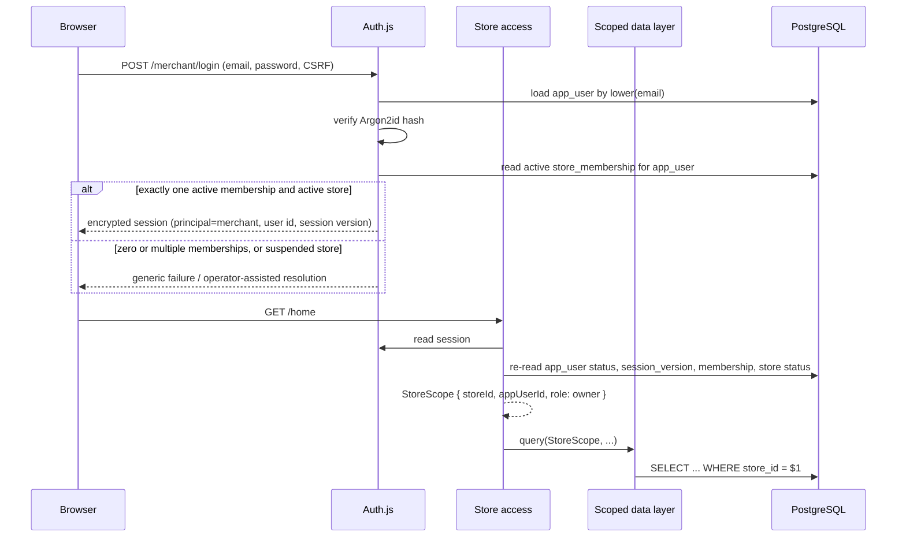
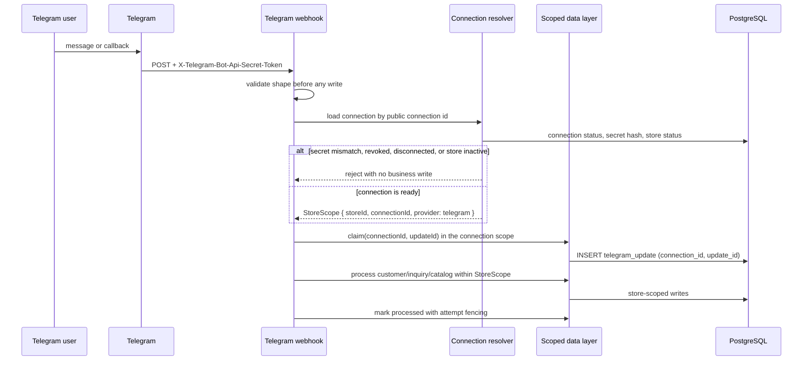
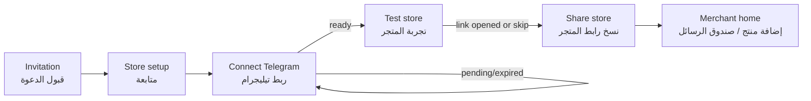
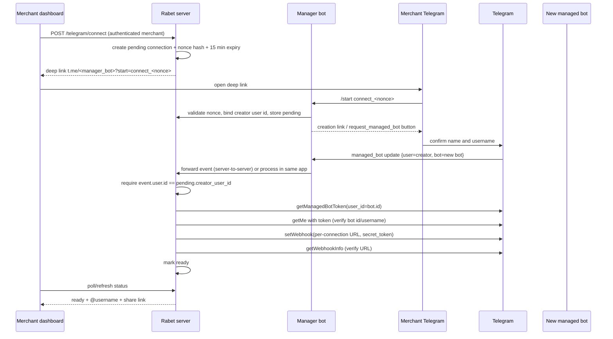

# Rabet SaaS MVP — Target Architecture, Ownership and Mobile Merchant Experience

**Status:** design proposal only. Nothing in this document is implemented by this
PR. No application runtime, database schema, migration, backfill SQL, deployment
workflow, authentication behavior, Telegram credential or production data is
changed.

**Repository baseline:** `main` at
`bab0649213461d9df7747a75b54c689e7f9377ef` (2026-11-18).

**Related documents:**

- [SAAS_MVP_DELIVERY_AND_BACKFILL.md](./SAAS_MVP_DELIVERY_AND_BACKFILL.md) —
  contract gates, backfill readiness, cutover and the first implementation PR.
- [S1.3A_SAAS_DATA_ARCHITECTURE.md](./S1.3A_SAAS_DATA_ARCHITECTURE.md) — the
  transitional ownership contract that this design replaces.
- [S1.2_TENANT_OWNERSHIP.md](./S1.2_TENANT_OWNERSHIP.md) — nullable ownership
  expansion and the backfill artifacts.
- [ARCHITECTURE.md](./ARCHITECTURE.md) — current stack and ADRs.

This design is grounded in the repository at the baseline above. Production
runtime state, live Telegram behavior and live database contents are **not**
verified here; those gaps are recorded in §3.7 and in the delivery document.

---

## 1. Decision summary

1. **One deployable application and one PostgreSQL database.** Keep the Next.js
   modular monolith and the current Render/GHCR deployment model. No
   microservices, plugin framework, generic event bus or speculative channel
   abstraction.
2. **Invitation-only MVP.** A platform Super Admin creates a store and invites
   one merchant. A merchant account manages exactly one store. There is no
   public signup, store switcher, agency dashboard, staff role or billing.
3. **Two trusted paths to a store.** A dashboard request resolves an
   authenticated `app_user` through an active `store_membership`. An incoming
   Telegram update resolves a verified `telegram_connection` through its
   per-connection webhook credential. Neither path accepts a browser-supplied
   store id or an unverified payload as ownership proof.
4. **Replace the legacy resolver.** `resolveLegacyStoreContext()` is a
   single-store transition guard, not tenant isolation. It fails closed when a
   second store exists. Reads are not store-scoped today. The target passes an
   explicit, server-derived `StoreScope` through every read, write, relation,
   webhook and retried-work path.
5. **Replace singleton configuration.** `bot_setting` and
   `seller_notification_setting` are one row globally. They become one row per
   store; enabled languages become a per-store mapping. `language` remains
   shared reference data.
6. **Replace global business identity keys where tenancy requires it.**
   `customer.telegram_id`, `telegram_update.update_id`, category/product slugs,
   message-template keys and seller-notification delivery keys become
   store-scoped or connection-scoped. Public inquiry references may remain
   globally unique because they are customer-facing support identifiers.
7. **Model one Telegram connection per store, with per-connection webhook
   identity and per-connection update deduplication.** The current single
   environment token and single global webhook are a one-bot compatibility
   path, not the target.
8. **Managed Bot provisioning is gated by an unverified correlation proof.**
   Official Telegram behavior gives us the creating Telegram user and the new
   bot, but no custom correlation parameter and no stable bot name. The design
   binds the creating user to the authenticated merchant through a one-time
   manager-bot deep link. This must be proven with a test-bot spike before
   implementation; until then the correlation status is **UNVERIFIED**.
9. **Arabic-first mobile onboarding and three frequent tasks.** The merchant
   sees invite, setup, connect, test and share as one linear journey, then a
   home screen centered on add product, edit price/availability and review an
   inquiry. Advanced catalog, button trees, bot content and payment methods stay
   secondary.
10. **No isolation claim from this design or from the existing backfill.** A
    successful backfill proves legacy rows at a point in time. It does not prove
    tenant isolation, and it must not be used to justify a second production
    store.

---

## 2. MVP boundary

### 2.1 In scope

| Capability | MVP behavior |
| --- | --- |
| Platform administration | Super Admin creates one store per merchant, sends a single-use invitation, can suspend a store |
| Merchant identity | Invitation acceptance, password sign-in, session revocation, one active store membership |
| Store setup | Store name, slug, currency, display name, default language and enabled languages |
| Telegram connection | Merchant connects one Managed Bot to their store through the platform manager bot; exactly one active connection per store |
| Customer catalog | Existing category/product/button-tree model, per-store scoped |
| Customer inquiries | Existing inquiry and two-way message model, per-store scoped |
| Merchant dashboard | Arabic-first mobile home; add product; edit price/availability; read and reply to inquiries; share store link; test store |
| Languages | Existing English/Arabic content and fallback behavior, with per-store enablement |
| Storefront menu | Existing configurable five-entry menu, per-store scoped |

### 2.2 Explicitly out of scope

- Public signup, self-service store creation, store switching, multiple stores
  per merchant, agency dashboards, staff roles or permissions.
- Billing, subscriptions, invoices, orders, checkout, real payments, Telegram
  Stars or payment-provider integrations.
- WhatsApp or any second customer channel. The channel boundary is documented
  only so the current design does not block a later provider.
- Per-store outbound seller notifications as a merchant-facing MVP feature.
  Existing notification code is kept but scoped and left for a later milestone.
- A dashboard or runtime prototype for this design.

---

## 3. Current state: confirmed evidence

### 3.1 Current runtime



The deployment target is now an immutable container on Render backed by the
existing Neon `Rabet_prod` database, not the Vercel hosting described in older
architecture text. See `docs/RENDER_DEPLOYMENT.md` §1–§2. The application is
still one store, one bot and one environment-configured administrator.

### 3.2 Actual merchant-side catalog read

The trace below is the real code path at the baseline.

1. `src/app/(dashboard)/products/page.tsx:18-22` calls `requireAdmin()` and
   `loadCatalogAdminViewData()`.
2. `src/lib/catalog/load-admin-data.ts:29-66` checks the `bot_setting` singleton
   (`isConfigured`, `readSettings`) and then calls `listLanguages`,
   `resolveDefaultLanguage`, `listCatalogCategories` and `listCatalogProducts`.
3. `src/lib/data/catalog.ts:163-234` (`listCatalogCategories`) selects from
   `category` with only `deleted_at IS NULL`; its translation query at
   `catalog.ts:185-195` has no tenant predicate.
4. `src/lib/data/catalog.ts:239-321` (`listCatalogProducts`) selects from
   `product` with only `deleted_at IS NULL` and an optional category id; its
   translation query at `catalog.ts:268-279` has no tenant predicate.
5. `src/components/dashboard/catalog/products-admin.tsx` renders every returned
   row. The page therefore reads every store's catalog if more than one store
   exists.

The same global pattern appears in `listPaymentMethods`
(`src/lib/data/payment-methods.ts:150`), `listTemplates`
(`src/lib/data/templates.ts:167`), `listSellerInquiries`
(`src/lib/data/seller-inbox.ts:133`) and the overview loader
(`src/lib/dashboard/overview.ts:29-75`). The repository-wide inventory is
recorded in §3.5.

**Proof that this is intentional compatibility, not isolation.**
`tests/db/tenant-ownership.test.ts:868` ("keeps historical NULL rows visible
before and after mixed writes") and the S1.3-A document §8 explicitly state that
reads are not filtered. No test asserts two-store read isolation because no such
contract exists.

### 3.3 Actual merchant-side catalog write

1. `src/app/actions/catalog.ts:712-717` (`createProductAction`) calls
   `requireAdmin()` before reading any input.
2. Validation produces `categoryId`, `slug`, price and translations
   (`catalog.ts:712-1040`).
3. `src/app/actions/catalog.ts:1047` calls
   `createCatalogProduct(db, input)`.
4. `src/lib/data/catalog.ts:846-892`:
   - `resolveLegacyStoreIdForWrite(db)` at `catalog.ts:851` reads **all** store
     rows.
   - A missing store yields `null`; exactly one store with the hard-coded
     identity `legacy-store / Rabet Legacy Store / active` yields its id; more
     than one store or a different identity throws `TENANT_CONTEXT_INVALID`
     (`src/lib/data/store-context.ts:56-118`).
   - The target category is loaded and checked with
     `assertOwnershipCompatible` (`catalog.ts:869`), which tolerates a `NULL`
     side (`store-context.ts:125-131`).
   - The product insert stamps the resolved id or `NULL` (`catalog.ts:884-892`).
5. The later read-back `readCatalogProduct` (`catalog.ts:399`) reads by id only.

The write path is transactional and ownership-preserving, and its tests are
strong: `tests/db/tenant-write-ownership.test.ts:248` (stamp all eight roots),
`:366` (ownership preserved on every update), `:482` (runtime updates do not
backfill history), `:218` (different non-null owners rejected). It is still not
a multi-store contract: the resolver refuses a second store, and `NULL`
compatibility is deliberate.

### 3.4 Actual customer Telegram update

1. `src/app/api/telegram/webhook/route.ts:3-5` delegates to
   `handleTelegramWebhookRequest`.
2. `src/lib/telegram/webhook.ts:331-359` reads one process-wide
   `TELEGRAM_BOT_TOKEN` and one `TELEGRAM_WEBHOOK_SECRET`, then verifies the
   `X-Telegram-Bot-Api-Secret-Token` header with constant-time comparison.
3. `webhook.ts:375-399` validates the update shape and callback grammar before
   any database write; `webhook.ts:423-427` calls `claimTelegramUpdate`, whose
   insert conflicts on the globally unique `telegram_update.update_id`
   (`src/db/schema/telegram.ts:43`,
   `src/lib/data/telegram.ts:67-160`). The claim is stamped with the legacy
   store id or `NULL`.
4. `webhook.ts:467-490` dispatches to `handleIncomingMessage` or
   `handleCallbackQuery`.
5. `src/lib/telegram/inquiry-journey.ts:828-860` calls `upsertCustomer`, which
   conflicts on the globally unique `customer.telegram_id`
   (`src/db/schema/customer.ts:39`, `src/lib/data/customer.ts:28-68`), then reads
   the singleton settings row (`src/lib/data/settings.ts:139-166`).
6. For free text, `inquiry-journey.ts:1036` calls
   `routeAndAppendCustomerText`. That function calls the private
   `assertInquiryOwnership` (`src/lib/data/inquiry.ts:143-184`), then runs a
   customer-scoped CTE batch (`inquiry.ts:916-1040`) that appends the message,
   binds a durable receipt and may create a notification outbox row.
7. `webhook.ts:494-505` marks the update processed only if the attempt still
   owns the claim. Lease recovery, failure fencing and retries are already
   covered by `tests/db/telegram-journey.test.ts:1153`, `:1208`, `:1514`,
   `:1579` and `:1643`.

This path has no notion of a Telegram connection or receiving bot id. It derives
the store only from the process environment and the legacy resolver.

### 3.5 Findings that block a second store

| # | Finding | Evidence | Impact |
| --- | --- | --- | --- |
| F1 | **Every read is global or key-only.** No SQL `WHERE store_id = ...` exists under `src/`. | `catalog.ts:178`, `:261`; `seller-inbox.ts:192-225`; `payment-methods.ts:159-170`; `templates.ts:168`; `dashboard/overview.ts:50-59` | Two stores would see each other's catalog, inquiries, templates and counts in the dashboard. |
| F2 | **One legacy resolver.** More than one store fails every write path that calls it; seller-inbox and delivery-retry paths do not call it at all. | `store-context.ts:74-95`; test `tenant-write-ownership.test.ts:205`; `seller-inbox.ts:526`, `:779` | Creating a second production store today breaks the stamped write paths while leaving other paths unscoped. |
| F3 | **Settings are singletons.** `bot_setting` and `seller_notification_setting` are constrained to `id = 1`. | `src/db/schema/settings.ts:41`, `:76-78`; `src/db/schema/seller-notifications.ts:51`, `:78-81`; `settings.ts:158`; `seller-notifications.ts:118` | One store's identity, currency, language and notification configuration would apply to all stores. |
| F4 | **Global Telegram uniqueness.** `customer.telegram_id` and `telegram_update.update_id` are globally unique. | `src/db/schema/customer.ts:39`; `src/db/schema/telegram.ts:43`; `customer.ts:60`; `telegram.ts:96` | The same person cannot be a customer of two stores; two bots cannot receive the same update id without colliding. |
| F5 | **Global business identity.** Category slug, product slug, template key and delivery reference are globally unique. | `src/db/schema/catalog.ts:68`, `:161`; `src/db/schema/content.ts:35`; `src/db/schema/seller-notifications.ts:110` | Two merchants cannot use the same natural slug/key, and template creation can return another store's row (`templates.ts:242-251`). |
| F6 | **Implicit inquiry ownership.** `inquiry` and `inquiry_message` have no `store_id`; ownership is inferred from the customer. | `src/db/schema/inquiry.ts:68-78`; `inquiry.ts:143-184` | Reads by inquiry id and seller-inbox writes (`seller-inbox.ts:526`, `:779`, `:1188`, `:1422`) do not re-check the store. |
| F7 | **Notification work is global.** Delivery rows derive from inquiries; maintenance scans are not store-scoped. | `seller-notifications.ts:1207-1258` | A second store's retries or revision cancellation can touch another store's deliveries. |
| F8 | **NULL compatibility is still active.** Any `NULL` ownership side is treated as compatible. | `store-context.ts:125-131`; `catalog.ts:520`, `:869` | New owned rows can attach to historical unowned rows; this is a transition rule, not isolation. |
| F9 | **One bot identity is process-wide.** The webhook has no connection id; the secret is one environment value. | `webhook.ts:335-359` | There is no trustworthy way to map an inbound update to one of two bots or stores. |
| F10 | **Merchant auth and invitations do not exist.** `app_user` stores identity only; the only login is the environment-backed operator. | `src/db/schema/tenant.ts:26-32`, `:91-123`; `src/auth.ts`; `src/lib/auth/session.ts` | There is no dashboard identity that can own a store membership. |
| F11 | **Backfill is point-in-time.** It refuses a second store and does not add `NOT NULL`, composite FKs or runtime scoping. | `docs/backfill/legacy-store-backfill.sql:300-336`, `:350-357`; `S1.3A_SAAS_DATA_ARCHITECTURE.md` §11 | A successful backfill is not tenant isolation. |
| F12 | **The backfill preservation snapshot is incomplete for content.** Translations, product names/prices, inquiry snapshots and message bodies are counted or linked, not content-hashed. | `legacy-store-backfill.sql:163-290`, `:466-593` | A content change that keeps counts and links equal could pass postflight. See the delivery document. |

### 3.6 The eight direct ownership roots and derived inheritance

| Root | Direct `store_id` | Derived records and inheritance | Current enforcement | Target |
| --- | --- | --- | --- | --- |
| `bot_setting` | Yes | None; references global `language` | Singleton `id = 1` | One row per store; default language points into per-store enabled set |
| `category` | Yes | `category_translation` via `category_id`; child categories via `parent_id` | Root stamped; parent compatibility checked with NULL tolerance | `NOT NULL`; per-store slug; composite `(store_id, parent_id)` ownership |
| `product` | Yes | `product_translation` via `product_id`; `product_action` via immutable `product_id`; action translations via action | Root stamped; category compatibility checked | `NOT NULL`; per-store slug; composite `(store_id, category_id)` FK; all action targets store-checked |
| `payment_method` | Yes | `payment_method_translation` via `payment_method_id` | Root stamped; edit preserves | Per-store config; dormant in MVP UI |
| `message_template` | Yes | `message_translation` via `template_id` | Root stamped; key globally unique | Per-store key uniqueness; store-scoped lookup and create |
| `customer` | Yes | `inquiry` via `customer_id`; `inquiry_message` via inquiry; `seller_notification_delivery` via inquiry | Root stamped; global Telegram id; inquiry creation checks relationships | `NOT NULL`; `(store_id, telegram_id)` identity; inquiry materializes `store_id` |
| `seller_notification_setting` | Yes | None; deliveries derive from inquiries, not this row | Singleton `id = 1` | One row per store; defer merchant enablement |
| `telegram_update` | Yes | None; receipt JSON references inquiry ids | Global `update_id`; stamped with legacy store | `(connection_id, update_id)` dedup; `store_id` derived from connection |

Derived tables that must be scoped explicitly in the target:
`category_translation`, `product_translation`, `product_action`,
`product_action_translation`, `payment_method_translation`,
`message_translation`, `inquiry`, `inquiry_message` and
`seller_notification_delivery`. The current backfill verifies these relationships
at cutover (`legacy-store-backfill.sql:400-459`) but does not enforce them as
database constraints.

### 3.7 Confirmed facts, assumptions and evidence gaps

**Confirmed from repository evidence**

- S1.1, S1.2 and S1.3-A are merged on `main`; migration `0006` adds eight
  nullable `store_id` roots; migration `0007` adds the operator login throttle.
- No runtime read filters by `store_id`; the catalog, settings, customer,
  template, payment-method and Telegram-claim writes resolve the legacy store
  context and fail closed on more than one store. Seller-inbox and delivery
  maintenance paths do not resolve it and remain unscoped.
- No merchant invitation, merchant session, store membership enforcement or
  Telegram connection model exists in application code.
- The existing backfill and verification SQL are present, atomic and exercised
  on disposable PostgreSQL by the `tests/db/tenant-*` suites.
- The current deployment runbook is Render + Neon + one Telegram bot.

**Assumptions not verified here**

- Production has migrations through `0006` applied and exactly one store row.
  The repository documents this but this session has no production access.
- The production bot is the only active customer bot and its current webhook
  secret/token are available to the operator.
- A verified Neon restore point or branch snapshot can be created before any
  cutover.
- The legacy store is legitimately owned by the merchant who will receive the
  first invitation, or is intentionally retained as an operator-managed store.

**Evidence gaps**

- No production database, credentials, webhook state or deployed SHA was
  inspected. No production SQL was run.
- Live Telegram Managed Bot behavior was not exercised. The correlation design
  is therefore **UNVERIFIED** (§8.3).
- No two-store read-isolation test exists; the target tests are proposed in the
  delivery document.
- The existing backfill has no dry-run artifact and its content-preservation
  proof is weaker than its comments imply (§3.5 F12; delivery document §3).
- The live lock duration of the backfill on `Rabet_prod` is unknown.

---

## 4. Target architecture

### 4.1 Target runtime



### 4.2 Module boundaries

| Boundary | Responsibility | Reuses | Must not do |
| --- | --- | --- | --- |
| Merchant management | invitations, merchant identity, membership, store lifecycle, connection records | `app_user`, `store`, `store_membership` | Read catalog or inquiry data for authorization |
| Catalog | categories, products, translations, button trees, storefront menu | existing catalog modules and editors | Trust a store id from a form or URL |
| Inquiries | inquiry lifecycle, messages, seller replies, status transitions | existing inquiry/seller-inbox modules | Read an inquiry by id without a store predicate |
| Telegram integration | connection resolution, managed-bot provisioning, webhook validation, transport | existing grammY-free transport and journey code | Know about dashboard sessions |
| Platform operations | operator login, migrations, deployment gates | current `requireAdmin()` and `admin_login_throttle` | Impersonate a merchant |

No new service, queue, event bus or generic repository is introduced. The
boundaries are modules in the same deployable and the same database.

### 4.3 Trusted path A — merchant dashboard



Rules:

- The session contains the `app_user` id and `session_version`, not an
  authoritative `store_id`. Every request re-reads the active membership and
  store status from PostgreSQL, so revocation and suspension take effect without
  waiting for JWT expiry.
- MVP expects exactly one active membership. Zero or more than one fails closed;
  there is no selector and no "first membership" fallback.
- A dashboard URL may contain a store slug or id as a **hint**. It is compared
  with the resolved scope; a mismatch is a 404, never a switch. Hidden form
  fields and `FormData` store ids are ignored.
- `requireMerchantStore()` is the only dashboard resolver. It returns a branded
  `StoreScope`; data functions require that type. A raw `string` store id cannot
  be passed accidentally without an explicit cast.
- The current operator login remains a deployment/operations gate. It is not a
  merchant identity and does not grant merchant data access.

### 4.4 Trusted path B — incoming Telegram update



Rules:

- The webhook URL contains a random public connection id, not a store id. The
  connection row is the only mapping to a store.
- The per-connection `secret_token` is verified constant-time before JSON
  parsing, database access or Telegram calls. A missing or wrong secret returns
  the same generic 401.
- The update's payload does **not** prove which bot received it. The connection
  row and its secret do.
- A connection resolves to exactly one store by foreign key. A revoked,
  disconnected, suspended-store or unknown connection fails closed.
- Update deduplication is `(connection_id, update_id)`, so two bots can receive
  their own `update_id` sequences without colliding. Customer identity is
  `(store_id, telegram_id)`.
- Background retries re-load the same connection and re-check its status. A
  retry cannot complete after the connection is revoked.

### 4.5 Where scoping is enforced

| Path | Enforcement point | Failure mode |
| --- | --- | --- |
| Dashboard page read | `requireMerchantStore()` then every query takes `StoreScope` | Redirect to login or generic not-found |
| Dashboard write | Server Action calls `requireMerchantStore()` before input parsing; data function re-checks relations | No write, generic error |
| Record lookup by id | Query includes `store_id = scope.storeId`; a foreign id is indistinguishable from missing | 404 |
| Relation write (product/category, action targets, inquiry customer/product) | Same-store composite FK where possible; explicit check where a composite FK is impractical | Constraint or `CROSS_STORE_REFERENCE` |
| Telegram webhook | Connection id + secret -> store; claim and all writes use that scope | 401/404 with no business write |
| Retried webhook | Same connection re-validation before completion; attempt fencing retained | Retry fails closed |
| Seller notification retry | Delivery row carries `store_id`/`connection_id`; worker claims within one store | Delivery not claimed by another store |
| Public store link | Bot username resolves a ready connection; no store id is trusted | Unknown bot shows no store |
| Admin/support | Super Admin operates on store lifecycle, not on merchant business rows | No implicit tenant read |

### 4.6 Store-specific identity and uniqueness

| Key | MVP decision | Reason |
| --- | --- | --- |
| `store.slug` | Global unique | Public identity; one canonical store address |
| `category.slug` | Unique per store | Two merchants may both have `design` |
| `product.slug` | Unique per store | Same reason |
| `message_template.key` | Unique per store | Template keys are internal to one store's bot content |
| `customer.telegram_id` | Unique per `(store_id, telegram_id)` | Same Telegram user may buy from two independent stores |
| `telegram_update.update_id` | Unique per `(connection_id, update_id)` | Each bot has its own update sequence |
| `inquiry.reference` | Globally unique | Customer-facing support identifier; still store-scoped on read |
| `seller_notification_delivery.reference` | Globally unique | Opaque retry id; still store-scoped on read/write |
| `language.code` | Global unique reference data | Shared ISO code table |
| Enabled languages | `(store_id, language_id)` in a store mapping | One store may enable Arabic while another does not |
| `bot_setting` | One row per store | Store identity, currency, display name and default language are per store |
| `seller_notification_setting` | One row per store | Per-store destination and verification state; feature deferred |
| `store_membership` | Many-to-many schema, one active membership enforced by MVP service | Preserves future flexibility without enabling switching |

### 4.7 Transaction and idempotency model

Keep the existing rules from ADR-015 and S1.3-A:

- One explicit read for context, then `db.batch([...])` for atomic multi-step
  writes; no interactive transaction on Neon HTTP.
- Every write is idempotent at its own site: update claim, active inquiry partial
  index, message dedup, notification outbox uniqueness.
- External Telegram sends happen after commit, with the message row as durable
  state (`pending -> sent | failed`).
- The new dedup keys are narrower, not a second mechanism:
  `(connection_id, update_id)`, `(store_id, telegram_id)`,
  `(store_id, category_slug)`, `(store_id, product_slug)`,
  `(store_id, template_key)`.

### 4.8 Channel boundary for a future WhatsApp

Only the boundary Telegram actually needs is defined now: a Telegram connection
module, a Telegram webhook endpoint and the existing store/catalog/inquiry
services.

| Concern | Shared with a future channel | Must stay provider-specific |
| --- | --- | --- |
| Store resolution | Store id, store status, merchant membership | How a provider account is proven to belong to a store |
| Identity | Internal customer id and inquiry history | Telegram user id vs WhatsApp phone number; provider profile fields |
| Webhook validation | Constant-time secret/signature check, raw-body validation before writes | Telegram `X-Telegram-Bot-Api-Secret-Token` vs Meta challenge/signature headers |
| Credentials | Encrypted-at-rest, key-versioned, server-only | Bot token + managed-bot lifecycle vs WABA token/app secret |
| Message presentation | Localized templates and fallback chain | Inline keyboards/callback data vs WhatsApp interactive/template messages and 24-hour window |
| Provider policy | Store-level enable/disable, audit trail | Telegram Bot terms/Stars rules vs WhatsApp template approval and messaging limits |
| Delivery dedup | `(connection_id, provider_update_id)` | Provider update identifier format |

A future WhatsApp connection can reuse the store, catalog, inquiry and outbox
domains. It must not reuse Telegram's managed-bot provisioning, callback-token
grammar, message-size assumptions or credential model. No plugin framework or
generic channel event bus is justified by one provider.

---

## 5. Target data model changes (design only, not implemented)

These are **proposed** additions and constraints for later approved migrations.
No SQL is authored or run by this PR.

1. **Merchant credential and invitation**
   - Add password hash metadata and credential state to `app_user` (or a
     one-to-one credential table) using the existing Argon2id library.
   - Add `merchant_invitation`: store id, invited email, single-use token hash,
     expiry, accepted/revoked timestamps, inviter, optional last-sent timestamp.
   - Accepting an invitation creates or reuses `app_user`, creates exactly one
     active `store_membership`, and consumes the token atomically.
2. **Telegram connection**
   - Add `telegram_connection`: store id, provider `telegram`, public connection
     id, status (`pending`, `provisioning`, `ready`, `revoked`, `disconnected`),
     bot user id, bot username, encrypted bot token, token key version, webhook
     secret hash, manager event id, creator Telegram user id, timestamps.
   - Partial unique indexes: one non-revoked connection per store; one bot user
     id globally; one pending correlation per creator Telegram user.
3. **Per-store configuration**
   - Replace the `bot_setting` singleton with `UNIQUE(store_id)` and remove the
     `id = 1` check.
   - Replace the `seller_notification_setting` singleton with `UNIQUE(store_id)`.
   - Add `store_language(store_id, language_id, is_enabled)`; keep `language` as
     shared reference data. Retire the global enabled flag after migration.
4. **Per-store business keys**
   - Replace global category/product slug uniqueness with
     `(store_id, slug)`.
   - Replace global template-key uniqueness with `(store_id, key)`.
   - Replace `customer.telegram_id` uniqueness with `(store_id, telegram_id)`.
   - Replace `telegram_update.update_id` uniqueness with
     `(connection_id, update_id)`.
5. **Inquiry ownership**
   - Materialize `inquiry.store_id` for indexed scoping.
   - Enforce `(store_id, customer_id)` and `(store_id, product_id)` ownership
     with composite foreign keys or triggers.
   - Keep `inquiry_message` and `seller_notification_delivery` derived, but
     require store-scoped reads and writes.
6. **Final constraints**
   - `NOT NULL` on all eight root `store_id` columns after the legacy store is
     backfilled and no `NULL` remains.
   - Composite ownership foreign keys where a dependent row can otherwise point
     across stores.
   - Contract names and migration order are approved in the delivery document
     before implementation.

---

## 6. Material component decisions

| Component | Decision | Evidence | User impact | Transition dependency | Deletion condition |
| --- | --- | --- | --- | --- | --- |
| `store`, `app_user`, `store_membership` schema | **Keep** | `src/db/schema/tenant.ts`; `tests/db/tenant-identity.test.ts` | Store and identity foundation already exists | Add credential/invitation fields; no destructive rewrite | None |
| Legacy `resolveLegacyStoreContext` | **Replace** | `src/lib/data/store-context.ts:56-118`; fails closed on two stores | Removes the single-store write outage risk | Merchant `StoreScope` and webhook connection scope must ship first | Delete when no `NULL` ownership remains and all runtime paths use explicit scopes |
| Eight `store_id` roots | **Keep, tighten** | `drizzle/0006_tenant_ownership_expansion.sql`; `tests/db/tenant-ownership.test.ts:341` | Preserves existing ownership data | Backfill, `NOT NULL`, composite FKs | None |
| Global catalog reads (`listCatalogCategories`, `listCatalogProducts`, `readCatalog*`) | **Refactor** | `src/lib/data/catalog.ts:163`, `:239`, `:326`, `:399` | Merchant sees only their catalog | `StoreScope`; per-store slugs | Old signatures removed when all callers pass scope |
| Catalog write ownership checks with NULL tolerance | **Replace** | `assertOwnershipCompatible` at `store-context.ts:125-131`; called from `catalog.ts` etc. | Cross-store relations become impossible | Backfill completes; no `NULL` rows | Remove NULL tolerance after `NOT NULL` |
| `bot_setting` singleton | **Replace** | `src/db/schema/settings.ts:41`, `:76-78`; `settings.ts:139` | Merchant edits their own store identity, currency and language | Per-store settings migration and UI scoping | Old singleton table shape removed after all stores migrated |
| `seller_notification_setting` singleton | **Replace** | `src/db/schema/seller-notifications.ts:51`, `:78-81` | Later milestone; current code stays dormant | Per-store row; deferred merchant enablement | Later notification milestone |
| Global `language.is_enabled` | **Refactor** | `src/db/schema/settings.ts:102`; `languages.ts:105` | One merchant can enable Arabic without changing another | `store_language` additive mapping | Remove global flag after all stores mapped |
| `customer.telegram_id` global unique | **Replace** | `src/db/schema/customer.ts:39`; `customer.ts:60` | Same Telegram user can be a customer of two stores | Per-store identity and customer lookup | Drop old unique index after data migration |
| `telegram_update.update_id` global unique | **Replace** | `src/db/schema/telegram.ts:43`; `telegram.ts:96` | Two bots can operate without dedup collisions | Connection model and per-connection claim | Drop old unique index after cutover |
| Telegram webhook handler | **Refactor** | `src/lib/telegram/webhook.ts:331-550` | Each store's bot reaches its own store | Connection resolver, per-connection secret, scoped claim | Old single-route handler removed after one bot per store |
| Telegram catalog/inquiry journeys | **Keep** | `src/lib/telegram/catalog-journey.ts`, `inquiry-journey.ts`; proven by `tests/db/telegram-journey.test.ts` | Preserves customer experience and tests | Scope every read/write with connection store | None |
| Seller inbox reads/writes | **Refactor** | `src/lib/data/seller-inbox.ts:133`, `:368`, `:526`, `:779`, `:1188`, `:1422` | Merchant can only open and answer their inquiries | `StoreScope`; inquiry `store_id` | Old unscoped functions removed |
| Notification outbox | **Keep, scope, defer** | `src/db/schema/seller-notifications.ts`; `seller-notifications.ts` | No merchant-facing change in MVP | Per-store delivery scope; later milestone | Later notification milestone |
| Catalog/products/inquiries dashboard UI | **Refactor, reuse** | `src/components/dashboard/catalog/*`, `src/components/dashboard/inquiries/*` | Familiar screens, mobile-first quick actions | Scoped loaders, Arabic/RTL strings, draft handling | None |
| Advanced catalog and button-tree editor | **Keep as advanced** | `src/components/dashboard/catalog/product-action-editor.tsx`; tests `tests/db/product-actions-persistence.test.ts` | Power users keep full control | Scope all product/action reads | None |
| Payment methods and manual-payment prototype | **Retire from MVP navigation** | `src/lib/payment-methods/*`; `payment-methods.ts`; `MANUAL_PAYMENT_JOURNEY_PROTOTYPE.md` | Merchant sees a smaller MVP | Scope if retained internally; no product surface | Delete when the payment/checkout decision is made |
| Static Customers page | **Retire from MVP navigation** | `src/app/(dashboard)/customers/page.tsx` (static empty state) | No misleading empty screen | None | Delete or replace in a later CRM phase |
| Current operator login and throttle | **Keep** | `src/auth.ts`; `src/lib/auth/login-throttle.ts`; ADR-011 revision | Platform operator behavior unchanged | Add merchant principal without weakening operator gate | None |
| Store switching, agency dashboards, staff roles, public signup | **Retire from MVP** | Product boundary in this document; S1.3-A §1 | Clear one-store, one-owner experience | None | Product decision to revisit |
| WhatsApp and generic channel framework | **Retire from MVP** | `docs/PROGRESS.md` line 1370 ("future direction only") | No unused abstraction | Later provider design | Not scheduled |

---

## 7. Mobile merchant experience

### 7.1 Experience principles

- **Arabic-first, RTL by default.** New merchant surfaces use Arabic labels and
  `dir="rtl"`; English remains available. Customer content keeps `dir="auto"`.
  The existing English-only dashboard is reused for advanced screens until they
  are localized.
- **One primary action per screen.** Secondary actions are text buttons or
  collapsed under "خيارات متقدمة".
- **Phone-first sizing.** Reviewed at 360 px width first, then 390, 430 and
  tablet. Interactive targets are at least 44 × 44 CSS px. No horizontal scroll.
- **The browser is not the source of truth.** Pending Telegram work and onboarding
  progress live on the server. Closing the tab or the phone cannot create a
  half-connected store.
- **One store, no switcher.** The store name is shown in the header; there is no
  store picker.

### 7.2 Screen-by-screen journey

#### Screen 1 — Invitation

| Item | Design |
| --- | --- |
| Purpose | Prove the invited email and create the merchant account |
| Minimum inputs | Email (prefilled from invitation), password, password confirmation |
| Primary action | `قبول الدعوة وإنشاء الحساب` (Accept invitation and create account) |
| Defaults | Invited email, store name and language shown read-only; no public signup link |
| Success | Account created, membership created, store status `onboarding`, redirect to setup |
| Waiting | Button disabled with `جارٍ التحقق…`; no duplicate submit |
| Failure | One generic message for invalid/expired/used token: `هذه الدعوة غير صالحة أو منتهية. اطلب دعوة جديدة من مسؤول المنصة.` Password errors are field-level |
| Resume | A consumed invitation cannot be replayed. If the browser closes after acceptance, the merchant signs in at `/app/login`; the session resumes the same onboarding step |

#### Screen 2 — Store setup

| Item | Design |
| --- | --- |
| Purpose | Create the minimum store identity needed by the catalog and bot |
| Minimum inputs | Store name, display name, slug, currency, default language |
| Primary action | `متابعة` (Continue) |
| Defaults | Store name from invitation; slug generated from the name and editable; currency from the platform default with the current allowlist; English default, Arabic optional |
| Success | Store is saved idempotently and the merchant sees `تم حفظ بيانات المتجر`; continue to Telegram |
| Waiting | Inline progress; the button shows `جارٍ الحفظ…`; no full-page spinner |
| Failure | Field-level validation; a save conflict keeps the entered values and offers retry |
| Resume | Server stores the store row and onboarding step; reopening returns to the same step. A local draft is an extra safety net, never the source of truth |

#### Screen 3 — Connect Telegram

| Item | Design |
| --- | --- |
| Purpose | Connect exactly one Managed Bot to this store |
| Minimum inputs | None after setup; Telegram confirmation is provider-required |
| Primary action | `ربط تيليجرام` (Connect Telegram) |
| Defaults | Suggested bot name and username derived from the store; both editable by Telegram and never used as proof |
| Success | `تم ربط البوت` with the bot `@username`; the customer bot is ready |
| Waiting | `بانتظار تأكيد تيليجرام…` with a refresh action and a short explanation; server-side pending state expires in 15 minutes |
| Failure | Cancelled, denied or expired: `لم يكتمل الربط. يمكنك المحاولة مرة أخرى.` A second attempt starts a new pending correlation; the old one is revoked |
| Resume | The pending connection is server-side. Closing the tab, losing the session or returning from Telegram reopens the same step and polls/refreshes the same pending connection |

#### Screen 4 — Test the store

| Item | Design |
| --- | --- |
| Purpose | Let the merchant see the real customer experience before sharing |
| Minimum inputs | None; the merchant opens the bot link |
| Primary action | `تجربة المتجر` (Try the store) |
| Defaults | Opens `https://t.me/<bot_username>` in Telegram; a secondary `إضافة أول منتج` is shown if the catalog is empty |
| Success | Returning to the dashboard shows `تم فتح المتجر`; the first inbound `/start` can later mark the connection `verified` |
| Waiting | The button opens Telegram immediately; the dashboard does not block on a message being sent |
| Failure | If Telegram is unavailable, the link remains visible and copyable; the merchant can continue |
| Resume | `test_opened_at` is stored when the merchant taps the link. Reopening the dashboard shows the same state. The test is not a prerequisite for the connection |

#### Screen 5 — Share the store

| Item | Design |
| --- | --- |
| Purpose | Give the merchant the public store link |
| Minimum inputs | None |
| Primary action | `نسخ رابط المتجر` (Copy store link) |
| Defaults | `https://t.me/<bot_username>`; a native share action is secondary |
| Success | Toast `تم نسخ الرابط`; the URL remains selectable if the clipboard is unavailable |
| Waiting | Not applicable |
| Failure | Show the link in a read-only field with `تعذر النسخ. حدد الرابط وانسخه يدوياً.` |
| Resume | The link is derived from the ready connection and is always available on the home screen |

The share card appears on the Done screen after **either** the merchant taps the
test link **or** taps `تخطي التجربة` (Skip test). It is not hidden behind a
successful Telegram message. This makes "first test moment" and "share moment"
measurable without pretending we can observe the merchant's Telegram app.



### 7.3 The working dashboard

The first visible level is deliberately small:

| First level | Advanced (secondary) |
| --- | --- |
| `إضافة منتج` (Add product) | Categories and nested catalog tree |
| `صندوق الرسائل` (Inbox) with an unread count | Bot content and message templates |
| Store status and share link card | Storefront menu order |
| Recent inquiries with one-tap reply | Payment methods (hidden in MVP) |
| Connection status (`متصل` / `غير متصل`) | Seller notification settings (later milestone) |

#### Add a product

- Opens a bottom sheet or a focused page, not the full catalog editor.
- Minimum: name, price, category. Category defaults to the last used category;
  if none exists, offer `إنشاء قسم` inline.
- Availability defaults to **on** for a store whose bot is ready, with a clear
  `إظهار في المتجر` switch. If this changes the current "born inactive" rule, the
  reviewer must approve it; otherwise the primary action is `حفظ كمسودة` followed
  by a one-tap `نشر`.
- Advanced fields: slug (auto-generated), description, details, translations,
  button tree.
- Success: `تمت إضافة المنتج` and the product is visible in the list.
- Failure: inline validation; no partial product. The form keeps its values.
- Draft: saved locally per store and user for 7 days; cleared on successful save.

#### Edit price or availability

- Tap a product row -> compact sheet with price and availability.
- Primary: `حفظ` (Save). Success: `تم الحفظ`. Failure: `تعذر الحفظ. حاول مرة أخرى.`
- The sheet shows the last server value and warns if another device saved first.
  The first implementation may use `updated_at` as a version check; no silent
  last-write-wins across devices.

#### Review and reply to an inquiry

- Home -> `صندوق الرسائل` -> thread. The list shows reference, customer name and
  the last message preview.
- Primary in the thread: `إرسال الرد` (Send reply). Secondary: status change
  (`تم الحل` / Resolved).
- Minimum input: reply text. Empty replies are rejected locally and on the server.
- Success: the reply appears with `تم الإرسال`; a failed send remains retryable
  and is never shown as sent.
- The customer's message and product context are visible above the composer.
  Long content scrolls; the composer stays reachable above the keyboard.

#### Empty, waiting and failure states

| Surface | Empty | Waiting | Failure |
| --- | --- | --- | --- |
| Products | `لا توجد منتجات بعد` with `إضافة أول منتج` | Skeleton row, not a blank screen | `تعذر تحميل المنتجات` with retry |
| Inquiries | `لا توجد رسائل بعد` with a short explanation that messages appear when customers ask | Skeleton list | `تعذر تحميل الرسائل` with retry |
| Categories | `لا توجد أقسام بعد` with `إنشاء قسم` | Skeleton | Retry |
| Connection | `لم يتم ربط تيليجرام بعد` | `بانتظار تأكيد تيليجرام…` | Expired/cancelled explanation and retry |
| Store | `المتجر غير جاهز للمشاركة` | Setup progress | Field-level errors |

### 7.4 Validation, drafts and interruptions

- Validate on blur and on submit; keep the server as the authority. Zod schemas
  are reused from the existing catalog and settings modules.
- Draft keys: `rabet:draft:<storeId>:<appUserId>:<surface>`; values are plain
  form data, never tokens or customer prose from another store.
- On returning from Telegram with a lost tab: sign in again; the server resolves
  the same store and the same pending connection. If the pending connection has
  expired, show the retry state, not a new phantom connection.
- On a lost session: the pending connection remains server-side and is scoped to
  the merchant. A different merchant cannot claim it.
- No service worker caching of authenticated data (ADR-008 remains).

### 7.5 RTL and narrow-phone behavior

- `dir="rtl"` on merchant surfaces; logical CSS properties (`ms-*`, `me-*`,
  `start-*`, `end-*`) rather than left/right.
- Prices, phone-like ids and bot usernames use `dir="ltr"` inline.
- Arabic labels wrap; no fixed-width buttons. The primary action is full-width
  above the safe-area inset on narrow screens.
- The sticky header shows the store name and connection status, not a store
  switcher.
- Tested at 360 px with the keyboard open; the composer and save buttons remain
  visible.

### 7.6 Measurable acceptance checks

**Eligible Telegram linking path (merchant-side taps).** Starting from the
authenticated dashboard home with the connection not yet ready:

| Step | Merchant taps | Notes |
| --- | --- | --- |
| Open connect screen | 1 (`ربط تيليجرام`) | |
| Start provisioning | 2 (`ربط البوت`) | Opens Telegram |
| Return/refresh readiness | 3 (`تحقق من الربط`) | Auto-poll may reduce this to 2 |
| **Merchant-side total** | **≤ 3** | Excludes OS app switching |

**Separately counted identity-verification steps:** possession of the invited
email, invitation acceptance, password creation, and the merchant sign-in if the
session was lost. These are not part of the Telegram linking count.

**Separately counted Telegram-required steps (not merchant dashboard taps):**
open the manager bot link, confirm the suggested bot name, confirm the suggested
username, confirm creation, and any Telegram security prompt. These are provider
steps and must not be compressed into a false dashboard tap count.

**Other acceptance checks**

- First test moment: the `تجربة المتجر` action is enabled when the connection is
  `ready`, even if the catalog is empty.
- Share moment: the share card is shown after the test link is opened or the
  merchant skips the test; the link is `https://t.me/<bot_username>` and is
  copyable.
- Add product: ≤ 2 taps from home to the form, plus typing; save is one tap.
  Publish is at most one additional tap if the draft-first rule is kept.
- Edit price/availability: ≤ 3 taps from home to a saved change, plus typing.
- Reply to an inquiry: ≤ 3 taps from home to send, plus typing.
- RTL: no horizontal overflow at 360 px; all primary targets ≥ 44 px.
- Failure: every server action has a safe, generic error and a retry path; no
  token, SQL or customer prose leaks into an error surface.
- Resume: after closing the browser during the Telegram wait, signing in returns
  to the same pending connection or its explicit expired state.

---

## 8. Telegram Managed Bot provisioning

### 8.1 What Telegram officially documents

Sources:

- <https://core.telegram.org/bots/features#managed-bots>
- <https://core.telegram.org/bots/api>
- <https://core.telegram.org/bots/api#managedbotupdated>
- <https://core.telegram.org/bots/api#getmanagedbottoken>
- <https://core.telegram.org/bots/api#setwebhook>

Confirmed behavior:

- A manager bot must have Bot Management Mode enabled in BotFather's Mini App.
- A user can be sent a creation link in the form
  `https://t.me/newbot/{manager_bot_username}/{new_username}?name={new_name}`.
  Both the username and display name are **pre-filled but editable**.
- When the user confirms, the manager bot receives a `managed_bot` update with a
  `ManagedBotUpdated` object containing `user` (the user that created the bot)
  and `bot` (the new bot).
- `getManagedBotToken` returns the token for a managed bot by `user_id`.
  `replaceManagedBotToken` revokes the current token and returns a new one.
- A bot can also send a reply-keyboard button with `request_managed_bot`
  (`KeyboardButtonRequestManagedBot`), which asks the user to create and share a
  bot managed by the current bot.
- `setWebhook` accepts a `secret_token` (1–256 characters, `A-Z a-z 0-9 _ -`);
  Telegram sends it in `X-Telegram-Bot-Api-Secret-Token` on every request.

Not documented as a correlation mechanism:

- `ManagedBotUpdated` does **not** echo the `request_id` from
  `KeyboardButtonRequestManagedBot`.
- There is no documented custom `start` parameter on the `newbot` creation link.
- The bot's final name and username can be edited, so neither is proof.

### 8.2 Proposed provisioning flow



The manager bot may live in the same deployable and use the same database. The
"forward event" step is not a network hop if provisioning is handled by the
manager bot's own webhook in the same application.

### 8.3 Correlation proof: status UNVERIFIED

**What can be proven using documented behavior**

The only documented correlation evidence is the creating Telegram user:
`ManagedBotUpdated.user`. The proposed proof is:

1. The merchant is authenticated and has exactly one store.
2. The server creates a pending connection with a random nonce and binds it to
   that store and merchant.
3. The merchant opens the manager bot with the nonce. The manager bot verifies the
   nonce, the pending state and the store, then records the **Telegram user id**
   that sent `/start` as `pending.creator_user_id`.
4. The creation UI is only sent to that Telegram chat.
5. When the `managed_bot` event arrives, its `user.id` must equal
   `pending.creator_user_id`. If it does not, the event is ignored and the bot is
   not connected.
6. The bot id and username are taken from the event only as data to verify with
   `getMe`; they are never proof of store ownership.
7. The token is fetched only after steps 5 and 6.

**Why this is still UNVERIFIED**

- No live test proves that `ManagedBotUpdated.user.id` is always the Telegram
  account that opened the manager-bot deep link, especially if the user forwards
  the link or creates the bot from another device/account.
- No live test proves delivery timing, retries, duplicate `managed_bot` events or
  behavior when the user edits the suggested name/username.
- `request_id` is not echoed in `ManagedBotUpdated`, so the keyboard-button route
  cannot be correlated by request id alone.
- `getManagedBotToken` accepts only a bot `user_id`; it does not prove which Rabet
  store initiated the creation.

**If the spike fails:** do not ship auto-provisioning. Use the smallest safe
fallback: operator-assisted connection (the operator creates/attaches the bot and
enters the token server-side; the merchant only sees the connected bot and the
share link), or a documented manual handoff with explicit operator approval.
Never accept a merchant-supplied bot token from the browser.

### 8.4 Smallest test-bot spike (not run in this session)

Objective: prove the correlation and lifecycle before implementation.

1. Create one disposable manager bot with Bot Management Mode enabled in a test
   workspace. Do not use production.
2. Run a local HTTPS endpoint that records raw updates for the manager bot.
3. With two test Telegram accounts, create two managed bots through the manager
   bot. Edit the name and username in one flow.
4. Confirm:
   - the `managed_bot` update is delivered to the manager bot;
   - `ManagedBotUpdated.user.id` equals the account that opened the deep link;
   - the event still arrives after a name/username edit;
   - `getManagedBotToken` succeeds for the new bot id;
   - `setWebhook` with a per-test secret succeeds and `getWebhookInfo` matches;
   - duplicate and delayed events are observable.
5. Record whether a user can complete creation without opening the deep link. If
   yes, the user-id binding is the only documented proof and the pending state
   must reject an event with no matching creator id.
6. Destroy the test bots and endpoint. No production bot, webhook or credential is
   touched.

### 8.5 Lifecycle, cancellation and duplicates

Proposed connection states:

```text
pending -> provisioning -> ready -> revoked | disconnected
   |             |
   +-> expired   +-> failed
```

- **One pending correlation per store** and **one per creator Telegram user**.
  Starting a second attempt revokes the first nonce and leaves the old state
  auditable.
- **Expiry:** 15 minutes. An expired pending connection cannot be completed by a
  late event. The merchant sees a retry action.
- **Cancellation:** no event or a dismissed Telegram window leaves the pending
  state to expire. The store is not marked ready and no token is fetched.
- **Duplicate events:** deduplicate on the manager bot's `update_id` and on
  `(bot_user_id)`. A duplicate `managed_bot` for an already-ready connection is a
  no-op.
- **Out-of-order events:** only forward transitions are allowed. A token retrieved
  before the correlation check is never accepted. A late event after expiry is
  ignored.
- **Retries:** `getManagedBotToken`, `getMe`, `setWebhook` and `getWebhookInfo`
  are idempotent and retryable with bounded backoff. A failed webhook
  registration leaves the connection `provisioning`, not `ready`.
- **Second connection attempt:** if a connection is `ready`, the merchant must
  explicitly disconnect first. Disconnect revokes the webhook, marks the
  connection `disconnected`, and never silently creates a second active bot.
- **Second merchant:** a bot id already connected to another store is rejected
  globally.

### 8.6 Server-only token and secret handling

- The bot token is never returned to the browser, never placed in a React prop,
  never logged and never stored in plaintext. It is encrypted at rest with
  AES-256-GCM and a versioned server-only key
  (`TELEGRAM_CONNECTION_TOKEN_KEY` / key id). Decryption happens only in the
  server-only Telegram transport.
- The webhook secret is generated server-side with at least 256 bits of entropy
  from the allowed character set. The database stores a SHA-256 hash (or an
  encrypted value) only. Verification hashes the incoming header and compares in
  constant time.
- The manager bot token remains an operator-managed environment secret. It is
  never stored per merchant and never sent to a merchant client.
- Rotation: `replaceManagedBotToken` -> new token -> `setWebhook` with a new
  secret -> atomic connection update. The old webhook secret is invalid after
  the update. If rotation fails midway, the connection stays `provisioning` and
  the previous token is not assumed valid.
- Logs redact tokens, secrets, connection URLs and raw update bodies. Error
  messages use the existing safe-diagnostic vocabulary.
- A connection token is decrypted only for outbound calls in the same store
  scope. A worker that retries a send re-reads the connection and refuses a
  revoked or disconnected connection.

### 8.7 Webhook identity boundary and readiness

**Identity boundary**

- URL: `/api/telegram/webhook/<connection_public_id>`, where the id is random and
  does not encode a store id.
- Load the connection by public id, require `provider = telegram`, require status
  `ready`, require the store to be active, and compare the secret in constant
  time.
- All update claims and business writes use the connection's store.
- The payload's `from`, `chat`, bot mentions or callback data never authorize a
  store.
- Allowed update types are restricted to what the product uses (`message`,
  `callback_query`, and the manager bot's `managed_bot` on its own endpoint).

**Readiness condition**

A customer connection is `ready` only when all of these are true:

1. The `managed_bot` event's creator user id matches the pending connection.
2. `getManagedBotToken` succeeds for the bot id.
3. `getMe` with the token returns the same bot id and a username.
4. `setWebhook` succeeds for the per-connection URL with a fresh secret.
5. `getWebhookInfo` reports the same URL and no active error.
6. The connection row and the store are active.

`ready` does **not** prove that a customer message can be delivered. The merchant
test step can later record `verified_at` when the bot receives its first private
`/start`, but sharing is allowed at `ready` because all server-controlled
conditions have passed. This distinction must be shown honestly in the UI:
`تم ربط البوت` vs `تم اختبار المتجر`.

### 8.8 Open decisions for Telegram

- Whether the manager bot is a separate bot from any future seller-notification
  bot, and where its token is held.
- Whether provisioning uses the `newbot` link or the `request_managed_bot`
  keyboard button. The spike should test both.
- Whether an operator must approve a newly created bot before it becomes `ready`
  (recommended for the first pilot).
- Whether a merchant may disconnect and reconnect a bot without operator help in
  the MVP.
- The precise evidence retained for a connection audit (event id, creator user
  id, bot id, timestamps; never the token).
- The fallback policy if the correlation spike fails: operator-assisted
  provisioning, or no provisioning in the first pilot.

---

## 9. Open owner decisions

| # | Decision | Why it blocks | Recommended default |
| --- | --- | --- | --- |
| D1 | Who owns the legacy store after cutover: the first invited merchant, or the operator | Determines membership, invitation and backfill timing | Treat it as an operator-managed legacy store until the first merchant is explicitly invited |
| D2 | Is one active membership per merchant enforced in the service only, or also by a partial unique index | Affects schema and future multi-store flexibility | Service-enforced for MVP; no destructive global unique |
| D3 | Does Super Admin read merchant catalog/inquiry data | Privacy and support expectations | No business-data access in MVP; store lifecycle only |
| D4 | Product creation default: draft-first or active-on-save | Changes the current "born inactive" behavior | Draft-first unless the reviewer explicitly approves active-on-save |
| D5 | Arabic-first scope: new onboarding only, or the whole dashboard | Localization effort and consistency | New onboarding and frequent tasks first; advanced screens follow |
| D6 | Managed Bot correlation acceptance | Blocks provisioning implementation | Require the test-bot spike; otherwise operator-assisted fallback |
| D7 | Per-store settings and language migration shape | Blocks per-store configuration | Additive `store_language` and per-store settings rows; no destructive rewrite |
| D8 | Inquiry materialized `store_id` vs pure derivation | Affects read performance and constraint design | Materialize `store_id`, keep derived messages |
| D9 | Seller notifications in MVP | Not in product scope | Keep code dormant and scoped; enable in a later milestone |
| D10 | Payment methods visibility | Not in product scope | Hide from merchant navigation; retain code until the checkout decision |

---

## 10. What this design does not claim

- It does not claim that the current deployment is tenant-isolated.
- It does not claim that a successful legacy backfill makes two stores safe.
- It does not claim that the Managed Bot correlation is proven.
- It does not claim that production has a verified restore point, an applied
  migration chain or a drained webhook queue.
- It does not ship a dashboard, schema, migration, Telegram connection or
  prototype runtime.

Those claims belong to the implementation PRs and their evidence, which are
sequenced in
[SAAS_MVP_DELIVERY_AND_BACKFILL.md](./SAAS_MVP_DELIVERY_AND_BACKFILL.md).
