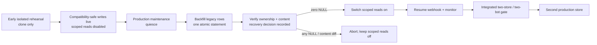

# Rabet SaaS MVP — Legacy Transition, Backfill Readiness and Delivery Sequence

**Status:** design proposal only. This PR executes no SQL, creates no store,
member, invitation, bot or webhook, changes no deployment, and touches no
production data.

**Repository baseline:** `main` at
`bab0649213461d9df7747a75b54c689e7f9377ef`.

**Related documents:**

- [SAAS_MVP_ARCHITECTURE.md](./SAAS_MVP_ARCHITECTURE.md) — target ownership,
  mobile experience, Telegram provisioning and component decisions.
- [S1.2_TENANT_OWNERSHIP.md](./S1.2_TENANT_OWNERSHIP.md) — the original backfill
  plan and rollback boundary.
- [S1.3A_SAAS_DATA_ARCHITECTURE.md](./S1.3A_SAAS_DATA_ARCHITECTURE.md) — the
  transitional write contract and its explicit limits.
- [RENDER_DEPLOYMENT.md](./RENDER_DEPLOYMENT.md) — current deployment, restore
  point and webhook-cutover context.

**Central rule:** a successful backfill is **not** tenant isolation. It proves
that the rows present during one locked transaction are owned by one legacy
store at one point in time. It does not prove store-scoped reads, per-store
Telegram identity, merchant authorization, or safe operation with two stores.

---

## 1. Contract decisions required before any production backfill

The following owner decisions must be approved first. C1–C3, C7–C10 block the
production backfill because the current backfill and runtime cannot express the
result. C4–C6 block the second store and must be approved before Phase 5; C6 is
also a Phase 3 prerequisite. They do not need to be implemented before the legacy
backfill.

| # | Decision | Why it must precede the backfill | Evidence / current gap |
| --- | --- | --- | --- |
| C1 | The legacy store's post-cutover owner: an invited merchant, or the platform operator, and the store lifecycle/activation authority | Membership, invitation, support ownership and customer readiness are undefined today; `app_user` has no credentials and no membership is created by the backfill | `src/db/schema/tenant.ts:26-42`; `legacy-store-backfill.sql:300-316` creates only `store`; lifecycle table in the architecture document §4.3.1 |
| C2 | The final ownership contract: all eight roots `NOT NULL`, explicit `inquiry.store_id`, derived records constrained, no NULL compatibility after cutover | The existing backfill leaves nullable columns and no composite ownership FKs; NULL tolerance remains in runtime | `store-context.ts:125-131`; `drizzle/0006_tenant_ownership_expansion.sql`; `S1.3A_SAAS_DATA_ARCHITECTURE.md` §11 |
| C3 | One merchant = one store, and one active store membership | The schema is many-to-many by design; the MVP must fail closed on zero or multiple memberships | `src/db/schema/tenant.ts:19-33`, `:143-173`; `S1.3A_SAAS_DATA_ARCHITECTURE.md` §1 |
| C4 | Per-store uniqueness contract for category/product slugs, template keys, customer Telegram ids and update ids | The existing global unique keys make two stores collide and can expose another store's template | `src/db/schema/customer.ts:39`; `src/db/schema/telegram.ts:43`; `src/db/schema/catalog.ts:68`, `:161`; `src/db/schema/content.ts:35`; `templates.ts:242-251` |
| C5 | Per-store configuration contract: one `bot_setting` row per store, one notification setting per store, enabled languages per store | Both settings tables are constrained to `id = 1` | `src/db/schema/settings.ts:41`, `:76-78`; `src/db/schema/seller-notifications.ts:51`, `:78-81` |
| C6 | Telegram connection contract: one ready connection per store, per-connection webhook secret, `(connection_id, update_id)` dedup, and a fail-closed rule for ambiguous `managed_bot` events | The current webhook has one process-wide secret and one global update id; official events carry creator identity but no attempt id | `src/lib/telegram/webhook.ts:335-359`; `src/db/schema/telegram.ts:43`; architecture §8.3 |
| C7 | Cutover policy: maintenance window, quiescence method, abort criteria, restore point and rollback boundary | `ACCESS EXCLUSIVE` locks block reads as well as writes; no production lock duration is known | `legacy-store-backfill.sql:99`, `:137-159` |
| C8 | Whether the legacy backfill remains a one-time operator artifact or becomes a tested runbook step | It is deliberately not wired into any runner, workflow or build | `S1.2_TENANT_OWNERSHIP.md` §5; `docs/backfill/*.sql` |
| C9 | Merchant lifecycle while `onboarding`: what the merchant may manage before customer readiness, and who activates the store | The runtime currently has no merchant lifecycle; ambiguity would either block onboarding or expose an unready store | Architecture §4.3.1; `src/db/schema/tenant.ts:35-42` |
| C10 | Reviewed pre/post content-preservation method and recovery decision (RPO, restore path, owner, abort authority) | The existing snapshot is not content-complete; a production backfill cannot start without a reviewed proof and a tested recovery path | Architecture §3.5 F12; delivery §3.3 and §4.6 |

### 1.1 Two different gates

Do not merge these into one approval:

1. **Pre-backfill gate:** C1, C2, C3, C7, C8, C9 and C10. These decide what the
   backfill means and whether it is operationally safe, including the reviewed
   recovery decision and pre/post content-preservation check.
2. **Pre-second-store gate:** C4, C5 and C6, the lifecycle/activation rule from
   the architecture document, the target read/write scoping, and the integrated
   two-store/two-bot acceptance matrix. These decide whether a merchant store may
   exist beside the legacy store.

The backfill must run **before any second store is created**. The current
backfill refuses an unrelated store, and the current runtime fails every write
path that calls the legacy resolver when more than one store exists. (Seller
inbox and delivery-retry paths do not call it, which is one reason the second
store is unsafe even after the backfill.) Both behaviors are safety properties,
not bugs to route around.

The order is not "deploy every scoped read, then backfill". It is:

1. deploy only compatibility-safe writes and dormant scoped functions;
2. keep scoped-only reads disabled;
3. run the production maintenance and backfill;
4. verify content and ownership;
5. switch scoped reads on only after the verification shows zero `NULL` rows in
   the required roots;
6. enable a second store only after the integrated isolation gate.

Deploying scoped-only reads while legacy rows still have `NULL` ownership would
make those rows invisible or unusable. That is prohibited. Any deployment or
readiness check that would enable scoped-only reads must fail closed and keep the
legacy read path active while any required legacy root still has a `NULL`.

---

## 2. Does the existing backfill still match the contract?

The artifacts are `docs/backfill/legacy-store-backfill.sql` and
`docs/backfill/legacy-store-verification.sql`. They were reviewed against the
current schema, runtime and tests.

### 2.1 What is still correct

| Property | Evidence | Assessment |
| --- | --- | --- |
| One atomic `DO` statement | `legacy-store-backfill.sql:38-603`; `S1.2_TENANT_OWNERSHIP.md` §5.1 | Keep |
| Idempotent legacy store creation and reuse | `legacy-store-backfill.sql:292-316`; test `tests/db/tenant-ownership.test.ts:629` | Keep |
| Migration baseline check | `legacy-store-backfill.sql:101-132`; test `:900` | Keep, but it only checks a count, not the expected journal identity |
| Schema and eight-root column checks | `legacy-store-backfill.sql:114-132` | Keep |
| Exact legacy store identity check | `legacy-store-backfill.sql:311-315`; test `:829` | Keep |
| Refuses a pre-owned row or another store | `legacy-store-backfill.sql:318-336`; tests `:790`, `:862` | Keep |
| Updates only the eight roots | `legacy-store-backfill.sql:350-357` | Keep |
| Derived rows inherit, not copied | `legacy-store-backfill.sql:338-357`; `S1.2_TENANT_OWNERSHIP.md` §2.1 | Keep |
| Preserves `updated_at` by disabling touch triggers | `legacy-store-backfill.sql:343-364` | Keep if trigger names remain exact |
| Postflight no NULL / no wrong store | `legacy-store-backfill.sql:367-383`; verification `:40-71` | Keep |
| Relationship checks | `legacy-store-backfill.sql:399-461`; verification `:73-127` | Keep |
| Activation, delivery and Telegram identity preservation | `legacy-store-backfill.sql:269-289`, `:563-592` | Keep |
| Rollback during the transaction | The single `DO` statement rolls back on any exception; test `tests/db/tenant-ownership.test.ts:736` | Keep |

### 2.2 What no longer matches the target contract

| Gap | Evidence | Consequence |
| --- | --- | --- |
| No `NOT NULL` enforcement | `drizzle/0006_tenant_ownership_expansion.sql` adds nullable columns; the backfill only updates values | New `NULL` rows are still possible until the scoped write path and later constraints ship |
| No composite ownership foreign keys | Only single-column FKs exist; `S1.2_TENANT_OWNERSHIP.md` §2 defers composite FKs | A dependent row can still point across stores if a future write path is wrong |
| No `inquiry.store_id` | `src/db/schema/inquiry.ts` has no store column; ownership is inferred | Inquiries and seller replies need join-based scoping and cannot be indexed by store directly |
| No per-store uniqueness | Global unique keys remain (`customer.telegram_id`, `telegram_update.update_id`, slugs, template key) | The backfill cannot make two stores safe |
| No connection identity | The backfill stamps `telegram_update.store_id`, but there is no `telegram_connection` | A future second bot still has no trustworthy store mapping |
| No membership creation | `legacy-store-backfill.sql:300-316` creates only `store` | After backfill there may be zero `store_membership` rows; the merchant login has no owner |
| Preservation snapshot is not content-complete | Baseline/postflight at `:163-290` and `:466-593` hash counts, links, settings, delivery state, update state and activation; translations and catalog names/prices are only counted; inquiry bodies and snapshots are not hashed | A content mutation that preserves counts and links could pass. This is a real weakness in the "preserved" claim |
| No dry-run artifact | Only the write statement and post-write verification exist | Lock timing, trigger names and postflight behavior cannot be measured on a clone without an ad hoc transaction |
| No statement timeout inside the `DO` body | `lock_timeout` is set at `:99`; no `statement_timeout` is set | Locks can be acquired within 10 s and the update can then run longer than the window |
| `ACCESS EXCLUSIVE` blocks reads | `:137-159` locks 21 tables including `telegram_update`, `inquiry` and `inquiry_message` | The customer bot and dashboard can stall for the transaction duration, not just writers |
| It is not a migration or runner step | `S1.2_TENANT_OWNERSHIP.md` §5 | An operator must run it with `psql` and capture evidence; no automation |

### 2.3 Verdict

The backfill **still matches the S1.2 point-in-time legacy ownership contract**
and should not be rewritten merely for style. It does **not** match the target
SaaS contract and cannot be used as the final ownership migration. The right
sequence is:

1. approve C1–C3, C7–C10;
2. run the isolated backfill rehearsal on a verified clone;
3. deploy only compatibility-safe writes and dormant scoped functions; keep
   scoped-only reads disabled;
4. run production maintenance, quiesce, backfill the legacy rows and verify
   content and ownership;
5. switch scoped reads on only after the required roots show zero `NULL`;
6. enable a second store only after C4–C6 and the integrated cross-store tests
   pass;
7. add `NOT NULL`, composite FKs and per-store uniqueness as separate,
   reversible steps with their own backfills.

Do not combine steps 4 and 7 into one production jump. Do not enable scoped-only
reads before step 5.

---

## 3. Dry-run evidence and checks across all eight ownership roots

### 3.1 Read-only preflight (production, before any write)

Run inside the approved inspection session, not from the application, and record
the output. This is read-only.

For each of `bot_setting`, `category`, `customer`, `message_template`,
`payment_method`, `product`, `seller_notification_setting`, `telegram_update`:

- total rows;
- rows with `store_id IS NULL`;
- rows with `store_id` equal to the legacy store id;
- rows with any other `store_id`;
- distinct `store_id` values.

Also record:

- `store` row count and the exact identity of any `legacy-store` row;
- `app_user` and `store_membership` counts;
- the applied migration ledger count and tags (`drizzle.__drizzle_migrations`);
- `getWebhookInfo` `pending_update_count`, `last_error_date`,
  `last_error_message` and the registered URL (read-only Telegram call by the
  operator, not this session);
- the count of `telegram_update` rows with `processed_at IS NULL` and a live
  lease;
- the count of inquiries/messages and the latest `updated_at`;
- `pg_total_relation_size` for the 21 locked tables, to estimate lock duration.

The existing verification SQL is **post-write only**; it is not a dry run. A
separate read-only preflight artifact should be added in the implementation PR,
not in this design PR.

### 3.2 Isolated backfill rehearsal (scheduled early)

Use a verified Neon branch/snapshot of production, never production itself. This
rehearsal is an early Phase 1 activity, in parallel with the first catalog slice;
it does not require production maintenance or a merchant store. Its evidence is a
precondition for the production backfill, not for the first code slice.

1. Record the snapshot/branch id and creation time as the recovery point.
2. On the clone, run the same whole-file `psql` execution:
   `psql "$CLONE_URL" -v ON_ERROR_STOP=1 -f docs/backfill/legacy-store-backfill.sql`.
3. Run `legacy-store-verification.sql`; every `assertion` row must be `true`.
4. Independently compare pre/post content, not only counts:
   - category/product slugs, prices, activation and sort order;
   - every translation body;
   - template keys, descriptions and translation bodies;
   - inquiry `product_snapshot`, `selected_options`, status, reference;
   - every `inquiry_message` body, author and Telegram message id;
   - customer Telegram identity and language fields;
   - seller notification settings and delivery state;
   - Telegram update ids, types, receipts and processed state;
   - `updated_at` on the seven trigger-managed tables.
   A row-level `EXCEPT`/`EXCEPT ALL` comparison or a per-table content digest is
   acceptable; a count alone is not.
5. Record wall-clock duration, lock wait, any `lock_timeout` abort and the
   postflight notice.
6. Repeat the negative cases on separate clones: second store present, wrong
   legacy slug identity, a pre-owned row, and a missing schema object. Each must
   abort with no ownership change. These are already covered on disposable
   databases by `tests/db/tenant-ownership.test.ts:736`, `:790`, `:829`, `:862`
   and `:900`, but the production clone is the operational evidence.

### 3.3 Dry-run acceptance

- All eight roots report zero NULL, zero wrong-store and zero other-store rows
  after the rollback-verified rehearsal.
- The content comparison is empty.
- The negative cases abort.
- The measured lock duration fits the approved window with margin.
- The restore point is verified by restoring a scratch branch and comparing a
  known row.
- A reviewer has signed off the pre/post content-preservation method and the
  recovery decision (RPO, restore path, owner, abort authority) before any
  production backfill.

### 3.4 Current evidence gap

This session has no production or clone access. The existing tests prove the SQL
on disposable PostgreSQL, but they do **not** prove the production lock time,
the production trigger names, the production row counts, the live restore point
or the live Telegram queue. Those remain unverified until the operator runs the
approved rehearsal.

---

## 4. Production cutover design (not executed)

### 4.1 Preconditions

- C1–C3, C7–C10 approved in writing.
- Compatibility-safe write code is deployed and health-checked; scoped-only
  reads are present only behind a disabled guard. No second store exists.
- The isolated backfill rehearsal has passed and the reviewed pre/post content
  method is recorded.
- A restore point is recorded and a restore rehearsal has passed.
- The Telegram webhook is paused with `deleteWebhook(drop_pending_updates=false)`
  (or the approved equivalent), and `pending_update_count` is recorded.
- In-flight update leases are drained or allowed to expire; no attempt is
  actively writing.
- The isolated rehearsal and content comparison passed on the clone.
- The maintenance window and communication are approved.

### 4.2 In-flight Telegram work

The webhook claims an update with a 30-second lease
(`src/lib/data/telegram.ts:13-14`, `:67-160`) and writes a durable receipt before
completing (`:240-273`). Cutover rules:

- Do not start the backfill while an attempt holds a live lease.
- Pause delivery before the lock so new updates do not queue on a blocked table.
- Allow the lease window plus a margin to expire; then count unprocessed rows.
- A committed receipt survives the backfill because the backfill does not touch
  `payload`; a retry after cutover must find the receipt and must not duplicate
  the customer message.
- After the backfill verifies and scoped reads are switched on, re-register the
  webhook with the same secret (or the approved per-connection secret) and
  `drop_pending_updates=false`, then watch `pending_update_count` drain to zero.
- Any update that arrives after the lock but before re-registration is held by
  Telegram according to the approved runbook; it must be deduplicated by
  `(connection_id, update_id)` in the target.

The current runbook documents pause/resume and the 24-hour Telegram queue at
`docs/RENDER_DEPLOYMENT.md:554-568`. It does not currently cover this backfill;
the implementation PR must extend it or add a separate runbook.

### 4.3 Execution order

1. Confirm the early isolated rehearsal, the reviewed content method and the
   recovery decision are recorded.
2. Record the restore point and snapshot id.
3. Confirm compatibility-safe write code is live, scoped-only reads are behind a
   disabled guard, and no second store exists.
4. Pause webhook delivery; record pending count.
5. Drain/expire in-flight leases; record unprocessed rows.
6. Run the read-only preflight and record all eight roots.
7. Run the whole-file backfill with `ON_ERROR_STOP=1`; do not split it.
8. Run `legacy-store-verification.sql`; review every assertion, not just the exit
   code.
9. Run the independent content comparison and the eight-root NULL/wrong-store
   query.
10. Switch scoped reads on only if the required roots show zero `NULL` and the
    guard's own check passes. The guard must fail closed and keep the legacy read
    path active if any `NULL` remains. If it cannot prove zero, abort the cutover.
11. Resume the webhook; monitor `pending_update_count` and duplicates.
12. Run the reconciliation checks in §4.5.
13. Record the final evidence bundle.

### 4.4 Lock-time review

`lock_timeout = 10s` bounds lock **acquisition**, not execution
(`legacy-store-backfill.sql:99`, `:137-159`). The statement takes
`ACCESS EXCLUSIVE` locks on 21 tables, which blocks reads as well as writes.
Before the window:

- estimate table sizes and the update cost for the eight roots;
- set an approved `statement_timeout` outside the file or in the `psql` session;
- confirm no long-running transaction holds a conflicting lock;
- measure the clone run and add margin;
- define the maximum acceptable lock duration and the abort action if exceeded.

If the duration is unacceptable, split the work by table with a reviewed,
resumable plan. Do not silently extend the window or run an unbounded statement.

### 4.5 Post-cutover reconciliation

Run after commit and again after the first webhook drain:

- Eight roots: `NULL` count = 0; wrong-store count = 0; other-store count = 0.
- `store` count = 1 and identity still exact.
- Category parent/child, product/category, inquiry/customer, inquiry/product,
  inquiry-message/thread and delivery/thread mismatches = 0.
- Content comparison: no changed slug, price, translation body, template body,
  inquiry snapshot, message body, delivery state, activation flag or `updated_at`.
- Telegram: duplicate `update_id` = 0 in the legacy scope; unprocessed rows are
  either actively leased or explicitly reconciled; receipts preserved.
- Inquiries/messages: counts and latest timestamps match the baseline.
- Notification deliveries: status counts and references unchanged.

Then monitor for 24 hours:

- any new `NULL` `store_id` in the eight roots;
- any cross-store relation mismatch;
- webhook `last_error_message` and pending count;
- duplicate customer/inquiry effects.

**No new NULL ownership after cutover** is proven only when:

1. compatibility-safe writes that stamp ownership are live;
2. the backfill and content verification show zero `NULL` and zero wrong-store
   rows;
3. scoped reads were switched on only after that verification;
4. no store is missing or ambiguous;
5. the 24-hour monitor shows zero new NULLs; and
6. the final `NOT NULL` constraint is applied successfully.

A one-time zero count immediately after the backfill is not that proof.

### 4.6 Recovery point, abort and rollback

| Item | Design |
| --- | --- |
| Recovery point | Verified Neon branch/snapshot immediately before the window; record branch id and timestamp |
| RPO | Backfill changes only `store_id`; the RPO is the snapshot creation time. Any write after the snapshot is lost only if the branch is restored |
| RTO | Restore the branch, repoint the connection, verify health and ownership. The restore rehearsal is required; the actual RTO is unverified until measured |
| Abort before commit | Any preflight mismatch, wrong store identity, pre-owned row, second store, lock timeout, statement timeout, postflight assertion failure or content difference. The `DO` statement rolls back atomically |
| Abort during webhook drain | Keep the webhook paused; do not re-run the backfill until the cause is understood |
| After commit | Do not drop columns. The safe application rollback is the previous image, which ignores `store_id`. A data rollback requires the verified restore point |
| Scoped-read switch rollback | Disable the scoped-read guard and return to the legacy read path while keeping the backfill and additive schema. Re-enable only after the cause is fixed and verification is repeated |
| Rollback boundary | Before commit: automatic. After commit: application rollback is cheap; data rollback is a restore, not a SQL undo. Dropping ownership columns is destructive and needs a separate approved plan |
| Review | Record the exact SQL file hash, psql version, operator, window, lock duration, assertion output, content-diff output and restore point |

The existing `S1.2_TENANT_OWNERSHIP.md` §6 rollback boundary remains correct:
before backfill, dropping additive columns is safe; after backfill, dropping them
is destructive.

---

## 5. Ordered delivery plan ending in an invite-only pilot

Each phase has a gate. The gates are prerequisites, not a strict serial order;
phases may overlap only where the table allows it. Every implementation slice,
starting with the Phase 1 catalog slice, adds its own two-store negative tests;
the Phase 5 gate accrues and repeats them as one integrated acceptance run.

| Phase | Work | What it proves | What it does not prove | Can run in parallel with | Must wait for |
| --- | --- | --- | --- | --- | --- |
| 0 | Approve C1–C10, lifecycle/activation, recovery, content-preservation and Telegram correlation acceptance | The target contract is agreed | Anything about production | Doc review, UI design | Nothing |
| 1 | **First slice:** store-scoped product list + availability update behind a fixtures-only `StoreScope` seam; two-store negative tests; existing single-store path untouched. **In parallel:** isolated backfill rehearsal on a verified clone | The catalog tenancy seam works with two stores in PostgreSQL tests; the backfill content/lock/restore evidence is measured | Auth, UI, Telegram, production readiness | Rehearsal, UI design, test fixtures | C2; StoreScope contract; rehearsal prerequisites |
| 2 | Merchant credential, invitation, merchant session, operator/merchant split, lifecycle/activation UI; scope the catalog call sites to the resolved membership; add this slice's two-store negative tests | A merchant can manage their own store while onboarding; membership is not customer readiness | Telegram connection; production isolation | UI strings; invitation content | Phase 1 gate; C1, C3, C9 |
| 3 | Telegram connection model, per-connection webhook, Managed Bot spike first, then implementation; keep the legacy bot unchanged; add this slice's two-store/two-connection negative tests | Inbound updates resolve one connection to one store; ambiguous provisioning fails closed | Live correlation until spike passes; second-store safety | Test-bot spike (test accounts only) | C6; spike result; Phase 2 gate |
| 4 | Production maintenance: confirm compatible writes live and scoped reads disabled; quiesce; backfill; verify content/ownership; switch scoped reads on; reconcile and monitor | The legacy rows are owned at cutover; scoped reads only start after zero NULL | Tenant isolation; second-store safety | Staging fixture preparation | Phase 1–3 gates; C1–C3, C7–C10 |
| 5 | Integrated two-store/two-bot acceptance gate on staging, accrued from every slice's negative tests | Cross-store access is denied at the data layer, membership boundary, webhook and worker | Live Telegram production behavior; scale | Pilot preparation | Phases 2–4; full matrix |
| 6 | Invite-only pilot: legacy store per C1, then a second production store only after Phase 5 | The real merchant journey works under isolation | Scale, billing, staff, WhatsApp | Monitoring and support | Phase 4 and Phase 5 gates |
| 7 | Final hardening: `NOT NULL`, composite constraints, drop legacy resolver and old unique indexes; later notifications | The transitional code can be retired | Future product scope | Notification milestone | Zero NULL, zero cross-store mismatches, all stores migrated |

### 5.1 What must not run in parallel or out of order

- Do not run the production backfill before compatibility-safe write code is
  deployed, the early rehearsal passes, and the recovery/content method is
  reviewed. The merchant and Telegram code may be deployed dark, but it must not
  be enabled before the scoped-read switch and the Phase 5 gate.
- Do not switch scoped-only reads while required legacy rows still have `NULL`
  ownership. The switch is a separate, guarded step after verification.
- Do not create a second production store before the backfill, the scoped-read
  switch and the Phase 5 integrated gate. Today the legacy resolver fails closed
  on two stores and global reads still leak.
- Do not drop the legacy unique indexes or singletons before their replacement
  data is backfilled and verified.
- Do not enable a second production bot before the two-connection isolated tests
  and the managed-bot correlation spike pass.
- Do not convert the operator-managed legacy store into a merchant store before
  C1 and a separate approved cutover.
- Do not treat the backfill as the isolation gate.

### 5.2 Pilot shape

1. **Pilot A:** the legacy store, explicitly operator-managed unless C1 approves
   an invited owner and a separate cutover. All catalog, translations, inquiries
   and activation flags must match the pre-cutover baseline.
2. **Pilot B:** one second store created only after Phase 5. It uses a separate
   merchant, separate store, separate bot connection and synthetic/staging data
   first.
3. The second production store is enabled only after the staging two-store matrix
   passes and the operator records the evidence.

### 5.3 Supported production order

The order above is the only supported order for the backfill/read-switch path.
A clone-only rehearsal is not a production action. A compatible write path is not
a scoped read switch. The backfill is not a read switch. The integrated gate is
not the backfill.

### 5.4 Render deployment verification is not SaaS acceptance

Direct Render verification (`/api/healthz`, GHCR digest, Render Live, exact SHA)
proves the image and process are running. It does not prove:

- the backfill content/ownership result;
- zero `NULL` ownership or scoped-read correctness;
- two-store or two-bot isolation;
- merchant membership, lifecycle or Telegram correlation.

SaaS acceptance requires the isolated checks in §3 and §6, the Phase 5 integrated
gate, and the recorded pilot evidence. A green Render deploy is necessary for
serving the release but is not a tenant-isolation or SaaS acceptance result.

Future plan capability is also not SaaS acceptance. Tenant authorization answers
who may manage the store; a later server-side store capability will answer
whether a feature exists for that store. It must be enforced in the action/API and
may also hide unavailable UI. No plan, pricing, billing or capability schema is
scheduled by this document.

### 5.5 Evidence levels

| Level | What it proves | Examples |
| --- | --- | --- |
| Documentation review | The design and decisions are internally consistent and approved | This PR, reviewer sign-off |
| Isolated checks | Code/SQL behavior on disposable or cloned data | CI PostgreSQL suites, two-store negative tests, clone rehearsal, synthetic Telegram events |
| Live verification | The deployed system behaves as intended with real data/providers | Production backfill evidence, live webhook/bot test, pilot acceptance |

A check at one level never implies a higher level. In particular, a docs review is
not an isolated test, an isolated test is not a production backfill, a green Render
deploy is not SaaS acceptance, and a successful backfill is not tenant isolation.

---

## 6. Two merchants, two stores and two bot connections in isolation

### 6.1 Fixture shape

Create in an isolated PostgreSQL database (the existing
`tests/db/helpers.ts` pattern).

**Phase 1 catalog-slice subset** needs only:

- `store` A and B, both active, distinct slugs.
- Categories/products with the same slug in A and B, different prices and
  activation states.
- A trusted `StoreScope` constructed in the test fixture from each store's
  server-side id; no browser, form, JWT or route supplies it.
- No merchant credential, session, Telegram connection or bot is required for
  this slice.

**Later-phase additions** for the integrated matrix:

- `app_user` A and B, both active, distinct emails.
- `store_membership` A->A and B->B, both active, role owner.
- `telegram_connection` A and B, both ready, distinct public ids, bot user ids and
  webhook secret hashes.
- The same Telegram user id as a customer in A and in B.
- The same `update_id` claimed by connection A and connection B.
- Templates with the same key in A and B.
- One inquiry in A and one in B, plus one message and one delivery each.
- One notification setting per store, both disabled.

Do not use a real Telegram token. Use the existing injected transport/test seam
(`tests/db/telegram-journey.test.ts` and `src/lib/telegram/webhook.ts:60-73`).

### 6.2 Phase 1 catalog-slice cases

| Case | Setup / call | Expected |
| --- | --- | --- |
| A lists A only | `listCatalogProductsForStore(db, scopeA)` | Exactly A's products; B's same-slug product is absent |
| Scoped translations | A's list query | Only A-owned product translations are read; B's translation rows are not loaded |
| Cross-store category hint | `listCatalogProductsForStore(db, scopeA, categoryB.id)` | No B products; no B translations |
| A cannot update B | `updateCatalogProductAvailabilityForStore(db, scopeA, productB.id, false)` | Not-found/no write; B's availability is unchanged |
| Missing scope | Call the scoped function with `null`/`undefined`/unbranded id | Throws/denies before SQL; no write |
| Invalid scope | Scope with a non-existent store id | Denied; no write |
| B unchanged | Read B's product and activation after A's failed update | Byte-for-byte unchanged |
| Existing single-store path | Existing `listCatalogProducts` / `updateCatalogProduct` suites | Pass without signature or behavior change |
| No browser store id | The scoped functions take only a server-built `StoreScope` | There is no form/URL/header store-id parameter to trust |

### 6.3 Integrated matrix

| Boundary | Test | Expected |
| --- | --- | --- |
| Merchant session | A signs in; B's store id is placed in URL and form | A resolves A only; B id is 404, never a switch |
| Membership | Revoke A's membership mid-session | A is denied on the next request; no cached scope survives |
| Session version | Increment `app_user.session_version` | A's old JWT is rejected |
| Onboarding lifecycle | A's store is `onboarding` with active membership | A can manage own catalog/setup; test/share and customer serving are denied |
| Suspended lifecycle | A's store is `suspended` with active membership | A gets read-only access; writes, test/share and customer serving are denied |
| Customer-ready | A's store is `active` and connection is `ready` | Test/share and customer serving are enabled |
| Catalog read | A lists products/categories | Only A rows; B's same slug is invisible |
| Catalog write | A updates B's product id | No write; generic not-found |
| Relation | A creates a product under B's category | Constraint/ownership error; no write |
| Template | A creates a key that exists in B | Creates A's own row; does not return B's |
| Customer identity | Same Telegram id messages both bots | Two customer rows, one per store |
| Update dedup | Same update id arrives on A and B | Both process once; no cross-store collision |
| Webhook secret | A's URL with B's secret | 401; no write |
| Connection status | Revoke B's connection, then deliver an update | 401/404; no business write |
| Inquiry read | A opens B's inquiry id | 404; no message content |
| Seller reply | A replies to B's inquiry | No write/send |
| Inquiry relation | A creates an inquiry for B's product | Cross-store error |
| Notification worker | B's delivery retried in A's scope | Not claimed; no send |
| Retry after revoke | A's in-flight update completes after A's connection is revoked | Completion rejected; no send |
| Settings | A changes currency/language | B unchanged |
| Store link | A's bot username resolves A's connection | Exactly one store |

### 6.4 Commands and CI

Add the new suites under `tests/db/` and run them in the existing isolated
PostgreSQL CI job (`.github/workflows/ci.yml` `db` job). The job already applies
the full migration chain and refuses Neon/Vercel credentials. A managed-bot
provisioning suite uses synthetic `managed_bot` events and an injected HTTP
transport; it does not contact Telegram. Each implementation slice adds its own
negative cases from §6.2 onward; they are not deferred to the integrated gate.

The live test-bot spike is separate and operator-run. It is not a CI job and must
never use production credentials.

### 6.5 Exit criteria before a second production store

- Every matrix row passes in CI on the exact SHA to be deployed.
- The full existing suite still passes (no regressions in catalog, inquiry,
  notifications or Telegram journeys).
- The operator records the store/connection ids and the CI run URL.
- The second store is created through the approved invitation flow, not by a
  manual SQL insert.
- Cross-store access is denied in staging with real sessions and two real
  connections before production gets the second store.

---

## 7. First implementation PR after this design review

This section replaces the earlier proposal to start with merchant invitations and
login. That earlier slice would add an authentication surface without proving the
data-layer tenancy seam. The first slice below is smaller, has no browser or
production route, and directly tests the isolation contract that later auth and UI
will call.

### 7.1 Selected slice: tenant-scoped catalog read and availability update

**Scope:** list products for one store and update one product's availability
(`is_active`) through a trusted `StoreScope`. No price update in this slice; price
uses the same scope in the very next slice, before any merchant UI is enabled.

**Actual existing functions and the narrow seam**

| Existing code | Current behavior | Slice use |
| --- | --- | --- |
| `listCatalogProducts(db, categoryId?)` — `src/lib/data/catalog.ts:239` | Global query; no store predicate; loads all translations | Keep unchanged for the existing single-store path; extract a private shared projection/translation helper if needed |
| `updateCatalogProduct(db, productId, {slug?, isActive?})` — `src/lib/data/catalog.ts:1107` | Resolves the legacy store, then updates by product id | Keep unchanged; add a scoped availability update with a `store_id` predicate instead of reusing the legacy resolver |
| `updateCatalogProduct` callers — `src/app/actions/catalog.ts` | Operator dashboard path | Do not wire the new slice into any route |

The narrowest design is an **additive seam**, not a rewrite:

- `src/lib/data/store-scope.ts` (new, server-only) — a branded `StoreScope`
  type and an assertion that rejects `null`, `undefined`, malformed or unbranded
  values. The type cannot be constructed from browser input.
- `src/lib/data/catalog.ts` — add:
  - `listCatalogProductsForStore(db, scope, categoryId?)`, reusing the existing
    record shape and translation assembly but adding `WHERE store_id = $1`.
    The translation query must be scoped to store-owned product ids in SQL; do
    not load every store's translations and filter in memory. A supplied
    `categoryId` is verified against the scope (or applied together with
    `store_id`), never trusted on its own.
  - `updateCatalogProductAvailabilityForStore(db, scope, productId, isActive)`,
    one `UPDATE ... WHERE id = $1 AND store_id = $2 AND deleted_at IS NULL
    RETURNING ...`.
- `tests/db/helpers.ts` — add a fixture helper that reads a store by id and
  returns a trusted `StoreScope`. This is test-only; production scope creation is
  a later session/membership concern.
- `tests/db/catalog-store-scope.test.ts` (new) — the two-store acceptance cases.
- Existing `tests/db/catalog.test.ts` and
  `tests/db/catalog-persistence.test.ts` — unchanged and must still pass.

There is no new production route, page, Server Action, migration or UI. The
existing global functions remain the single-store path until later call sites
migrate.

**Why this before invitations/auth.** The repository evidence is that the read
side is the actual isolation gap: `listCatalogProducts` has no store predicate
(`catalog.ts:239-321`) and the dashboard calls it globally
(`src/lib/catalog/load-admin-data.ts:29-66`). The write side already has a narrow
availability update. Proving this seam first gives the later merchant session a
tested function to call, instead of adding a login that still reads every store.
This is a change from the previous draft's first-PR selection and supersedes it.

### 7.2 Dependencies

- Approved C2 (final ownership contract direction) and the `StoreScope` contract.
- No dependency on merchant invitations, credentials, sessions, Telegram,
  backfill execution or a second production store.
- The existing `tests/db/helpers.ts` disposable PostgreSQL infrastructure and
  the existing CI `db` job.
- The existing source tree; no new dependency.

### 7.3 User outcome

No visible user-facing change in this PR. The developer/user outcome is a
provably store-scoped catalog read and availability update that later merchant
screens can call without trusting a browser store id. It does not enable a
merchant or create a production store.

### 7.4 Acceptance tests

Use the existing isolated PostgreSQL test pattern with **two stores, A and B**,
and a fixture-built server-side `StoreScope` for each.

- A lists only A's products; B's product with the same slug is absent.
- A's translation read is scoped in SQL and does not load B's translation rows.
- A passing B's category id returns no B products and no B translations.
- A's scoped availability update changes A's product.
- A's scoped availability update targeting B's product id writes nothing and B's
  `is_active` is unchanged.
- Missing, malformed or unbranded scope is denied before any SQL write.
- A scope for a non-existent store is denied and writes nothing.
- B's product, price, translation and activation row are unchanged after A's
  failed update.
- The existing single-store `listCatalogProducts` and `updateCatalogProduct`
  suites pass unchanged.
- The test helper and test file run in the existing `tests/db` CI job without
  new services, scripts or secrets.

### 7.5 Stop condition

Stop before implementation if any of the following is true:

- The `StoreScope` cannot be made structurally distinct from a browser-supplied
  string without a production auth/session dependency.
- The scoped queries cannot be added without changing the existing single-store
  function contracts and breaking their tests.
- A two-store test cannot prove A cannot read or update B.
- The slice would require a schema, migration, route, credential or production
  data change.
- The PR would need to create a store, run the backfill or connect a bot to make
  its tests pass.

### 7.6 What this PR explicitly does not do

- It does not add merchant invitations, credentials, sessions or login.
- It does not add a production route, page, Server Action or dashboard UI.
- It does not wire the scoped functions to any browser path.
- It does not update price (the immediate next field on the same seam).
- It does not change the legacy resolver or the eight ownership roots.
- It does not add settings, per-store uniqueness, composite FKs or Telegram.
- It does not run the backfill or create a second production store.
- It does not prove customer readiness, Telegram correlation or full tenant
  isolation.

### 7.7 How later work replaces the legacy paths

1. **Next catalog slice:** add the same scoped seam for price, reusing the scope
   type and the same `store_id` predicate. Do not broaden the legacy
   `editCatalogProduct` path.
2. **Merchant identity and UI:** after C1/C3/C9, the merchant session builds the
   `StoreScope`; dashboard loaders call the scoped functions. Onboarding uses the
   scoped catalog while the store is `onboarding`.
3. **Inquiry, settings and Telegram slices:** each adds its own scoped functions
   and its own two-store negative cases, as in §6.
4. **Backfill and read switch:** after the production backfill verifies zero
   `NULL` and content preservation, scoped reads are switched on. The legacy
   global functions remain a fallback for the operator-managed legacy store until
   its separate ownership decision and cutover.
5. **Deletion:** remove `listCatalogProducts` / `updateCatalogProduct` and the
   legacy resolver only when all callers use `StoreScope`, no `NULL` ownership
   remains, the legacy store is migrated or explicitly retired, and the full
   existing suite plus the integrated matrix pass. Removal belongs to a separate
   reviewed PR; it is not part of this slice.

---

## 8. Evidence gaps and stop-and-decide items

| Gap | Why it matters | Smallest next evidence |
| --- | --- | --- |
| No production inspection in this session | The applied migration state, store count, `NULL` counts and webhook state are assumptions | Operator runs the read-only preflight and records output |
| No restore rehearsal | RTO and restore integrity are unverified | Restore a scratch branch and compare a known row |
| No isolated rehearsal | Lock duration and production trigger names are unverified | Isolated rehearsal in §3.2 with content diff and timing |
| No live Managed Bot test | Creator identity is not attempt proof; correlation is UNVERIFIED | Test-bot spike in §8.4 of the architecture document, including late A/while B, duplicate, edited name/username and owner/token-change cases |
| No two-store runtime test | Read/write isolation is unproven | Phase 1 catalog-slice cases in §6.2, then each slice's negatives and the integrated matrix in §6.3 |
| Content preservation is not hashed in the existing SQL | A silent translation/inquiry content change could pass | Reviewed content digests/exceptions before the production run (§3.3) |
| Current runtime writes `NULL` when no store exists | A deployment timing mistake can create new NULLs after cutover | Deploy compatibility-safe writes, backfill, verify zero NULL, switch scoped reads, monitor, then add `NOT NULL` |
| A late `managed_bot` event from canceled/expired attempt A can arrive while B is pending | The official event has no attempt id, so A and B may be indistinguishable | Spike case; fail closed and choose an explicit fallback until proven safe |
| The backfill is not wired to a runner | Operator execution can be inconsistent | Approved runbook and evidence template, not automation |

**Stop and raise a decision** if the team cannot prove any of the following
before enabling a second production store:

1. Merchant identity resolves exactly one store from a verified membership.
2. The incoming Telegram connection resolves exactly one store from a verified
   webhook credential.
3. The legacy restore point and rehearsal are verified, and the reviewed
   content-preservation method passes.
4. Cross-store access is denied by the isolated two-store matrix.
5. Ambiguous `managed_bot` events fail closed, or a fallback is explicitly
   approved instead of automatic linking.

Until then, the correct state is one production store and no claim of tenant
isolation. The legacy store remains operator-managed until C1 and the approved
cutover.
