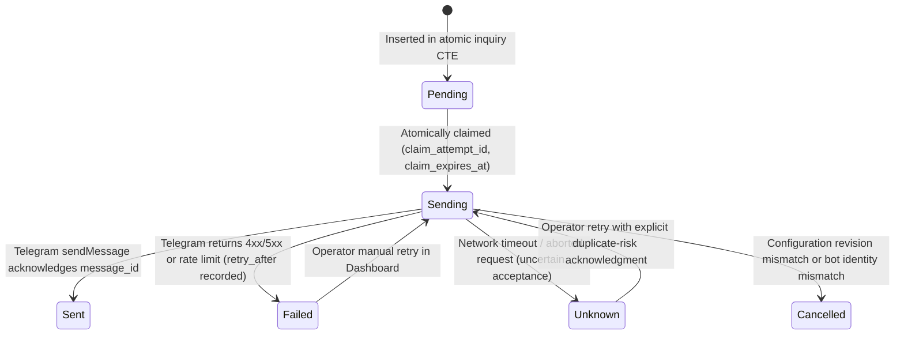

# Handoff: Seller Notification Bot v1 (Phase 12)

## 1. Executive Summary

This feature implements an **outbound-only Telegram seller notification bot** that alerts the single store seller whenever a genuinely new customer inquiry is opened on Rabet.

Key design highlights:
- **Dedicated Outbound Bot:** Operates via its own server-only bot token `TELEGRAM_SELLER_NOTIFICATION_BOT_TOKEN`. Completely decoupled from the customer-facing bot `@Mawthoqbot` (which continues handling customer journeys on its own token and webhook).
- **Atomic Event Integration:** The notification outbox row is created within the **same** database transaction/CTE batch that creates the inquiry. Replayed updates, duplicate Telegram messages, inquiry resumptions, and stale fenced attempts never emit duplicate notifications.
- **Durable Delivery State Machine:** Delivery records transition through `pending` -> `sending` -> `sent`, `failed`, `unknown`, or `cancelled`. Timeouts and uncertain network responses are marked `unknown` and require explicit operator acknowledgment to avoid duplicate Telegram alerts.
- **Dual-Schema Compatibility:** Designed for additive migration `0003_seller_notifications.sql`. If the database has not yet been migrated, capability checks safely render an "Upgrade Required" banner in the Settings UI without crashing customer flows or settings queries.
- **Server-Side Security:** All actions, connection checks, chat detection helpers, test sends, and retries strictly enforce `requireAdmin()`. Secret bot tokens are never stored in the database, never exposed in client props, never displayed in logs or URLs, and never accepted via client input forms.

---

## 2. Secrets & Configuration Contract

### 2.1 Dedicated Environment Variable
- **Secret Name:** `TELEGRAM_SELLER_NOTIFICATION_BOT_TOKEN`
- **Scope:** Server-only hosting environment secret (e.g., Vercel / environment configuration).
- **Enforcement:**
  - Never prefixed with `NEXT_PUBLIC_`.
  - Never stored in database rows.
  - Never accepted as form input from the browser.
  - Never logged or echoed into error messages.
  - Never falls back to `TELEGRAM_BOT_TOKEN` (customer bot).
  - Redaction utilities (`sanitizeTelegramError`) scrub token values from any unexpected Telegram API error bodies.

### 2.2 Singleton Settings Table (`seller_notification_setting`)
- `id`: smallint primary key default 1 (check `id = 1`).
- `enabled`: boolean default false.
- `destination_chat_id`: numeric private chat ID (regex `^[1-9][0-9]{4,19}$`). Channels, groups, and usernames are rejected.
- `language`: char(2) `'ar'` or `'en'`, default `'ar'`.
- `verified_at`: timestamptz (recorded upon successful test message send).
- `verified_bot_id`: bigint (ID of the bot that sent the test message).
- `verified_bot_username`: text.
- `verified_chat_id`: text.
- `revision`: integer default 1 (incremented when destination or verification changes).
- `last_test_at`: timestamptz (persisted rate limiter / 5-second server-side cooldown).

### 2.3 Verification Invalidation Rules
- **Destination Chat Change:** Immediately sets `enabled = false`, clears `verified_at`, increments `revision`, and cancels pending deliveries bound to the prior revision.
- **Bot Token Change in Hosting Environment:** If the server environment changes the bot token to a different bot identity, connection and enable checks verify `me.bot.id === setting.verifiedBotId`. A mismatched bot identity refuses delivery and blocks enabling until re-tested.

---

## 3. Database Schema & Migration 0003

The migration file is `drizzle/0003_seller_notifications.sql` with metadata in `drizzle/meta/_journal.json` and `drizzle/meta/0003_snapshot.json`.

### 3.1 Tables & Indexes
1. `seller_notification_setting`:
   - Singleton check: `CHECK (id = 1)`
   - Language check: `CHECK (language IN ('ar', 'en'))`
   - Destination format check: `CHECK (destination_chat_id IS NULL OR destination_chat_id ~ '^[1-9][0-9]{4,19}$')`
   - Trigger: `seller_notification_setting_touch_updated_at`
2. `seller_notification_delivery`:
   - `id`: uuid primary key default `gen_random_uuid()`
   - `event_type`: text default `'new_inquiry'`
   - `inquiry_id`: uuid foreign key references `inquiry(id)` on delete cascade
   - `reference`: text unique (format `SND-XXXXXX`)
   - `revision`: integer not null
   - `destination_chat_id`: text not null
   - `status`: text check in `('pending', 'sending', 'sent', 'failed', 'unknown', 'cancelled')`
   - `claim_attempt_id`: text (atomic worker lease)
   - `claim_expires_at`: timestamptz (lease expiration for crash recovery)
   - `attempt_count`: integer not null default 0
   - `telegram_message_id`: bigint (recorded upon delivery)
   - `error_category`: text (safe allowlisted category: `missing_token`, `api_error`, `rate_limited`, `timeout`, `network_error`, `budget_exceeded`, `bot_identity_changed`, `incompatible_configuration`)
   - `retry_after_until`: timestamptz (backoff timestamp for HTTP 429)
   - Partial Unique Index: `UNIQUE (event_type, inquiry_id)` ensuring strict at-most-once event emission per inquiry.
   - Trigger: `seller_notification_delivery_touch_updated_at`

---

## 4. Atomic Event Rules & Delivery Engine

### 4.1 Event Insertion
Inquiry creation paths in `src/lib/data/inquiry.ts`:
- `createOrResumeProductInquiry`
- `createOrResumeSupportInquiry`
- `routeAndAppendCustomerText`

Each includes an atomic CTE `delivery_insert`:
```sql
delivery_insert AS (
  INSERT INTO seller_notification_delivery (
    id, event_type, inquiry_id, reference, revision, destination_chat_id, status, created_at, updated_at
  )
  SELECT
    ${deliveryId}::uuid,
    'new_inquiry',
    id,
    ${reference}::text,
    ${revision}::int,
    ${destinationChatId}::text,
    'pending',
    now(),
    now()
  FROM inserted_inquiry -- (or created_support)
  WHERE EXISTS (SELECT 1 FROM locked_attempt)
  ON CONFLICT (event_type, inquiry_id) DO NOTHING
  RETURNING id
)
```
- **Resumed inquiries:** `inserted_inquiry` returns 0 rows; 0 delivery records created.
- **Replayed updates / receipts:** `locked_attempt` does not match; 0 delivery records created.
- **Stale fenced attempts:** 0 inquiries and 0 delivery records created.
- **Free-text support opening:** Inserts 1 inquiry and 1 delivery record; follow-up messages insert 0 delivery records.

### 4.2 Delivery State Machine


### 4.3 Unknown Delivery & Duplicate Risk
Telegram's `sendMessage` API does not provide client-side idempotency keys. If a request times out or is interrupted, the message may or may not have been delivered.
- The delivery status is marked `unknown`.
- It cannot be resent with a simple single click.
- The dashboard displays a warning banner explaining that resending might duplicate the alert on Telegram, requiring confirmation (`acknowledgeUnknownRisk: true`).
- Each notification includes a distinct `Delivery ID: SND-XXXXXX` and inquiry reference, allowing the seller to identify duplicates immediately.

---

## 5. Message Content & Localization

Messages are cleanly formatted in plain text with an authenticated Telegram inline keyboard button:
- **Title:** `🔔 استفسار جديد عن منتج` (New Product Inquiry) or `🔔 استفسار دعم جديد` (New Support Inquiry).
- **Reference:** e.g., `INQ-48A1B2C3`.
- **Product / Category:** Snapshot name for product inquiries, or category name for support inquiries.
- **Creation Time:** Explicit UTC timestamp (e.g., `2026-11-12 12:20:00 UTC`).
- **Delivery ID:** Stable reference (e.g., `SND-A1B2C3`).
- **Button:** `عرض الاستفسار في لوحة التحكم` (View Inquiry in Dashboard) pointing to `${APP_URL}/inquiries/{id}`.
- **Test Notifications:** Clearly tagged `[TEST]` / `[تجربة]` and do not link to any customer inquiry.

---

## 6. Dashboard Experience

Located in Store Settings (`/settings`):
1. **Connection Status:** Shows whether `TELEGRAM_SELLER_NOTIFICATION_BOT_TOKEN` is configured in the environment. "Check Bot Connection" performs a live `getMe` call.
2. **Setup Instructions (Steps 1–6):**
   - Step 1: Create a separate bot via BotFather.
   - Step 2: Set `TELEGRAM_SELLER_NOTIFICATION_BOT_TOKEN` in hosting environment.
   - Step 3: Open the bot in Telegram and click **Start** (`/start`).
   - Step 4: Enter your numeric private chat ID (assisted by the safe "Discover Chat ID" helper).
   - Step 5: Send a test notification.
   - Step 6: Enable notifications switch.
3. **Operator Helper:** Queries recent private updates (`getUpdates?limit=10`) on the notification bot to discover the seller's chat ID without inspecting raw network payloads or terminal commands.
4. **Recent Deliveries Table:** Displays delivery history with status badges, attempt counts, timestamps, error categories, and retry buttons (with modal confirmation for `unknown` states).
5. **Mobile & RTL:** Fully responsive down to 360px viewport without horizontal scroll; complete Arabic RTL layout support.

---

## 7. Operator Setup Guidance (Future Production Deployment)

When deploying to Production (to be executed only after Ammar's independent review):

1. **Bot Creation:**
   - In Telegram, open `@BotFather`.
   - Run `/newbot` and create a dedicated notification bot (e.g., `@YourStore_SellerBot`).
   - Do NOT configure a webhook for this bot (it is outbound only).
2. **Environment Secret:**
   - In hosting environment (e.g., Vercel), add:
     `TELEGRAM_SELLER_NOTIFICATION_BOT_TOKEN=<your_new_bot_token>`
   - Redeploy or restart the application.
3. **Run Production Migration:**
   - Execute the migration runner in migrate mode:
     `npm run db:prod:actions migrate`
   - Verifies the healthy 0002 baseline and applies `0003_seller_notifications.sql`.
4. **Configure in Settings:**
   - Visit `/settings` as admin.
   - Click "Check Bot Connection" to verify bot identity.
   - Click `/start` in the Telegram bot from your seller account.
   - Click "Discover Chat ID" or enter your numeric ID.
   - Click "Save Configuration".
   - Click "Send Test Notification" and verify receipt in Telegram.
   - Switch "Enable Notifications" to ON.

---

## 8. Verification Results

| Check | Tool / Scope | Result | Details |
|---|---|---|---|
| **Unit Tests** | `vitest run` | **Passed** (40 test files, 637 tests) | Setup, security, formatting, capability detection |
| **DB Integration Tests** | `npm run test:db` (disposable PostgreSQL) | **Passed** (22 test files, 360 tests) | Atomic batches, outbox claims, cooldown, migrations 0000..0003 |
| **Seller Notifications DB Tests** | `tests/db/seller-notifications.test.ts` | **Passed** (23 tests) | Fencing, receipt replay, 429 backoff, revision invalidation, atomic cooldown, expired sending recovery |
| **Typecheck** | `npm run typecheck` (`tsc --noEmit`) | **Passed** | 0 type errors |
| **Lint** | `npm run lint` (`eslint`) | **Passed** | 0 errors, 0 warnings |
| **Next.js Production Build** | `npm run build` | **Passed** | All 17 routes compiled cleanly |
| **Browser Acceptance** | `scripts/test-seller-notifications-browser-acceptance.mjs` | **Passed** | Real headless Chromium CDP, 0px horizontal overflow on 360px mobile, Arabic RTL, unknown delivery retry confirmation modal |
